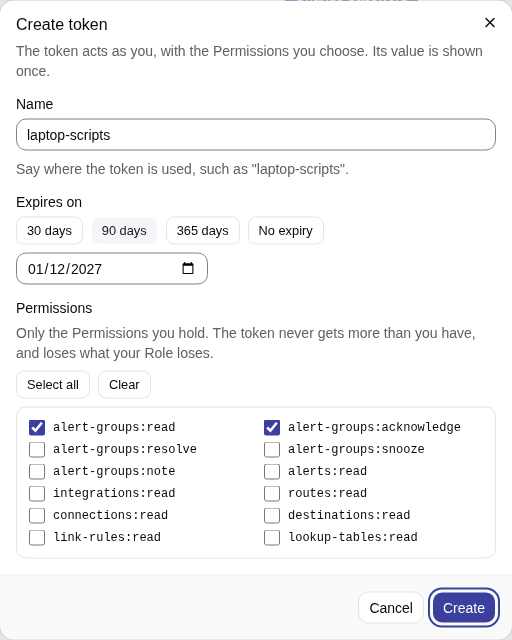
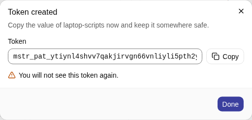
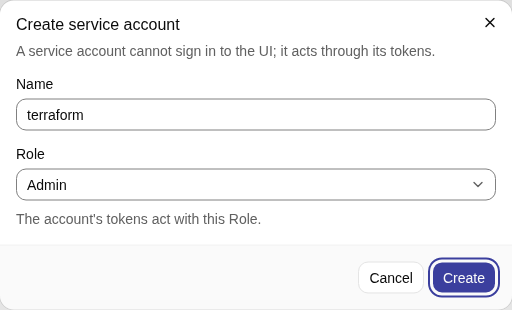
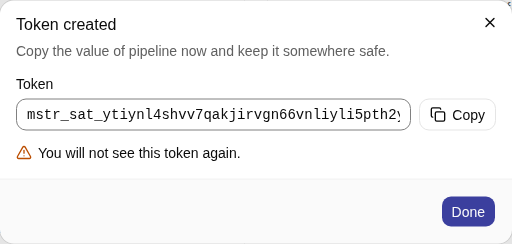
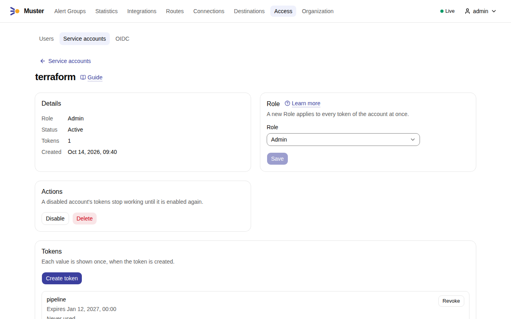

# API tokens and automation

Everything the web UI does, a script can do through the API, as a person or as a non-person identity. This page shows
how to get a token, how to call the API, and what to expect from it. The [API reference](../reference/api.md) lists
every operation, its Permission and its answers; the binary serves the same specification at `/api/v1/openapi.yaml`.

## Two kinds of token

A **Personal access token** acts as a User. It has the Permissions you choose, never more than you hold, and it loses
what your Role loses. Use it for your own scripts. Its prefix is `mstr_pat_`.

A **Service account** is an identity that is not a person, such as Terraform or a pipeline. It has a name, a Role and
any number of tokens, whose prefix is `mstr_sat_`. It cannot sign in to the web UI and has no Account links.

!!! note "A Service account cannot become an Owner"
    The Owner of an Alert Group is always a User. Acknowledge from a Service account is refused with `409` and the code
    `owner_must_be_user`. It may Resolve, Snooze and add Notes, and the Timeline shows the Service account as the actor.
    A Personal access token acts as its User, so acknowledging with one makes that User the Owner.

An **Integration token** (`mstr_int_`) is a third kind and is not for the API: it sends alerts and Heartbeats only, and
the API does not accept it. See [Connect Alertmanager](../integrations/alertmanager.md).

The prefix `mstr_` and the kind in it let secret scanners find a token that leaked into a repository. If one does,
revoke it.

## Create a Personal access token

Tokens are created in the web UI. A token cannot create or revoke another token, so there is no API call to start from
nothing.

1. Open **Profile**, **Personal access tokens**, and select **Create token**.
2. Give it a **Name** that says where it is used, such as `laptop-scripts`.
3. Under **Permissions** tick what the script needs. You see only the Permissions you hold. A script that reads Alert
   Groups needs `alert-groups:read`; one that also acknowledges needs `alert-groups:acknowledge`.
4. Choose **Expires on**: **30 days**, **90 days**, **365 days** or a date of your own. A token may have **No expiry**
   (`token.expiry` is none by default), but the page warns about a token that never expires: choose a date.

    { .screenshot }

5. Select **Create**. The dialog shows the token once. Copy it with **Copy** before you select **Done**: only a hash is
   kept.

    { .screenshot }

The list shows when each token was created, when and from which address it was last used, and when it expires.
**Revoke** stops a script that uses it at once. The Audit log records a request made with a token as "alex via token
laptop-scripts".

## Create a Service account

1. Open **Access → Service accounts** and select **Create service account**.
2. Give it a **Name** and a **Role**: Admin, Responder or Viewer. You can give only a Role whose Permissions you hold.
   Select **Create**.

    { .screenshot }

3. On its page, under **Tokens**, select **Create token**, give it a name and an expiry, select **Create**, and copy the
   value once.

    { .screenshot }

4. The page of the Service account shows its Role, its status and its tokens, with **Disable** and **Delete**.

    { .screenshot }

Its tokens act with the Role of the account, and changing the Role changes every token at once. To change a token
without a gap, create the second token, switch the pipeline to it and revoke the first. **Disable** stops all its tokens
until you **Enable** it; **Delete** revokes them for good.

## Call the API

Send the token as a bearer token. The API is under `/api/v1` of the address people open, `MUSTER_PUBLIC_URL`:

```sh
MUSTER=https://muster.example.org
TOKEN=mstr_pat_...
curl -sS -H "Authorization: Bearer $TOKEN" "$MUSTER/api/v1/alert-groups?status=firing&limit=20"
```

The answer is JSON: `items` and `next_cursor`. A request with no token, or a wrong one, gets `401`; one with a token
that lacks the Permission gets `403`. Every operation in the reference names the Permission it needs.

Snooze the Alert Group `AGK7M3QX9P2RTA` until a time (the token needs `alert-groups:snooze`):

```sh
curl -sS -X POST -H "Authorization: Bearer $TOKEN" -H 'Content-Type: application/json' \
  -d '{"until": "2026-10-20T08:00:00Z"}' "$MUSTER/api/v1/alert-groups/AGK7M3QX9P2RTA/snooze"
```

A call on the interactive path, such as a check of a Connection, answers `503` with `Retry-After` when Muster's limit
toward the messenger leaves no room within 5 seconds (`delivery.interactive_budget`); retry after the pause.

A few operations need the web session and refuse a token with `403` (`session_required`): changing your own password,
TOTP, Account links and tokens.

### Conventions

**Identifiers**
:   URLs carry the `public_id` of a resource, such as `AGK7M3QX9P2RTA`, never the `#N` of an Alert Group.

**Pagination**
:   `limit` is 50 by default and at most 500 (`api.page_size`). A page carries `next_cursor`; send it back as `cursor`
    for the next page. There are no offsets.

**Changing configuration**
:   Routes, Destinations, the Organization and other configuration carry an `ETag`, in a header and in the body. Read
    it, then update with `PUT` and `If-Match` set to it. A stale value gets `412`, a missing header `428`. This stops
    two writers from overwriting each other.

    ```sh
    curl -sS -D - -o /dev/null -H "Authorization: Bearer $TOKEN" "$MUSTER/api/v1/organization" | grep -i '^etag'
    ```

    Then send the changed Organization with `-X PUT -H 'If-Match: <that value>'`. An omitted optional field keeps its
    stored value, and an explicit `null` clears one that can be cleared.

**Errors**
:   RFC 9457 problems (`application/problem+json`) with a stable `type` and `code`, and `errors[]` with a JSON pointer to
    each invalid field.

**Times and units**
:   RFC 3339 in UTC; durations in whole seconds in `*_seconds`; retention in `*_days`.

**Secrets**
:   Write-only. A read shows whether a secret is set and when it changed, never its value.

### Rate limit

The API is limited per token: 20 requests per second with bursts of 100 (`api.rate_limit`), counted on each Muster
replica. A request over the limit gets `429` with `Retry-After` in seconds; wait that long and retry. Another token is
not affected. Web sessions and ingestion are not limited.

## Tokens of OIDC users

A Personal access token of a User who signs in through OpenID Connect follows the identity provider. If the provider
refuses the person at a background re-check, the token gets `401` with the code `oidc_recheck_required` and the text
"Sign in through OIDC to make your tokens work again", and works again after the person's next OIDC sign-in, without a
new token. When the provider granted no offline token, the tokens also stop once the last OIDC sign-in is older than the
Organization's grace period (`auth.oidc_token_grace`, 7 days; **Organization → Security**, see
[Organization settings](organization.md#security)). Your profile shows the date until which your tokens work. Service
account tokens are not affected, which is why automation belongs on a Service account.

A web session has its own lifetimes: see [Sign-in](../sign-in/index.md#ways-to-sign-in).
