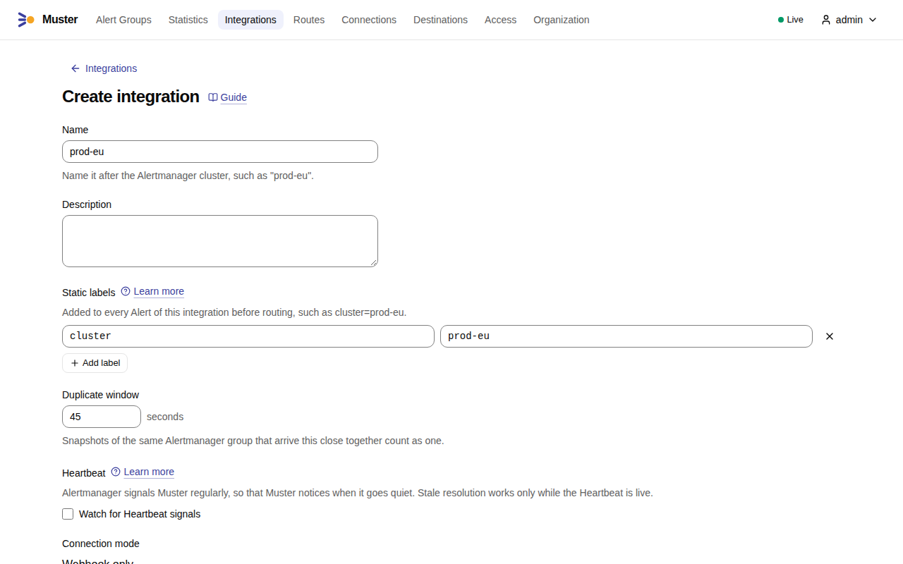
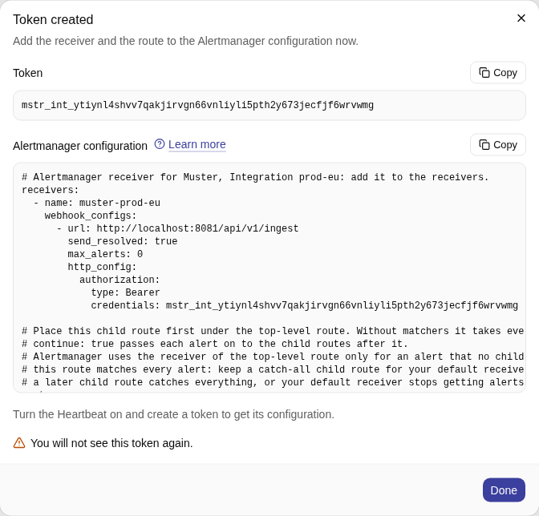
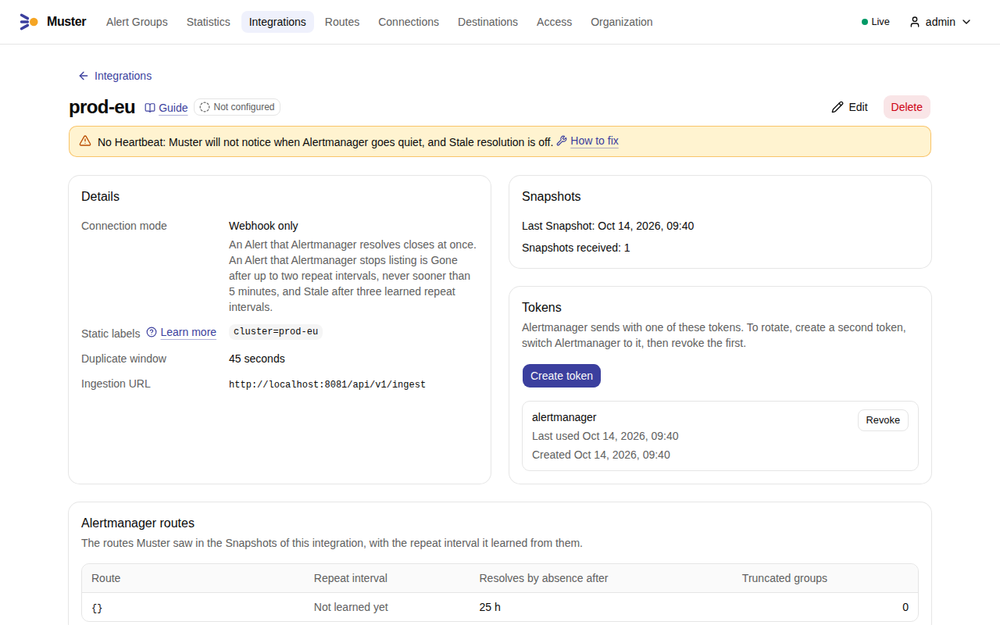
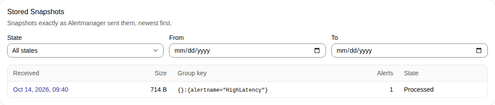
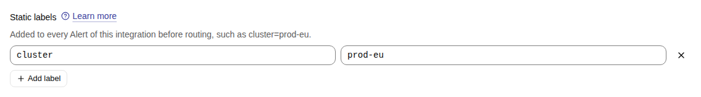

# Connect Alertmanager

Muster receives alerts from Alertmanager through an Alertmanager receiver with a webhook. Each delivery is a
**Snapshot** of one Alertmanager group: every alert of the Alertmanager group that still fires, and its resolves. Muster stores each request exactly as
received, answers `202` once it is written, and processes it afterwards.

In the examples, `MUSTER_INGEST_URL` is `https://ingest.muster.example.org`.

## One Integration per Alertmanager cluster

Create one **Integration** for each Alertmanager cluster that sends to Muster. An HA pair — two or more Alertmanager
instances that gossip with each other — is **one** cluster and gets **one** Integration: both instances send the same
notifications, and Muster folds their copies together within the Integration's duplicate window. Two independent
Alertmanagers, such as one per region, get one Integration each, so that each has its own repeats, its own Static
labels and its own health.

Static labels are added to every alert of the Integration before routing, for example `cluster=prod-eu`, so that Routes
and messages can tell the clusters apart.

Alertmanager pushes its Snapshots to Muster by webhook: the Integration's connection mode is `webhook-only`
(`integration.connection_mode`), the only mode in this version.

## Create a token and paste the snippet

1. In Muster, open **Integrations** and select **Create integration**. Enter a **Name** after the Alertmanager cluster,
   such as `prod-eu`, and add its [Static labels](#static-labels) with **Add label**, such as `cluster=prod-eu`. Keep
   the **Duplicate window** of 45 seconds. Select **Create**.

    { .screenshot }

2. On the Integration page, select **Create token**, give the token a **Name** if you like, such as `alertmanager`, and
   select **Create**. Muster shows the token and a ready Alertmanager snippet, the **Alertmanager configuration**,
   **once**; copy it with **Copy** before you select **Done**. Only a hash of the token is kept, so a lost token cannot
   be shown again: create a new one.

    { .screenshot }

3. Paste the snippet into the Alertmanager configuration, as the rest of this section explains, and reload Alertmanager.

The snippet has two parts. The Alertmanager receiver goes into `receivers`:

```yaml
receivers:
  - name: muster-prod-eu
    webhook_configs:
      - url: https://ingest.muster.example.org/api/v1/ingest
        send_resolved: true
        max_alerts: 0
        http_config:
          authorization:
            type: Bearer
            credentials: mstr_int_…
```

- `send_resolved: true` sends resolves, which close alerts in Muster at once.
- `max_alerts: 0` sends every alert of the Alertmanager group. Muster treats each Snapshot as the whole Alertmanager
  group; a Truncated Snapshot makes it warn.
- The token travels as `Authorization: Bearer`. A sender that cannot set a header may append the token to the URL
  instead, as `/api/v1/ingest/<token>`; Muster's logs name only the route, never such a path.

The route goes first under the top-level `route`, before your other child routes:

```yaml
route:
  routes:
    - receiver: muster-prod-eu
      continue: true
      repeat_interval: 10m
    # ... your existing child routes
    # The last child route: a catch-all without matchers for the receiver of the top-level route.
    # - receiver: <your default receiver>
```

- With no matchers, the route takes every alert, and `continue: true` passes each alert on to the child routes after
  it, so Muster runs beside your current Alertmanager receivers while you try it.
- **Keep a catch-all child route last.** Alertmanager sends an alert to the receiver of the top-level `route` only when
  no child route matches it. The Muster route matches every alert, so without a catch-all, an alert that none of your
  other child routes matches goes to Muster alone and your default receiver stops getting it. Add a last child route
  without matchers for your default receiver, or make sure an existing later child route already catches everything.

For example, a configuration that sends critical alerts to `oncall` and everything else to the top-level `default`:

```yaml
route:
  receiver: default
  routes:
    - receiver: oncall
      matchers: ['severity="critical"']
```

becomes:

```yaml
route:
  receiver: default
  routes:
    - receiver: muster-prod-eu
      continue: true
      repeat_interval: 10m
    - receiver: oncall
      matchers: ['severity="critical"']
    - receiver: default
```

A critical alert goes to `muster-prod-eu` and `oncall`, any other alert to `muster-prod-eu` and `default`. Without the
last line, a warning would reach only Muster. `amtool config routes test --config.file=alertmanager.yml
severity=warning` prints the receivers an alert reaches; it should list Muster and your default receiver.

- Keep `repeat_interval` between **5 and 15 minutes** (10 minutes in the snippet, `snippet.repeat_interval`). See
  [Repeat intervals](#repeat-intervals) for why.

Reload Alertmanager (`POST /-/reload` or `SIGHUP`). The Integration page then shows the time of the last Snapshot and
the Stored Snapshots as received. In the screenshots, the addresses start with `http://localhost:8081`, the ingest
address of a development installation; yours start with your `MUSTER_INGEST_URL`.

{ .screenshot }

Further down, **Stored Snapshots** lists each Snapshot as received, newest first, with its group key and its state;
select one to see its body.

{ .screenshot }

## Repeat intervals

Keep the `repeat_interval` of the route that sends to Muster between **5 and 15 minutes**. It is a setting of the
route, not of the receiver, so a route that sends only some alerts to Muster can have its own.

Muster learns from the repeats. An Alertmanager group sends a Snapshot again each time `repeat_interval` elapses, and
Muster measures the gaps between those Snapshots. Two rules depend on them:

- An Alert is **Gone** when at least two consecutive Snapshots of its Alertmanager group, and at least
  `processing.gone_min_absence` (5 minutes), do not list it any more. This is how Muster notices an alert that
  Alertmanager dropped without a `resolved` notification.
- An Alert goes **Stale** when its Alertmanager group sends no Snapshot at all for `processing.stale_after_factor`
  (3) times the learned repeat interval, for example when the group is silenced in Alertmanager. It applies only while
  the Integration's [Heartbeat](heartbeat.md) is live. Until Muster has learned the interval, it waits
  `processing.stale_after_unlearned` (25 hours).

Alertmanager sends a repeat on the first `group_interval` tick after `repeat_interval` has elapsed, so the gaps are
about `repeat_interval` + `group_interval`. With 10 minutes and Alertmanager's default `group_interval` of 5 minutes,
Muster learns an interval of about 15 minutes, and an Alert of a silenced group goes Stale after about 45 minutes. With
a daily interval it takes more than three days, and the Integration page warns about an interval longer than
`processing.long_repeat_warning` (1 hour) and shows the route to put in Alertmanager. A short interval does not make
Muster noisy: Muster sends one message per Alert Group and edits it, so a repeat changes nothing that people see. It
only makes Muster faster to notice that an alert is gone.

The routes Muster has learned, with their intervals and the time each needs to resolve by absence, are on the
Integration page.

## Send every alert of the group

Set `max_alerts: 0` on the webhook configuration, as the snippet does. Alertmanager's default is no limit, but a
`max_alerts` above 0 makes it keep only the first alerts of a group in each notification and count the rest in
`truncatedAlerts`. A truncated Snapshot lists only part of the Alertmanager group, so Muster cannot tell an alert that is
missing from one that was cut off. It never takes a truncated Snapshot as proof of absence: it keeps the unlisted Alerts
firing as long as Snapshots of that group keep arriving, which can keep a resolved Alert open. It raises the Internal
alert `MusterSnapshotTruncated` for the Integration and counts the Snapshot in
`muster_ingest_truncated_snapshots_total`. If you see that alert, set `max_alerts: 0` on the receiver and reload
Alertmanager; the [runbook](../operations/runbooks/MusterSnapshotTruncated.md) has the steps.

## Static labels

Static labels belong to the Integration, not to Alertmanager. Add them in the Integration's settings, such as
`cluster=prod-eu`; Muster adds them to every Alert of the Integration before it routes the Alert, so a Route and a Group
key can use them as if the rules had set them.

1. Open the Integration and select **Edit**, or set them in the form of a new Integration.
2. Under **Static labels**, select **Add label** and enter the label's name and value, one label per row; **Remove
   label** takes a row away. Select **Save**.

    { .screenshot }

- Use them for what the Alertmanager cluster knows and the rules do not: the cluster, the region, the environment. The
  default Group key of a Route includes `cluster`, so Alert Groups of different clusters stay apart.
- An Alert that already has the label keeps its own value. Muster then warns about the label on the Alert and in its
  Alert Group's Timeline, and the Alerts view of the Integration shows the warning. A Static label never overwrites a
  label that a rule set.

## Instance labels in informational alerts

**Instance labels** are the labels that change when the process that reports an Alert restarts, such as `pod` and
`instance`. The Organization lists them in `organization.instance_labels` (by default `pod`, `instance`, `container`
and `endpoint`).

Keep them out of informational alerts, the ones nobody needs to act on at once, such as those of a Route with the
Informational profile. A
restarted pod reports the same problem under a new `pod` label, which is a different Alert. Muster recognises that
case: it records a **Replacement**, a Quiet event in the Timeline that names the label that differs, and the Alert Group
page suggests fixing the rule. But every restart still adds an Alert and a Timeline entry to an Alert Group that was
meant to be calm, and if the label is also in the Route's Group key, each pod gets an Alert Group of its own.

Aggregate the label away in the rule instead, for example `sum without(pod, instance) (...)` in the expression. Keep the label where it helps a person find the culprit, in
an annotation rather than a label. For alerts about one particular pod that people must act on, Instance labels are fine:
there each pod is a separate problem.

## Start delay

When Alertmanager starts, it does not know the alerts that were firing before. It learns them again as the rule
evaluators (Prometheus, vmalert) send them, and until then its Alertmanager groups list only part of their alerts. A
Snapshot sent in that time is **partial**, and Muster would take the missing alerts as Gone.

Set `--dispatch.start-delay` so that Alertmanager waits before it sends. It must be at least **twice** the longer of the
rule evaluation interval and the rule evaluator's resend delay, plus a margin. Prometheus re-sends a firing alert only
every second evaluation at its defaults, so with a 1-minute evaluation interval use **about 2.5 minutes or more**:

```sh
alertmanager --dispatch.start-delay=2m30s ...
```

With 90 seconds, the first Snapshot after a start was still partial in tests.

## HA pairs need a persistent volume

Give every instance of an HA pair a persistent volume for its data directory (`--storage.path`). Without one, a
restarted instance loses its silences and its notification log: it can notify silenced alerts and send partial
Snapshots until the other instance catches it up.

## Token rotation

An Integration may hold several tokens. To rotate one without losing a webhook:

1. Create a second token and paste its snippet (or only the new `credentials`) into the Alertmanager configuration.
2. Reload Alertmanager and check that the token list shows a recent use of the new token.
3. Revoke the old token. It is refused from the next request.

A request with a revoked token is refused with `401` and counted under the Integration in
`muster_ingest_requests_total{outcome="unauthorized"}`, so the chart rule `MusterIngestRejected` shows an Alertmanager
that still uses an old token.

## Behind a reverse proxy

Muster serves ingestion on its own listener, `MUSTER_LISTEN_INGEST` (`:8081` by default), apart from the UI and API on
`MUSTER_LISTEN_APP`. Set `MUSTER_INGEST_URL` to the address Alertmanager uses; it defaults to `MUSTER_PUBLIC_URL`, and
the snippets are built from it.

With separate listeners, route `/api/v1/ingest` and `/api/v1/heartbeat` (with everything below them) to the ingest
port. A reverse proxy that serves both on one host name, for example, sends these two paths to `:8081` and everything
else to `:8080`. Keep the proxy's body size limit at **16 MB** or more: Muster accepts bodies up to `ingest.body_limit`
(16 MB) and answers `413` above it. Do not let the proxy log request paths with the token, or prefer the
`Authorization` header, which proxies do not log by default.

With one listener for both (`MUSTER_LISTEN_INGEST` equal to `MUSTER_LISTEN_APP`), the same port serves ingestion and
the API.

## What Muster answers

| Answer | When | Alertmanager |
|---|---|---|
| `202` | The body was stored, whatever it holds | done |
| `401` | No token, an unknown or revoked token, a token of a deleted Integration, or an API token | does not retry |
| `413` | The body is larger than 16 MB | does not retry |
| `500` | The body could not be written | retries |

Muster never answers `400`: a body that is not JSON, or not an Alertmanager payload, is stored and fails later in
processing, where the Stored Snapshot shows the error.
