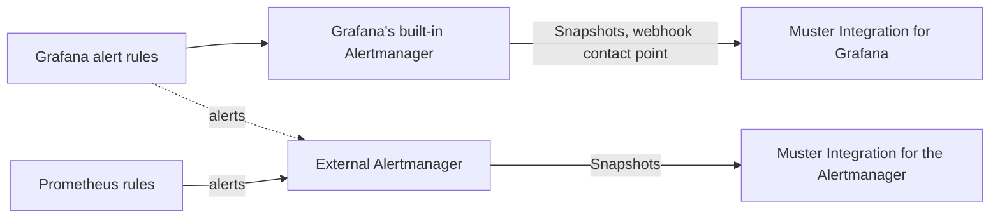
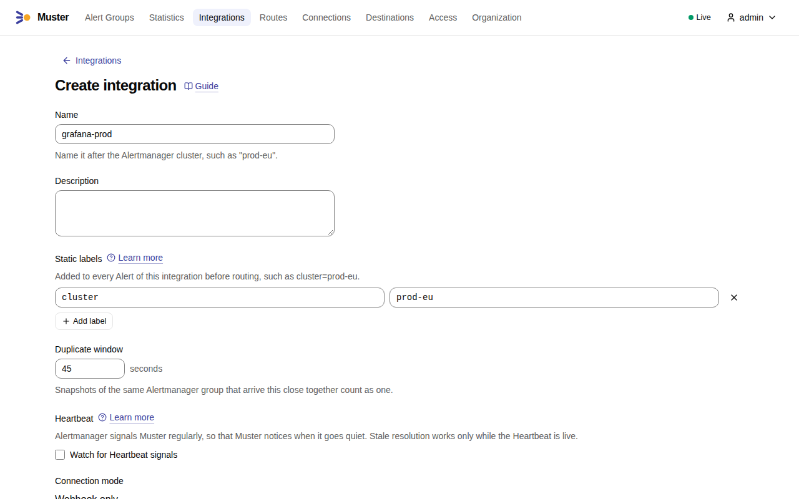
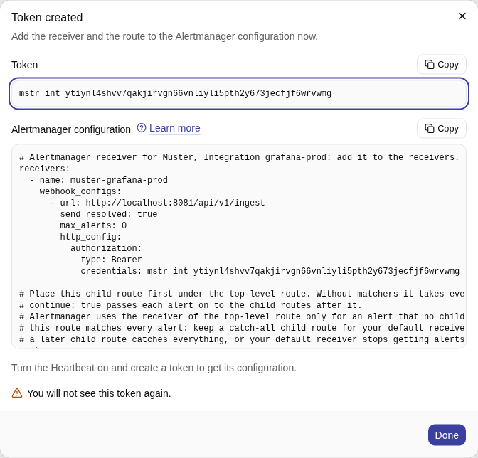
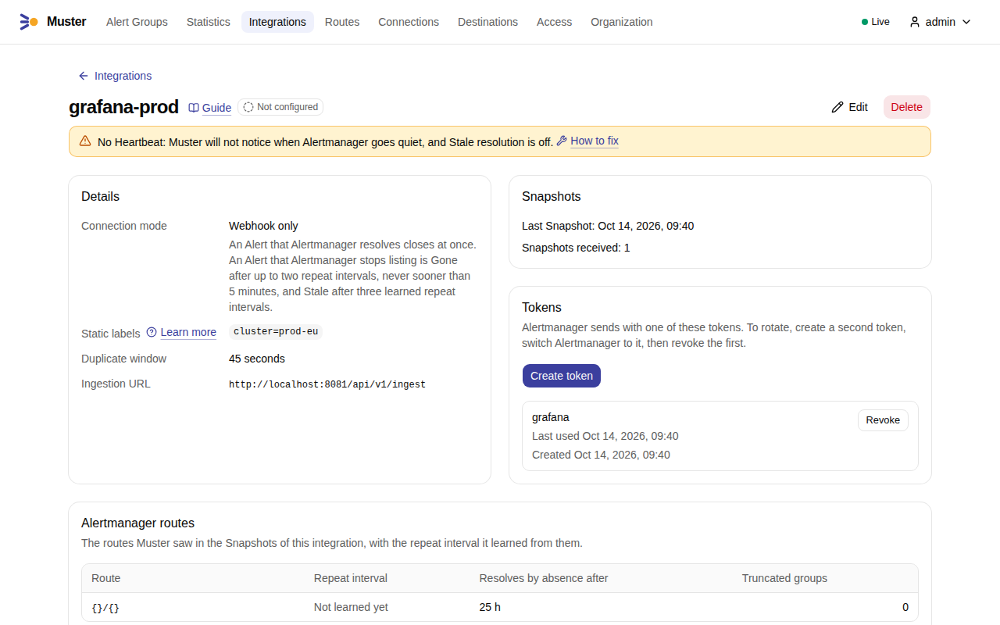

# Connect Grafana

Grafana Alerting reaches Muster in one of two ways: directly, from Grafana's built-in Alertmanager through a webhook
contact point, or through an external Alertmanager that Grafana forwards its alerts to. Both carry Grafana-managed
alert rules.



- **Directly** needs nothing between Grafana and Muster. Grafana's built-in Alertmanager sends Alertmanager's webhook
  format with a few fields of its own, and Muster reads each notification as a **Snapshot**, as from any Alertmanager.
- **Through an external Alertmanager** suits you when you already run an Alertmanager for Prometheus rules and want one
  Integration in Muster for both.

In the examples, `MUSTER_INGEST_URL` is `https://ingest.muster.example.org`. Muster was tested with Grafana OSS 13.2.4,
as a single instance and as an HA pair.

## Connect Grafana directly

The steps, in this order: create an Integration and its token in Muster, create a webhook contact point in Grafana, and
send the alerts to it with a notification policy.

### One Integration per Grafana cluster and organization

Create one **Integration** for each Grafana cluster, and for each Grafana organization in it, that sends to Muster.

- An HA pair — two or more Grafana replicas that share a database and gossip with each other — is **one** cluster and
  gets **one** Integration. See [HA pairs](#ha-pairs).
- Each Grafana organization gets an Integration of its own. The `groupKey` of a Snapshot names the notification policy
  and the group, not the organization, so two organizations with the same notification policies send the same
  `groupKey`s, and one Integration would take their Snapshots for one Alertmanager group.
- Give the Integration [Static labels](alertmanager.md#static-labels) for what the rules do not say, such as
  `cluster=prod-eu`.

### Create the Integration and a token

1. In Muster, open **Integrations** and select **Create integration**. Enter a **Name**, such as `grafana-prod`, and
   add the [Static labels](alertmanager.md#static-labels) with **Add label**, such as `cluster=prod-eu`. Select
   **Create**.

    { .screenshot }

2. On the Integration page, select **Create token**, give the token a **Name** if you like, such as `grafana`, and
   select **Create**. Muster shows the token **once**, with a snippet for Alertmanager; Grafana needs only the
   **Token** (`mstr_int_…`), the `credentials` of that snippet. Copy it with **Copy** before you select **Done**.

    { .screenshot }

3. Create the contact point and the notification policy in Grafana, as the next two sections say. Once Grafana sends
   its first Snapshot, the Integration page shows it under **Snapshots**: the time of the last one and how many were
   received. In the screenshot, the address starts with `http://localhost:8081`, the ingest address of a development
   installation; yours starts with your `MUSTER_INGEST_URL`.

    { .screenshot }

### Create a webhook contact point

In Grafana, open **Alerting** → **Contact points** → **Add contact point** and choose the integration **Webhook**:

1. **URL**: the Integration's ingest URL, `MUSTER_INGEST_URL` followed by `/api/v1/ingest`:
   `https://ingest.muster.example.org/api/v1/ingest`.
2. **HTTP Method**: `POST`.
3. **Authorization header**: the scheme `Bearer`, and the Integration token as its credentials.
4. **Max alerts**: `0`, the default, which sends every alert of the group. Muster treats each Snapshot as the whole
   Alertmanager group; see [Limits](#limits).
5. **Disable resolved message**: off, the default. Resolves close Alerts in Muster at once.
6. No custom payload: Muster reads the payload that Grafana sends by default, and a custom one replaces it.

Check these names against the version of Grafana that you run, because the places of the settings in the interface
change between versions. The same contact point in a provisioning file, together with the notification policy of the
next step:

```yaml
apiVersion: 1

contactPoints:
  - orgId: 1
    name: muster
    receivers:
      - uid: muster
        type: webhook
        disableResolveMessage: false
        settings:
          url: https://ingest.muster.example.org/api/v1/ingest
          httpMethod: POST
          authorization_scheme: Bearer
          authorization_credentials: ${MUSTER_TOKEN}

policies:
  - orgId: 1
    receiver: muster
    group_by: [grafana_folder, alertname]
    repeat_interval: 10m
```

Grafana replaces `${MUSTER_TOKEN}` with the variable of its environment when it reads the file, so the token stays out
of the file. The file leaves out Max alerts (`maxAlerts`), so it is 0. Grafana does not let you edit resources
provisioned from files in its interface, this contact point and the notification policy tree included: change the
file, then restart Grafana or reload the provisioned files through its Admin API.

### Send the alerts with a notification policy

In **Alerting** → **Notification policies**, send the alerts to the contact point:

- Keep Grafana's default grouping, `group_by: [grafana_folder, alertname]`, and let Muster make Alert Groups with its
  [Routes and Group keys](../concepts/routes-and-group-keys.md). See
  [Do not merge rules into one group](#do-not-merge-rules-into-one-group).
- Set `repeat_interval` between **5 and 15 minutes** (10 minutes in the example). See
  [Repeat intervals](#repeat-intervals).
- The example makes Muster the contact point of the default policy, which takes every alert. A provisioned `policies`
  entry is the whole notification policy tree of the organization and replaces the one set in the user interface. If
  Grafana also notifies other contact points, add Muster instead as the first nested policy, without matchers, with
  `continue: true` and its own `repeat_interval`, and keep a last nested policy for your default contact point, as for
  the [Alertmanager route](alertmanager.md#create-a-token-and-paste-the-snippet).
- Grafana's built-in Alertmanager sends the notifications, so keep it receiving Grafana-managed alerts, the default in
  **Alerting** → **Settings**.

On its first start, Grafana applies provisioned policies within about a minute. Grafana sends the first Snapshot when
an alert fires; the Integration page then shows the time of the last Snapshot and the Stored Snapshots as received, as
in [Create the Integration and a token](#create-the-integration-and-a-token).

### Repeat intervals

Repeats are how Muster learns when an alert is **Gone** or **Stale**, as with Alertmanager; see
[Repeat intervals](alertmanager.md#repeat-intervals). Grafana sends no `notification_reason`, so Muster recognises a
repeat as a Snapshot identical to the one before it and learns the interval from those.

Grafana sends a repeat on the first `group_interval` tick after `repeat_interval` has elapsed. With 10 minutes and
Grafana's default `group_interval` of 5 minutes, Muster learns an interval of about 15 minutes; with Grafana's default
`repeat_interval` of 4 hours, an Alert of a silent group would go Stale only after more than 12 hours. Control the noise
in Muster, not with a long interval: Muster sends one message per Alert Group and edits it, so a repeat changes nothing
that people see.

### Do not merge rules into one group

Keep each Grafana notification group to the alerts of one rule, as the default grouping by `grafana_folder` and
`alertname` does, and do not group many rules together, for example by a label that they share.

After a restart, Grafana knows the alerts of a rule again only once it has evaluated the rule. A group of rules with
different evaluation intervals then sends Snapshots without the slower rules' alerts until their first evaluation: in
a test, the alert of a rule evaluated every 8 minutes was missing from its group's Snapshots for about 7 minutes. Muster
can take such an alert for Gone, and its return for a new firing, which is Loud. Grafana has no setting like
Alertmanager's [start delay](alertmanager.md#start-delay). The alerts of one rule all return with its first evaluation,
and Muster's Routes put them into Alert Groups as they would any other alerts.

### Simplified routing

A contact point chosen in the rule itself (simplified routing) puts the label `__grafana_route_settings_hash__`, a hash
of the rule's notification settings, into the route path of the `groupKey`. Editing those settings starts a new
`groupKey`, and the old one falls silent, as when the matchers of an Alertmanager route change: an Alert that the new
`groupKey` lists stays firing, and one that only the old `groupKey` listed resolves only by going Stale, which needs a
live [Heartbeat](#heartbeat). Notification policies avoid this.

### What Grafana sends

- **Every end of an alert is an explicit resolve**: a value back under the threshold, a series that is missing for two
  evaluations, a paused rule and a deleted rule. Muster resolves the Alert at once, with the reason `resolved`. Grafana
  gives the resolve the annotation `grafana_state_reason` (`MissingSeries`, `Paused` or `RuleDeleted`); Muster takes
  annotations from firing alerts only, so that reason shows in the Stored Snapshot, not on the Alert.
- **NoData and Error are alerts of their own.** A rule whose query returns no data, with the no-data state No Data,
  resolves its alert and fires an alert `DatasourceNoData` in a group of its own, with the label `rulename` (the rule's
  title), `datasource_uid` and `ref_id` beside the rule's labels. When data returns, the rule's alert fires again as a
  new firing and `DatasourceNoData` resolves. The error state Error gives an alert `DatasourceError` with the label
  `rulename` the same way, as Grafana documents it; it has not been tested with Muster. A Route can match both by
  `alertname`.
- **Links.** The **Source** link of an Alert Group opens the rule's page in Grafana, the alert's `generatorURL`:
  `<root_url>/alerting/grafana/<rule uid>/view?orgId=1`. Set Grafana's `root_url` to the address people open. The
  built-in Link rule Explore builds its link from the Prometheus query of a `generatorURL`, which Grafana's does not
  have, so it makes no link for Grafana's alerts.

### HA pairs

An HA pair needs nothing more than its one Integration and one contact point. Normally one replica sends; when both do,
Muster folds their copies together within the Integration's duplicate window.

The replicas evaluate the rules each on its own, so their copies of one alert can carry different `startsAt`. Muster
takes the resolve of either replica: a resolve whose firing overlaps the current one resolves it (see
[Resolved](../concepts/snapshot-semantics.md#resolved)). Such copies can also make Muster record a Quiet Continuation
for an Alert once. Grafana's `ha_single_node_evaluation`, which makes one replica evaluate the rules for both, has not
been tested with Muster.

### Heartbeat

The [Heartbeat](heartbeat.md) page's setup is for Alertmanager. The same idea in Grafana — an always-firing rule with a
notification policy of its own, a `repeat_interval` of about one minute, and a second webhook contact point at the
Integration's Heartbeat URL, `https://ingest.muster.example.org/api/v1/heartbeat`, with resolved messages disabled —
**has not been verified with Grafana**.

Without a Heartbeat, Muster never resolves an Alert as Stale: an Alert whose Grafana group stops sending altogether
stays firing in Muster. Gone still works. A cron job that requests the Heartbeat URL keeps the Heartbeat live too, but
it proves only the network: when Grafana itself stops, its groups fall silent and their Alerts go Stale.

### Limits

- **Truncation.** With Max alerts above 0, a Snapshot lists only part of its group. Muster keeps the unlisted Alerts
  alive and raises the Internal alert `MusterSnapshotTruncated`
  ([runbook](../operations/runbooks/MusterSnapshotTruncated.md)). Grafana computes the status of a Snapshot from the
  alerts it lists, so a truncated Snapshot can say `resolved` while alerts it left out still fire; Muster recognises a
  Snapshot from Grafana by its top-level `orgId`, and a truncated `status: resolved` from Grafana resolves only the
  Alerts it lists as resolved. When a whole group resolves, its last Snapshot too lists only the first alerts, and
  Grafana sends nothing more for the group until one of its alerts fires again: the Alerts it left out stay firing in
  Muster until they go Stale, which needs a live [Heartbeat](#heartbeat). Set Max alerts to 0; for the Alerts already
  left firing, see the [runbook](../operations/runbooks/MusterSnapshotTruncated.md#fix).
- **The Integration page speaks of Alertmanager**, the part that Grafana's built-in one plays. Its Alertmanager routes
  are Grafana's notification policies; its warning about a long repeat interval shows an Alertmanager route, where for
  Grafana you set the `repeat_interval` of the policy; its truncation warning names `max_alerts`, which is Max alerts
  in Grafana.
- [What Muster answers](alertmanager.md#what-muster-answers), [Token rotation](alertmanager.md#token-rotation) and
  [Behind a reverse proxy](alertmanager.md#behind-a-reverse-proxy) apply to Grafana as they are.
- **Not tested with Muster**: Grafana's retries of a webhook after an error or a timeout; Grafana's silences and mute
  timings; several Grafana organizations on one Integration; a custom payload; HMAC signing (Muster checks the
  Integration token only); `ha_single_node_evaluation`; `DatasourceError`; the Heartbeat through Grafana.

## Connect Grafana through an external Alertmanager

Grafana-managed alert rules can also reach Muster the same way as Prometheus rules do: Grafana forwards its alerts to
an external Alertmanager, and that Alertmanager has the Muster receiver from [Connect Alertmanager](alertmanager.md).
One Alertmanager can serve Grafana and Prometheus together, with one Integration in Muster for the whole Alertmanager
cluster.

Prefer this way when you already run an Alertmanager for Prometheus rules and want one Integration for both: the
Heartbeat route of the [Heartbeat](heartbeat.md) page then watches the path of Grafana's alerts too.

### Send Grafana's alerts to the Alertmanager

In Grafana, two settings are needed, and both must be on.

1. Add the Alertmanager as a data source: **Connections** → **Data sources** → **Alertmanager**. Set the
   **Alertmanager Implementation** (Prometheus, for a plain Alertmanager) and the **HTTP URL**, and turn on **Receive
   Grafana Alerts**.
2. In **Alerting** → **Settings** (called Administration in some versions), enable that Alertmanager so that it shows
   that it receives Grafana-managed alerts.

From then on Grafana forwards all its Grafana-managed alerts to the Alertmanager. The same data source in a
provisioning file, which covers step 1 only; step 2 is still done in **Alerting** → **Settings**:

```yaml
apiVersion: 1

datasources:
  - name: Alertmanager
    type: alertmanager
    url: http://alertmanager.monitoring.svc:9093
    access: proxy
    jsonData:
      implementation: prometheus
      handleGrafanaManagedAlerts: true
```

The option in the user interface is **Receive Grafana Alerts**; its `jsonData` name is `handleGrafanaManagedAlerts`. The
names above are those of the Grafana documentation of the Alertmanager data source; check the version of Grafana that
you run, because the places of the settings in the interface change between versions.

Then follow [Connect Alertmanager](alertmanager.md): create an Integration for the Alertmanager, paste the receiver and
the route into its configuration, and keep the catch-all child route last.

## Labels

Grafana adds two labels of its own to every Grafana-managed alert: `alertname`, the name of the alert rule, and
`grafana_folder`, the title of the folder that holds the rule. Labels that you set on the rule, such as `severity` or
`team`, come with them. Route and Group key on these labels in Muster as on any others:

- Set `severity` on your rules: it is part of the default Group key, and Routes can match it.
- `alertname` is also part of the default Group key, so rules of different names make different Alert Groups.
- Grafana rules have no `cluster` label of their own: add it to the Integration as a
  [Static label](alertmanager.md#static-labels). Through an Alertmanager shared with Prometheus, you can instead give
  Grafana's alerts an Integration of their own.
- A rule on a query that returns one series per pod or instance makes one alert per series, with those labels. Keep
  [Instance labels out of informational alerts](alertmanager.md#instance-labels-in-informational-alerts); a Grafana
  rule can reduce the series to one with an aggregation.
- Directly from Grafana, an Alert's fingerprint is the one in the body, which also covers the rule's hidden uid, so two
  rules with the same labels make two Alerts.

Muster shows the labels of each alert on the page of its Alert Group. If a label you expected is missing, open the
Stored Snapshot on the Integration page, which shows the request as Grafana or the Alertmanager sent it.
