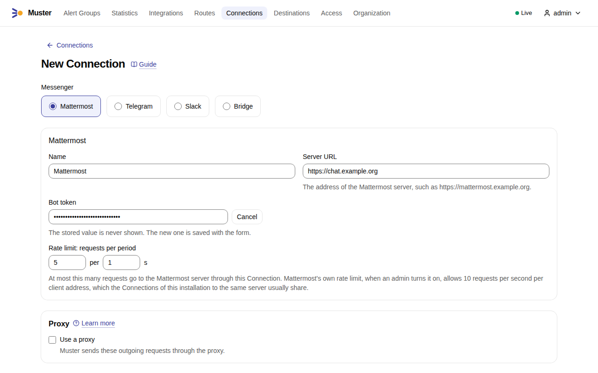
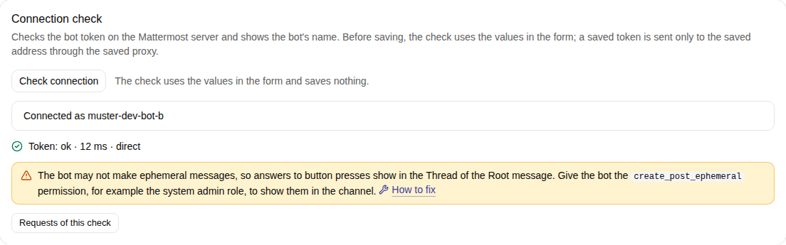
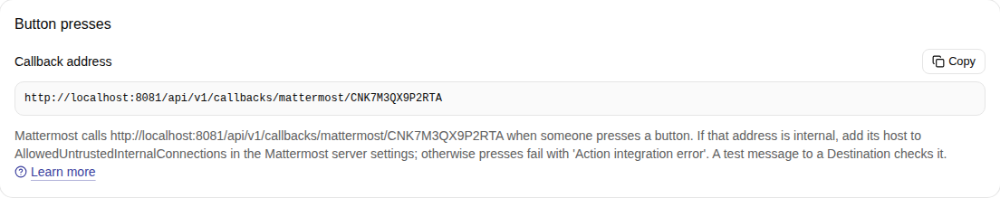
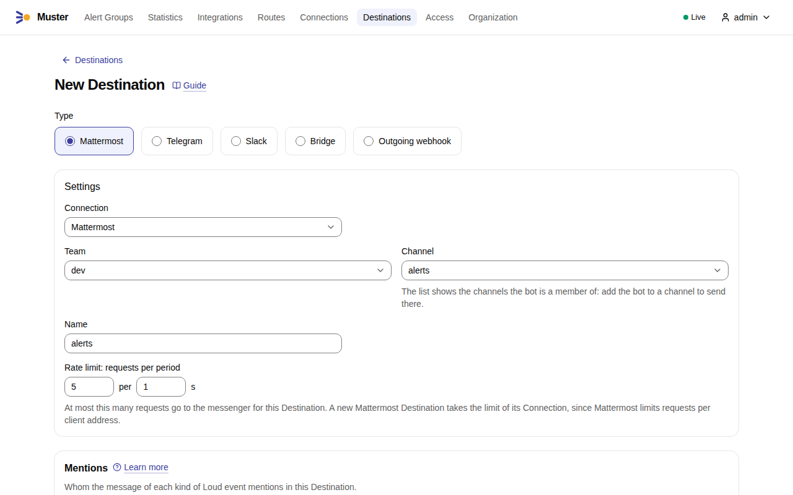
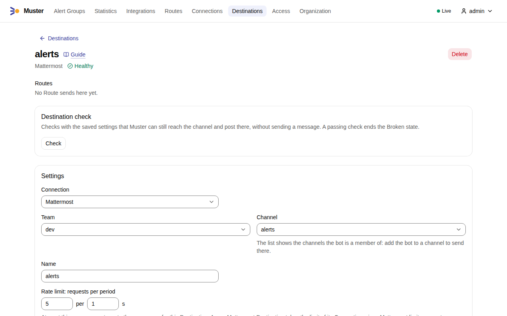
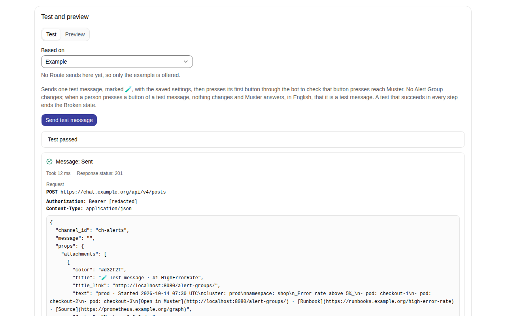
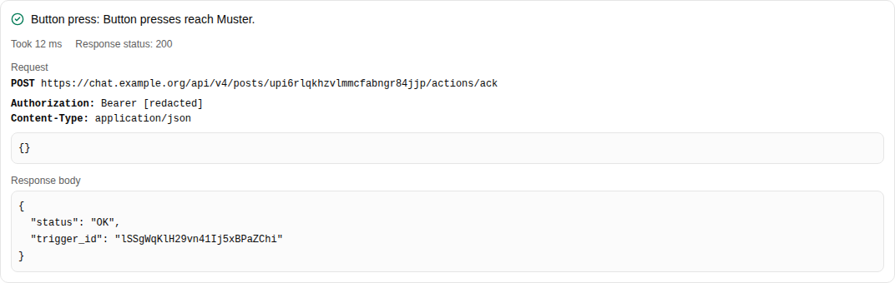

# Connect Mattermost

Muster posts to Mattermost through the REST API with a **bot account**: one post per Alert Group, the **Root
message**, which Muster edits as the Alert Group changes, and replies in its **Thread** for what happens later. People
act on the Alert Group with the buttons of the post. Muster uses no incoming webhook and no plugin.

In the examples, `MUSTER_PUBLIC_URL` is `https://muster.example.org`, `MUSTER_INGEST_URL` is
`https://ingest.muster.example.org` and the Mattermost server is `https://chat.example.org`.

## Create the bot account

1. In the System Console, under **Integrations → Bot Accounts**, turn on **Enable Bot Account Creation**.
2. In **Integrations → Bot Accounts**, add a bot, for example `muster`. Give it the role **Member**: Muster needs no
   system admin role and no **post:all** or **post:channels** permission, because it posts only to channels the bot
   is a member of. With the role Member, the answers to button presses show in the Thread of the Root message; see
   [Where answers to presses show](#where-answers-to-presses-show).
3. Copy the bot's access token. Mattermost shows it once.
4. Add the bot to the team, and to every channel a Destination posts to. A public channel is enough; a private channel
   works the same once the bot is a member.

The bot token works even when **Enable Personal Access Tokens** is off, its default.

## Create the Connection

1. In Muster, open **Connections**, select **Create connection** and choose **Mattermost**.
2. Enter a **Name** and the **Server URL**, the address people open Mattermost at, such as `https://chat.example.org`.
   Select **Set a value** next to **Bot token** and paste the bot's access token.

    { .screenshot }

3. Select **Check connection**, below the form. The check reads the bot's own user with the token and shows the
   bot's name. When the bot may not make ephemeral posts, it passes with a warning: see
   [Where answers to presses show](#where-answers-to-presses-show).

    { .screenshot }

4. Select **Save**. The saved Connection shows its **callback address**, which Mattermost calls when someone presses
   a button: `MUSTER_INGEST_URL` followed by `/api/v1/callbacks/mattermost/CN…`. In the screenshot it is
   `http://localhost:8081`, the ingest address of a development installation; yours starts with your
   `MUSTER_INGEST_URL`. [Let button presses reach Muster](#let-button-presses-reach-muster) says what the server
   needs to call it.

    { .screenshot }

## Check before saving

**Check connection** checks the values in the form, before anything is saved: in the form of a new Connection, as
above, and on the page of a saved one while the form holds changes. It saves nothing: no bot name is recorded and the
Audit log gets no entry.

- With the bot token typed in the form, the check reads the bot's own user at the server URL in the form, through the
  proxy in the form, and shows the bot's name.
- Without a token typed, the page of a saved Connection uses its stored token only when the server URL and the proxy
  are the saved ones: the stored token is sent only to the saved address, through the saved proxy. After a change of
  the server URL or of the proxy, the check makes only a dry probe: `GET <server>/api/v4/system/ping` without a token,
  which a Mattermost server answers to anyone with `200` and `"status":"OK"`. It tells a wrong address, a wrong path
  prefix (`404`) and a server that is not Mattermost apart, and the step **Token** asks you to type the bot token again
  to check the new address or proxy, or to save first. A new Connection without a token gets the dry probe alone too.

The check is `POST /api/v1/connections/checks`, which needs `connections:write`; with a Personal access token of an
Admin in `MUSTER_TOKEN`:

```sh
curl -X POST https://muster.example.org/api/v1/connections/checks \
  -H "Authorization: Bearer $MUSTER_TOKEN" -H 'Content-Type: application/json' \
  -d '{"type":"mattermost","server_url":"https://chat.example.org","bot_token":"the-bot-token"}'
```

Add `"connection_id":"CN…"` to check the changes of a saved Connection, whose stored token the rule above may use.

## Add a Destination

A Mattermost Destination is one channel of one team that the bot is a member of.

1. Open **Destinations**, select **Create destination** and choose **Mattermost**.
2. Choose the **Connection**, the **Team** and the **Channel**. The list shows the channels the bot is a member of:
   add the bot to a channel to send there. The **Name** takes the channel's name; change it if you like.

    { .screenshot }

3. Select **Save**. Saving runs the **Destination check**: the bot is a member of the channel, which belongs to the
   team and is not archived. A Destination that fails the check is not saved, and the check names what failed.

    { .screenshot }

4. Under **Test and preview**, on the tab **Test**, select **Send test message**. Muster posts a message marked 🧪;
   the result shows the request it sent and Mattermost's answer. Links in the screenshot start with
   `http://localhost:8080`, the address of a development installation; yours start with your `MUSTER_PUBLIC_URL`.

    { .screenshot }

    Muster then presses the message's first button through the bot. The step **Button press** says whether the press
    reached Muster at the callback address; when it did not, read
    [Let button presses reach Muster](#let-button-presses-reach-muster).

    { .screenshot }

**Check** on the Destination page runs the Destination check at any time.

## Direct messages

Account links send a person a direct message from the bot: the bot opens the direct channel with the person's user id
and posts there. Make sure your server lets the bot open direct messages with the people who link their accounts — for
example, if **Enable users to open Direct Message channels with** is restricted to members of a team, add the bot to
the teams of those people.

## Let button presses reach Muster

A press on a button makes the Mattermost server call Muster at the Connection's callback address, which the Connection
page shows:

```text
https://ingest.muster.example.org/api/v1/callbacks/mattermost/CN…
```

When that address resolves to a private or otherwise reserved address — the usual case inside one network — the
Mattermost server refuses to call it unless the host is listed in **ServiceSettings.AllowedUntrustedInternalConnections**
(**Environment → Developer → Allow untrusted internal connections to** in the System Console). Add the host of
`MUSTER_INGEST_URL`, for example:

```json
"ServiceSettings": {
  "AllowedUntrustedInternalConnections": "ingest.muster.example.org"
}
```

Without it, a person who presses a button sees only a generic **Action integration error**; only the Mattermost server
log says why ("address forbidden … in a reserved range and not in AllowedUntrustedInternalConnections"). The test
message of a Destination presses its own button through the bot and tells you whether the press reached Muster.

Whatever the person who pressed must read — that the press was refused, that their Mattermost account is not linked
to Muster yet, or that the button could not be verified — arrives as a message only they can see. A press from an
account without an Account link changes nothing. A request that does not come from a button of a Muster post in one of
the Connection's channels gets no answer at all.

### Where answers to presses show

Muster first sends the answer as an ephemeral message, which shows in the channel, marked "(Only visible to you)".
Mattermost allows that only with the `create_post_ephemeral` permission, which by default only the system admin role
has. Without it, Mattermost refuses the ephemeral message, and Muster returns the same text in its answer to the press:
Mattermost then shows it from **System** in the **Thread** of the Root message. With collapsed reply threads,
Mattermost's default, it is not shown in the channel view; the person opens the Thread to read it. Either way the answer
is never lost.

**Check connection** tells you which applies: when the bot's roles do not grant `create_post_ephemeral`, the check
passes with a warning that answers will show in the Thread of the Root message, and `muster doctor` prints the
Connection as a `WARN` line. The warning names the bot whose token the Connection holds, as `@username`, and the roles
Muster read for it, for example `system_user`, so you can see which account the token belongs to. To show answers in
the channel, give the bot that permission, for example the system admin role. Otherwise keep the role Member and let
people read the answers in the Thread.

Promote the bot account itself, not the person who owns it, and check that it is the bot the warning names: a bot of
another Connection, or an older token of another bot, keeps its own roles. As a system admin, open **Integrations →
Bot Accounts** from the product menu, select **Edit** on the bot, set **Role** to **System Admin** and select
**Update**; or run `mmctl roles system-admin <bot-username>`. Then run **Check connection** again: the warning is gone
once the bot's roles grant the permission.

## Rate limit

Mattermost's rate limit is off by default. When an admin turns it on (`RateLimitSettings.Enable`, which takes a server
restart), it allows 10 requests per second, with a burst of 100, **per client address**. All Connections of one Muster
installation to the same Mattermost server usually come from one address and share that bucket, so keep their limiters
together below it. The default limiter of a Connection is 5 requests per second. A `429` from Mattermost holds every
request of the Connection, to any of its Destinations, for the seconds of its `Retry-After`.

## Keep posts editable

Muster edits a Root message for as long as its Alert Group is open, which can be days. Keep
**ServiceSettings.PostEditTimeLimit** at `-1`, its default, so that posts can be edited at any age.

## Who gets notified

- **Edits notify nobody**, even an edit that adds a Mention. That is why every Loud event is a new post: a new Root
  message, or a reply in the Thread.
- **Thread replies notify the Thread's followers** by their own notification settings, and a Mention makes the person
  mentioned a follower of the Thread. "Quiet" therefore means "without a Mention", not "nobody notified".
- A Loud Root message carries its Mentions — `@channel`, `@here`, `@all`, a Mattermost group, or a person's
  `@username` through their Account link — as one line at the top of the attachment, directly under its title. There a
  person's `@username`, `@channel`, `@here` and `@all` notify as they do anywhere in a post; whether a group's Mention
  notifies from an attachment has not been checked. The post's own text is empty: everything is in the attachment, so
  the post shows its title once. What a notification shows follows from that: an email notification shows no content;
  a push notification, when the server's **PushNotificationContents** is `full`, and a desktop notification show the
  attachment's summary line — the status, `#N` and the title — which Muster sets as its `fallback` and the channel does
  not show; a push notification under `generic` shows a fixed text such as "… notified the channel." An edit removes
  the line of Mentions. A reply in the
  Thread carries its Mentions in its own text. A `{{ mention "channel" }}` in a Route's template shows in the attachment
  as text and, on a Loud post, adds its Mention to the line of Mentions.
- Alert data never mention anyone: an `@` in a label or annotation is shown as text and notifies nobody.
- The footer of a Root message — "Acknowledged by", "Snoozed by", "Resolved by" — writes a person with an Account link
  for the Connection as `@username`, so that Mattermost shows their name with their profile; a person without one is
  their Muster name as text. An edit notifies nobody, but a new post with the footer, after a republish, may notify that
  person.

## Check from the command line

`muster doctor` prints one line per Mattermost Connection and per Mattermost Destination with the same checks, without
sending anything.
