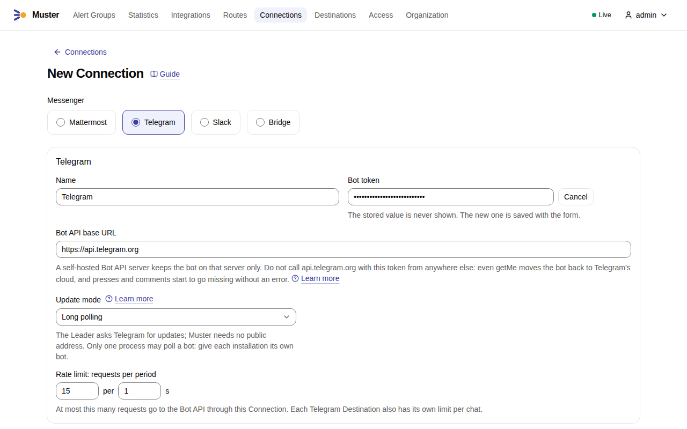
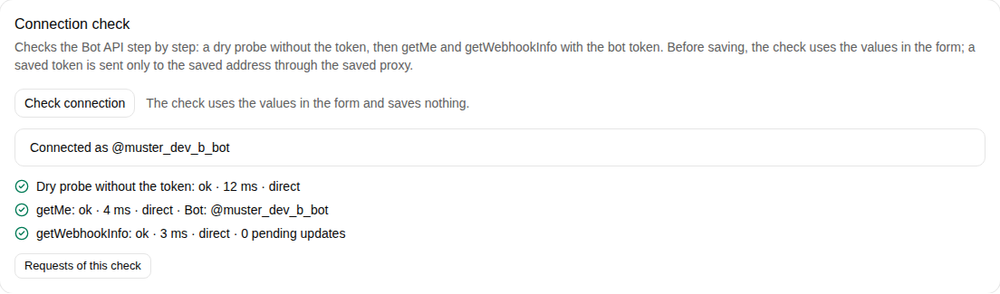
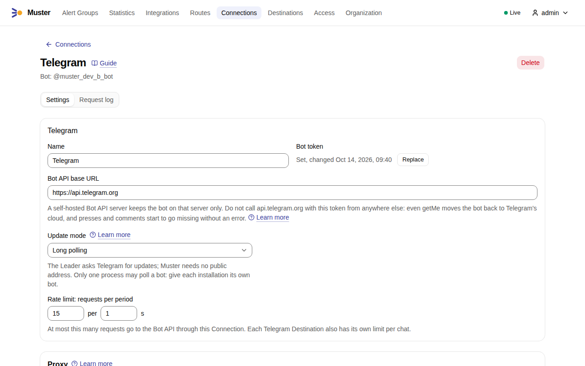
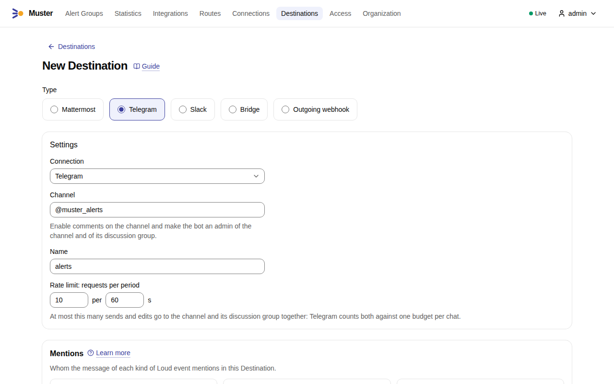
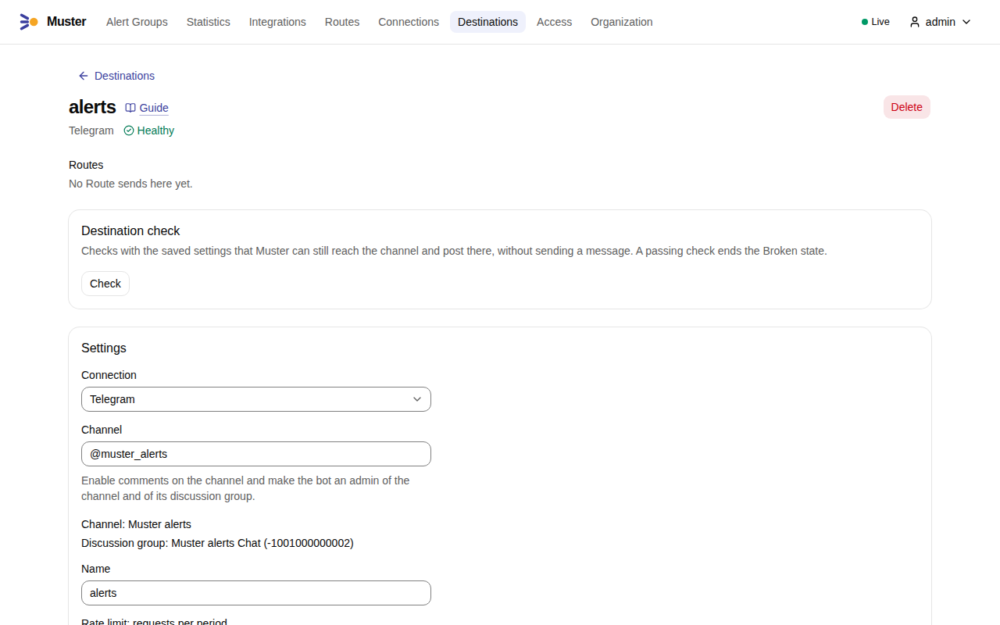
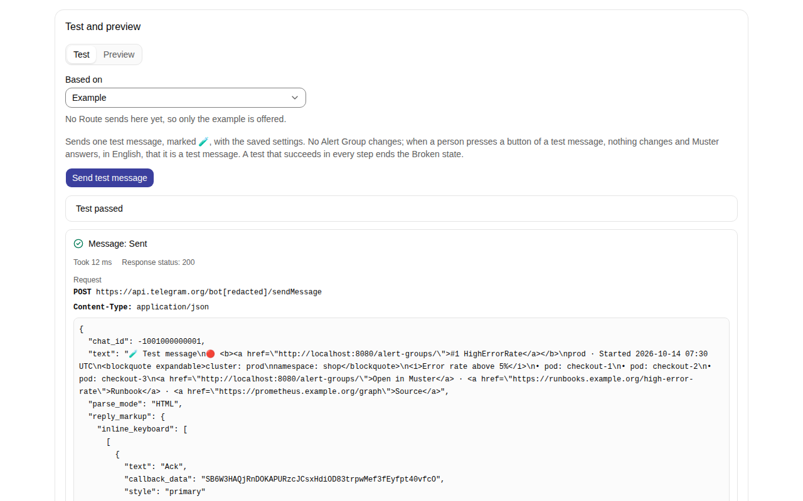

# Connect Telegram

Muster posts to a Telegram **channel** through the Bot API with a **bot**: one channel post per Alert Group, the
**Root message**, which Muster edits as the Alert Group changes. Everything that happens later goes to the channel's
**discussion group**, the group that Telegram creates when comments are enabled on the channel. People act on the Alert
Group with the buttons under the post.

In the examples, `MUSTER_INGEST_URL` is `https://ingest.muster.example.org` and the bot is `@muster_alerts_bot`.

## Create the bot

1. In Telegram, open [@BotFather](https://t.me/BotFather) and send `/newbot`. Give the bot a name and a username, for
   example `@muster_alerts_bot`.
2. Copy the bot token that BotFather sends, such as `123456789:AA…`. Anyone with the token controls the bot; Muster
   stores it encrypted and never shows it again.
3. Leave the bot's privacy mode on, the default. Muster needs no other setting in BotFather.

## Create the Connection

1. In Muster, open **Connections**, select **Create connection** and choose **Telegram**.
2. Enter a **Name**, select **Set a value** next to **Bot token** and paste the bot token. Keep the **Bot API base
   URL** `https://api.telegram.org` unless Telegram is blocked in your network; for a proxy or another address, see
   [Telegram in restricted networks](telegram-restricted-networks.md). Keep the **Update mode** **Long polling** unless
   Telegram can reach Muster: see [Long polling or webhook](#long-polling-or-webhook).

    { .screenshot }

3. Select **Check connection**, below the form. The check runs in steps and shows the latency of each and whether it
   went through the proxy:

    1. a dry probe, `GET <base>/bot0:x/getMe` without your token, which only a Bot API answers with `401` and JSON — it
       tells a wrong address, a wrong path prefix, a proxy that refuses or a web server that is not a Bot API apart
       before your token goes anywhere;
    2. `getMe` with your token, which names the bot;
    3. `getWebhookInfo`, which says whether a webhook is set and how many updates wait.

    { .screenshot }

4. Select **Save**. On the saved Connection, **Check connection** records the bot, which the page then names.

    { .screenshot }

## Check before saving

**Check connection** checks the values in the form, before anything is saved: in the form of a new Connection, as
above, and on the page of a saved one while the form holds changes. It saves nothing: no bot name is recorded and the
Audit log gets no entry.

- With the bot token typed in the form, the check runs its three steps against the base URL in the form, through the
  proxy in the form, with that token.
- Without a token typed, the page of a saved Connection uses its stored token only when the base URL — a trailing `/`
  aside — and the proxy are the saved ones: the stored token is sent only to the saved address, through the saved
  proxy, since a proxy you have not saved would see it in the path of an `http` base URL. After a change of the base
  URL or of the proxy, the check makes only the dry probe there, `GET <base>/bot0:x/getMe` without your token, and
  `getMe` and `getWebhookInfo` ask you to type the bot token again to check the new address or proxy, or to save
  first. A new Connection without a token gets the dry probe alone too.

The check is `POST /api/v1/connections/checks`, which needs `connections:write`; with a Personal access token of an
Admin in `MUSTER_TOKEN`:

```sh
curl -X POST https://muster.example.org/api/v1/connections/checks \
  -H "Authorization: Bearer $MUSTER_TOKEN" -H 'Content-Type: application/json' \
  -d '{"type":"telegram","bot_api_base_url":"https://api.telegram.org","update_mode":"long_polling",
       "bot_token":"123456789:AA…"}'
```

Add `"connection_id":"CN…"` to check the changes of a saved Connection, whose stored token the rule above may use.

## Enable comments on the channel

A Telegram Destination is a channel **with comments**. Comments on a channel post live in the channel's discussion
group, and Muster writes everything about an Alert Group after its Root message there.

1. Create the channel, or open an existing one.
2. In the channel's settings, open **Discussion** and add a group, or let Telegram create one. This enables comments,
   and Telegram links the group to the channel.

You never enter the group in Muster: the Destination check finds it through the channel.

## Make the bot an admin of the channel and of the group

1. In the channel's settings, under **Administrators**, add the bot. Telegram adds a bot to a channel only as an admin:
   added as a subscriber, it stays outside the channel. Allow it to **post messages** and to **edit messages of
   others**; Muster needs both, because it edits its own posts as the Alert Group changes.
2. In the discussion group's settings, under **Administrators**, add the bot as well. An admin may always post in the
   group. The bot must be an admin, not a plain member: Telegram does not send a bot that is a plain member the copies
   of the channel's posts in the group, which the Threads of the Root messages hang under.

## Add a Destination

A Telegram Destination is the channel only: Muster finds its discussion group.

1. Open **Destinations**, select **Create destination** and choose **Telegram**.
2. Choose the **Connection** and enter the **Channel**: its chat id, such as `-1001234567890`, or `@username` for a
   public channel. Give the Destination a **Name**.

    { .screenshot }

3. Select **Save**. Saving runs the **Destination check**:

    - `getChat` on the channel: it exists and is a channel, and it names its discussion group;
    - `getChatMember` for the bot in the channel: an admin allowed to post and to edit messages;
    - `getChatMember` for the bot in the discussion group: an admin there.

    A Destination that fails the check is not saved, and the check says what to fix:

    - "Comments are not enabled for this channel. Enable comments in the channel settings in Telegram; this creates
      its discussion group."
    - "The bot is not an admin of the discussion group {group}. Make the bot an admin there, allowed to post
      messages."
    - "The bot is not an admin of the channel.", "The bot may not post messages in the channel." or "The bot may not
      edit messages in the channel."

    The saved Destination shows the channel and the discussion group it found.

    { .screenshot }

4. Under **Test and preview**, on the tab **Test**, select **Send test message**. A message marked 🧪 appears in the
   channel; the result shows the request Muster sent, with the bot token as `bot[redacted]`, and Telegram's answer.
   Links in the screenshot start with `http://localhost:8080`, the address of a development installation; yours start
   with your `MUSTER_PUBLIC_URL`.

    { .screenshot }

Muster keeps sending to that channel and that group: when comments are moved to another group later, or the
`@username` to another channel, the check fails with "The channel or its discussion group changed since the
Destination was saved. Save the Destination again." until you save it. **Check** on the Destination page runs the same
check at any time, and `muster doctor` prints one line per Telegram Destination with its result. When Telegram refuses
the bot later — for example, someone removed its admin rights — the Destination becomes **Broken**; Muster runs the
same check every few minutes while nothing waits for the Destination, and ends the Broken state once the check passes
again.

## Long polling or webhook

Muster receives the bot's updates — button presses and the messages of the discussion group — in one of two **update
modes**, set on the Connection:

- **Long polling**, the default. The Leader asks Telegram for updates with `getUpdates`. Muster needs no public address:
  it only calls out to Telegram. Only one process may poll a bot: when a second one starts — another
  Muster installation with the same token, or a test script — Telegram ends one of the polls with `409 Conflict`, and
  the two then take turns. Muster backs off and logs `telegram_poll_conflict`; the Destination does not become Broken.
  Give each installation its own bot.
- **Webhook**. Telegram posts each update to Muster at
  `https://ingest.muster.example.org/api/v1/callbacks/telegram/CN…`, under `MUSTER_INGEST_URL`, with a secret token
  header that Muster checks. Saving the Connection in this mode calls `setWebhook`; leaving the mode, or deleting the
  Connection, calls `deleteWebhook`. Use the webhook mode when Telegram can reach `MUSTER_INGEST_URL` over HTTPS.

Where Telegram is blocked, a Connection can reach the Bot API through a proxy or through another Bot API address; see
[Telegram in restricted networks](telegram-restricted-networks.md).

## Join the discussion group and mute the channel

For the people on call:

- **Join the discussion group, and mute the channel itself.** Telegram copies every channel post into the discussion
  group, so each new Alert Group reaches the members of the group once, through its copy, with the Thread of its
  replies under it.
- Only members of the discussion group are notified about the replies in a Thread — even a reply that mentions them.
  Someone who only subscribed to the channel sees the Root messages, but not what happens to them later.

## Known limitation: Quiet Root messages ring the group

A Quiet Root message is sent with `disable_notification`, which in Telegram silences the notification but does not
remove it. Members of the discussion group still get a notification **with sound** for every new Alert Group, because
Telegram notifies them about the copy of the post in the group, and that copy cannot be sent without sound.

## What Muster sends

- The Root message is a regular message in Telegram's HTML: the status and `#N` with the title, linked to the Alert
  Group page, the labels in an expandable quote, the summary, one line per Alert — never a table, which phones cannot
  show — the link to Muster and the footer. Alert data are escaped, so a label value cannot format the message or
  mention anyone. A message is at most 4,096 characters: a long one drops its Alert lines first, then the label
  sections, but always keeps its title, status, footer, buttons and link to Muster.
- Every edit of the Root message carries all its buttons again, because Telegram removes the buttons of a message
  edited without them. The bot may edit its own messages at any age.
- Muster never replies inside the channel: a reply there would be a new post that notifies every subscriber.
- The bot token never appears in a log line, an error, the Timeline or a metric: logs show the scheme and host of the
  Bot API address only, and the token in a request path is written as `bot[redacted]`.
