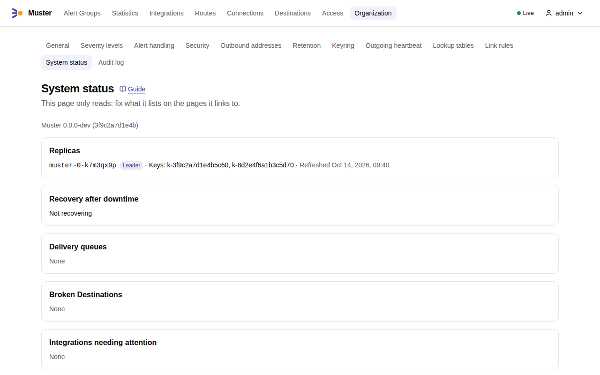
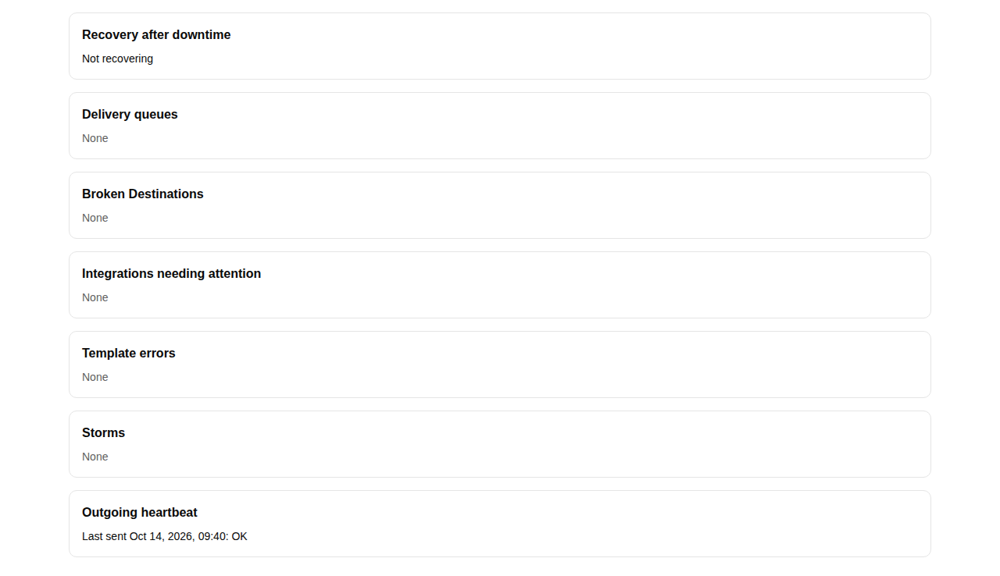

# Monitoring

Muster exports Prometheus metrics, ships alert rules and a Grafana dashboard in its Helm chart, and raises Internal
alerts about its own problems. Use all three: the metrics and the rules tell you from outside, and the Internal alerts
reach you through Muster itself.

## Metrics

Muster serves `/metrics` on the **internal listener**, port 8082 by default (`MUSTER_LISTEN_INTERNAL`), next to
`/health/live` and `/health/ready`. It never pushes metrics. Do not expose that listener outside the cluster.

With the Prometheus Operator, set `serviceMonitor.enabled: true`. The chart then creates a `ServiceMonitor` for the
internal Service, with `serviceMonitor.interval` (default 30 seconds) and `serviceMonitor.scrapeTimeout` (default 10
seconds), and extra labels from `serviceMonitor.labels` for the selector of your Prometheus. Without the operator, scrape
the internal Service yourself, or the pods on port 8082.

Every metric is in the [metrics reference](../reference/metrics.md). Entities appear by their immutable id; their names are
in the `*_info` metrics, which the dashboard joins. No metric carries an alert label, a user or an Alert Group number.

## Alert rules

The chart renders one group of rules, named `muster`, when you enable one of:

`alerting.prometheusRule.enabled`
:   renders: a `PrometheusRule` · needs: the Prometheus Operator CRDs

`alerting.vmRule.enabled`
:   renders: a `VMRule` · needs: the VictoriaMetrics Operator CRDs

Both take extra labels (`alerting.prometheusRule.labels`, `alerting.vmRule.labels`) for the rule selector of your
operator. Each rule has a `description` and a `runbook_url` that points to its [runbook](runbooks/index.md), built from
`alerting.runbookBaseURL` and the version of Muster the chart deploys.

What you can tune:

- `alerting.jobSelector` is the label matcher that selects Muster's series in every rule. By default it is
  `job="muster"`, the job the `ServiceMonitor` gives. Change it when your scrape job has another name.
- `alerting.rules.<Name>.enabled` switches one rule off, and `.for` sets how long its condition holds before it fires.
- Some rules have thresholds: `window` (the range of the `rate` or `increase`), `seconds` (`MusterDeliverySlow`: p95
  delivery latency; `MusterClockSkew`: the skew), `size` (`MusterDeliveryQueueGrowing`), `backlog` and `delaySeconds`
  (`MusterIngestBacklog`), `unauthorized` (`MusterIngestRejected`) and `failures` (`MusterLoginFailures`).

The defaults are in the [chart values reference](../reference/chart-values.md), and the expression of each rule is on
its [runbook](runbooks/index.md) page. The rules are covered by unit tests in CI.

The five rules with severity `critical` are `MusterDown`, `MusterNoLeader`, `MusterDeliveryFailing`,
`MusterDestinationBroken` and `MusterHeartbeatLost`. The others are `warning`.

### Send the critical rules around Muster

!!! warning "Do not route the critical rules through Muster"
    A rule such as `MusterDown` or `MusterDeliveryFailing` fires when Muster cannot do its job. If Alertmanager sends
    it to Muster, the alert goes exactly where it cannot be delivered. Use an Alertmanager route that **bypasses** Muster
    for them, to a receiver you trust to work when Muster does not.

The chart rules carry the labels `alertname` (starting with `Muster`) and `severity: critical` or `warning`, plus the
labels Prometheus adds from the series. Match on both, and put the bypass route **first**, above the route that sends
everything to Muster, with `continue` false (the default) so that the alert stops there. Here it is added to the
configuration of [Connect Alertmanager](../integrations/alertmanager.md), whose receivers `muster-prod-eu`, `oncall`
and `default` stay as they are:

```yaml
route:
  receiver: default
  routes:
    - receiver: platform-direct          # not Muster
      matchers: ['alertname=~"Muster.+"', 'severity="critical"']
    - receiver: muster-prod-eu
      continue: true
      repeat_interval: 10m
    - receiver: oncall
      matchers: ['severity="critical"']
    - receiver: default

receivers:
  # ... muster-prod-eu, oncall and default
  - name: platform-direct
    webhook_configs:
      - url: https://chat.example.org/hooks/<id>          # a chat or a pager of your own
        send_resolved: true
```

The matchers use `alertname=~"Muster.+"` for the rules of this chart; `severity="critical"` limits the bypass to the ones
that need it, so the warnings still reach Muster, and every other alert still reaches Muster and your own receivers.
Point the receiver `platform-direct` at a path that does not depend on Muster.

The Internal alerts of Muster itself do not go through Alertmanager, so this route does not see them.

## Dashboard

The chart ships one dashboard, "Muster", with the fixed uid `muster`, a data source variable, and the variables
`namespace`/`job`, `integration`, `route` and `destination`. It has four rows: Overview, Ingestion, Delivery and
Platform. You enable it in either or both ways, each behind its own flag:

`dashboard.configMap.enabled`
:   renders: a `ConfigMap` with the dashboard JSON

    For the Grafana sidecar; `dashboard.configMap.labels` defaults to `grafana_dashboard: "1"`.

`dashboard.grafanaDashboard.enabled`
:   renders: a `GrafanaDashboard` of the Grafana Operator

    References that ConfigMap, so it needs `dashboard.configMap.enabled` too; `instanceSelector`, `folder` and
    `allowCrossNamespaceImport` are values.

## Internal alerts

Muster raises its own problems as **Internal alerts**: `MusterSnapshotTruncated`, `MusterHeartbeatLost`,
`MusterDestinationBroken`, `MusterTemplateError` and `MusterOIDCSecretExpiring`. They are Alerts of the built-in
"Muster" Integration, which has no tokens and cannot be changed. They go through Routes like any Alert, and they reach
nobody until a Route sends them to a Destination. The [Internal alerts reference](../reference/internal-alerts.md) lists
them with their labels.

Give them a Route:

1. Open **Routes**. At the top of the list, Muster suggests *Send Muster's own alerts to a Destination* when no Route
   other than the Default route matches them.
2. Choose a Destination, and press *Create the route*. The Route matches `alertname=~"Muster.*"`.

Use a Destination that does not depend on what the alert reports: not the one that is Broken. A second messenger, or an
[outgoing webhook](../outgoing-webhooks/events.md) to a chat of your own, serves well. When a Route for
`MusterHeartbeatLost` exists, the Internal alerts Route goes directly below it. Every Internal alert has a
[runbook](runbooks/index.md), and `MUSTER_RUNBOOK_BASE_URL` (set by the chart from `alerting.runbookBaseURL`) is the base
of its link.

Two Internal alerts have a chart rule with the same name, `MusterHeartbeatLost` and `MusterDestinationBroken`. The rule is
the backup for when Muster cannot deliver; the Internal alert carries the labels of what it is about: the Integration,
with its Static labels, for `MusterHeartbeatLost`, and the Destination for `MusterDestinationBroken`.

## Watching that Muster is alive

Metrics and rules need Prometheus. To notice that Muster, its cluster or its network is down altogether, configure the
[outgoing heartbeat](outgoing-heartbeat.md): an external service alerts you when the calls stop.

The **System status** page shows the same from the inside: see [System status](#system-status).

## System status

**Organization → System status** (Admins only) shows the state of the installation from the inside. It only reads: it
lists what is wrong, and you fix it on the pages it links to.

1. Open **Organization → System status**. At the top, the version of Muster and the **Replicas**: every live replica,
   the Leader marked, with the key ids it holds and when its record was last refreshed. Below them, **Recovery after
   downtime** and the **Delivery queues**.

    { .screenshot }

2. Further down: **Broken Destinations**, **Integrations needing attention** — Heartbeat lost or Snapshots truncated —,
   **Template errors**, **Storms**, and the **Outgoing heartbeat**, with the result of its last call or a link to set
   one up. Each says **None** when there is nothing to show.

    { .screenshot }
