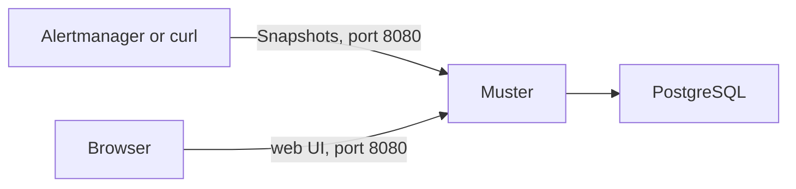

# Quick start

Run Muster with Docker Compose on one machine, sign in, connect Alertmanager and send a test alert. You need Docker with
the Compose plugin, `curl` and `openssl`, and it takes about five minutes. The compose example runs one replica of
Muster beside its own PostgreSQL; for a production installation, [install with Helm](install/helm.md).



## Start Muster

Download the compose example into a new directory:

<!-- quickstart -->
```sh
mkdir muster && cd muster
curl -fsSLO https://raw.githubusercontent.com/muster-io/muster/v0.1.4/deploy/compose/docker-compose.yml # x-release-please-version
```

Write its settings into `.env` next to it, with a generated master key and generated passwords:

<!-- quickstart -->
```sh
cat >.env <<EOF
MUSTER_SECRET_KEYS=$(openssl rand -base64 32)
POSTGRES_PASSWORD=$(openssl rand -hex 16)
MUSTER_PUBLIC_URL=http://localhost:8080
MUSTER_BOOTSTRAP_ADMIN_EMAIL=admin@example.org
MUSTER_BOOTSTRAP_ADMIN_PASSWORD=$(openssl rand -hex 16)
EOF
chmod 600 .env
```

- `MUSTER_SECRET_KEYS` is the **master key**. It encrypts the secrets Muster keeps in the database, such as the tokens
  of messenger bots, and Muster refuses to start on a database without the key that wrote it. Keep a copy of the key,
  **apart from the database backups**: see [Backup and restore](operations/backup-and-restore.md).
- `MUSTER_PUBLIC_URL` is the address people open, and links in messages point to it.
- `MUSTER_BOOTSTRAP_ADMIN_EMAIL` and `MUSTER_BOOTSTRAP_ADMIN_PASSWORD` create the first Admin at the first start. Use
  your own email if you like; it is also the login. Once an Admin exists, Muster ignores both.

Start Muster:

<!-- quickstart -->
```sh
docker compose up -d --wait
```

Muster creates its schema at the first start. One port, `8080`, serves the web UI, the API and ingestion.

## Sign in

Open `http://localhost:8080` and sign in with the login `admin@example.org` and the password from `.env`:

```sh
grep MUSTER_BOOTSTRAP_ADMIN_PASSWORD .env
```

Muster runs on a machine without HTTPS, such as a VM? Browsers keep the session only over HTTPS or on `localhost`, and the
shortest way in is an SSH tunnel. On your own machine run `ssh -L 8080:localhost:8080 <vm>`, keep it open and browse to
`http://localhost:8080`, with `MUSTER_PUBLIC_URL=http://localhost:8080` as above. See
[Sign-in needs HTTPS or localhost](sign-in/index.md#sign-in-needs-https-or-localhost).

Everything in the web UI and the API works only after sign-in: people sign in with a password or through
[OpenID Connect](sign-in/oidc-keycloak.md), and automation with tokens. Each User has a Role — Admin, Responder or
Viewer — that decides what they see and change. Add the people of your team as Users under **Access**; each of them
links their own messenger accounts in their profile, as [Link your messenger accounts](messengers/account-links.md)
describes.

## Create an Integration

An **Integration** is the way one Alertmanager cluster sends to Muster.

1. Open **Integrations** and select **Create integration**.
2. Name it after your Alertmanager cluster, such as `prod-eu`, and select **Create**.
3. On the Integration's page, under **Tokens**, select **Create token**, then **Create**.
4. The dialog shows the **Token** and the **Alertmanager configuration** once. Copy both before you select **Done**:
   only a hash of the token is kept.

The Alertmanager configuration is a receiver that sends to Muster with the token, and a child route for it to place
first under the top-level route:

```yaml
receivers:
  - name: muster-prod-eu
    webhook_configs:
      - url: http://localhost:8080/api/v1/ingest
        send_resolved: true
        max_alerts: 0
        http_config:
          authorization:
            type: Bearer
            credentials: mstr_int_…
route:
  routes:
    - receiver: muster-prod-eu
      continue: true
      repeat_interval: 10m
    # ... your existing child routes
```

Its URL comes from `MUSTER_PUBLIC_URL`, because the compose example serves ingestion on the same address. Keep
`MUSTER_PUBLIC_URL=http://localhost:8080` for your browser on this machine. When your Alertmanager runs on another
machine, replace `localhost` in the receiver's `url` with an address of this machine that Alertmanager reaches.
Browsers keep Muster's session only over HTTPS or on `localhost`: to open Muster from other machines, put an HTTPS
reverse proxy in front of port 8080, set `MUSTER_PUBLIC_URL` in `.env` to its `https://` address and run
`docker compose up -d --wait` again. [Connect Alertmanager](integrations/alertmanager.md) explains every line of the
configuration, the catch-all child route to keep last, and the start delay.

## Send a test alert

You do not need Alertmanager for a first try: send what it would send. Put the token you copied into `TOKEN`, then post
a Snapshot with one firing alert:

```sh
TOKEN=mstr_int_...
curl -sS -o /dev/null -w '%{http_code}\n' http://localhost:8080/api/v1/ingest \
  -H "Authorization: Bearer $TOKEN" -H 'Content-Type: application/json' --data-binary @- <<EOF
{
  "version": "4",
  "groupKey": "{}:{alertname=\"QuickStartTest\"}",
  "status": "firing",
  "receiver": "muster-prod-eu",
  "groupLabels": {"alertname": "QuickStartTest"},
  "commonLabels": {"alertname": "QuickStartTest", "severity": "warning"},
  "commonAnnotations": {"summary": "A test alert from Quick start"},
  "externalURL": "http://localhost:9093",
  "alerts": [
    {
      "status": "firing",
      "labels": {"alertname": "QuickStartTest", "severity": "warning"},
      "annotations": {"summary": "A test alert from Quick start"},
      "startsAt": "$(date -u +%Y-%m-%dT%H:%M:%SZ)",
      "endsAt": "0001-01-01T00:00:00Z"
    }
  ]
}
EOF
```

Muster answers `202`. Open **Alert Groups**: the Alert Group `QuickStartTest` is there, firing, and its page shows the
alert, its labels and its Timeline. It reached no messenger, because the alert went to the **Default route**, the Route
that takes every Alert no other Route takes, and the Default route has no Destination yet.

To resolve it, send the same request with both `"status": "firing"` changed to `"status": "resolved"`.

## Next steps

- **Send your first alert to a messenger.** [First alert in a messenger](first-alert.md) connects Telegram, sends
  the Alert Groups of one service to a channel, and acknowledges one from Telegram, step by step.
- **Set the time zone.** The Organization's time zone is UTC until you change it, so times in messages are UTC. Set it
  under **Organization → General**: see [Organization settings](configure/organization.md#general).
- **Connect a messenger.** Connect [Mattermost](messengers/mattermost.md), [Slack](messengers/slack.md) or
  [Telegram](messengers/telegram.md), add a Destination for a channel, and add the Destination to the Default route or
  to a Route of its own; see [Routes and Group keys](concepts/routes-and-group-keys.md). Mattermost sends button presses
  to `MUSTER_PUBLIC_URL` here, so the Mattermost server must reach that address: unless it reaches Muster at
  `http://localhost:8080`, put an HTTPS reverse proxy in front of port 8080 and set `MUSTER_PUBLIC_URL` to its
  `https://` address first. Slack in Socket Mode needs no address of Muster that Slack can reach.
- **Use any other messenger through a Bridge.** A [Bridge](messengers/bridge.md) is a small service that connects
  Muster to a messenger it does not support natively. [Write a bridge](messengers/write-a-bridge.md) with the library
  for Go, [muster-bridge-go](https://github.com/muster-io/muster-bridge-go), or for Python,
  [muster-bridge-python](https://github.com/muster-io/muster-bridge-python), or try the
  [example bridge](messengers/write-a-bridge.md#the-example-bridge) from
  [`examples/chat`](https://github.com/muster-io/muster-bridge-go/tree/master/examples/chat) of the Go library: a
  small chat with a web page, to see Muster's messages without a real messenger. It runs
  [next to this Quick start](messengers/write-a-bridge.md#the-example-bridge) as one more service of the compose project.
- **Change what messages say**, and add links to your dashboards and runbooks, as
  [Messages and templates](configure/messages-and-templates.md) describes. [API tokens and
  automation](configure/api-tokens.md) is for scripts and Terraform.
- **Connect your Alertmanager** as [Connect Alertmanager](integrations/alertmanager.md) describes, and watch the path
  from it with a [Heartbeat](integrations/heartbeat.md).
- **Learn how Muster groups alerts** in [Concepts](concepts/alert-groups.md).
- **Run it in production**: [install with Helm](install/helm.md), and read
  [Operations](operations/backup-and-restore.md) for backups, upgrades and monitoring.

`docker compose down` stops Muster and keeps its data; `docker compose down -v` deletes the database too.
