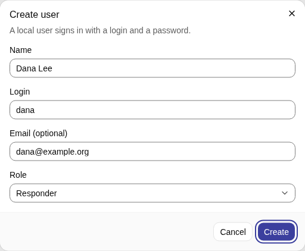
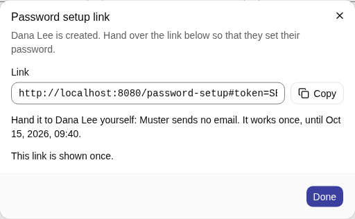
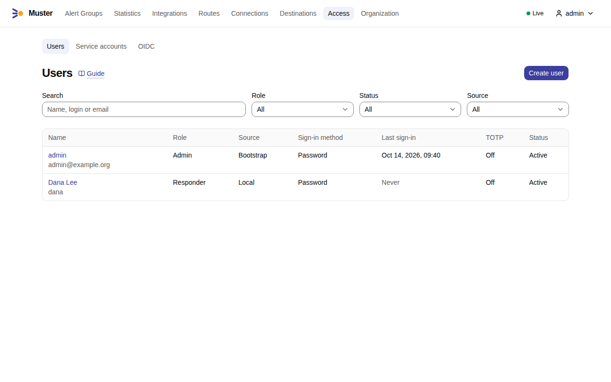
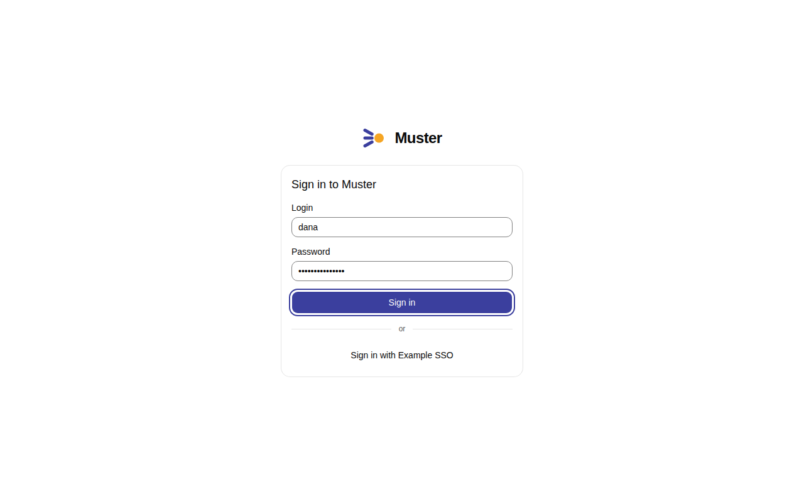
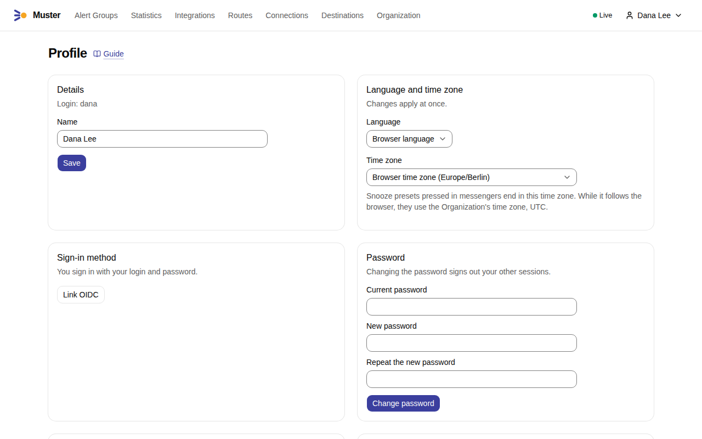
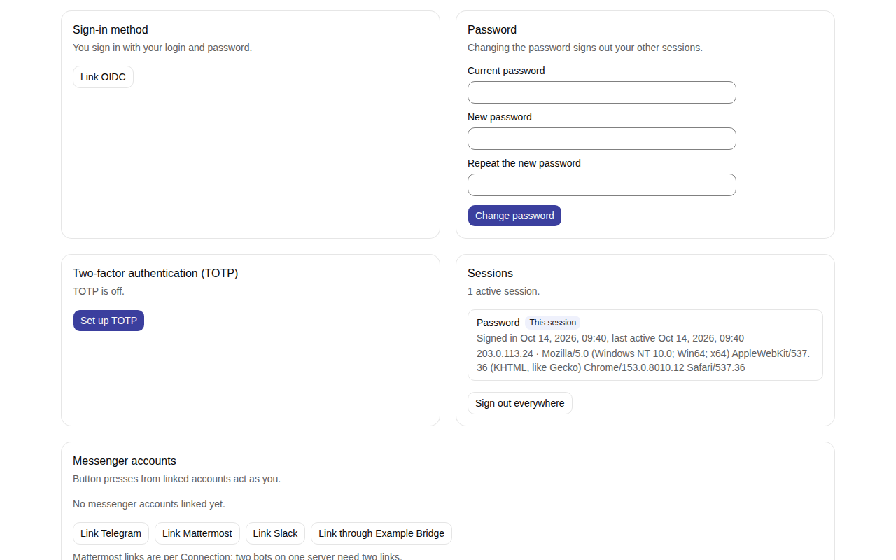

# Sign-in

Everything in the web UI and the API works only after sign-in. No page and no read of the API is open to someone who has
not signed in. What is open is a short list of endpoints that cannot ask for a session:

- the sign-in itself: the list of sign-in methods, the password sign-in, the OpenID Connect redirect and its callback,
  and the page where a person sets a password from a setup link;
- [ingestion](../integrations/alertmanager.md) and the [Heartbeat](../integrations/heartbeat.md), which take an
  Integration token;
- the callbacks that Mattermost, Slack, Telegram and a [Bridge](../messengers/bridge.md) send to Muster, which each
  carry a secret or a signature of their own;
- the served API specification;
- the health checks and `/metrics`, on the internal listener, which is not meant to be reachable from outside the
  cluster.

Everything else answers `401` without a session or a token.

## Roles

Each User and Service account has one of three Roles, each a fixed set of Permissions:

| Role | May |
|---|---|
| Admin | everything: also configures Integrations, Routes, Connections and Destinations, manages Users, the OIDC settings, Service accounts, the Organization's settings, and reads the Audit log and the System status |
| Responder | what a Viewer reads, and acts on Alert Groups: acknowledges and takes over, resolves, snoozes, adds Notes and answers Reminders |
| Viewer | reads Alert Groups, Alerts, Integrations, Routes, Connections, Destinations, Link rules and Lookup tables, with secret values masked |

Every signed-in person also manages their own profile: password, TOTP, Account links and Personal access tokens. Every operation in the [API reference](../reference/api.md) names the Permission it needs.

## Ways to sign in

- **Local users.** An Admin creates a user with a login, and Muster returns a single-use link, valid for 24 hours
  (`auth.password_setup_link_ttl`), where the person sets a password of at least 12 characters
  (`auth.password_min_length`). Muster sends no email; the Admin hands the link over. The first Admin comes from
  `MUSTER_BOOTSTRAP_ADMIN_EMAIL` and its password at the first start, as the [Quick start](../quick-start.md) shows.
- **OpenID Connect.** People sign in at your identity provider, and a mapping from the groups in their token to Roles
  decides what they may do. [Sign-in with Keycloak](oidc-keycloak.md) is a complete walkthrough.
- **TOTP.** A second step with a one-time code from an authenticator app, for local and OIDC users alike; the
  Organization can require it. See [TOTP](totp.md).
- **Personal access tokens.** A person creates them in the profile for scripts. A token acts as its User, with at most
  that User's Permissions, and can be narrowed to fewer. It can expire (`token.expiry`; a token has no expiry unless
  you set one, and the page warns about that), and the Audit log names the token with the person. The API limits each
  token (`api.rate_limit`). See [API tokens and automation](../configure/api-tokens.md).
- **Service accounts.** An identity that is not a person, for automation such as a pipeline. It has a Role and any number
  of tokens, cannot sign in to the web UI, and cannot become the Owner of an Alert Group.

Operations that change one's own account, such as the password, TOTP, tokens and Account links, need the web session; a
token is refused there.

A web session ends after 12 hours without a request (`auth.session_idle_timeout`), or 7 days after sign-in
(`auth.session_lifetime`). Both are built in. A session of an OIDC user whose identity provider granted no offline token
ends 12 hours after sign-in (`auth.oidc_fallback_session_lifetime`), and a background re-check asks the identity provider
about every OIDC user who has an offline token and a live session or a usable Personal access token, every 15 minutes
(`auth.oidc_recheck_interval`).

When the identity provider is in a network that Muster cannot reach, see [Closed networks](closed-networks.md).

## Add a User

An Admin adds a local user; a person who signs in through OpenID Connect gets their User at their first sign-in.

1. Open **Access → Users** and select **Create user**. Enter the **Name**, the **Login** and, if you like, the
   **Email (optional)**, and choose the [Role](#roles). Select **Create**.

    { .screenshot }

2. Muster shows the **Password setup link** once. Copy it with **Copy** and hand it to the person yourself: Muster sends
   no email. The link works once, until the time the dialog names. In the screenshot it starts with
   `http://localhost:8080`, the address of a development installation; yours starts with your `MUSTER_PUBLIC_URL`.

    { .screenshot }

3. The **Users** list shows the new User with the Role, the source, the sign-in method, the last sign-in, TOTP and the
   status. If the link is lost or expires, open the User and select **New password setup link**.

    { .screenshot }

4. The person opens the link, sets a password, and signs in on **Sign in to Muster** with the login and the password.
   With OpenID Connect on, the page also offers **Sign in with {name}**.

    { .screenshot }

## Your profile

Every signed-in person opens their own profile from the user menu, their name at the top right: **Profile**.

1. Under **Details**, change your **Name** and select **Save**. Under **Language and time zone**, choose the
   **Language** and the **Time zone** of the web UI; they apply at once. The time zone also sets when the Snooze
   presets you press in messengers end.

    { .screenshot }

2. Under **Password**, enter the **Current password** and the new one twice, and select **Change password**; your other
   sessions are signed out. **Sessions** lists where you are signed in, and **Sign out everywhere** ends them all, this
   one too.

    { .screenshot }

The profile also holds [TOTP](totp.md#enrol), the [messenger accounts](../messengers/account-links.md) and the
[Personal access tokens](../configure/api-tokens.md#create-a-personal-access-token).

## Sign-in needs HTTPS or localhost

The session cookie is `Secure`, so browsers keep it only on a page served over HTTPS or from the browser's own machine:
`localhost`, a name under `.localhost`, `127.0.0.1` or `[::1]`. On plain `http://` to any other address, such as
`http://192.0.2.10:8080`, the browser drops the cookie and every sign-in returns to the sign-in page. Muster says so in
two places:

- the sign-in page shows "Sign-in needs HTTPS or localhost" above the form when the browser does not treat the page as
  secure;
- the server logs [`public_url_insecure`](../reference/log-events.md#public_url_insecure) at WARN when it starts with
  `MUSTER_PUBLIC_URL` set to an `http://` address on any other host.

There are two ways out:

- **HTTPS.** Put a reverse proxy or an [Ingress](../install/helm.md#ingress) with a certificate in front of the app
  port 8080, set `MUSTER_PUBLIC_URL` to its `https://` address and restart Muster.
- **An SSH tunnel to localhost**, to try Muster on another machine without a certificate. On your own machine, run
  `ssh -L 8080:localhost:8080 <host>`, keep it open and browse to `http://localhost:8080`, with `MUSTER_PUBLIC_URL`
  set to `http://localhost:8080`. Safari may drop the cookie on `localhost` too: if sign-in still returns to the
  sign-in page there, use HTTPS or another browser.

## Link your messenger accounts

A button in Mattermost, Slack or Telegram acts as a Muster User only if the person who presses it has linked their
messenger account to their User. People do it themselves, from their profile, as [Link your messenger
accounts](../messengers/account-links.md) describes. Admins cannot do it for them: they see the links of every User and
can remove them, but they cannot create one for someone else. A press from an unlinked account changes nothing, and the
person is answered privately with a link to their profile.
