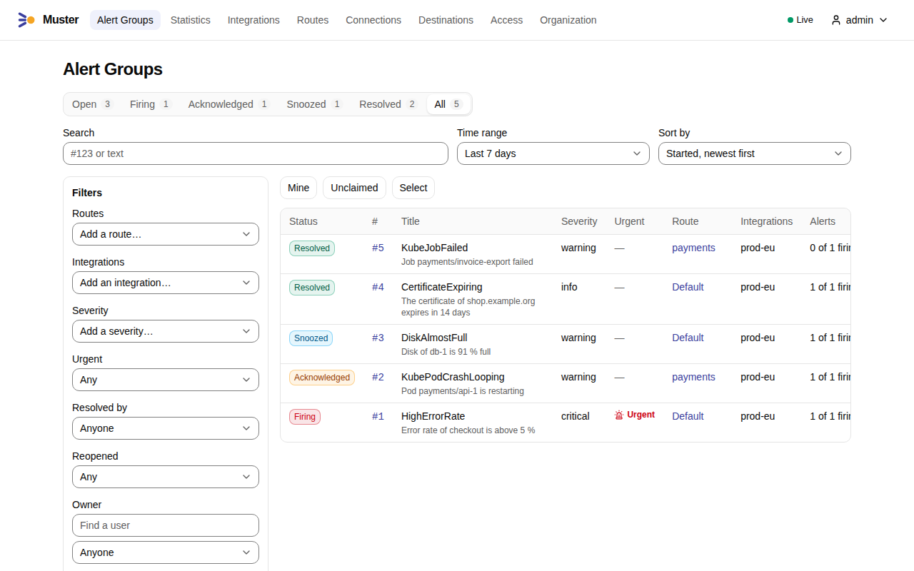
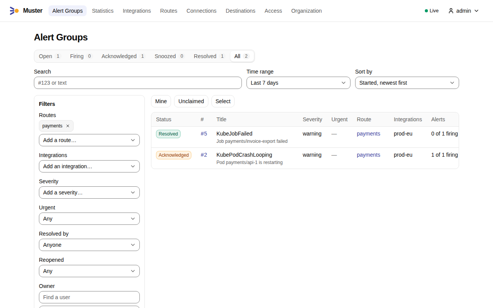
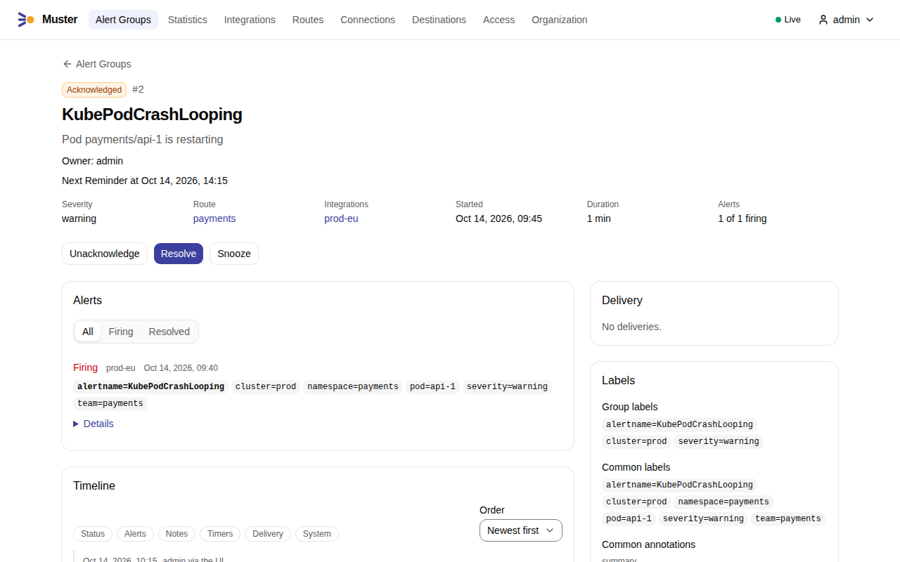
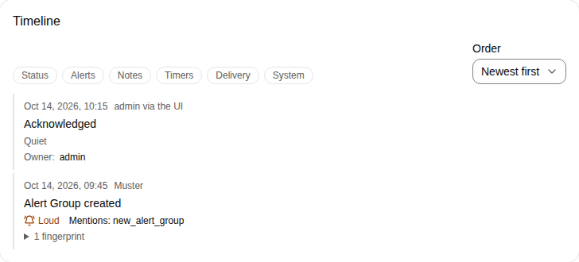
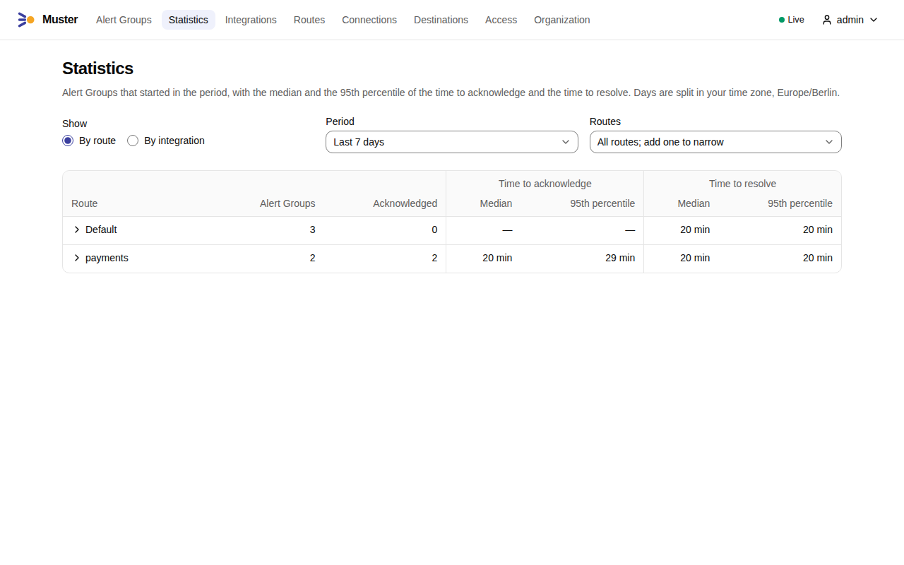
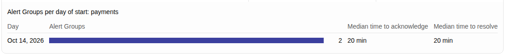

# Alert Groups

An **Alert Group** is a set of Alerts that Muster treats as one problem. It is the thing people act on: it has a number
like `#412`, a status, and at most one **Owner**, and each Destination that receives it shows it as a single message
that Muster keeps up to date. Acknowledge it, snooze it or resolve it, and everyone looking at it sees the result.

This page explains what an Alert Group is and how it relates to the other things Muster handles. The pages that follow
go deeper:

- [Routes and Group keys](routes-and-group-keys.md): how an Alert finds its Alert Group.
- [Snapshot semantics](snapshot-semantics.md): how Alertmanager's notifications become Alerts, and when an Alert counts
  as gone.
- [Statuses and commands](statuses-and-commands.md): the four statuses, the commands, ack timeouts and Reminders.
- [Loud and Quiet](loud-and-quiet.md): which changes ring a phone, and whom they Mention.
- [Broken Destinations](broken-destinations.md): what happens when a messenger stops answering.

## The things Muster handles

Four words sound alike and are not the same. Muster keeps them apart:

| Term | What it is |
|---|---|
| Snapshot | One notification from Alertmanager. It lists the current Alerts of one **Alertmanager group**. It is input, not an Alert. |
| Alertmanager group | The alerts Alertmanager notifies about together under one `groupKey`. It is Alertmanager's idea of "together", decided by the `group_by` of its route. |
| Alert | One firing problem reported by a source, identified by its full set of labels, such as one pod, one node or one domain. |
| Alert Group | The problem Muster shows people. It contains Alerts, and which ones go together is decided by a [Route and its Group key](routes-and-group-keys.md), not by Alertmanager. |

Muster does not copy Alertmanager's grouping. Alertmanager's groups exist to batch notifications. An Alert Group exists
so that a person can say "I have this one". The two often look alike, but you can change either without the other.

## What an Alert Group has

Number, `#N`
:   Assigned per Organization, without gaps, when the Alert Group is created. It is what people say aloud: "I took
    #412".

Status
:   `firing`, `acknowledged`, `snoozed` or `resolved`. See [Statuses and commands](statuses-and-commands.md).

Owner
:   The user who acknowledged it. Only a user can be an Owner; a Service account cannot.

Title
:   The `alertname` that its Alerts share. When Alerts with different `alertname` values join it, the Group key values
    instead, such as `cluster=prod, namespace=payments`. It is set when the Alert Group is created and changes at most
    once, at that switch.

Summary
:   The `summary` annotation of the first of its Alerts that has one. It is set once.

Route
:   The [Route](routes-and-group-keys.md) that took its Alerts. It decides the Destinations and the timers.

Severity level
:   The highest Severity level of its firing Alerts: critical, warning or info.

Urgent
:   Set when its Route is marked urgent, or when its Severity level is critical and the Organization treats critical as
    Urgent (`organization.critical_is_urgent`, on by default).

Reopen count
:   How many times Muster reopened it.

Alerts
:   One entry per fingerprint, firing first, resolved ones struck through with their reason.

Timeline
:   The ordered record of everything that happened to it.

The Alert Group page shows all of this, the Alerts with their labels and annotations, the labels they share, and the
previous Alert Groups with the same Route and Group key values. The page and the list work at phone width.

## In the web UI

1. Open **Alert Groups**. The list shows the Alert Groups of the chosen **Time range**, the last 7 days by default,
   newest first: the status, the number, the title, the Route, the Integrations, the Owner, when each started and how
   long it has lasted. The tabs above it — **Open**, **Firing**, **Acknowledged**, **Snoozed**, **Resolved** and
   **All** — choose the statuses and count each one; **Search** finds an Alert Group by its number, such as `#412`, or
   by text.

    { .screenshot }

2. Narrow the list with the filters beside it: the **Routes**, the **Integrations**, the **Severity**, **Urgent**, the
   **Owner**, label Matchers and more. They combine, and they live in the address, so a filtered list can be shared;
   **Clear filters** removes them. On a phone they open from **Filters**.

    { .screenshot }

3. Select the number or the title of an Alert Group to open its page: the status, the Owner, the command buttons, the
   [Alerts](#what-an-alert-group-has), the labels, the deliveries to its Destinations and the previous Alert Groups
   with the same Route and Group key values.

    { .screenshot }

4. Further down, the [Timeline](#the-timeline) lists what happened to it, with the actor and the Transport of each
   change, and the box to add a Note.

    { .screenshot }

The [commands](statuses-and-commands.md#commands-in-the-web-ui) act on the Alert Group from its page.

## Live updates

The list and the Alert Group page change as soon as something happens, without a reload. A mark in the header of every
page says whether these live updates reach your browser, so that on a phone at night you know whether the list in front
of you is current:

| Mark | Meaning |
|---|---|
| Green filled dot, "Live" | Live updates are on. |
| Grey ring, "Connecting…" | The page has loaded and is connecting. The text shows once this has taken 5 seconds. |
| Amber half-filled dot, pulsing, "Reconnecting…" | The connection has been lost for 5 seconds, and the browser keeps trying again. |
| Red ring with a slash, "Offline" | The connection has been lost for 30 seconds, or the page has not connected within 30 seconds of loading. |

On a screen narrower than 640 pixels, such as a phone, only the dot shows, whatever the state, so that the navigation
keeps its room; each state has its own shape as well as its colour, so you can tell them apart without the colour. A
drop shorter than 5 seconds, such as a Muster replica restarting, leaves the mark as it was. Press the mark to read its
state and what it means: in every state but "Live" it says that what you see may be out of date, while reconnecting or
offline it names the time the connection was lost, and when offline it offers to reload the page. As soon as the
connection is back, the list and the page are read again, so they show everything that happened meanwhile. The mark
sends nothing to Muster.

## How Alerts join an Alert Group

When an Alert starts firing, Muster picks its [Route](routes-and-group-keys.md) and reads the values of the Route's
**Group key** from the Alert's labels. Then, in this order:

1. If an **open** Alert Group of that Route has the same Group key values, the Alert joins it.
2. Otherwise, if the system resolved an Alert Group of that Route with the same values within the
   [Reopen window](#reopening), that Alert Group reopens.
3. Otherwise a new Alert Group starts, with the next number.

An Alert that is already in an open Alert Group is not routed again: it stays there until the Alert Group is resolved,
even if you change the Route's Matchers or Group key meanwhile.

What a new Alert does to an Alert Group depends on its status, because the status says whether anybody is paying
attention:

| The Alert Group is | A new Alert joining it is |
|---|---|
| firing | a Loud event, added to the Thread in batches |
| acknowledged | a Quiet event; the acknowledgement stays, always |
| snoozed | a Quiet update of the Root message only; what accumulated is listed when the Snooze ends |

### Replacements

An exporter restarts and reports the same problem with a new `pod` label. That is a different Alert, since its labels
differ, but it is the same problem. When a new Alert differs from a firing Alert of the same Alert Group only in
[Instance labels](#instance-labels), Muster records a **Replacement**: a Quiet event in the Timeline that names the label
that differs. The old Alert resolving is Quiet too. The Alert Group page suggests the real fix, which is to aggregate the
label away in the rule, for example with `without(pod, instance)`.

### Instance labels

Instance labels are the labels that change when the process reporting an Alert restarts. The Organization lists them in
`organization.instance_labels`; by default `pod`, `instance`, `container` and `endpoint`. See [Instance labels in
informational alerts](../integrations/alertmanager.md#instance-labels-in-informational-alerts) for when to keep them
out of your rules.

## Reopening

An Alert Group is **resolved by the system** when its last Alert resolves, whether Alertmanager said so, or the Alert
went [Gone or Stale](snapshot-semantics.md), or its Integration was deleted. A person can resolve it too.

The two ways to resolve differ in what happens when the problem returns:

| Resolved by | When an Alert with the same Route and Group key values fires again |
|---|---|
| The system | Within the **Reopen window** (`route.reopen_window`, 15 minutes by default) the same Alert Group **reopens**: same number, Reopen count plus one, and it returns to the status it had before, with the same Owner if it was acknowledged. After the window, a new Alert Group starts. |
| A person | The Reopen window does not apply. If the Alerts that were still firing are still reported when the **Grace period** (`route.grace_period`, 15 minutes by default) ends, they are grouped again as if they had just fired. Within the Grace period, a new firing starts a new Alert Group at once. |

A reopen is keyed by the Route and the Group key values, not by one Alert: any Alert with the same values brings the
Alert Group back, whether it is one of its own Alerts or a new one. How loud a reopen is depends on where it returns:
Loud into firing, Loud into acknowledged but Mentioning only the Owner, Quiet into snoozed.

A person who resolved the wrong Alert Group presses **Unresolve** in the web UI or the API. Unresolve is not offered in
messengers, and it works only on an Alert Group that a person resolved, not on one that reopens by itself.

The reason is always visible. A resolution by the system carries the reason, such as "Alertmanager no longer reports this
alert", and so does every other automatic change; the page, the Timeline and the message show it.

## Where an Alert Group shows up

A Route lists the Destinations that receive its Alert Groups. For each Alert Group and each of its Destinations, Muster
keeps one **Root message** and brings it to the latest state each time something changes. Replies, such as new Alerts
joining or a Reminder, go to the message's **Thread**. See [Loud and Quiet](loud-and-quiet.md) for which changes are new
messages and which are edits.

An Alert Group whose Route has no Destination, as with the Default route in the [Quick start](../quick-start.md), exists
only in Muster. Its page, the list, the statistics and the Timeline still work.

## The Timeline

The Timeline of an Alert Group shows, in order: Alerts added, resolved, replaced and continued; status changes with the
actor and the Transport; Reopens; Notes; Takeovers; ack timeout notices, Reminders and their answers; use of the
Fallback template; delivery events such as a Publication, a possible duplicate or a delivery that was Not delivered;
moves to the Default route; and the periods when Muster itself was down. Each entry that records something Muster might
tell people also shows whether it was Loud and whom it Mentioned.

You can filter the Timeline by kind and read it oldest first or newest first. Notes belong to it: Responders and Admins
can add one, up to 4,000 characters (`alert_group.note_max_length`).

## Changing a Route does not change an Alert Group

Edits of a Route's settings apply at once, also to its open Alert Groups, whose messages are updated. They never change
an Alert Group's status. A new Group key or new Matchers apply only to Alerts that start firing afterwards.

A Route that still has open Alert Groups cannot be deleted. Muster refuses and offers to move them to the Default
route. A moved Alert Group keeps its Group key values, takes no new Alerts, and never reopens; it stays open until its
Alerts resolve or a person resolves it.

## Statistics

**Statistics** counts the Alert Groups that started in a period and how fast people took and closed them: for each
Route or each Integration, the number of Alert Groups and the median and the 95th percentile of the time to acknowledge
and of the time to resolve. Days are split in your time zone.

1. Open **Statistics**. Choose the **Period** — **Last 7 days**, **Last 30 days**, **Last 90 days** or **Custom** — and
   show it **By route** or **By integration**; add Routes or Integrations to narrow it.

    { .screenshot }

2. Select a Route or an Integration to see its Alert Groups per day of start, with the median times of each day.

    { .screenshot }

## How long Alert Groups are kept

`retention.alert_details`
:   kept for: 90 days

    Alerts in Alert Groups, Timeline entries, delivery events.

`retention.alert_group_summaries`
:   kept for: 2 years

    The summary row of an Alert Group: number, title, summary, times, Route, status, and its Notes.

After the details are removed, search still finds the Alert Group by its title and number, and its page shows the
summary with the notice that the Alerts and the Timeline were removed. The list shows Alert Groups whose lifetime
overlaps the chosen time range, 7 days by default (`alert_group.list_range`), so an Alert Group that has been firing for
weeks is always in the default view. Searching by number ignores the range.
