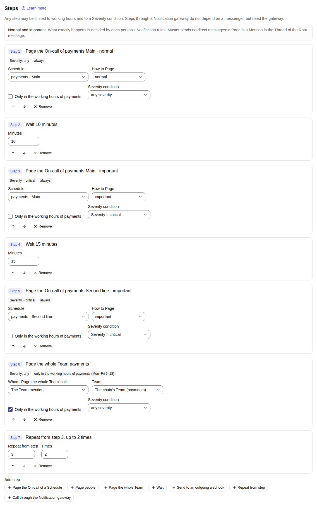
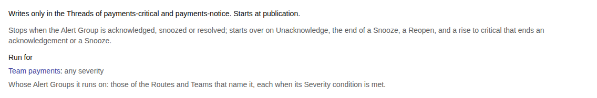
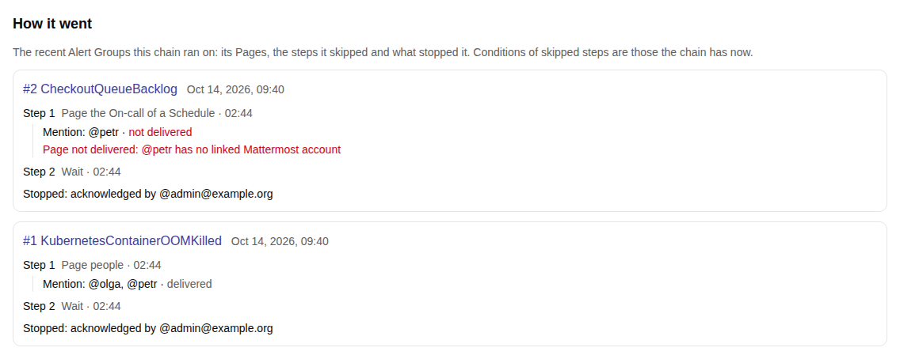
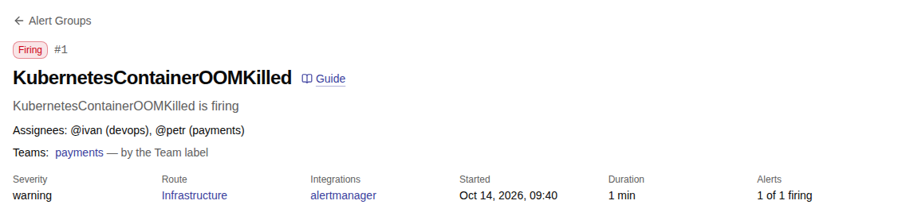
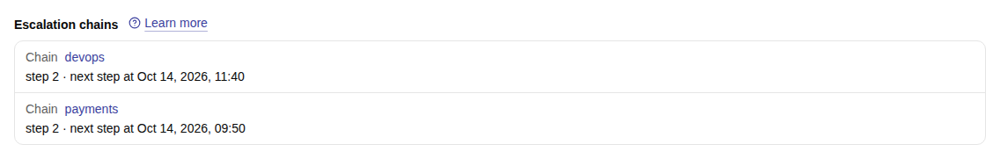

# Escalation chains

An **Escalation chain** Pages more and more people while an Alert Group stays firing. Its steps Page the On-call of a
Schedule, chosen people or a whole Team, call through a [Notification gateway](../messengers/notification-gateways.md),
wait, send to an outgoing webhook and repeat. Routes and Teams name their chains. Chains are managed through the API under
`/api/v1/escalation-chains`, listed in the [API reference](../reference/api.md).

Chains run on Alert Groups at the points described under [When chains run](#when-chains-run): their steps follow one
another with their waits and repeats, and a step is skipped where it cannot be made. A webhook step sends its event
to its outgoing webhook ([Webhook steps](#webhook-steps)). A step that Pages people or a Team writes a Mention in the
Threads of its chain's own Destinations ([Where chains Page](#where-chains-page)); a step that calls through a
Notification gateway, and the call actions of the Notification rules, call the person's confirmed contact
([Calls through a Notification gateway](#calls-through-a-notification-gateway)). Where no chain runs, the ack timeout
of a Route keeps working as before.

[How an alert reaches people](how-an-alert-reaches-people.md) walks one Alert through the chains, and [Notification
rules](notification-rules.md) says how a Page reaches one person.

## What an Escalation chain is

An Escalation chain has:

- a **name**, unique in the Organization, compared without regard to case;
- a **description**;
- an optional **owning Team**, which organizes the chains — the list filters by Team, `team=<public_id>` or `team=mine`
  — and whose Working hours its steps use;
- its **steps**, in their order, numbered from 1.

Only Admins create, change and delete chains (`escalation-chains:write`); everyone reads them
(`escalation-chains:read`). A change is saved with `If-Match`, like every configuration, and is recorded in the Audit log
as `escalation_chain.created`, `escalation_chain.updated` or `escalation_chain.deleted` with the values before and after.
The metric `muster_escalation_chain_info` has one series per chain, with its name ([Metrics](../reference/metrics.md)).

A chain's read also lists the Routes and Teams that name it (`referrers`), the Destinations it writes in — those of
those Routes and Teams (`destinations`) — and its `warnings`, what the chain or a step cannot do:

- `pages_nobody`: no step of the chain Pages anyone — it has no step that Pages the On-call, chosen people or a Team,
  or calls, such as an empty chain or one of waits, repeats and webhooks. It concerns the whole chain, so its `step` is
  null, and it comes first. The chain is saved all the same;
- `everyone_unsupported`: a step "Page the whole Team" whose Team mention, or word for everyone in the chat, the
  Connection of one of the chain's Destinations cannot mention, such as a Telegram Destination, with the Destination and
  the reason;
- `gateway_deleted`: a call step whose Notification gateway was deleted, or is no Notification gateway any more;
- `destination_deleted`: a webhook step whose Destination was deleted;
- `team_deleted`: a step "Page the whole Team" whose Team was deleted since it was saved, instead of its
  `everyone_unsupported` warnings.

A chain that a Route or a Team names cannot be deleted: `deleteEscalationChain` answers `409` `chain_in_use`, naming
them in `in_use_by`. A Team that owns a chain cannot be deleted either (`409` `team_in_use`), and a Schedule that a step
names cannot be deleted (`409` `schedule_in_use`).

## Steps

A chain has at most 20 steps (`escalation.limits`). Each step is of one kind and takes the fields of its kind only; a
field of another kind is refused with `422` `unsupported` at it, and a missing one with `required`:

| Kind | What it does | Its fields |
|---|---|---|
| `page_on_call` | Pages the On-call of a Schedule of any Team | `schedule_id`, `importance` |
| `page_people` | Pages chosen people | `user_ids`, `importance` |
| `page_team` | Pages a whole Team by its Team mention, or everyone in the chat | `team_id` or `everyone` |
| `call` | Calls the On-call of a Schedule or chosen people through a Notification gateway | `call_target`, `schedule_id` or `user_ids`, `gateway_id` |
| `wait` | Waits a number of whole minutes | `wait_seconds` |
| `webhook` | Sends to an outgoing webhook Destination | `destination_id` |
| `repeat` | Goes back to an earlier step, a number of times | `repeat_from`, `repeat_times` |

- **Importance.** A Page is `normal` or `important`, `normal` when omitted; it runs the person's
  [Notification rule](notification-rules.md) of that name.
- **People.** A step names people who may be Paged: a Viewer or a disabled User that a save adds is refused with `422`
  `not_pageable` at `/steps/{i}/user_ids/{j}`, with the `reason` `viewer` or `disabled`. A person the stored steps
  already name is kept when the chain is saved again, even if they have become a Viewer or been disabled since; a
  running chain will skip them.
- **The whole Team.** Without `team_id` and `everyone`, the step Pages the chain's owning Team; a chain without an
  owning Team must name the Team (`required` at `team_id`). `everyone` is `channel`, `here`, `all` or `everyone`.
- **Calls.** `call_target` is `on_call`, with `schedule_id`, or `people`, with `user_ids`. A call step needs a
  Notification gateway: without one it is refused with `422` `gateway_required`; with one, `gateway_id` may be omitted
  and the step takes that gateway; with several, `gateway_id` is required.
- **Waits.** A wait lasts from 1 to 1,440 minutes, given in seconds: `wait_seconds` is a multiple of 60 from 60 to
  86400, so a wait of 10 minutes is `{"kind": "wait", "wait_seconds": 600}`. Another value is refused with `422`
  `out_of_range` at it.
- **Webhooks.** The Destination of a webhook step is an outgoing webhook in the mode `events` or `both`; another one is
  refused with `422` `webhook_events_required`.
- **Repeats.** `repeat_from` is the number of an earlier step, and `repeat_times` from 1 to 10.
- **Limits.** Every step but `wait` and `repeat` takes `working_hours_only` — the step is made only in the Working
  hours of the chain's owning Team, else the Organization's — and a `severity_condition`, `any` by default, `critical`
  or `below_critical`.

A gateway or a webhook Destination that a stored step names may be deleted; the chain warns about it and can still be
saved.

### The chain of payments

The Team `payments` names a chain with seven steps, which the examples of these pages use:

1. Page the On-call of its Schedule "Main", normally.
2. Wait 10 minutes.
3. For critical Alert Groups only, Page the On-call of "Main" importantly.
4. Wait 15 minutes.
5. For critical Alert Groups only, Page the On-call of its Schedule "Second line" importantly.
6. During the Working hours of `payments`, Page the whole Team.
7. Repeat from step 3, up to 2 times.

A warning Alert Group Pages the On-call once, skips steps 3 and 5 as "only for critical", and in Working hours Pages the
whole Team at step 6, in each of the three passes. A critical one Pages the On-call importantly 10 minutes later, the
second line 15 minutes after that, and the whole Team in Working hours, and does so three times in all before the chain
runs out.

{ .screenshot }

### Webhook steps

A step "Send to an outgoing webhook" (`webhook`) sends the event `escalation_webhook` to the outgoing webhook
Destination it names when the step is made. The event carries the Alert Group, as every event does, with the chain and
the step. The Destination receives it whether or not the Alert Group is delivered there, so an outgoing webhook on
none of the Alert Group's Routes can be called at a chosen step of a chain. Such a Destination receives no other event
of the Alert Group, and the events-mode Destinations of the Alert Group's Routes do not receive `escalation_webhook`.
A Destination that is also one of the Alert Group's receives it once, in order among its other events. The event is
signed, ordered and delivered at least once like every event
([escalation_webhook](../outgoing-webhooks/events.md#escalation_webhook)).

The Timeline records the Quiet `escalation_webhook`, of the kind `escalation`, with the chain, the step and the
Destination; nothing appears in a messenger. Like every step that sends, a webhook step can be limited to Working hours
and to a Severity condition. A running chain skips a webhook step, recording `escalation_step_skipped`, when its
Destination:

- was deleted since the step was saved: `destination_deleted`;
- is no longer an outgoing webhook in the mode `events` or `both`, such as one switched to the template mode:
  `webhook_events_required`.

## Naming chains on Routes and Teams

Routes and Teams name their chains in `chain_entries`, as they name their Destinations: each entry is a chain with a
Severity condition — `any`, the default, `critical` or `below_critical` — checked against the Severity level of the
Alert Group. An entry list replaces the stored one as a whole, and an update that omits it keeps it. Reads give the
entries and the chains by name, `chains`, and the Audit log of the Route or the Team records the change.

```json
{"chain_entries": [{"chain_id": "ECK7M3QX9P2RTA", "severity_condition": "critical"}]}
```

Naming a chain on a Route needs `routes:write`, and on a Team `teams:write`. Where the chain then Pages is the rule of
[Where chains Page](#where-chains-page).

## In the web UI

The button **Escalation chains** on the Teams page opens the list of the chains with the Routes and Teams that name
each, which filters them by Team. **New chain**, also on the Team page under "Escalation chain of the Team", opens the
chain page, where an Admin builds the steps; everyone else reads them ("Only Admins change Escalation chains."). "Add
step" offers the seven kinds — "Page the On-call of a Schedule", "Page people", "Page the whole Team", "Wait", "Send to
an outgoing webhook", "Repeat from step" and "Call through the Notification gateway", which is greyed with "Unavailable:
a Notification gateway is needed (a bridge for calls and SMS)" while there is none. Each step shows in words, numbered,
with its limits as chips: "Severity: any", "always", "only in the working hours of payments" with the days and hours,
or "Severity = critical". "Whom 'Page the whole Team' calls" offers the Team mention, `@channel`, `@here`, `@all` and
`@everyone`, and greys the ones that the chain's Destinations cannot mention with their reason. The warnings of the
chain are listed under "Warnings", a section that shows only when the chain has any.

The page also says what the chain does:

{ .screenshot }

"Writes only in the Threads of" names the Destinations that the chain Pages in, "Stops when the Alert Group is
acknowledged, snoozed or resolved; starts over on Unacknowledge, the end of a Snooze, a Reopen, and a rise to critical
that ends an acknowledgement or a Snooze." gives its lifecycle, and "Run for" lists the Routes and Teams that name the
chain, each with the Severity condition it meets. The Route form has "Escalation chains" with the conditions of its
chains, and the Team page names a Team's chains. Under "Normal and important" the page reminds that each person's
Notification rules decide what exactly a Page does, and that Muster sends no direct messages: a Page is a Mention in the
Thread of the Root message.

"How it went" lists the recent Alert Groups the chain ran on, with their Pages, the steps it skipped and what stopped
it. The screenshot is of a run that a person acknowledged:

{ .screenshot }

## When chains run

The chains that run on an Alert Group are those its Route names and — where the Route has "Also to the Teams from the
label" (`deliver_to_teams`) and "Run the Teams' Escalation chains" (`run_team_chains`) on — those that each of its Teams
names, each whose Severity condition its Severity level meets. Several chains may run on one Alert Group at the same
time. A chain that the Route and a Team both name, or several Teams, runs once, with all of them as its sources. With
"Run the Teams' Escalation chains" off, the Teams' Destinations still receive the Alert Group, but their chains do not
start.

A chain runs only while the Alert Group is firing, and only Alerts and Commands start chains:

| Point | What happens to the chains |
|---|---|
| The Alert Group's first Publication; for one that a Storm summary stood for, its own Publication; for an outgoing webhook in events mode, its delivered `created` event | The chains that apply start at their first step |
| The Alert Group is created while no Destination reaches it, or only Broken ones | The chains that apply start at once |
| It becomes firing again: a Reopen into firing, Unacknowledge, Unsnooze, the end of a Snooze, Unresolve, a rise to critical that ends an acknowledgement or a Snooze, an auto-unacknowledge, its Owner disabled or deleted | The chains that apply start over at their first step |
| Its Severity level rises by its Alerts while it is firing and nobody owns it | The chains whose condition it now meets start; running chains go on |
| A Team joins it by a new Alert while it is firing and nobody owns it | That Team's chains start, where the Route runs the chains of Teams |
| A change of configuration: saving a Team, turning on "Also to the Teams from the label" or "Run the Teams' Escalation chains", naming a chain on a Route or a Team or changing its condition, changing the Severity condition of a Destination, changing the Minimum severity | No chain starts, and the running chains go on |
| Acknowledge, Snooze, Resolve | Every chain stops |

A chain whose condition the Alert Group no longer meets after its Severity level falls goes on. A chain that a change of
configuration would apply to starts at the next point that starts or starts over the chains, such as an Unacknowledge.
A held Alert Group that a raised Minimum severity releases is published Quietly and starts its ack timeout, but no
chain: that release is a change of configuration.

Each run keeps the steps its chain had when it started, until it stops or starts over: a change of the chain applies to
the runs that start after it. A step that Pages or sends, limited to Working hours, is skipped outside the Working hours
of the chain's owning Team, else the Organization's; a step whose Severity condition the Alert Group does not meet, a
step that Pages the On-call of a Schedule with a gap now, and each person a step names who has become a Viewer or been
disabled since the step was saved are skipped too. Each skip records the Quiet lifecycle event
`escalation_step_skipped` in the Timeline, of the kind `escalation`, with the chain, the step and the reason —
`outside_working_hours`, `severity`, `schedule_gap`, `viewer` or `disabled`, for a webhook step
`destination_deleted` or `webhook_events_required` ([Webhook steps](#webhook-steps)), for a step "Page the whole
Team" that none of its chain's Destinations can mention `no_mention_possible` ([Where chains Page](#where-chains-page)),
and for a call step whose gateway was deleted `gateway_deleted`, or for a person it would call without a confirmed
contact there `no_confirmed_contact` ([Calls through a Notification gateway](#calls-through-a-notification-gateway))
— and the chain goes on with its
next step at once. A wait delays the next step by its length on the clock of Muster, and "Repeat from step 3, up to 2 times" makes
steps 3 to the repeat three times in all, then goes on. Outgoing webhooks in the mode events receive
`escalation_step_skipped` with the chain, the step and the reason ([Events](../outgoing-webhooks/events.md)).

Steps are timer rows that any replica claims, and each step is a change of its Alert Group made by Muster, so a replica
that stops never stops a chain. `getAlertGroup` gives the runs of the chains since they last started in
`escalation_chains`: each with its chain, its sources, its state — `running`, `ran_out` once it passed its last step,
`stopped` by Acknowledge, Snooze or Resolve —, the step it is at and `next_step_at`, when its next step is due.
`listEscalationChainRuns` (`GET /api/v1/escalation-chains/{escalation_chain_id}/runs`) lists the recent runs of a chain,
newest first: each with its Alert Group, the steps it made and skipped with their reasons, and what stopped it — the
Command and the person who ran it — or that it ran out. An Alert Group whose chains started over has a run per start.

## Chains and the ack timeout

When the first chain of an Alert Group starts, its running ack timeout stops and sends no more notices: the steps take
their place. When the Alert Group becomes firing again, its ack timeout starts over only if none of its chains starts.
An Alert Group on which no chain applies keeps the ack timeout of its Route, as in L1
([Statuses and commands](statuses-and-commands.md#ack-timeouts-reminders-and-auto-unacknowledge)).

## Where chains Page

A chain Pages only in the Threads of its own Destinations, so that a step that Pages everyone in the chat never rings
another team's chat:

- a chain of the Route, in those of the Route's Destinations that have the Alert Group's Root message;
- a chain of a Team, in those of the Team's Destinations that have it, and, where none of them has, in those of the
  Route's Destinations;
- a chain that the Route and a Team both name, which runs once, in the Threads of both.

A Destination whose first Publication of the Alert Group is still on its way counts as one with the Root message: the
chains start with the first Publication in one Destination, and the Page waits there for the Root message to reply
under. One that a Storm holds does not.

Which Destinations a Route or a Team reaches is the rule of [Routing to Teams](routing-to-teams.md): the Severity
condition of each entry against the Alert Group's Severity level. A Destination is the Route's or a Team's when that
Route's or Team's own entry reached it, at a level the Alert Group had, and still names it. Destinations only grow, so
a Destination stays the Route's or the Team's after the level falls: when the critical Alerts resolve and the level
falls to warning, the chain of a Team still Pages in the Team's critical channel, which has the Root message, and does
not fall back to the Route's. A channel that several name belongs only to those whose entry reached it: when Team
devops names a shared channel for any level and Team payments names it for critical only, a warning Alert Group that
was never critical has its Root message there by devops' entry, so the chain of payments does not Page there, and its
`@here` never rings devops' channel. A Page is a Thread reply that delivery sends like any
other: Loud, due at once without the Thread batching window, never combined with another reply. It says which step
and which chain it comes from:

```text
Step 1: @ivan, you are needed
Chain of the Route Infrastructure · On-call of devops Main · normal
```

- **The people.** A step "Page the On-call of a Schedule" Pages the On-call of that moment, and a step "Page people"
  each person it names; each person by their [Notification rule](notification-rules.md) of the step's importance. The
  first Mentions of the rules that come due together are one reply per Destination naming them all. An important
  Page says "important, again in 5 min" when the person's rule Mentions them again — for a Page naming several people,
  only when every one of their rules does after the same time — and that later Mention repeats the first line with
  "· important, again". The rule stops when the Alert Group is acknowledged, snoozed or resolved, or
  when its chain starts over, and a Mention that comes due after that is not made.
- **A whole Team or everyone in the chat.** A step "Page the whole Team" writes the Team's Team mention for the
  Destination's Connection — the chain's owning Team when the step names none, the owning Team the chain had when its
  run started — or the word for everyone in the chat, `@here` for example. Where a Destination's Connection can
  mention neither, the step makes no reply there; where it can reply in none of the chain's Destinations, as when the
  only one is a Telegram channel, it records `escalation_step_skipped` with `no_mention_possible`.
- **The Timeline.** Each Page records the Loud lifecycle event `paged`, of the kind `escalation`, with its people,
  its chain and its step; outgoing webhooks in events mode receive it as every event, with its people as data
  ([Events](../outgoing-webhooks/events.md)).

A Page by Mention replies in Mattermost, Slack and Telegram Destinations and through Bridges; in Telegram the reply
is a comment under the channel post in the discussion group, as every Thread reply. An outgoing webhook in the template
mode takes the Page through its "reply in thread" request, and one without that request takes none. One in the events
mode has no Root message and takes no reply: it receives `paged` as an event, and only when the Page replies in
another Destination of the chain. A chain whose only Destinations are outgoing webhooks in the events mode records no
`paged`: a Page of people records `page_not_delivered` with `no_root_message`, and a step "Page the whole Team"
`escalation_step_skipped` with `no_mention_possible`. A step "Page the whole Team" never replies in Telegram, which
mentions no group and no one for everyone in the chat, and through a Bridge only when its bridge declares group
mentions, for a Team mention, or the word for everyone in its `everyone_mentions`.

## How a Page reaches a person

A Page names each person as a Mention only where they have an Account link in the Identity space of that Destination's
Connection ([Account links](../messengers/account-links.md)); a person without one is named in the line "Page not
delivered: @petr has no linked Mattermost account" instead, which mentions nobody.

| Where | A Page is | It reaches the person when |
|---|---|---|
| Mattermost | a Thread reply with `@username` | they have an Account link for the Connection |
| Slack | a Thread reply with `<@U…>` | they have an Account link for the Connection |
| Telegram | a comment in the discussion group with a `tg://user?id=` link | they have a Telegram Account link and are in the discussion group |
| Bridge | a Thread reply with a Mention marker | they have an Account link for the Connection and the bridge declares `native_mentions` |
| Outgoing webhook, events mode | the event `paged`, with the people as `mentions` data, when the Page replies in another Destination of the chain | the receiver acts on it |
| Outgoing webhook, template mode | the "reply in thread" request, when it has one | the receiver acts on it |
| Notification gateway | a call to the confirmed contact | the gateway reaches them, whatever the messengers do |

In Telegram the reply reads "Step 1: Ivan, you are needed" with Ivan as a link that mentions him, and in a bridge
"Step 1: [@Ivan](muster-mention:m1), you are needed" with his entry in the envelope's `mentions`
([Rendering the envelope](../messengers/write-a-bridge.md#rendering-the-envelope)). A Mention in Telegram rings only a
member of the discussion group: the creator of the group, anonymous in it, who muted it is not rung. A bridge without
`native_mentions` shows a linked person's marker as their plain name, which rings nobody, so the Page is not delivered
to them through that Destination: when no other Destination of the chain reaches them, it records
`page_not_delivered` with `not_delivered`. The same holds for a person whose Mention a bridge's reply leaves out
because its line of Mentions keeps only the whole Mentions that fit half of the bridge's body limit
([Undelivered Mentions](mentions.md#undelivered-mentions)): the reply does not reach them and they do not become an
Assignee. The same holds for a linked person whose marker cannot be written — an account id longer than 512
characters, or neither the link nor the person has a name to show — and whom the reply therefore names by the plain
name. An outgoing webhook takes every person of the Page as data, linked or not, and the Team of a step "Page the
whole Team" by its slug and name; the template mode gives them to the "reply in thread" request as `.Mentions`, with
`.Event` `paged` ([Template mode](../outgoing-webhooks/templates.md#mentions)).
One whose "reply in thread" request was removed after the Page was queued sends nothing, and that reply ends Not
delivered.

!!! warning "At night, only a Notification gateway is reliable"
    A Mention in a Thread may or may not reach a person's phone as a push notification: it depends on the messenger,
    on its app, on the settings of the person's phone and on the push mode of the messenger. Muster cannot see whether a
    push arrived. For Pages that must wake someone at night, rely on a call through a Notification gateway, and treat a
    Mention as the record in the Thread that the person was named, not as a promise that a phone rang. See
    [At night](../messengers/notification-gateways.md#at-night).

## Calls through a Notification gateway

A step "Call through a Notification gateway" (`call`) calls the On-call of its Schedule at that moment, or each person
it names who may still be Paged, through its gateway; a person whose [Notification rule](notification-rules.md) has a
call action is called the same way when a step Pages them normally or importantly. Each call is a Page of its step,
of one person: it records the Quiet lifecycle event `paged` in the Timeline, of the kind `escalation`, naming the
person and the gateway in `gateway`, and writes nothing in any Thread — the Thread reply of the same step, when there
is one, already names the person. The call goes to the person's confirmed contact at the gateway
([Notification gateways](../messengers/notification-gateways.md)), through the queue of calls: the first call to a
person through a gateway goes at once, and the Pages that come due while a call to them waits, is being retried or
within `gateway.combine_window` after the previous one ended go together in the next call, one call about all of
their Alert Groups.

Calls depend on no Root message and on no messenger: they keep working while a messenger is down or a Destination is
[Broken](broken-destinations.md), and a Route with a chain and no Destination starts its chain when the Alert Group is
created, so that its call steps still call. Right before its first attempt, a call drops the Alert Groups on which the
chain or the rule that Paged has stopped — acknowledged, snoozed, resolved or started over —, and a call left without
any is not sent; a chain that started over and Paged again keeps its Alert Group in the call. Once every Alert Group
of a call being retried has stopped, its retries end.

A call that the gateway accepted reaches the person: they become an Assignee of the chain, as by a delivered Mention
([Assignees](#assignees)). A call that ends Not delivered — refused, an answer Muster cannot classify, the retry
budget used up, a gateway Broken or deleted, or a contact removed before it went — records `page_not_delivered` with
the chain, the step, the person, the gateway and the reason, and leaves the Assignees as they were; the chain and
the rules go on either way. A call step whose gateway was deleted, or is no Notification gateway any more, is skipped
with `gateway_deleted`; a person it would call who has no confirmed contact there is skipped with
`no_confirmed_contact`, and the step with them when none is left. Calls count in `muster_pages_total` with the `kind`
`call`, and "How it went" lists them as Pages of the kind `call` with their `gateway`.

## Undelivered Pages

A Page that reaches its person nowhere records the Quiet `page_not_delivered` with the person and the reason:

- `no_root_message`: none of the chain's Destinations has the Alert Group's Root message — such as a Route with a
  chain and no Destination, whose chains start when the Alert Group is created;
- `no_account_link`: the person has no Account link in the Identity space of any of the chain's Destinations;
- `not_delivered`: every Thread reply that would mention them ended Not delivered, was withheld while its
  Destination was [Broken](broken-destinations.md), was sent through a bridge with their Mention left out for length
  or with their plain name for want of a marker, or was never sent because its Root message — a first Publication,
  or one published again after it was deleted — ended Not delivered; a reply withheld while Broken is not sent after
  the Destination recovers. A reply queued before its Destination became Broken, such as one whose own attempt made
  it Broken, is withheld too as soon as the Destination is Broken: the Page does not wait for the recovery, and still
  reaches the people that its other, delivered replies mentioned.

A call through a Notification gateway that ends Not delivered records it too, with the reason of the call
([Calls through a Notification gateway](#calls-through-a-notification-gateway)).

A Page counts in `muster_pages_total{chain,kind,outcome}` once it ended: `delivered` once a delivered reply mentioned
one of its people — for a Team or everyone in the chat, once one of its replies was delivered — or, for a call, once
the gateway accepted it, and `not_delivered` otherwise; a Page whose chain was deleted before it ended, and a call not
made because its chain or rule stopped first, are not counted ([Metrics](../reference/metrics.md)).

## Assignees

Until someone acknowledges, an Alert Group shows its **Assignees**: for each chain started on it, running or run out,
the people its latest step Paging people by name — the On-call of a Schedule, chosen people or a call through a
Notification gateway — reached, each with the owning Team of that chain. A person is reached once a delivered Thread
reply mentions them, or a call to them that the gateway accepted, as the table of
[How a Page reaches a person](#how-a-page-reaches-a-person) says for each messenger — a bridge's reply that names them
by the plain name reaches nobody; a person a Page did not reach (see [Undelivered Pages](#undelivered-pages)) never
becomes an Assignee.

How they change, for each chain on its own:

- a later step that reaches someone replaces the chain's Assignees, a repeated step included;
- another reply of the same step, and the later Mentions of that step's rules, add to them; the later Mentions of an
  earlier step's rules, and a reply of an earlier step that comes late, change nothing;
- a step that reaches none of its people leaves them as they were, and a step that Pages a whole Team or everyone in
  the chat changes nothing;
- a chain that runs out keeps its Assignees, so an Unclaimed Alert Group still shows whom it Paged;
- Acknowledge, Snooze and Resolve clear them all.

Each change records the Quiet `assignees_changed` in the Timeline, of the kind `escalation`, with the Assignees after
it, and edits the Root messages without notifying anyone. Nobody sets Assignees by hand, and being one gives no right
of its own: any Responder may acknowledge, and whoever does becomes the Owner.

Before an acknowledgement, item 7 of the Root message names them — "Assignees: @ivan (devops), @petr (payments)" —
each as a Mention where their account is linked in the Destination's Identity space, by name otherwise. After an
acknowledgement that stopped running chains it reads "Acknowledged by @ivan · Escalation chains stopped": the Owner is
named without a Team. The `layout` that a bridge receives names the Assignees in `assignees` with the Team in `team`,
and with the `ref` of their Mention entry in a new message to a bridge with `native_mentions`.

The Alert Group page names the Assignees under its title as "Assignees: @ivan (devops), @petr (payments)", each with the
owning Team of their chain, and below it lists "Escalation chains": each running chain with its state — "step 2 · next
step at" with a date and time, "ran out" or "stopped" — and a link to the chain.

{ .screenshot }

{ .screenshot }

The Alert Group list has the column "Assignees" and the filter "Assignee", a person or "me". The Home page lists, under
"I am an Assignee", the open Alert Groups that an Escalation chain Paged the signed-in person about — "Alert Groups that
an Escalation chain Paged you about. They leave this list once acknowledged." — with their Assignees, the chain and its
step, and the buttons to acknowledge and snooze.

The API reads them in `assignees` of an Alert Group (`user`, `team`, `chain`, `since`), and
`GET /api/v1/alert-groups?assignee=me` lists the open Alert Groups where the calling User is an Assignee, by a User's
`public_id` for anyone else, and `GET /api/v1/alert-group-counts` counts them with the same parameter; a Service
account token gets `422` for `me`. Outgoing webhook events carry them in the
`assignees` of `alert_group`.

## Unclaimed

A chain has run out when it has passed its last step. An Alert Group with chains is Unclaimed once every chain started
on it has run out without an acknowledgement: it records `unclaimed`, and the Root message and the UI show "Nobody has
taken this", as after the last ack timeout notice. A chain that starts later on an Unclaimed Alert Group — for a Team
that joins, or a rise — makes it no longer Unclaimed while that chain runs, and it is Unclaimed again, recording
`unclaimed` again, once that chain has run out too. Acknowledge, Snooze and Resolve end Unclaimed.
