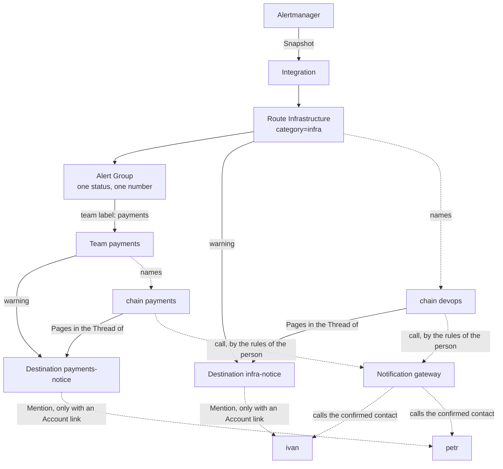
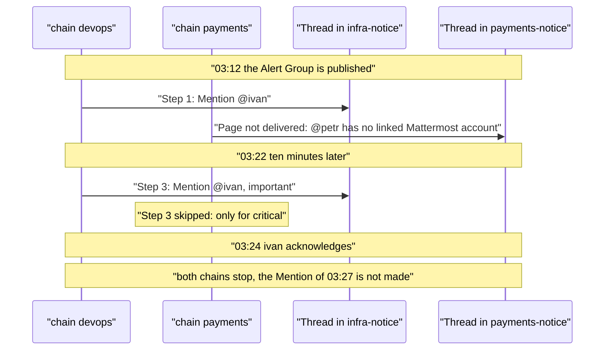
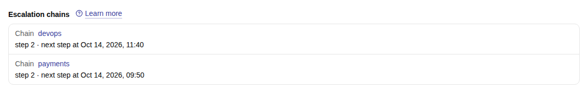

# How an alert reaches people

This page follows one Alert from the moment Alertmanager sends it to the moment a person acknowledges it. Along the way
it names every step that decides who is told, where and when: the [Route](routes-and-group-keys.md) and the Alert
Group, the [Teams](teams.md) of the Alert, the Destinations, the [Escalation chains](escalation-chains.md), and the
[Notification rules](notification-rules.md) of the people they Page. Each step has a page of its own; this one shows
how they fit together.

## The example

The installation has two Teams and two people:

- The Team `devops` has `ivan`, whose Schedule "Main" puts him On-call. He has linked his Mattermost account
  ([Account links](../messengers/account-links.md)).
- The Team `payments` has `petr`, who is On-call in its Schedule "Main". The Team also has a Schedule "Second line".
  Petr has not linked a Mattermost account yet.
- The Route "Infrastructure" takes the Alerts with `category="infra"`. It has two Destinations, `infra-critical` for
  critical Alert Groups and `infra-notice` for the rest, and names the Escalation chain `devops`. "Also to the Teams
  from the label" and "Run the Teams' Escalation chains" are on.
- The Team `payments` has two Destinations, `payments-critical` and `payments-notice`, by the same Severity conditions,
  and names the Escalation chain `payments`.

The chain `devops`, owned by the Team `devops`, has three steps: Page the On-call of "Main" normally, wait 10 minutes,
Page the On-call importantly. The chain `payments`, owned by the Team `payments`, has seven:

1. Page the On-call of "Main" normally.
2. Wait 10 minutes.
3. Only for critical: Page the On-call of "Main" importantly.
4. Wait 15 minutes.
5. Only for critical: Page the On-call of "Second line" importantly.
6. In the Working hours of `payments` only: Page the whole Team.
7. Repeat from step 3, up to 2 times.

Everyone has the default [Notification rules](notification-rules.md): a normal Page is a Mention, an important Page is a
Mention, a wait of 5 minutes and a second Mention.

At 03:12 a warning `KubernetesContainerOOMKilled` of `team="payments"` arrives.

## The path of the Alert

The diagram reads from the top. Solid arrows are what always happens for this Alert; dotted arrows are what happens
only where the configuration asks for it, such as a call through a Notification gateway.

1. **Integration.** Alertmanager sends its Snapshot to the Integration, which stores the Alerts
   ([Snapshot semantics](snapshot-semantics.md)).
2. **Route and Alert Group.** The first Route whose Matchers pick the Alert takes it, here "Infrastructure", and the
   Alert joins the Alert Group of its Group key, or starts one ([Routes and Group keys](routes-and-group-keys.md)). The
   Alert Group has one status, whatever number of Destinations show it.
3. **Teams.** The value of the Team label, `payments`, names the Team `payments`, so the Alert Group has that Team
   ([Teams](teams.md#which-alerts-belong-to-a-team)).
4. **Destinations.** The Route's own Destinations and, with "Also to the Teams from the label" on, those of each Team
   are reached when their Severity condition is met by the Alert Group's Severity level
   ([Routing to Teams](routing-to-teams.md)). The warning reaches `infra-notice` and `payments-notice`; a critical Alert
   Group reaches `infra-critical` and `payments-critical` instead. Muster publishes the Root message of the Alert Group
   in each, so each Destination has a Thread for it.
5. **Escalation chains.** The chains that run are those the Route names, `devops`, and those the Teams name, `payments`,
   because "Run the Teams' Escalation chains" is on. Both start when the Alert Group is first published
   ([When chains run](escalation-chains.md#when-chains-run)). The Team `devops` is not a Team of this Alert, but its
   chain runs all the same: the Route names it.
6. **Where each chain Pages.** A chain Pages only in the Threads of its own Destinations: `devops` in the Thread in
   `infra-notice`, `payments` in the Thread in `payments-notice`
   ([Where chains Page](escalation-chains.md#where-chains-page)). So a step that Pages everyone in a chat never rings
   another team's chat.
7. **Pages.** A step Pages a person by one of their two Notification rules: normal or important. A Mention of the rule
   is a reply in the Thread, and it rings the person only where they have an Account link in the Identity space of that
   Destination's Connection. A call of the rule goes through a Notification gateway to the person's confirmed contact,
   and needs no Root message and no messenger ([How a Page reaches a person](escalation-chains.md#how-a-page-reaches-a-person)).
8. **Assignees.** A person whom a Page reached becomes an Assignee, and the Root messages and the Alert Group page name
   the Assignees until somebody acknowledges.
9. **Acknowledge.** An acknowledgement from any Destination, from the web UI or from a call stops every chain and makes
   the person the Owner.

## The timeline of the chains

The diagram shows the first 12 minutes of the example, and it ends when Ivan acknowledges. In words, minute by minute:

03:12, the first Publication
:   Both chains start at their first step. The chain `devops` writes "Step 1: @ivan, you are needed" in the Thread in
    `infra-notice`. Ivan has a linked account there, so he becomes an Assignee with his Team, and the Root messages read
    "Assignees: @ivan (devops)". The chain `payments` Pages petr in the Thread in `payments-notice`, but Petr has no
    Account link, so the reply reads "Page not delivered: @petr has no linked Mattermost account" and mentions
    nobody. The Timeline records `page_not_delivered`, and Petr is not an Assignee. Both chains then wait 10 minutes.

03:22, step 3 of both chains
:   The chain `devops` Pages Ivan importantly: his important rule is a Mention now, a wait of 5 minutes and a second
    Mention. The chain `payments` skips its step 3, "only for critical", because this Alert Group is a warning, records
    `escalation_step_skipped` and goes on to its wait of 15 minutes.

03:24, Ivan acknowledges
:   Acknowledge from `infra-notice` acknowledges the Alert Group in `payments-notice` too. Both chains stop, the
    second Mention of Ivan's rule, due at 03:27, is not made, and the Assignees are cleared. The Root messages read
    "Acknowledged by @ivan · Escalation chains stopped": the Owner is named without a Team.

If nobody acknowledges, the chains go on. The chain `devops` has no step left after 03:22 and has run out. The chain
`payments` skips its steps 3 and 5 on every pass, "only for critical", and its step 6, first made at 03:37, falls
outside the Working hours of `payments` at night, so that is skipped too, with the reason `outside_working_hours`. Step
7 sends it back to step 3 twice, so steps 3 to 6 are made three times in all: step 3 at 03:22, 03:37 and 03:52, and
steps 5 and 6 at 03:37, 03:52 and 04:07. The chain runs out at 04:07, and the Alert Group is then Unclaimed: the Root
messages read "Nobody has taken this", and the chains Page nobody more until a point that starts them again, such as a
rise to critical or a Team that joins by a new Alert ([Unclaimed](escalation-chains.md#unclaimed)).

### The critical Alert

A critical `CheckoutQueueBacklog` of `payments`, with `category="infra"` like the first, goes to `infra-critical` and
`payments-critical`, and step 3 of `payments` is made, not skipped: it Pages the On-call of "Main" importantly. If
Petr's rules are in the state "Call" ([the switch](notification-rules.md#the-switch)), his important rule calls him
through the Notification gateway at the same moment as its first Mention, and Mentions him again 5 minutes later. The
call goes to his confirmed contact whatever his messenger does, and he can acknowledge in the call
([Acknowledging from a call](../messengers/notification-gateways.md#acknowledging-from-a-call)). The Mentions of his
rule are not delivered, since he has no Account link; the call needs none. Once the gateway accepts the call he becomes
an Assignee, as by a delivered Mention; a call the gateway refuses leaves the Assignees as they were. Calls to the same
person through the same gateway that come due close together go in one call
([Calls through a Notification gateway](escalation-chains.md#calls-through-a-notification-gateway)).

## What the people see

{ .screenshot }

The Alert Group page lists the chains that run with their current step and the time of their next step, and names the
Assignees with their Teams. The Alert Group list has a column and a filter for Assignees, and the Home page lists,
under "I am an Assignee", the open Alert Groups that an Escalation chain Paged the signed-in person about. The Timeline
records each Page, each skipped step and each Page that was not delivered.

## Where to go next

- [Teams](teams.md) and [Schedules](schedules.md) say who is On-call and in which Team.
- [Routing to Teams](routing-to-teams.md) says which Destinations an Alert Group reaches.
- [Escalation chains](escalation-chains.md) say what each step does and when chains start, start over and stop.
- [Notification rules](notification-rules.md) say how a Page reaches one person.
- [Notification gateways](../messengers/notification-gateways.md) say how a call reaches a person at night.
