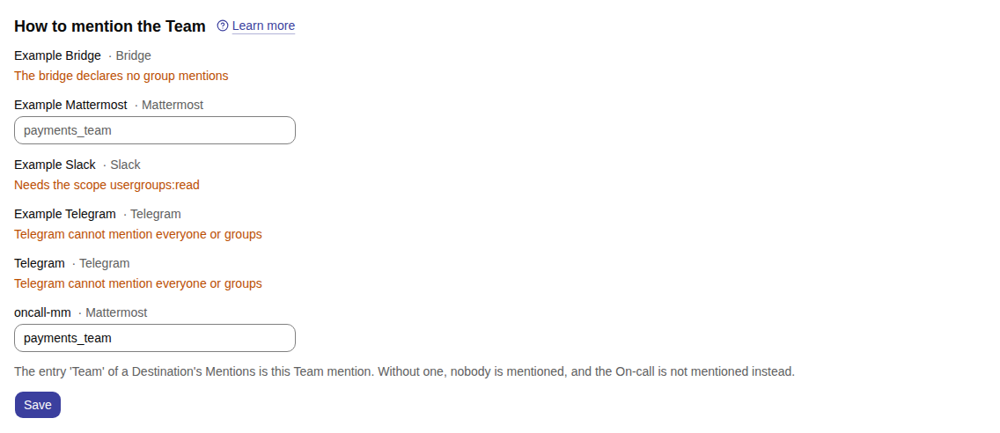
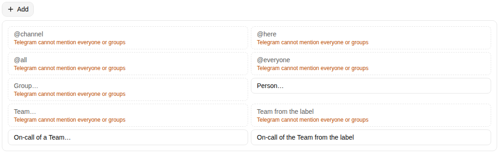

# Whom a message mentions

Mention entries say who is mentioned. Each Destination has one list of them, each entry one target and the Loud events
it applies to, so that one Destination can mention `@here` for a new Alert Group and the On-call of the Alert Group's
Team on every Loud event. A Quiet message mentions nobody, and an edit never adds a Mention.

## Mention entries

The targets of an entry (`mention_entries[].target.kind`):

`everyone`
:   Everyone in the chat, with the word of the messenger: `channel`, `here`, `all` or `everyone`.

`user`
:   A person, by User. The message mentions them through their linked account in the Destination's messenger; a
    person without a linked account there is not mentioned.

`group`
:   A messenger group by its name, such as a Mattermost group; in Slack a user group with its id (`group_id`).

`team`
:   A [Team](teams.md), by its [Team mention](teams.md#team-mentions) for the Destination's Connection.

`teams_from_label`
:   Each Team of the Alert Group, by its Team mention.

`on_call_of_team`
:   The On-call of a Team: the person whom the Team's main [Schedule](schedules.md) has on Shift at the moment of the
    event.

`on_call_of_teams_from_label`
:   The On-call of each Team of the Alert Group.

The Loud events an entry applies to (`events`), all of them for a new entry:

`new_alert_group`
:   A new Alert Group; it also applies when an Alert Group joins the Destination Loudly (`destination_joined`).

`new_alerts`, `reopen`, `snooze_ended`, `rise_to_urgent`
:   New Alerts, a Reopen, the end of a Snooze and a rise to critical.

`ack_timeout`
:   The ack timeout notice.

`storm_started`
:   The first publication of a [Storm](#start-of-a-storm) summary.

A Destination without entries mentions nobody. Each person and group is mentioned once in a message, however many
entries name them. The rules for the Owner stay as they were: Reminders and auto-unacknowledge always mention the
Owner, a Takeover the previous Owner, and a Reopen into acknowledged only the Owner.

The API saves the entries in order with `If-Match`, and the Audit log shows the change in the diff of
`destination.updated`. A read gives each entry with `available`, whether the Connection can mention it now, and
`resolves_to`, what it mentions now: for the targets from the label, one item per Team.

```json
"mention_entries": [
  {"target": {"kind": "on_call_of_teams_from_label"}},
  {"target": {"kind": "everyone", "everyone": "here"}, "events": ["new_alert_group", "storm_started"]}
]
```

## An example: infra-critical

The operations Destination `infra-critical` should reach the On-call of the Team that owns the Alert Group on every
Loud event, and everyone on duty in the channel only when it matters. Two entries do that:

| Entry | Loud events |
|---|---|
| On-call of the Team from the label | all seven |
| `@here` | New Alert Group, Rise to critical, Start of a Storm |

So a new Alert Group of the Team payments mentions its On-call and `@here`; New Alerts, a Reopen, the end of a Snooze
and the ack timeout mention only the On-call; a rise to critical and the start of a Storm mention both again. A Quiet
message mentions nobody. A new entry is ticked for every Loud event, so untick the events `@here` does not take.

Open **Destinations**, select the Destination and find the section **Mentions**. Each row of the grid is one entry,
with its Loud events beside it as seven boxes, in this order: New Alert Group, New Alerts, Reopen, Ack timeout, End of
Snooze, Rise to critical and Start of a Storm. **Add** puts a new entry at the end. Under each target the row reads what it mentions now. In the picture, `@here` is ticked for a new
Alert Group, a rise to critical and the start of a Storm only.

{ .screenshot }

An entry that names a person without a linked account in the Destination's messenger is warned about above the grid
([Undelivered Mentions](#undelivered-mentions)).

## What each messenger supports

A Destination takes only the targets its Connection can mention. Any other target is refused with `422` and the code
`mention_unsupported` at `/mention_entries/{i}/target`:

| Destination type | Everyone in the chat | Groups and Teams | People and the On-call |
|---|---|---|---|
| Mattermost | `channel`, `here`, `all` | Mattermost groups | linked people |
| Slack | `channel`, `here` | user groups, with the scope `usergroups:read` | linked people |
| Telegram | none | none | linked people |
| Bridge | the words the bridge declares | when the bridge declares group mentions | linked people, by the plain name without `native_mentions` |
| Outgoing webhook | every target, as data | every target, as data | every target, as data |

Mattermost
:   `@channel`, `@here` and `@all` mention in a Root message's attachment as in a post, and `@payments_team` mentions
    the members of a custom group in a Root message and in a Thread reply; a custom group can always be mentioned,
    since its setting to allow references cannot be turned off. The bot reads the groups with the role Member and no
    added permission. Checked on Mattermost 11.2.2 with the Entry licence (F-122, F-123, F-124); groups synced from
    LDAP were not checked (F-121). See [Connect Mattermost](../messengers/mattermost.md#who-gets-notified).

Slack
:   Slack offers only `<!channel>` and `<!here>`, and no `everyone`: a bot's `<!everyone>` mentions only in the
    workspace's general channel, where `<!channel>` reaches the same people, and nothing tells the two cases apart
    (F-127). A user group or a Team mention, `<!subteam^…>`, mentions the group's members in a Root message and in a
    Thread reply (F-126). A Slack Connection takes user groups and Teams once its check found the optional scope
    `usergroups:read`, which reaches the bot only after the app is reinstalled; the reinstall keeps the bot token, so
    check the Connection again, do not edit it (F-125). A workspace may let only its Admins and Owners create user
    groups. See [Connect Slack](../messengers/slack.md#add-usergroupsread-to-an-installed-app).

Telegram
:   Telegram mentions only people, by a link to their account, and only in the discussion group. See
    [Telegram](#telegram).

Bridge
:   A bridge declares in its `info` the mentions of everyone it has (`everyone_mentions`) and whether it has group
    mentions (`group_mentions`); a bridge that has native mentions renders the markers of people as the messenger's
    mentions ([Write a bridge](../messengers/write-a-bridge.md)).

Saving an entry whose kind the bridge does not declare is refused. At delivery Muster sends a bridge only the groups and
mentions of everyone that its copy of `info` declares, and leaves out the others. A bridge never refuses a message for
the kind of an entry: one that receives a `group` or an `everyone` entry it no longer declares shows the marker's link
text, which notifies nobody. A person is named by their plain name when the bridge has no native mentions
([Undelivered Mentions](#undelivered-mentions)). Muster reads `info` again when its copy is older than
`bridge.info_max_age`.

An entry stays when its Connection later loses an ability, such as a Slack app reinstalled without the scope: it reads
`available: false` with the reason in `unavailable_reason`, and mentions nobody. An entry whose User or Team was deleted
stays too, shows them as deleted and mentions nobody.

A bridge receives a group and a mention of everyone as entries of `mentions` of their own kind
([What Muster posts](../messengers/bridge.md#what-muster-posts)).

An outgoing webhook receives the targets as data in `mentions` and `.Mentions`: a Team as `{"type": "team", "slug":
…, "name": …}`, one per Team of the Alert Group for "Team from the label", and the On-call as a `user`.

## Teams and the On-call

"Team payments" mentions the Team mention of payments for the Destination's Connection, such as `@payments_team` in
Mattermost. When the Team has no Team mention for that Connection, the entry mentions nobody: Muster never mentions the
On-call instead. To reach the On-call, add "On-call of a Team" or "On-call of the Team from the label".

The On-call is taken from the Team's main Schedule at the moment of the event, also when the message is sent later.
A Team without a main Schedule, or one with a gap at that moment, gives nobody. A Team mention that is set later, or an
On-call who links an account later, is mentioned from the next Loud event on.

The Team mention is set on the Team page, in the section **How to mention the Team**, one field for each Connection
that may have a Destination. A Connection that cannot mention a group says why beside its field. See
[Team mentions](teams.md#team-mentions).

{ .screenshot }

When a Destination becomes a Destination of a Team, Muster adds the entry "Team {Team}" for every Loud event, unless
the Destination already has an entry naming that Team or has 100 entries, the most a Destination has. A Telegram
Destination gets none, since Telegram cannot mention Teams. An Admin may remove the entry; naming the Destination
again later adds it again only when it has none.

## Telegram

A Telegram Destination mentions people only, each by a link to their Telegram account. When you select **Add** in its
**Mentions** section, everyone in the chat, groups and Teams are greyed with the reason "Telegram cannot mention
everyone or groups", and it offers a person and the two On-call entries.

{ .screenshot }

A Mention in a Thread reaches only the members of the channel's discussion group:

- A subscriber of the channel who is not in the discussion group is not mentioned (F-014). The Destination check names
  the people of its Teams who are outside the group, in its item **Members of the discussion group**. A person who left
  the group shows as outside only some time later, about a minute (F-128).
- Muting the discussion group does not hide a Mention from an ordinary member: a Mention in a comment rang a member who
  had muted the group, on the desktop and on the phone (F-129).
- The creator of the discussion group, who is anonymous in it, was not rung by a Mention in a group they had muted
  (F-129). So a person who created the discussion group, or is anonymous in it, should not mute it. The Destination
  check sees the creator as a member, so it gives no warning for this.

[Connect Telegram](../messengers/telegram.md#join-the-discussion-group-and-mute-the-channel) tells the people on call to
join the group.

## Undelivered Mentions

A person whom an entry names is sometimes not mentioned as their messenger mentions people:

- They have no linked account in the Destination's messenger. The message leaves them out. Only the Owner of a Reminder,
  an auto-unacknowledge or a Takeover, the footer and the Assignees name a person without a link, by their name as
  text.
- The Destination is a bridge whose `info` does not declare `native_mentions`, or Muster has not read its `info` yet.
  The message names them by their plain name, which notifies nobody.
- The Destination is a bridge, and the message's line of Mentions has no room for theirs. The line keeps, in their
  order, the whole Mentions that fit half of the bridge's body limit, and leaves out the rest.

Nothing is written in the Thread for them: Muster never posts a message about a Mention. Instead, once the Loud
message is delivered, the Alert Group's Timeline records the delivery event "Mention not delivered in
{Destination}" (`mention_not_delivered`). Each person, entry and message gets one, with the entry, the Loud event and
the reason: `no_account_link`, `bridge_cannot_mention_people` or `message_too_long`, one for each case above. A message
that ends Not delivered records none, nor does a Quiet message or an edit, since neither mentions anyone. The first
publication of a Storm summary belongs to no Alert Group, so its undelivered Mentions appear in no Timeline. They still
warn on the Destination.

The Destination page warns about each person and entry whose latest "Mention not delivered" is not followed by a
delivered Mention of that person through that entry. The API reads the warnings in `mention_warnings` of every
Destination, each with the person, the entry, the messenger, the reason and since when. For example: "Mention not
delivered: @petr, On-call of payments, has no linked Mattermost account."

The warning clears by itself, because Muster computes it from the delivery events and never stores it:

- When the person links an account (or the bridge declares `native_mentions`), the next Loud message that mentions
  them through that entry clears it.
- When the message's line of Mentions had no room for them, a later Loud message whose line has room for them clears
  it.
- When the events behind it are older than `retention.alert_details`, which removes them, the warning goes too.

A warning whose entry was removed from the Destination since goes at once. So does the warning of a deleted User.

## Start of a Storm

The first publication of a Storm summary mentions the Destination's entries for `storm_started`. "Team from the label"
and "On-call of the Team from the label" take the Teams of the Alert Groups the Storm counts. The summary's later edits
mention nobody, and the summary starts no Escalation chain.

## Upgrading from 0.1

Version 0.1 kept one Mention setting per kind of Loud event: nobody, everyone in the chat, chosen Users or messenger
groups. The 0.2.0 migration turns them into entries with the same effect: each target chosen for a kind becomes one
entry for the kinds it was chosen for. An entry for `new_alert_group` also applies to `storm_started`, since a 0.1
Storm summary mentioned the targets of a new Alert Group. A Destination that mentioned nobody has no entries.

For example, "`@channel` for new Alert Groups, Alice for the ack timeout" becomes two entries: `channel` for
`new_alert_group` and `storm_started`, and Alice for `ack_timeout`.

Until 0.3.0 the API still returns `mentions`, the 0.1 form, computed from the entries that 0.1 could express on the
Destination's type, and still takes it in a request without `mention_entries`. Such a request replaces only those
entries and keeps the others, and a request that sends back the `mentions` it read changes nothing, so that 0.1 clients
keep working. The 0.1 form read back has the same Users and groups for each kind, but lists them in the order of the
first kind that lists each, since the entries are one list. 0.3.0 removes the field. The
[upgrade notes](../install/versions.md#upgrade-notes) describe the migration.
