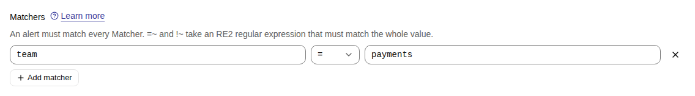
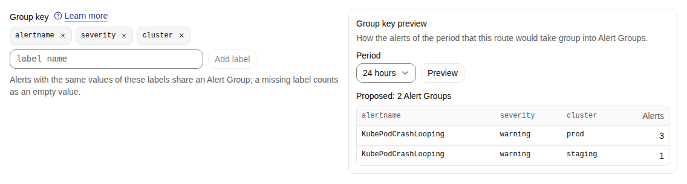
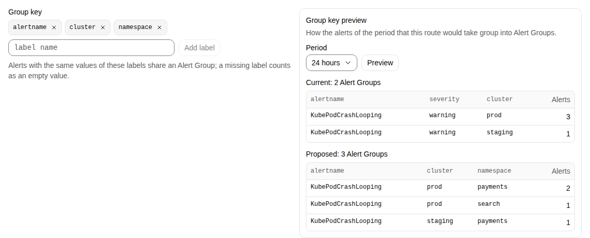
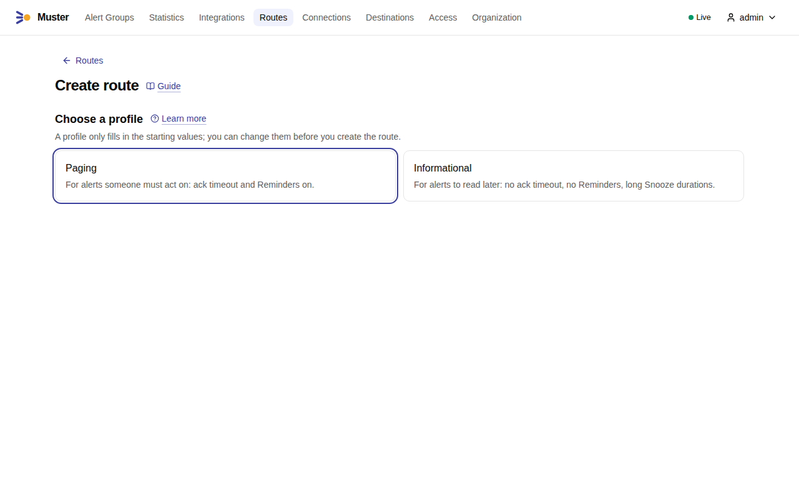
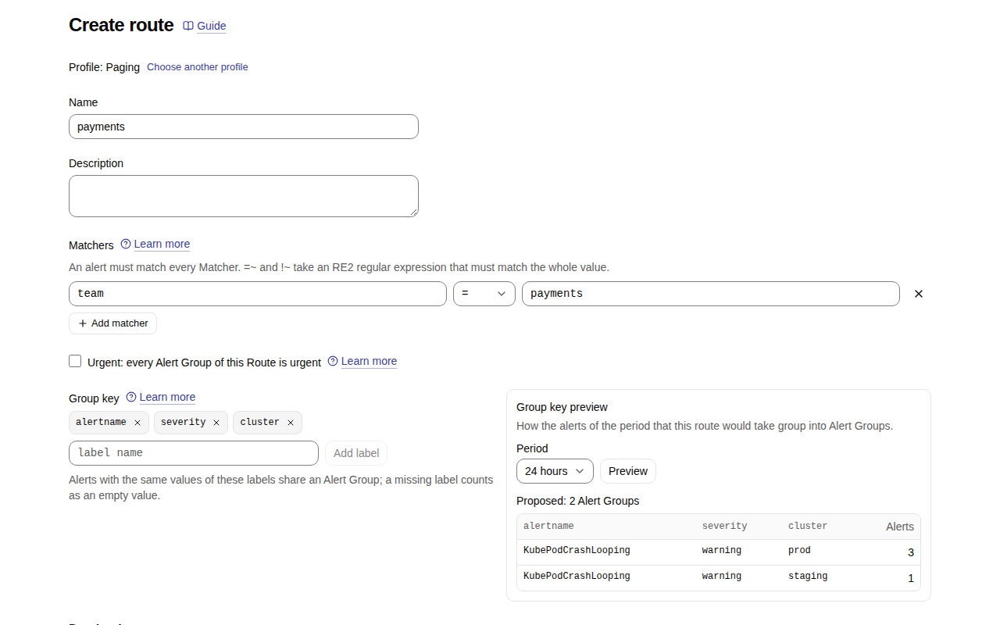
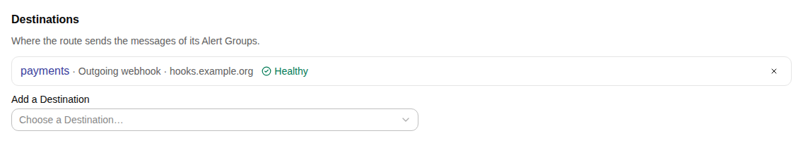
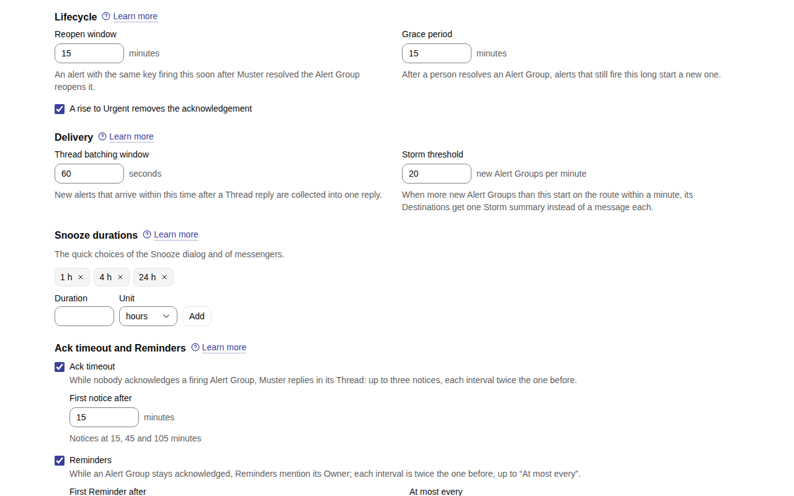
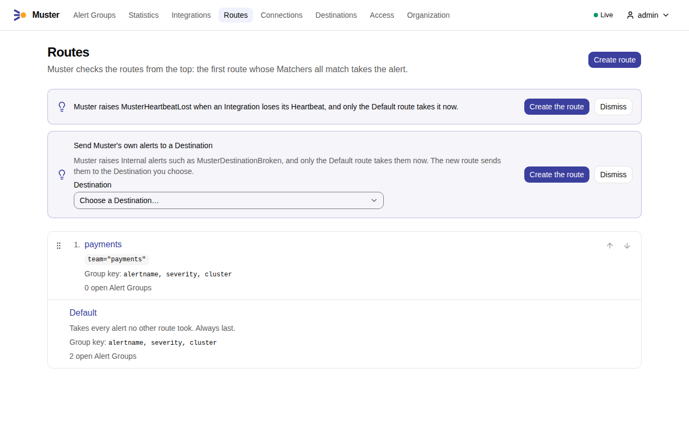

# Routes and Group keys

A **Route** decides what happens to an Alert after Muster has read it: which Alert Group it joins, who is told, and how
the Alert Group is handled afterwards. A **Group key** decides which Alerts share an Alert Group. Together they are the
two settings that shape what your team sees.

Do not confuse a Route with an **Alertmanager route**. An Alertmanager route is a rule inside Alertmanager that picks a
receiver and a repeat interval. A Route of Muster is evaluated after the Alert has arrived, on the labels of the Alert.

## How an Alert is routed

1. The Alert arrives in a [Snapshot](snapshot-semantics.md) of an Integration.
2. The Integration's **Static labels** are added to it. If the Alert already has a label of that name, its own value
   wins, and Muster warns about the label.
3. Muster walks the Routes in list order. The first Route whose Matchers all match takes the Alert.
4. The Route's Group key says which Alert Group the Alert goes to. See [Alert Groups](alert-groups.md#how-alerts-join-an-alert-group).

Only an Alert that starts firing is routed. An Alert that already lives in an open Alert Group stays in it.

## Routes

A Route has:

- a **name**, unique in the Organization, and a description;
- **Matchers**, which pick the Alerts;
- a **position** in the list;
- a [**Minimum severity**](#minimum-severity);
- a **Group key**;
- the **Destinations** that receive its Alert Groups;
- policy fields for how its Alert Groups are handled: the Reopen window and the Grace period, whether a rise to Urgent
  removes an acknowledgement, the Snooze durations, the Thread batching window and the Storm threshold, the templates
  and the language, and the ack timeout, the Reminders and auto-unacknowledge.

### Matchers

A Matcher is a condition on one label, written as in Alertmanager: `=`, `!=`, `=~` and `!~`, where the last two take an
RE2 regular expression. The Matchers of a Route are all required: they combine with AND. The Route editor builds them
from fields; the API takes the same structure; an invalid expression is refused with a pointer to the field.

`team="payments"` and `severity="critical"`
:   Takes Alerts of the payments team that are critical.

`namespace=~"prod-.*"`
:   Takes Alerts in any namespace that starts with `prod-`.

`alertname!="Watchdog"`
:   Takes everything except the Watchdog.

A missing label counts as an empty value. So `team!="payments"` also matches an Alert that has no `team` label.

In the Route editor, under **Matchers**:

1. Select **Add matcher**. A row appears with the label, the operator and the value.
2. Enter the label, such as `team`, choose the operator, `=` by default, and enter the value, such as `payments`. The ×
   at the end of a row removes it.

{ .screenshot }

### Order, and the Default route

Routes are evaluated in list order, and the first Route that matches takes the Alert. Put the narrow Routes first and
the broad ones after them. Drag the Routes on the Routes page to reorder them.

The **Default route** is always last. It has no Matchers, cannot be deleted or moved, and takes every Alert that no other
Route took. A small installation may keep only the Default route. A Route with no Destinations is fine too: its Alert
Groups exist in Muster and in no messenger.

Edits to Routes use optimistic locking: if somebody changed the Routes while you were editing, your save is refused and
you reload.

### Route profiles

When you create a Route, you choose a **Route profile**. A profile only fills in the settings; it is not stored, and you
can change every field afterwards. There are two:

Ack timeout (`route.ack_timeout`)
:   Paging: on; first notice after 15 minutes · Informational: off

Reminders (`route.reminders`)
:   Paging: on; first after 4 hours · Informational: off

Snooze durations (`route.snooze_durations`)
:   Paging: 1 h, 4 h, 24 h · Informational: 1 d, 3 d, 7 d

Group key (`route.group_key`)
:   Paging: `alertname`, `severity`, `cluster` · Informational: the same

Reopen window and Grace period
:   Paging: 15 minutes each · Informational: the same

Choose **Informational** for alerts nobody needs to act on at once, such as a certificate that expires in a month: no
notices, no Reminders, and long Snooze durations. Choose **Paging** for the rest. See [Statuses and
commands](statuses-and-commands.md#ack-timeouts-reminders-and-auto-unacknowledge) for what the timers do.

### Minimum severity

The **Minimum severity** of a Route (`route.minimum_severity`: none, `warning` or `critical`; none by default) is the
lowest Severity level of its Alert Groups. An Alert Group's Severity level is the highest Severity level of its firing
Alerts, raised to the Minimum severity of its Route. The Minimum severity only raises: it never lowers an Alert Group,
and it never changes the level of an Alert, which the Alerts of the Alert Group page, the Alerts view and the `alerts[]`
of outgoing webhook events still show as received.

Use it for a Route whose Alerts all matter as much as a critical one, whatever their `severity` label says: with the
Minimum severity critical, a warning Alert of the Route starts a critical, and so [Urgent](#urgent), Alert Group. The
Route that Muster suggests for `MusterHeartbeatLost` has the Minimum severity critical.

A changed Minimum severity applies at once to the open Alert Groups of the Route, Quietly. A raised one records a Quiet
`severity_raised`, or the Quiet `urgency_raised` of an Alert Group it makes critical, with the reason "Minimum severity
of the Route"; it never removes an acknowledgement or a Snooze. A lowered one records nothing and lowers their level,
as a falling Severity level does. The Root messages show the new level.

By default the `severity` label maps to a Severity level: `critical` is critical, `warning` is warning, `info` and
`none` are info, any other value counts as warning and is shown as received, and an Alert without the label counts as
info. The Organization can change the label and the mapping.

### Urgent

An Alert Group is **Urgent** when its Severity level is critical — from its Alerts, or from the
[Minimum severity](#minimum-severity) of its Route. An Urgent Alert Group is posted first when many arrive at once, is
published on its own during a Storm, and a rise to Urgent can end a Snooze or remove an acknowledgement, where the
Route's "rise to Urgent removes the acknowledgement" is on.

From 0.2.0 the urgent mark of a Route and the Organization's "critical is Urgent" no longer act: a Route marked urgent
got the Minimum severity critical, and a critical Alert Group is always Urgent. The API keeps `urgent` on Routes and
`critical_is_urgent` on the Organization until 0.3.0. A Route request with `urgent: true` and no `minimum_severity`, as
a 0.1 client sends it, sets the Minimum severity critical; `urgent: false`, `urgent` beside `minimum_severity`, and
`critical_is_urgent` change nothing. See the
[upgrade notes of 0.2.0](../install/versions.md#upgrade-notes).

## Group keys

The **Group key** of a Route is a list of label names. Alerts of the Route that have the same values for all of those
labels go to the same Alert Group. A label that an Alert lacks counts as an empty value, so Alerts that all lack
`cluster` group together.

The default Group key is `alertname`, `severity` and `cluster`. Take these four Alerts, all taken by one Route:

| Alert | `alertname` | `severity` | `cluster` | `namespace` | `pod` |
|---|---|---|---|---|---|
| 1 | `KubePodCrashLooping` | `warning` | `prod` | `payments` | `api-1` |
| 2 | `KubePodCrashLooping` | `warning` | `prod` | `payments` | `api-2` |
| 3 | `KubePodCrashLooping` | `warning` | `prod` | `search` | `web-1` |
| 4 | `KubePodCrashLooping` | `warning` | `staging` | `payments` | `api-1` |

| Group key | Alert Groups | Which Alerts |
|---|---|---|
| `alertname`, `severity`, `cluster` (default) | 2 | 1, 2 and 3 in one; 4 in another |
| `alertname`, `cluster`, `namespace` | 3 | 1 and 2; 3; 4 |
| `alertname`, `cluster`, `namespace`, `pod` | 4 | one Alert Group per pod |
| `alertname` | 1 | all four |

There is no best key. A coarse key gives few Alert Groups that stay open longer, and a person takes the whole problem
with one Acknowledge. A fine key gives more Alert Groups and a clearer ownership of each. Pick the labels that tell
"who should look at this" apart. A good start is the labels your teams split on: the alert name, the cluster and the
namespace or the service.

In the Route editor, the **Group key** shows its labels in order:

1. To take a label out, select the × next to it.
2. To add one, type its name in the field under the labels and select **Add label**.

{ .screenshot }

### Preview before you save

The Group key editor previews what a key would do. It reads the Stored Snapshots of the chosen period (24 hours by
default, at most the retention of Stored Snapshots; `routing.group_key_preview_period`) and shows how many Alert Groups
the current and the proposed key would produce, with the 5 largest as examples (`routing.group_key_preview_examples`).
It covers the Alerts that the Route would take
at its place in the current order, each Alert once, and it works for a Route you are still creating. Use it before every
change of a key.

1. Change the Matchers or the Group key in the Route editor.
2. Under **Group key preview**, choose the **Period**, 24 hours by default, and select **Preview**.
3. Compare **Current**, the saved key, with **Proposed**, the key in the editor: each table lists the largest Alert
   Groups with the values of the key's labels and the number of Alerts. A new Route has only the proposed side. When
   you change the Matchers, the key or the period after a preview, the preview says so; select **Preview** again.

{ .screenshot }

The screenshot shows the four Alerts of the table above: with `namespace` in place of `severity`, the Alerts of `prod`
split by namespace.

### Do not put Instance labels in the key

**Instance labels** change when the process that reports an Alert restarts, such as `pod` and `instance`. If one is in the
Group key, every restart of a pod starts an Alert Group of its own and the old one stays open. Keep `pod` and `instance`
out of the key unless one Alert Group per pod is what you want. When it is, restarts cause no trouble, since the Alert Group
for a pod fires and resolves with that pod. Otherwise leave the labels out of the key, so that the restarted pod's
Alert is recognised as a **Replacement** inside the same Alert Group. See [Alert Groups](alert-groups.md#replacements)
and [Instance labels in informational alerts](../integrations/alertmanager.md#instance-labels-in-informational-alerts).

### Static labels

**Static labels** belong to an Integration, not to the Route. Muster adds them to every Alert of the Integration before it
routes it, so the Matchers and the Group key can use them like labels the rules set. Their usual job is to name what
the Alertmanager cluster knows and the rules do not, such as `cluster=prod-eu`. That is why the default Group key can
include `cluster`: set it as a Static label on each Integration, and Alert Groups of different clusters stay apart even
when the alerting rules never mention the cluster. See [Static
labels](../integrations/alertmanager.md#static-labels).

## Create a Route

1. Open **Routes** and select **Create route**. Choose a [Route profile](#route-profiles), **Paging** or
   **Informational**; **Choose another profile** takes you back.

    { .screenshot }

2. Enter a **Name** and, if you like, a **Description**. Add the [Matchers](#matchers) and check the
   [Group key](#group-keys) with its [preview](#preview-before-you-save).

    { .screenshot }

3. Under **Destinations**, choose each Destination in **Add a Destination**. The list shows each one with its type and
   health; a Route without Destinations sends no messages.

    { .screenshot }

4. Check the policy below, filled in by the profile: **Lifecycle** (the Reopen window and the Grace period),
   **Delivery** (the Thread batching window and the Storm threshold), **Snooze durations**, **Ack timeout and
   Reminders** — see [Statuses and commands](statuses-and-commands.md#ack-timeouts-reminders-and-auto-unacknowledge) —
   and **Message**, which [Messages and templates](../configure/messages-and-templates.md#edit-a-routes-message)
   explains.

    { .screenshot }

5. Select **Create**. The Routes list opens with the new Route just above the Default route, with its Matchers, its
   Group key and its open Alert Groups; drag it, or use its arrows, to [change the order](#order-and-the-default-route).
   Above the list, Muster may suggest Routes for its own alerts.

    { .screenshot }

## Examples

**Only the Default route.** Every Alert goes to one Route, grouped by `alertname`, `severity` and `cluster`. Add one
Destination to the Default route and everything reaches one place. This is the setup of the [Quick start](../quick-start.md)
plus a messenger.

**Pages for payments.** Create the Route `payments-critical` with the Matchers `team="payments"` and
`severity="critical"`, the Paging profile and a Destination that is the payments team's channel. Put it above the
Default route. Critical alerts of the payments team reach their channel and are Urgent. Their other alerts fall through
to the Default route.

**Certificates.** Create the Route `certificates` with the Matcher `alertname=~"Cert.*"`, the Informational profile and a
Destination for the platform channel. These Alert Groups send no ack timeout notices and no Reminders, and they offer
Snooze for a day, three days or a week.

**Muster's own alerts.** The Internal alerts, such as `MusterDestinationBroken`, are Alerts of the built-in "Muster"
Integration and are routed by Routes like any other. Route them to a Destination of another kind than the one that
failed. The Routes page offers a Route for `alertname=~"Muster.*"` once you have a Destination, and a Route for
`MusterHeartbeatLost` when an Integration has a [Heartbeat](../integrations/heartbeat.md). See the [Internal
alerts](../reference/internal-alerts.md).

## What changes when you edit a Route

- Settings, such as the timers, the templates and the Snooze durations, apply at once, also to open Alert Groups, whose
  messages are brought up to date.
- A new Group key or new Matchers apply to Alerts that start firing afterwards. A fingerprint already in an open Alert
  Group stays there until that Alert Group is resolved.
- A changed [Minimum severity](#minimum-severity) raises or lowers the Severity level of the open Alert Groups, Quietly.
- No edit changes the status of any Alert Group.
- Adding a Destination to a Route gives it the Route's open Alert Groups, Quietly. Removing one gives each open Root
  message one last edit that says it is no longer updated and links to Muster.
- Deleting a Route that has open Alert Groups is refused. You can move them to the Default route first.
