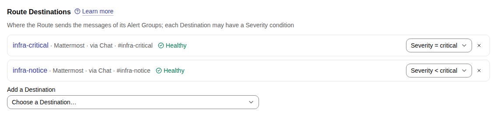
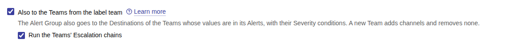
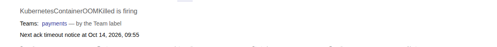
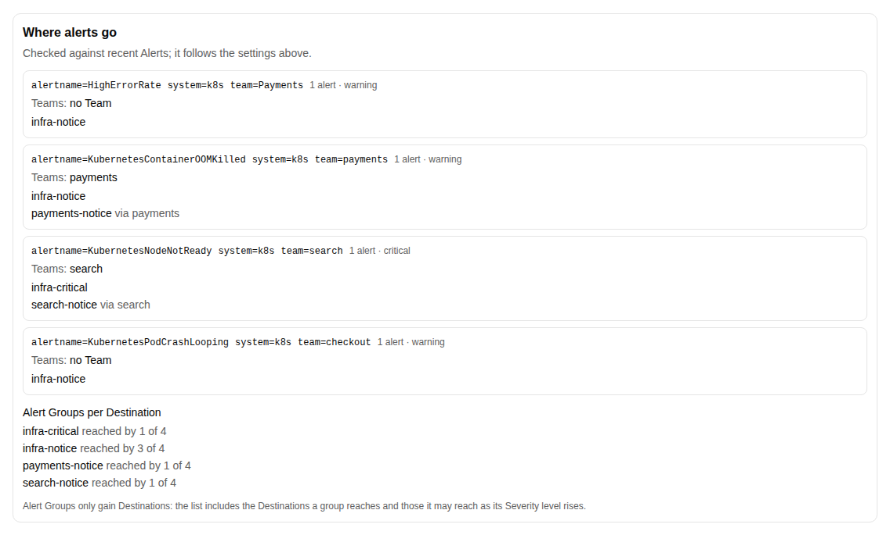

# Routing to Teams

One Route can serve many teams. Each Destination of a Route, and each Destination of a Team, may be limited by
Severity level, and a Route may also deliver its Alert Groups to the Destinations of the Teams of their Alerts. Every
Destination then shows the same Alert Group with one status. The settings are on the Route form, and each links here:
[the Severity condition of a Destination](#severity-conditions), ["Also to the Teams from the
label"](#also-to-the-teams-from-the-label) with ["Run the Teams' Escalation chains"](#also-to-the-teams-from-the-label),
the Group key's [Team label](#teams-that-want-their-own-alert-groups), the
[preview](#preview-where-alerts-go), the [Owning Team](teams.md#what-a-team-is) and the
[Minimum severity](what-critical-changes.md).

The feature is optional. Many installations need only two operations channels — one for critical Alert Groups and one
for the rest — and a Route that names both with a Severity condition each. Teams and their Destinations come in when
teams want their own channels.

## Severity conditions

A Route names its Destinations in `destination_entries`, each with a `severity_condition`, and a Team names the
Destinations of the Team the same way:

`any`
:   Every Severity level, the default.

`critical`
:   Only an Alert Group whose Severity level is critical.

`below_critical`
:   Every level but critical.

The condition is checked against the Alert Group's Severity level: the highest level of its firing Alerts, raised to
the Route's Minimum severity. A Destination may be named by several Routes and Teams, each with its own condition, and
is reached when the condition of any of its entries is met.

{ .screenshot }

Until 0.3.0 Routes still read and take `destination_ids`, derived from `destination_entries`: a request that sends only
`destination_ids` keeps the condition of each Destination it keeps and gives a new one `any`.

## Also to the Teams from the label

With "Also to the Teams from the label" (`deliver_to_teams`) on, an Alert Group of the Route also goes to the
Destinations of each of its Teams — the Teams its Alerts belong to by the Team label or by Team matchers
([Teams](teams.md#which-alerts-belong-to-a-team)) — whose condition its Severity level meets. With it off, the Alert
Group goes only to the Route's own Destinations. The owning Team of a Route adds nothing: it only organizes and
filters.

{ .screenshot }

"Run the Teams' Escalation chains" (`run_team_chains`) is stored with the option; it acts once Escalation chains run.

### Operations and team channels by Severity

Operations has `infra-critical` and `infra-notice`, and the Team `payments` has `payments-critical` and
`payments-notice`. The Route "Infrastructure" takes `category="infra"`, names `infra-critical` for `critical` and
`infra-notice` for `below_critical`, and has "Also to the Teams from the label" on. The Team `payments` names
`payments-critical` for `critical` and `payments-notice` for `below_critical`.

A warning Alert of `team="payments"` makes one Alert Group with one Root message in `infra-notice` and one in
`payments-notice`, and none in the critical channels. If a critical Alert joins it, the Alert Group is also published
in `infra-critical` and `payments-critical`; its messages in the notice channels stay and keep being updated, also
after the critical Alert resolves. The Destinations of an Alert Group only grow, and only when a Team joins it —
which adds that Team's Destinations — or its Severity level rises: a level that falls again, or a new Alert that
brings neither, adds no Destination below critical where the Alert Group was not published before.

## One Alert Group, one status

An Alert Group has one status and one list of Alerts in every channel it is in. Acknowledge it from `payments-notice`
and its message in `infra-notice` shows the same Owner; resolve it anywhere and every message shows it resolved. The
Alert Group page names its Teams, and the deliveries of the Alert Group show where it went.

{ .screenshot } The
delivery state of the Alert Group (`listAlertGroupDeliveries`) names, for each Destination, the entries that reached
it — the Route, or a Team — with their conditions.

When an Alert Group reaches a Destination after its first Publication elsewhere — a new Alert raised its Severity level
into the Destination's condition, or brought a Team — the lifecycle event `destination_joined` publishes it there:
Loudly, with the Mentions of a new Alert Group, while it is firing; Quietly while it is acknowledged or snoozed. The
other Destinations see only an update of their Root message. During a Storm of the Route the Destination counts it in
its Storm summary instead, unless it is Urgent.

A change of configuration publishes Quietly and never with `destination_joined`: a raised Minimum severity, or a new
Team whose Alerts are already in an open Alert Group, adds that Alert Group to the Destinations it now reaches without
a Mention.

### Teams that want their own Alert Groups

In a Route whose Group key lacks the Team label, Alerts of different Teams with the same key share one Alert Group,
shown in the channels of all of them: an Alert of "search" that joins a firing Alert Group of "payments" is published
in `search-notice` with `destination_joined`. Teams that want their own Alert Groups add the Team label, `team` by
default, to the Group key of the Route: with `alertname`, `system` and `team` as the Group key, the "search" Alert gets
an Alert Group of its own, with its own status, and the Route form offers **Add team to the key** when the preview
sees Alerts of different Teams share one.

## Preview where alerts go

Before saving a Route, ask where its Alerts would go. The preview (`previewGroupKey`, `routes:write`) takes the Alerts
reported firing in the last day that the Route would take, as the Group key preview does, and the settings of the form
as they are, saved or not: the Minimum severity, the Destinations with their conditions, "Also to the Teams from the
label" and the proposed Group key. A setting left out is the saved Route's; a Route that is not saved starts from none. The answer has a `delivery` part when the request names a saved Route
(`route_id`), gives `destination_entries` or gives `deliver_to_teams`; a Minimum severity alone does not add it.

The answer lists the largest Alert Groups the Alerts would form under the key, five by default, each with its Group
key values, its number of Alerts, its Severity level raised to the Minimum severity, its Teams and the Destinations it
would reach, with the entries that reach each: the Route's, or a Team's. The Destinations of an Alert Group only grow, so the
preview follows each Alert Group as its Alerts arrived, by their `startsAt`: it reaches the Destinations of every
Severity level the group rose through, and of each Team from the Alert that brought it. A Group key without the
severity can thus list Destinations for `warning` and for `critical`, as the group reached them in turn; the Severity
level shown is the highest. Alerts that started at the same time count together. When an Alert has no `startsAt`
there is no order, and the preview lists the Destinations the group may reach: those of each Alert's own level. For every Destination that any of the Alert
Groups reaches it counts how many of all of them reach it, those listed or not, so that a Destination reached by
hundreds of Alert Groups is seen before the Route is saved.

Teams are read as they are saved: the Team label and the Team matchers of the Teams now, not any change you have not
saved on the Teams page. When the Route delivers to the Teams and the Group key lacks the Team label, the answer says
so (`shared_key_warning`), and the form offers to add the Team label to the key.

The preview only reads: it saves nothing, writes no Audit log entry, publishes nothing and sends no message.

{ .screenshot }

## When you change a Route or a Team

A save of a Route's Destination entries or of "Also to the Teams from the label", and a save of a Team's Destination
entries, reach the open Alert Groups at once, without a lifecycle event in their Timelines:

- A new Destination, a changed condition that is met now, or the Destinations of the Teams when "Also to the Teams
  from the label" is turned on add Root messages, Quietly and without `destination_joined`: each open Alert Group is
  published in each of those Destinations that it reaches at its current Severity level and was not in. A save
  publishes only through the entries it added or changed: an Alert Group whose level fell from critical, and that was
  never published in a Destination below critical, stays out of it when an unrelated entry is saved. A condition is
  checked against the level as it is: a Destination named for `critical` receives only the open critical Alert
  Groups. A change of configuration starts no Escalation chain.
- No change removes a Root message by a condition. A Destination whose condition is not met any more, or a condition
  narrowed back, keeps its Root messages, which stay current until their Alert Groups resolve.
- A Destination taken away — removed from the Route or from the Team, reached only through the Teams when "Also to the
  Teams from the label" is turned off, or named by a deleted Team — gets the final edit "No longer updated here" with a
  link to the Alert Group in Muster, for each open Alert Group that no entry still names it for. If the Alert Group
  reaches it again later — its Severity level rises into a condition, or a Team that names it joins — it is published
  there afresh with `destination_joined`, Loudly while it is firing. If the final edit has not been carried out yet, as
  while the Destination is Broken, the Root message is kept instead and edited Quietly back to the current state, with no
  `destination_joined` and no Mention (C-26.FR-5). An entry that still
  names it keeps the Root message, whether its condition is met or not: in the example above, if the Route also names
  `payments-notice` for `critical`, removing `payments-notice` from the Team keeps the Root message of a warning Alert
  Group there.

## A Route for test clusters

Test alerts should reach the team that owns the workload, in its own channels, and wake nobody. A Route "Test
clusters" placed above the Route "Infrastructure", with the Matcher `cluster=~".*-stage|.*-preprod"`, no Destination of
its own, "Also to the Teams from the label" on and "Run the Teams' Escalation chains" off, does that: the Alert Group of
`team="payments"` from `shop-stage` goes to the Destinations of the Team `payments` and to nothing else, with their
Severity conditions, and starts no Escalation chain of the Team. Routes are checked in order, and the first one that
picks an Alert takes it, so it never reaches "Infrastructure". An Alert of a test cluster whose `team` value names no
Team goes nowhere: the Route has no Destination of its own, so the Alert Group is only in the web UI. Where that
matters, give the Route one Destination of its own, such as a channel for test alerts.

The Teams of such Alerts are those of the Team label and the Team matchers, as everywhere. On a test cluster where
every team shares one namespace, use a Team matcher on the Pod name or an app label, or put the Team label on the
workloads ([Teams](teams.md#which-alerts-belong-to-a-team)).

A Minimum severity on the Route would make every test alert critical, and so [Urgent](what-critical-changes.md); leave it
at none.
