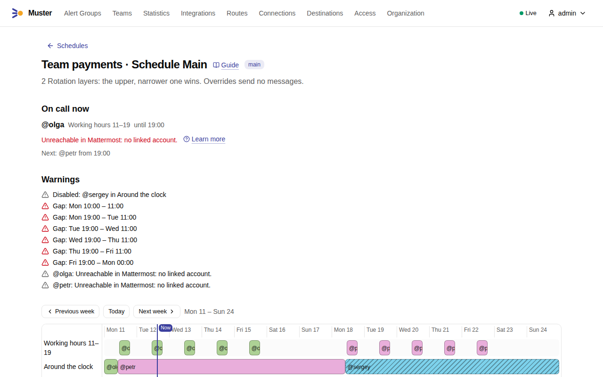
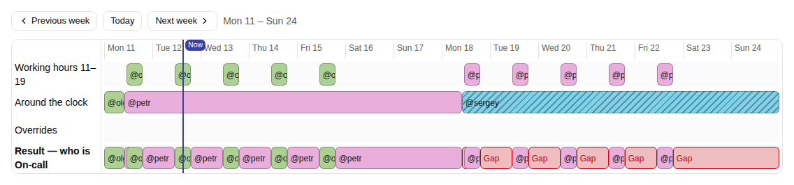
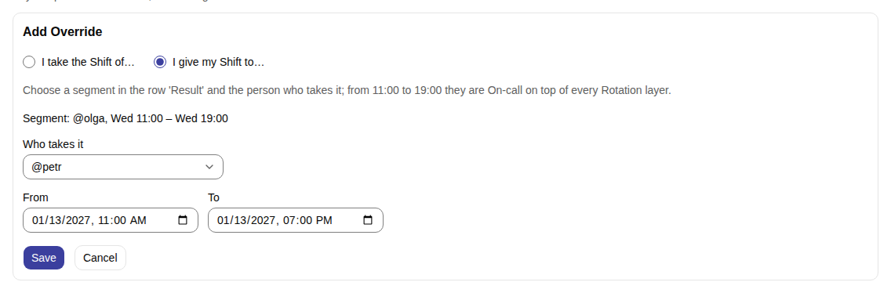
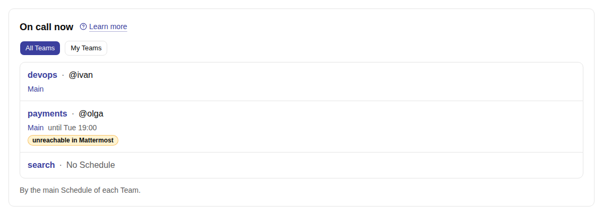

# Schedules

A **Schedule** says who in a Team is On-call and when. It is made of Rotation layers, in which people take Shifts in
turn, with Overrides on top. Schedules are managed through the API under `/api/v1/schedules`; nothing about a Schedule
sends a message.

## What a Schedule is

A Schedule belongs to one Team and has:

- a **name**, unique in the Team, compared without regard to case;
- a **time zone**, such as `Europe/Berlin`. A Schedule created without one takes the Organization's time zone of that
  moment and keeps it when the Organization's changes later (`schedule.time_zone`);
- its **Rotation layers**, from the lowest to the highest;
- its **Overrides**;
- its **gap alert**, whether it reports its gaps as an Internal alert (see
  [Gaps and the Internal alert](#gaps-and-the-internal-alert)).

The **On-call** of a Schedule at a moment is the person of its Override then; otherwise the person on Shift in the
highest Rotation layer that has a Shift then; otherwise nobody, which is a **gap**. `getScheduleOnCall` gives the
**Result** of a period — by default from now to 14 days ahead (`schedule.gap_view`), at most 67 days — cut into
segments, each with the person On-call or nobody, together with the Shifts of each Rotation layer and the Overrides.
Muster computes it on its own clock, so the development clock moves it.

Only Admins create, change and delete Schedules (`schedules:write`); everyone reads them (`schedules:read`). Every
change is recorded in the Audit log, and the metric `muster_schedule_info` has one series per Schedule, with its name
([Metrics](../reference/metrics.md)). The operations are listed in the [API reference](../reference/api.md).

## Rotation layers

A Schedule has at most 20 Rotation layers. A Rotation layer has a name and the people who take Shifts in turn, in
order, at most 100. A Shift lasts:

- a **day**, handed over every day at the handover time;
- a **week**, handed over on a day of the week at the handover time;
- a number of **whole hours**, given as `shift_seconds`, a multiple of 3600 such as 43200 for 12 hours, up to 28 days.

The first Shift starts on the start date, a day from 2000-01-01 to 2100-12-31, at the handover time, with the first
person of the list. Times are wall-clock times in the Schedule's time zone, so a handover at 10:00 stays at 10:00 when
the clocks change. A time that the clocks skip when they move forward, such as 02:30 on the night of the change, is
the moment they move; a time that happens twice when they move back is its first occurrence.

A Rotation layer may be **limited** to some days of the week and, optionally, a time of day, such as Monday to Friday
11:00–19:00. Outside the limits it has no Shift. A time of day whose end is earlier than its start crosses midnight,
and each window belongs to the day it starts on: Friday 19:00–09:00 runs from Friday 19:00 to Saturday 09:00.

A higher Rotation layer wins wherever it has a Shift. [A worked example](#a-worked-example) follows.

A Rotation layer may only add people who can be Paged: Users in the Team who are neither Viewers nor disabled. Adding
anyone else is refused with `422` `not_pageable` at the person, with the reason `viewer`, `disabled` or `not_in_team`.
Someone who becomes one of these later stays in the Rotation layer: their Shifts are skipped — the Rotation layer
below, or a gap, takes the time — and the Result lists a warning about them until an Admin removes them.

## A worked example

The Schedule "Main" of the Team "payments", in the time zone `Europe/Berlin`, has two Rotation layers. Both hand over
on Monday at 10:00, and week 1 below is a week in which both lists are at their first person:

Around the clock, below
:   Weekly Shifts handed over on Monday at 10:00 among Petr, Sergey and Olga.

Working hours 11–19, above
:   Weekly Shifts handed over on Monday at 10:00, limited to weekdays from 11:00 to 19:00, among Olga and Petr.

Each week the next person of each list is on Shift:

| | Week 1 | Week 2 | Week 3 |
|---|---|---|---|
| Around the clock, below | Petr | Sergey | Olga |
| Working hours 11–19, above | Olga | Petr | Olga |

Who is On-call on a Wednesday of week 1:

- **At 15:00** both Rotation layers have a Shift, and the upper one wins: **Olga** is On-call.
- **At 21:00** the upper Rotation layer has no Shift, as its Shifts end at 19:00, so the lower one has it: **Petr**
  is On-call. He is also On-call on the Saturday at 15:00, as the upper Rotation layer has no Shifts at the weekend.

In week 2 the same Wednesday gives Petr at 15:00 and Sergey at 21:00. The handover of each Rotation layer is at 10:00
on the Monday, so on the Monday of week 2 Petr is still On-call until 10:00, then Sergey until 11:00, and from 11:00
Petr, who is on Shift in the upper Rotation layer.

The page of the Schedule shows the two weeks, with a row for each Rotation layer, the row "Overrides" and, below them,
the row "Result — who is On-call", which is what Muster uses. In the picture, Sergey has been disabled: his Shifts in
the lower Rotation layer are hatched, and the evenings, nights and the weekend of week 2, when only he is on Shift
there, are gaps in red, as is the hour from 10:00 to 11:00 of its Monday, after his handover and before the upper
Rotation layer begins. The section "Warnings" lists them. [Gaps](#gaps-and-the-internal-alert) says what happens
then.

{ .screenshot }

{ .screenshot }

## Several Schedules

A Team may have several Schedules, such as a first and a second line. One of them is its **main Schedule**, whose
On-call is the Team's On-call: the first Schedule of a Team is its main one, and an Admin makes another one main with
`main` set to true, which takes the mark off the previous one. The main Schedule cannot be unmarked on its own; deleting
it leaves the Team without one until an Admin marks another.

For example, "payments" has its "Main" Schedule, whose On-call is the Team's, and a Schedule "Second line" with one
Rotation layer, "Second line, working hours", of the people who back the first line up. A Mention of the Team's On-call
([Mentions](mentions.md)) names the person of "Main"; an [Escalation chain](escalation-chains.md) whose step Pages the
On-call of a Schedule names the Schedule itself, so a step can Page "Second line" while the Team's On-call stays that of
"Main".

Each Schedule has its own Rotation layers, Overrides and gap alert: a Schedule that is not main reports its gaps only
when an Admin turns its gap alert on (see [Gaps and the Internal alert](#gaps-and-the-internal-alert)). "On call now"
([below](#on-call-now)) shows the main Schedule of each Team only.

A Team that has Schedules cannot be deleted: `deleteTeam` answers `409` `team_in_use` and names them.

## Overrides

An **Override** makes one person On-call from one time to another, on top of every Rotation layer: within its span it
wins over all of them, and so it also closes a gap. It may name the person whose Shift it takes, which changes nothing
in the On-call. Where Overrides overlap, the one created last wins.

Who may make them
:   Responders and Admins (`schedule-overrides:write`). A Responder must be in the Schedule's Team, else `409`
    `not_in_team`; an Admin need not. The person who takes the Shift must be able to be Paged, else `422`
    `not_pageable` at `user_id`; the person whose Shift it takes may be anyone.

When
:   An Override may be planned any time ahead, but it may not rewrite the past. It starts at most 5 minutes before now
    (`422` `out_of_range` at `start`), ends after its start and after now, and lasts at most 31 days (`422`
    `out_of_range` at `end`). A span that would overlap 1000 other Overrides of the Schedule is refused the same way.

Changing and deleting
:   Before an Override begins, everything in it may change, and deleting it removes it. Once it has begun, only its end
    may change — another start or person is refused with `422` `unsupported` — and deleting it ends it now: the part
    that has passed stays in the Schedule. Once it has ended, it can be neither changed nor deleted (`409`
    `override_ended`), so the past stays as it was.

No messages
:   Overrides need no approval and send no message, and neither do Shifts: who is On-call is shown by Muster and its
    API, and every Override is recorded in the Audit log with its people and span.

Olga, who is On-call on Wednesday from 11:00 to 19:00 in the example above, gives that Shift to Petr. On the page of
the Schedule she selects "Add Override", chooses "I give my Shift to…", selects her segment in the row "Result" and
Petr as the person who takes it. The Override is exactly that segment: the Result shows Petr On-call on Wednesday from
11:00 to 19:00, and nothing else changes. "I take the Shift of…" is the form the other way round: the person who makes
the Override takes the Shift, and chooses whose Shift it is.

{ .screenshot }

## iCal feed

Each User may subscribe a calendar application to a personal **iCal feed** of the times when they are On-call. The
feed has one event for each span in which the User is On-call in a Schedule of any of their Teams, named
"{Team} · {Schedule}", from 7 days back to 60 days ahead (`ical.window`), counted in whole days in UTC:

- It follows the Result: where a higher Rotation layer or someone else's Override has the time, it is not in the feed.
  With the two Rotation layers above, a week in which Petr has the lower Rotation layer shows only its nights and its
  weekend.
- An Override that makes the User On-call is an event of its own span; adjacent spans of one Schedule are otherwise
  one event, so a Rotation layer limited to Friday 19:00–09:00 is one event from Friday 19:00 to Saturday 09:00.
- Times are in UTC, so a calendar application shows them in its own time zone, across the changes of the clocks too.

The link
:   `issueMyIcalFeed` (`POST /api/v1/me/ical-feed`) gives the link, `MUSTER_PUBLIC_URL/ical/{token}.ics`, from the web
    session only. It is shown once: Muster keeps only a hash of its token (`ical.token`, starting with `mstr_cal_`), so
    copy it at once. `getMyIcalFeed` tells whether a feed exists and when it was issued.

A new link revokes the old one
:   Each User has one feed. Issuing a new link stops the old one at once, and `revokeMyIcalFeed` stops the current one;
    a stopped link, and the link of a disabled or deleted User, answers `404`. Deleting a User deletes their feed.
    After a link stops, calendar applications keep showing the copy they last fetched.

An Admin revokes the feed of a User
:   If a link leaked, an Admin revokes it for the User: "Revoke iCal feed" on the User's page, or `revokeUserIcalFeed`
    (`DELETE /api/v1/users/{user_id}/ical-feed`, permission `users:write`). The link stops at once on every replica,
    the Audit log records `ical_feed.revoked` with the reason `revoked_by_admin`, and the User can issue a new link
    from the profile.

Counting the fetches
:   `muster_ical_feed_requests_total{outcome}` counts the fetches: `served`, `not_found` (a malformed, unknown or
    revoked token, or a disabled or deleted User's) and `failed`. It has no label for the token or the User.

Calendar applications fetch the link without signing in, so treat it as a password: anyone who has it sees the times.
Muster never writes it to its logs, which show the path as `/ical/[redacted].ics`; a reverse proxy or ingress in
front of Muster records the real path in its own access log, so keep that log private or mask `/ical/` there.
Schedules are not imported from iCal: the feed only shows what the Schedules say.

## Gaps and the Internal alert

A **gap** is a time when no Override and no Rotation layer has a Shift with a person who may be Paged, so nobody is
On-call. The people whose Shifts are skipped are Viewers, disabled Users and Users who are no longer in the Team — after
the groups of the identity provider changed, for example: the Rotation layer below takes their time, or a gap does.
`getScheduleOnCall` lists a warning `gap` with its `start` and `end` for each gap of the period, besides the warnings
`disabled`, `viewer` and `not_in_team` about those people, and every Schedule carries `next_gap`, the first gap of the
next 14 days (`schedule.gap_view`), or null. A Rotation layer limited to Friday 19:00–09:00 alone has its gaps from
Saturday 09:00 to Friday 19:00; the night from Friday to Saturday is no gap.

A Schedule may report its gaps as the Internal alert `MusterScheduleGap` (`schedule.gap_alert`):

`by_default`
:   The default: on while the Schedule is its Team's main one, off otherwise. When an Admin makes another Schedule
    main, the alert follows it at the next scan.

`on`
:   On whether or not the Schedule is main.

`off`
:   Never.

`gap_alert_active` says whether it is on now. Every 5 minutes (`schedule.gap_scan_interval`) the Leader looks at the
next 7 days (`schedule.gap_alert_horizon`) of each Schedule whose gap alert is active. A gap now, or one that starts
within those 7 days, raises `MusterScheduleGap` with the Schedule's and its Team's id and name, the Team's slug under
the Organization's Team label, so that the alert belongs to the Team, and the start of the nearest gap in the annotation
`gap_start`. The alert stays raised while the gap lasts and resolves at the next scan once no gap is current or within
the 7 days — an Override or a change of the Rotation layers closed it, or it is past — and when the gap alert is turned
off or the Schedule is deleted. Renaming the Schedule or its Team updates the open alert. The metric
`muster_schedule_gap` is 1 for each Schedule with such a gap and 0 for the others, and the chart rule of the same name
is the backup for the Internal alert; its [runbook](../operations/runbooks/MusterScheduleGap.md) says how to fill a gap.

In the worked example, with Sergey disabled, nobody is On-call in the evenings, nights and weekend of week 2, nor in the hour after his Monday handover: the upper
Rotation layer has no Shift then and the lower one belongs to Sergey, whose Shifts are skipped. A Responder of the Team
fills the gaps with Overrides, or an Admin replaces Sergey in the Rotation layer; once no gap is left within the next
7 days, the alert resolves at the next scan.

A Schedule that covers only part of the day on purpose, such as a second line in working hours, has gaps every evening:
keep its gap alert off. With `by_default` it already is, as long as it is not its Team's main Schedule.

## On call now

`getOnCallNow` lists every Team by name — or with `teams=mine` the Teams of the caller — with the On-call of its main
Schedule now: the person and the Rotation layer whose Shift it is, until when, and what follows, a person or a gap,
within the next 14 days. A Team without a main Schedule has `no_schedule` true. The Home page shows it as "On call
now", and the Team page shows the same for its Team.

{ .screenshot }

In the picture the On-call of "payments" is Olga, whose account is not linked in Mattermost, so the row says
"unreachable in Mattermost" ([Unreachable On-calls](#unreachable-on-calls)); "search" has no Schedule.

## Unreachable On-calls

A Mention of the On-call notifies them only where it reaches them. For each segment of the period in which someone is
On-call, `getScheduleOnCall` lists a warning `unreachable` for each [Destination of their
Team](routing-to-teams.md) that a Mention of the person cannot reach, whatever its Severity condition, with the
Destination, its `messenger` and the `reason`; `getOnCallNow` lists the same, for the On-call now, in `unreachable`.
The warnings also cover the Destinations of the [Escalation chains](escalation-chains.md) that Page the Schedule: a
chain with a step that Pages its On-call writes in the Threads of the Destinations of the Routes and Teams that name it
([Where chains Page](escalation-chains.md#where-chains-page)), so each of those Destinations is warned about too, with
the same reasons, whatever its Severity condition; a Destination that the Team and a chain both name is listed once. A
step that calls the On-call through a Notification gateway writes nothing in a Thread and adds no Destination. When
none of a Team's Destinations has the Root message of an Alert Group, the Team's chain Pages at run time in the
Route's Destinations instead; which Route that is depends on the Alert Group, so the warnings do not cover that
fallback. The warning changes nothing that Muster sends: it says ahead of time what a Mention would not do.

`no_account_link`
:   The person has no Account link where the Destination posts: a Mattermost, Slack or Bridge Destination needs a link
    through its Connection, a Telegram one a Telegram link. The person links their account in their profile
    ([Link your messenger accounts](../messengers/account-links.md)); the warning goes once the link is made.

`bridge_no_native_mentions`
:   The bridge of a Bridge Destination does not declare `native_mentions` in its
    [info](../messengers/write-a-bridge.md#getinfo), or Muster has not read its info yet, so a Mention is the person's
    name in plain text, which notifies nobody, linked or not. A bridge that renders Mentions declares it; check the
    Connection again once it does.

`webhook_no_thread_reply`
:   An [outgoing webhook in template mode](../outgoing-webhooks/templates.md) has no **Reply in thread** request, so
    the follow-ups that carry Mentions are never sent. Add the request; an outgoing webhook in events mode mentions
    nobody and gets no warning.

`not_in_discussion_group`
:   The last Destination check of a Telegram Destination saw the person outside the discussion group of its channel,
    and Telegram notifies only the members of the group about the replies in a Thread, a reply that mentions them
    included. The person joins the discussion group
    ([Join the discussion group](../messengers/telegram.md#join-the-discussion-group-and-mute-the-channel)), and
    then someone selects **Check** on the Destination page, or saves the Destination.

The check of a Telegram Destination — on save, on **Check** and in `muster doctor`, which prints the people it found
outside the group without recording them — asks Telegram, with `getChatMember`, about every active person of the Teams
that name the Destination who has a Telegram Account link and is not a Viewer (a disabled User or a Viewer is never
On-call), and lists those outside the group in its item **Members of the discussion group**, which always passes. On
save and on **Check** it also asks about the people with a Telegram Account link whom a chain Paging in the
Destination can Page: those in a Rotation layer of a Schedule whose On-call a step of the chain Pages by Mention (a
`page_on_call` step; a step that calls the On-call does not count), or with an Override of it that has not ended. It
makes one request per person, once for a person of both, one after the other, limited by the Connection's limiter,
not by the Destination's, as it sends nothing to the chat; on save and on **Check** it stops after 10 seconds
(`destination.telegram.group_people_budget`), and `muster doctor` paces its requests at the Connection's limiter and
stops after as long. A Team with hundreds of linked people may so leave some unasked.

The warning is as old as the last check. A leave reaches Telegram's answer only some time later, about a minute
(F-128), so a check right after someone left the group may still see them in it, and a person who left may show as
unreachable only later; check again later. A person the check could not
tell — Telegram answered with an error, did not answer in time, or was not asked before the check stopped — keeps what
the check before saw: the warning of someone who was outside the group stays until a check sees them in it, and
someone never seen outside it gets no warning.

For an ordinary member, muting the discussion group did not hide a Mention: a Mention in a comment, written as a
`tg://user?id=` link, notified a member who had muted it, on the desktop and on the phone (F-129 of the verified facts in
`design/facts.md` of the repository), so such an On-call may mute the discussion group.

One case the warning cannot see: the creator of the discussion group, who is anonymous there, was not notified of a
Mention in a group they had muted (F-129). The check sees the creator in the group, so they get no warning; an On-call
who created the discussion group, or is anonymous in it, should not mute it. That one a Destination check cannot see.
