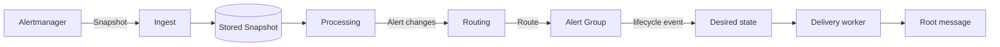

# Snapshot semantics

Alertmanager does not tell Muster "this alert started" and "this alert stopped" as separate events. It sends a
**Snapshot**: the full state of one Alertmanager group at the moment of the notification, listing every alert it holds.
Muster works out what changed by comparing Snapshots. This page explains the rules, and why an alert can be **Gone** or
**Stale** without anybody sending a "resolved".

You only need this page to understand why Muster resolved something, or why it did not. The settings that matter are on
[Connect Alertmanager](../integrations/alertmanager.md), in particular its
[Repeat intervals](../integrations/alertmanager.md#repeat-intervals).

## From a Snapshot to a message

Receiving is store-first. Muster checks the Integration token and the size, stores the Snapshot exactly as received, and
answers `202`. A worker then processes it, on any replica, and everything that follows is a chain of small steps:

1. **Ingest** stores the Snapshot as a **Stored Snapshot** and wakes a worker. It is kept for
   `retention.stored_snapshots` (14 days) for debugging, previews and replay.
2. **Processing** splits the Snapshot into Alerts by fingerprint, adds the Integration's Static labels, and applies the
   rules below. It emits Alert changes: a new firing, a resolution with its reason, a Continuation, a change of
   annotations. It processes the Snapshots of an Alertmanager group in the order they arrived.
3. **Routing** gives each newly firing Alert its Route and Severity level.
4. The **Alert Group** takes the Alert: it joins an open one, reopens a resolved one, or starts a new one. Every change
   records a lifecycle event in the Timeline.
5. The lifecycle event changes the **Desired state** of the Alert Group's message in each of its Destinations: what the
   Root message should look like right now.
6. The **delivery worker** brings the actual message to the Desired state with one call, and the **Root message** in the
   messenger shows it. See [Loud and Quiet](loud-and-quiet.md) for when that is an edit and when a new message.

Processing writes one log line per Snapshot, never one per Alert.

## One Alertmanager group, one stream of Snapshots

An Alertmanager group is the set of alerts that Alertmanager notifies about together under one `groupKey`. The
Snapshots of one group form a stream, and Muster compares each with the ones before it. Alertmanager sends a Snapshot
again each time the group changes and each time the route's `repeat_interval` elapses, and Muster learns from the gaps.

Two things about Snapshots matter in practice:

- **Copies from an HA pair are harmless.** Two Alertmanagers in a pair send their own copy, 0 to 15 seconds apart,
  sometimes one of them incomplete. Muster processes an Alert once for the same fingerprint, status and `startsAt`, so a
  duplicate changes nothing. Snapshots of one group that arrive within the Integration's **duplicate window**
  (`integration.duplicate_window`, 45 seconds) count as one, and an Alert listed in either of them counts as listed.
- **A Snapshot's status is the group's, an Alert's status is its own.** A Snapshot with `status: firing` can list alerts
  that are resolved, and each alert's own status decides for it.

## Resolved

The normal way an Alert ends is that Alertmanager lists it as `resolved`. Muster resolves it at once, with the reason
that Alertmanager resolved it, in the latest Alert Group where that fingerprint is still firing.

- A `resolved` for an Alert that is already resolved, or for an earlier firing of it, changes nothing. Prometheus re-sends
  a resolved alert for about 15 minutes, so the same `resolved` arrives several times.
- A `resolved` for a fingerprint that fires nowhere is dropped, and counted.
- A Snapshot whose status is `resolved`, sent when all the alerts of its group resolved, resolves **every Alert of that
  group** that still fires, also the ones it does not list. After a restart of both Alertmanagers of a pair, such a
  Snapshot can list only some of them and the others are never sent.

## Gone

Sometimes Alertmanager stops listing an alert without saying that it resolved. The rule evaluator may have stopped, an
alert may have been inhibited, or the route may have changed. Muster notices that the Alert is **Gone**:

> An Alert is Gone in an Alertmanager group when it has been missing from **at least two consecutive Snapshots** of that
> group, over **at least `processing.gone_min_absence`** (5 minutes), counted from the first Snapshot that missed it to
> the latest one.

A Snapshot that lists it ends the count. Both conditions are needed, for good reasons. A restarted Alertmanager starts
with an empty memory, and its first Snapshots can leave out a firing alert twice, a minute apart, because Prometheus
re-sends firing alerts only every 2 minutes. The minimum absence covers that. A restarted instance of an HA pair is
covered by the duplicate window, because the other instance sends the full Snapshot 15 seconds later.

| Snapshots of one group | Result |
|---|---|
| Alert A missing at T and T+60 s, listed at T+120 s | A stays firing; the count restarts |
| Alert A missing at T, T+60 s and T+6 min | A is Gone at T+6 min |
| Alert A missing at T only | A stays firing; one Snapshot never counts |

An Alert that appears in several Alertmanager groups is resolved by absence only when it is Gone (or Stale) in **every**
one of them.

## Stale

If the whole group sends nothing at all, there is no Snapshot to miss the Alert from. This happens when the group is
silenced, inhibited or muted as a whole in Alertmanager. Muster calls an Alert **Stale** when it has heard nothing about
it for too long:

> An Alert goes Stale when its Alertmanager group has sent no Snapshot for `stale_after`, which is
> `processing.stale_after_factor` (3) times the repeat interval that Muster has learned for the group's Alertmanager
> route.

Muster learns the interval from the gaps between Snapshots whose `notification_reason` is `repeat interval elapsed`, and
uses the median of the last 9 gaps. Until it has learned an interval, `stale_after` is `processing.stale_after_unlearned`,
25 hours. With a 10-minute `repeat_interval`, a silenced group's Alerts go Stale after about 30 minutes. With a daily
interval it takes three days, which is why the Integration page warns about an interval longer than
`processing.long_repeat_warning` (1 hour). See [Repeat intervals](../integrations/alertmanager.md#repeat-intervals).

Gone and Stale both resolve the Alert with the reason "Alertmanager no longer reports this alert — it resolved without
notice, was silenced or inhibited in Alertmanager, or the Alertmanager routing changed". If a silenced alert's mute
ends within about 14 minutes, Alertmanager still reports it as resolved, so it resolves normally; after that it only
goes Stale.

## The Heartbeat

Stale resolution has a risk: if the path from Alertmanager to Muster breaks, Muster hears nothing, and every Alert would
go Stale, although they may still fire. The [Heartbeat](../integrations/heartbeat.md) removes the risk. It is a regular
signal that proves the path works.

- **Stale applies only while the Integration's Heartbeat is live.** An Integration without a Heartbeat, or still waiting
  for the first signal, never resolves an Alert as Stale. Gone still works.
- While the Heartbeat is **lost** (no signal within `integration.heartbeat_timeout`, 5 minutes), the time does not count
  towards `stale_after`. From the last signal before the loss until the signal returns, nothing goes Stale. Muster's own
  downtime does not count either, beyond the timeout.
- The Integration shows "No contact with Alertmanager since HH:MM", and Muster raises the Internal alert
  `MusterHeartbeatLost`.

So with a live Heartbeat and a learned 5-minute interval, an Alert whose group last arrived at T goes Stale at T+15
minutes. If the Heartbeat was lost from T+5 to T+10 minutes, it goes Stale at T+25 minutes, because those 10 minutes
did not count.

## Truncation

An Alertmanager webhook configuration with `max_alerts` above 0 keeps only the first alerts of a group in each
notification, and counts the rest in `truncatedAlerts`. A truncated Snapshot lists only part of the group, so it can
never be evidence that an Alert is missing.

- Muster does **not** count a truncated Snapshot as absence. While Snapshots of the group keep arriving truncated, the
  unlisted Alerts stay alive, which can keep an Alert open that has resolved in reality.
- Muster raises the Internal alert `MusterSnapshotTruncated` for the Integration while any group is truncated, and
  resolves it when none is left. The Integration page shows a warning too.
- The fix is `max_alerts: 0` on the Alertmanager receiver. See [Send every alert of the
  group](../integrations/alertmanager.md#send-every-alert-of-the-group) and the
  [runbook](../operations/runbooks/MusterSnapshotTruncated.md).

## Continuation

A rule evaluator that restarts for longer than the alerts' `endsAt` window makes Alertmanager send the same alerts again,
with a new `startsAt` and no `resolved` in between. That is a **Continuation**: the Alert stays the same, its start time
is updated, and nothing is Loud and nothing reopens. Once an Alert has resolved by any route, the next firing of the same
fingerprint is a new firing.

## Why an Alert resolved

Every Alert resolved by Muster carries one of four reasons, which the Integration's Alerts view shows and the metric
`muster_alerts_resolved_total` counts:

| Reason | Meaning |
|---|---|
| `resolved` | Alertmanager sent `resolved`, for the Alert or for its whole group. |
| `gone` | Missing from at least two consecutive Snapshots for the minimum absence. |
| `stale` | Its group sent nothing for three learned repeat intervals, with a live Heartbeat. |
| `integration_deleted` | Its Integration was deleted. |

When the last Alert of an Alert Group resolves, the Alert Group is resolved by the system with the reason of the last
one. See [Alert Groups](alert-groups.md#reopening) for what happens if the problem returns. If processing ever misbehaves,
`muster ingest replay` reprocesses Stored Snapshots, and because processing is idempotent it changes nothing that was
already right.
