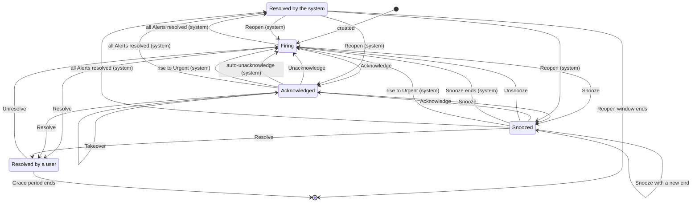

# Statuses and commands

An Alert Group is always in one of four statuses, and only a few things move it from one to another. Some are
**Commands** that a person gives, from the web UI, the API, a button in a messenger, or a Text command in a Thread. The
others are transitions that Muster makes on its own, always with a reason you can read.

## The four statuses

| Status | Meaning |
|---|---|
| **Firing** | The Alert Group has a live problem and nobody has taken it. |
| **Acknowledged** | A person has taken it and is handling it. That person is its **Owner**. |
| **Snoozed** | It is set aside until a chosen time, or with no end. Muster stays quiet about it meanwhile. |
| **Resolved** | It is closed, by a person or by Muster because its Alerts are gone. |

New Alerts and edits of a Route never change a status. Only the transitions below do.

Resolved appears twice because the two ways back differ. After the system resolved an Alert Group, it **reopens** by
itself if the problem returns within the Reopen window. After a person resolved it, nothing reopens it; the person can
**Unresolve** it, or Muster starts a new Alert Group if the Alerts still fire after the Grace period. See
[Reopening](alert-groups.md#reopening).

The ack timeout runs only while an Alert Group is Firing, and an Alert Group is **Unclaimed** after its last notice. See
[Ack timeouts, Reminders and auto-unacknowledge](#ack-timeouts-reminders-and-auto-unacknowledge).

### Transitions Muster makes on its own

Each carries its reason, which you see on the Alert Group page, in its Timeline and, in a messenger, in the Root
message or a Thread reply.

| Transition | When | Reason you see |
|---|---|---|
| Open → Resolved | The last Alert resolved: Alertmanager sent `resolved`, or the Alert went [Gone or Stale](snapshot-semantics.md), or its Integration was deleted. This also ends a Snooze. | The reason of the last Alert |
| Resolved → previous status | An Alert with the same Route and Group key values fires within the Reopen window. | The Reopen, with the Reopen count |
| Snoozed → Firing | The Snooze ends while Alerts still fire. It has no Owner, and the message lists what accumulated. | The Snooze ended |
| Snoozed or Acknowledged → Firing | A rise in Severity level makes the Alert Group Urgent. It ends a Snooze, unless the Snooze was set while the Alert Group was already Urgent, and removes an acknowledgement when the Route has `route.urgent_rise_removes_ack` on (the default). | The rise to Urgent |
| Acknowledged → Firing | The Route's auto-unacknowledge removes the acknowledgement of an Owner who stopped answering. | "No answer to the last two Reminders" |
| Acknowledged → Firing | The Owner was disabled or deleted. | "The owner was disabled" or "The owner was deleted" |

## Commands

| Command | Allowed from | Effect |
|---|---|---|
| **Acknowledge** | Firing, Snoozed | The caller becomes the Owner. It ends a Snooze. By the current Owner it changes nothing. By another user it is a **Takeover**. |
| **Unacknowledge** | Acknowledged | The Alert Group is Firing again, without an Owner, and the ack timeout starts over. Any user who may acknowledge can do it, not only the Owner. |
| **Resolve** | Firing, Acknowledged, Snoozed | The Alert Group is Resolved by the person. A Note can come with it. |
| **Unresolve** | Resolved by a person | The Alert Group is Firing again without an Owner. Web UI and API only. |
| **Snooze** | Firing, Acknowledged, Snoozed | The Alert Group is Snoozed until a time in the future, or with no end. A Snooze with a new end changes the end. |
| **Unsnooze** | Snoozed | The Alert Group is Firing again without an Owner, and the ack timeout starts over. |
| **Add Note** | any | A Note appears in the Timeline with its author. Web UI and API only. |
| **Still on it** | Acknowledged, while a Reminder waits | The Owner answers the Reminder. See below. |

Details:

- **Takeover.** Acknowledging an Alert Group that somebody else owns moves it to you, without asking. The previous Owner
  is Mentioned in a Loud Thread reply, and your Reminders start from zero. The web UI says "Take over from {Owner}" on the
  button.
- **Snooze.** The web UI and the API accept any future time, or no end. The API makes you say which: a request names
  either `until` or `no_end`. A Snooze with no end asks you to confirm "This Alert Group stays snoozed until someone
  unsnoozes it". Messengers offer the Route's **Snooze durations** as separate buttons or a menu (`route.snooze_durations`:
  1 hour, 4 hours and 24 hours on an On-call Route, 1 day, 3 days and 7 days on an Informational Route).
- **Unresolve** is refused when the system resolved the Alert Group ("it reopens by itself when an alert returns"),
  when its Route was deleted, when a newer open Alert Group with the same key exists, and when all its Alerts have
  already resolved.
- **Notes** are up to 4,000 characters (`alert_group.note_max_length`).
- **Bulk commands.** In the list, select up to 100 Alert Groups (`alert_group.bulk_max`) and run Acknowledge, Resolve,
  Snooze or Unsnooze on all of them. Each goes through the rules on its own and the result lists the outcome per Alert
  Group. One refusal never stops the others. A bulk Acknowledge skips an Alert Group that another user owns ("skipped:
  owned by {Owner}"), so it never takes over by accident.
- **Refusals** carry a stable code and a message, such as "already resolved", "not acknowledged" or "not permitted". The
  API answers `409` for a precondition and `403` for a permission.
- Commands on one Alert Group are serialized. Two people acknowledging at the same moment leave the later one as Owner and
  one Takeover in the Timeline.

Every command is a Quiet event except the Takeover. See [Loud and Quiet](loud-and-quiet.md).

### Who may

A **Responder** or an **Admin** may acknowledge, resolve, snooze and add Notes. A **Viewer** may read and may not act: the
command is refused. A **Service account** may resolve, snooze and add Notes, but cannot acknowledge, because an Owner is
always a person. A Personal access token acts as its owner. Every command is recorded in the Audit log with its actor and
the Transport.

## Where a command comes from

The **Transport** is the way a command reaches Muster. It is recorded with the command, and Muster applies the same rules
to all of them.

| Transport | How | Notes |
|---|---|---|
| Web UI | buttons on the Alert Group page and in the list, with dialogs for Snooze and Resolve | everything above, including bulk commands, Notes and Unresolve |
| API | `POST` to `/api/v1/alert-groups/{id}/acknowledge` and its siblings, with a session or a token | the same; see the [API reference](../reference/api.md) |
| Mattermost | a button on the message | Acknowledge, Unacknowledge, Resolve, Snooze, Unsnooze, Still on it |
| Telegram | an inline button on the message | the same |
| Bridge | a button on the message, if the bridge declares `buttons`; or a **Text command** in the Thread, if it declares `thread_messages` | the same |
| `system` | Muster itself | the automatic transitions above, shown in the Timeline |

Messengers never offer Unresolve or Notes, and never a Snooze with no end. A person who presses a button in a messenger
must have linked their messenger account to their Muster user; see [Link your messenger
accounts](../messengers/account-links.md). A press from an unlinked account changes nothing, and the person is told
privately how to link it.

### What each button does

The buttons of a Root message depend on the status of its Alert Group:

| Status | Buttons |
|---|---|
| Firing | **Ack**, **Resolve**, **Snooze** |
| Acknowledged | **Unack**, **Resolve**, **Snooze** |
| Snoozed | **Ack**, **Unsnooze**, **Resolve** |
| Resolved | none; a link "Open in Muster" |

- **Ack** takes the Alert Group: you become its Owner, the Reminders start, and the message shows who has it. If somebody
  else has it, Ack takes it over from them.
- **Unack** gives it back. The Alert Group becomes Firing again with no Owner, and the ack timeout starts over.
- **Resolve** closes the Alert Group by hand. If Alerts still fire, the message shows "⚠ N alerts still firing in
  Alertmanager", and after the Grace period the Alerts that still fire start a new Alert Group.
- **Snooze** sets it aside. It offers the Route's Snooze durations, such as 1 hour, 4 hours and 24 hours, one choice for each. When the time is up and Alerts still fire, the Alert Group comes back Firing and a Loud message says so.
- **Unsnooze** ends the Snooze early. The Alert Group becomes Firing again.
- On a **Reminder**, **Still on it** tells Muster you are still handling the Alert Group, and **Unack** gives it up.
- A **Storm summary** and an ack timeout notice carry only links to Muster. A test message carries the buttons of its
  status, but pressing them changes nothing: you get "This is a test message; nothing was changed".

A press edits the Root message to show the result. A press that Muster refuses, such as a Resolve by a Viewer, is answered
privately to the person who pressed, and nothing changes.

### Text commands

Some messengers have no buttons, or a bridge does not offer them. A **Text command** is a Command written as a reply in a
Thread. Only a **Bridge** Destination takes them, and only when the bridge declares `thread_messages`. A Root message
that is not resolved then ends with a line such as "Reply in the Thread: ack · resolve · snooze 1h".

A reply is a Text command when its whole text, trimmed, in any case and with an optional leading `/`, is one of:

| Text command | Same in Russian | Command |
|---|---|---|
| `ack` | `взял` | Acknowledge |
| `unack` | `отпускаю` | Unacknowledge |
| `resolve` | `решено` | Resolve |
| `snooze <duration>` | `отложить <duration>` | Snooze |
| `unsnooze` | `вернуть` | Unsnooze |
| `still on it` | `ещё работаю` (also `еще работаю`) | Still on it |

The `<duration>` is one of the Route's Snooze durations, written in minutes, hours or days: `30m`, `4h` or `1d`, and
`30м`, `4ч` or `1д` in Russian. Every word works whatever the Route's language is. The writer needs an Account link, and
the same permissions as for a button.

Muster answers a Text command in the Thread, for example "Done: Acknowledged #42", or with the reason it refused. A
duration that is not one of the Route's is answered "Snooze for one of: …". **Any other text is ignored and never
answered**, so people can talk in the Thread. The Thread of an older Root message works too: a Text command there acts on
the Alert Group like any other, also when the message is past its [edit window](../messengers/bridge.md#edit-windows).
A Text command older than an hour (`bridge.event_max_age`) is dropped. If the bridge forwards only the messages that
mention its bot, the line says "mentioning the bot", and the command must mention it. See [Write a
bridge](../messengers/write-a-bridge.md#events) for how a bridge reports a Thread message.

## Ack timeouts, Reminders and auto-unacknowledge

Three timers make sure nobody forgets: one for an Alert Group nobody has taken, one for an Alert Group somebody took and
then went quiet, and an optional one that takes the Alert Group back. They are Route settings; the On-call profile turns
the first two on and the Informational profile turns everything off.

### Ack timeout

The ack timeout runs while an Alert Group is Firing. It starts at the Alert Group's first Publication in a Destination, and
starts over each time it becomes Firing again. Acknowledge, Snooze and Resolve stop it.

When nobody acknowledges, Muster sends up to three **notices**, at doubling intervals from the Route's first interval
(`route.ack_timeout`, 15 minutes on an On-call Route). With 15 minutes they come at 15, 45 and 105 minutes after the start.
Each is a Loud Thread reply that Mentions whom the Destination's `ack_timeout` setting says. After the last notice the
Alert Group is **Unclaimed**: its message shows "⚠ Nobody has taken this", and the Alert Group list has an Unclaimed
filter, column and badge. Unclaimed ends when the Alert Group stops being Firing.

An Alert Group that has not been published, as when its Route has no Destination or only Broken ones, has no ack timeout
until its first Publication.

### Reminders

When somebody acknowledges, Muster reminds the Owner while the Alert Group stays open (`route.reminders`, on an On-call
Route). The first **Reminder** comes 4 hours after the acknowledgement, and each next interval doubles up to 24 hours: at 4,
12, 28 and 52 hours, then every 24 hours. Each is a Loud Thread reply that Mentions the Owner, with the buttons **Still
on it** and **Unack**.

- **Still on it** is recorded in the Timeline and does not change the interval. The Owner can also answer from the Alert
  Group page or the API.
- A **Takeover** starts the Reminders over for the new Owner. A Reopen into acknowledged continues them. A snoozed Alert
  Group gets none. There are no quiet hours.
- An Owner who is disabled or deleted loses the acknowledgement: the Alert Group becomes Firing without an Owner, and the
  ack timeout starts over.
- After Muster was down, the overdue notices of one Alert Group collapse into one Loud Thread reply that says how many
  were missed.
- Buttons on Reminders are signed like the others, but are not updated after a key rotation. Once the old key is removed,
  a press is answered "This button has expired; use the buttons on the Alert Group's message".

### Auto-unacknowledge

If an Owner goes home and says nothing, the Alert Group would stay acknowledged forever. **Auto-unacknowledge**
(`route.auto_unacknowledge`, off by default) takes it back. The Owner answers a Reminder by pressing **Still on it**, by
running any command on the Alert Group or by adding a Note before the next Reminder is due. When the Owner has answered
neither of the last two Reminders (`timers.auto_unacknowledge_after`), the next Reminder is not sent. Instead Muster
unacknowledges the Alert Group with the reason "No answer to the last two Reminders". It becomes Firing without an Owner,
a Loud Thread reply gives the reason and Mentions the Owner, and the ack timeout starts over.

For example, Carol acknowledges at 10:00 and goes home. She answers neither the Reminder at 14:00 nor the one at 22:00.
At 14:00 the next day, instead of a third Reminder, Muster unacknowledges the Alert Group and Mentions Carol, and the
ack timeout notices begin again.

The Alert Group page shows the next scheduled notice or Reminder.
