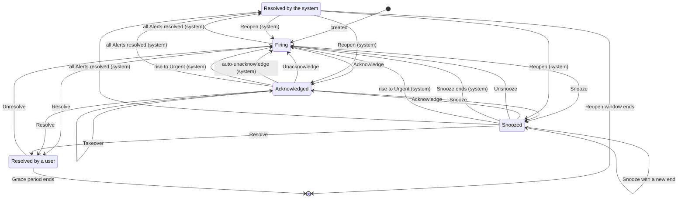
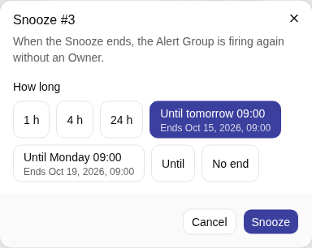
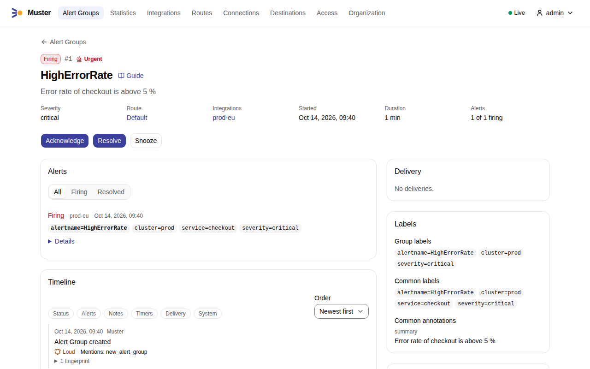
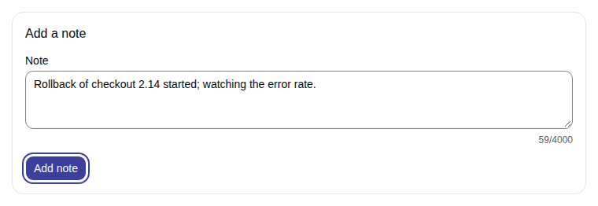
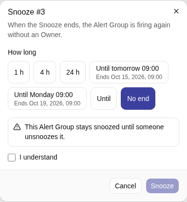
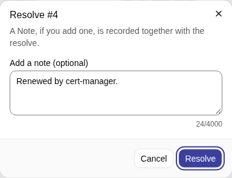
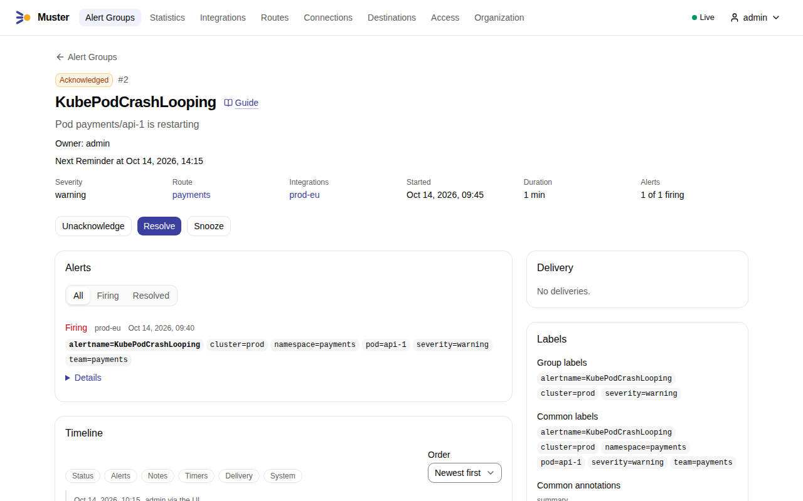
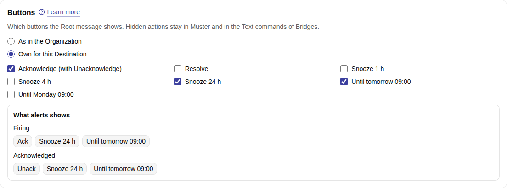

# Statuses and commands

An Alert Group is always in one of four statuses, and only a few things move it from one to another. Some are
**Commands** that a person gives, from the web UI, the API, a button in a messenger, or a Text command in a Thread. The
others are transitions that Muster makes on its own, always with a reason you can read.

## The four statuses

| Status | Meaning |
|---|---|
| **Firing** | The Alert Group has a live problem and nobody has taken it. |
| **Acknowledged** | A person has taken it and is handling it. That person is its **Owner**. |
| **Snoozed** | It is set aside until a chosen time, or with no end. Muster stays quiet about it meanwhile. |
| **Resolved** | It is closed, by a person or by Muster because its Alerts are gone. |

New Alerts that join an open Alert Group change its status only through a rise to Urgent, and edits of a Route never
change a status. Only the transitions below do.



Resolved appears twice because the two ways back differ. After the system resolved an Alert Group, it **reopens** by
itself if the problem returns within the Reopen window. After a person resolved it, nothing reopens it; the person can
**Unresolve** it, or Muster starts a new Alert Group if the Alerts still fire after the Grace period. See
[Reopening](alert-groups.md#reopening).

The ack timeout runs only while an Alert Group is Firing, and an Alert Group is **Unclaimed** after its last notice. See
[Ack timeouts, Reminders and auto-unacknowledge](#ack-timeouts-reminders-and-auto-unacknowledge).

### Transitions Muster makes on its own

Each carries its reason, which you see on the Alert Group page, in its Timeline and, in a messenger, in the Root
message or a Thread reply.

Open → Resolved
:   reason you see: the reason of the last Alert

    The last Alert resolved: Alertmanager sent `resolved`, or the Alert went [Gone or Stale](snapshot-semantics.md), or
    its Integration was deleted. This also ends a Snooze.

Resolved by the system → previous status
:   reason you see: the Reopen, with the Reopen count

    An Alert with the same Route and Group key values fires within the Reopen window.

Snoozed → Firing
:   reason you see: the Snooze ended

    The Snooze ends while Alerts still fire. It has no Owner, and the message lists what accumulated.

Snoozed or Acknowledged → Firing
:   reason you see: the rise to Urgent

    A rise in Severity level makes the Alert Group Urgent. It ends a Snooze, unless the Snooze was set while the Alert
    Group was already Urgent, and removes an acknowledgement when the Route has `route.urgent_rise_removes_ack` on (the
    default).

Acknowledged → Firing
:   reason you see: "No answer to the last two Reminders"

    The Route's auto-unacknowledge removes the acknowledgement of an Owner who stopped answering.

Acknowledged → Firing
:   reason you see: "The owner was disabled" or "The owner was deleted"

    The Owner was disabled or deleted.

## Commands

| Command | Allowed from | Effect |
|---|---|---|
| **Acknowledge** | Firing, Snoozed | The caller becomes the Owner. It ends a Snooze. By the current Owner it changes nothing. By another user it is a **Takeover**. |
| **Unacknowledge** | Acknowledged | The Alert Group is Firing again, without an Owner, and the ack timeout starts over. Any user who may acknowledge can do it, not only the Owner. |
| **Resolve** | Firing, Acknowledged, Snoozed | The Alert Group is Resolved by the person. A Note can come with it. |
| **Unresolve** | Resolved by a person | The Alert Group is Firing again without an Owner. Web UI and API only. |
| **Snooze** | Firing, Acknowledged, Snoozed | The Alert Group is Snoozed until a time in the future, until a [Snooze preset](#snooze-presets), or with no end. A Snooze with a new end changes the end. |
| **Unsnooze** | Snoozed | The Alert Group is Firing again without an Owner, and the ack timeout starts over. |
| **Add Note** | any | A Note appears in the Timeline with its author. Web UI and API only. |
| **Still on it** | Acknowledged, while a Reminder waits | The Owner answers the Reminder. See below. |

Details:

- **Takeover.** Acknowledging an Alert Group that somebody else owns moves it to you, without asking. The previous Owner
  is Mentioned in a Loud Thread reply, and your Reminders start from zero. The web UI says "Take over from {Owner}" on the
  button.
- **Snooze.** The web UI and the API accept any future time, a [Snooze preset](#snooze-presets), or no end. The API
  makes you say which: a request names exactly one of `until`, `no_end` and `preset`. A Snooze with no end asks you to
  confirm "This Alert Group stays snoozed until someone unsnoozes it".
  Messengers offer the Route's **Snooze durations** as separate buttons or a menu (`route.snooze_durations`: 1 hour,
  4 hours and 24 hours on a Paging Route, 1 day, 3 days and 7 days on an Informational Route), and after them the
  two Snooze presets; see [In messengers](#in-messengers).
- **Unresolve** is refused when the system resolved the Alert Group ("it reopens by itself when an alert returns"),
  when its Route was deleted, when a newer open Alert Group with the same key exists, and when all its Alerts have
  already resolved.
- **Notes** are up to 4,000 characters (`alert_group.note_max_length`).
- **Bulk commands.** In the list, select up to 100 Alert Groups (`alert_group.bulk_max`) and run Acknowledge, Resolve,
  Snooze or Unsnooze on all of them. Each goes through the rules on its own and the result lists the outcome per Alert
  Group. One refusal never stops the others. A bulk Acknowledge skips an Alert Group that another user owns ("skipped:
  owned by {Owner}"), so it never takes over by accident.
- **Refusals** carry a stable code and a message, such as "already resolved", "not acknowledged" or "not permitted". The
  API answers `409` for a precondition and `403` for a permission.
- Commands on one Alert Group are serialized. Two people acknowledging at the same moment leave the later one as Owner and
  one Takeover in the Timeline.

Every command is a Quiet event except the Takeover. See [Loud and Quiet](loud-and-quiet.md).

### Snooze presets

A **Snooze preset** ends a Snooze at the start of the working day instead of after a duration. Muster turns it into an
end when the command runs:

Until tomorrow 09:00
:   API value: `tomorrow` · ends at: the next start of the working day

Until Monday 09:00
:   API value: `week_start` · ends at: the next start of the working day on the first day of the week

"Next" is strictly after now. With the working day starting at 09:00:

- At 02:00, "Until tomorrow 09:00" ends at 09:00 the same day. The night belongs to the day before it, so "tomorrow"
  is the morning about to come, seven hours away.
- At 08:59 it ends one minute later: the preset means "until the working day starts".
- At 09:00 sharp, and at any later time of the day, it ends at 09:00 the next day.
- There is no working-week calendar, so on Friday evening "Until tomorrow 09:00" ends on Saturday at 09:00. For a
  weekend, use `week_start`, which ends on Monday at 09:00.
- The start is the time on the clock on the day of the end. A start that the clocks skip moves forward by the change:
  02:30 on the night the clocks jump from 02:00 to 03:00 is 03:30. A start that the clocks show twice, when they go
  back, is the first of the two.

The end is stored as a time. A later change of the settings or of a time zone never moves a Snooze already set, and the
Snooze ends like any other: if Alerts still fire, the Alert Group is Firing again without an Owner, with a Loud message.

**Time zone.** The preset counts in the time zone that the request names in `time_zone`. Without one, it counts in the
profile time zone of the user who snoozes, also through a Personal access token, and otherwise in the Organization's
time zone (`organization.time_zone`). A Service account has no profile, so it always gets the Organization's. A press on
a button in a messenger and a Text command carry no time zone, so they count in the profile time zone of the linked user
who pressed or wrote, and otherwise in the Organization's.

**Settings.** Two Organization settings define the presets, as the fields `workday_start` and `week_start` of the
organization in the API:

`organization.workday_start`
:   default: `09:00`

    The start of the working day, `HH:MM` on the 24-hour clock.

`organization.week_start`
:   default: `monday`

    The first day of the week, `monday` to `sunday`.

**API.** A Snooze takes `preset`, `tomorrow` or `week_start`, as a third choice beside `until` and `no_end`, with an
optional `time_zone`:

```json
{"preset": "tomorrow", "time_zone": "Europe/Berlin"}
```

A `time_zone` without `preset` is refused with `422` `unsupported`, and a time zone Muster does not know with `422`
`invalid_format`. A bulk Snooze with a preset computes the end once, so every Alert Group gets the same end.
`GET /api/v1/snooze-presets`, with an optional `time_zone`, answers the end that each preset would set now and the time
zone it used; it needs the Permission to snooze and changes nothing. The Audit log entry of a preset Snooze names the
preset and the time zone beside the end. See the [API reference](../reference/api.md).

#### In the web UI

The Snooze dialog of an Alert Group offers both presets after the Route's Snooze durations and before "Until" and "No
end", also on a Route without durations; the bulk Snooze of the list, which has no durations, offers them first. Under
each preset the dialog shows the end it would set now, such as "Ends Oct 20, 2026, 09:00": Muster computes it when the
dialog opens, on its own clock and in your time zone (the one of your profile, else your browser's), and the dialog sends
that time zone with the preset. Admins set the start of the working day and the first day of the week on Organization →
General. In the profile, a hint under the time zone says that presets pressed in messengers end in that time zone, and
in the Organization's while the profile follows the browser.

{ .screenshot }

#### In messengers

On a Route with Snooze durations, the Root message of a firing or an acknowledged Alert Group offers both presets as
two more Snooze buttons after the durations: "Until tomorrow 09:00" and "Until Monday 09:00", or «До завтра 09:00» and
«До понедельника 09:00» on a Route in Russian. The time is `organization.workday_start` and the day
`organization.week_start`, so with the week starting on Sunday the second button reads "Until Sunday 09:00". A snoozed
Alert Group offers no Snooze button, and a Route without Snooze durations offers no preset either, because an empty
`route.snooze_durations` means no Snooze from messengers. Telegram shows the presets on a row of their own under the
durations, and a bridge with a limit on buttons drops them first; see
[Bridge](../messengers/bridge.md#what-muster-posts). Slack offers the durations and then the presets as the options of
one **Snooze…** menu, since its web client folds the buttons beyond five in a row.

The labels are part of the message. After a change of `organization.workday_start` or `organization.week_start`, each
Root message shows the new labels at its next update, and a press on a button shown before the change already ends at
the new start of the working day: the preset is computed when the command runs. On a bridge without buttons, the presets
are [Text commands](#text-commands).

### Who may

A **Responder** or an **Admin** may acknowledge, resolve, snooze and add Notes. A **Viewer** may read and may not act:
the command is refused. A **Service account** may run the commands its Role allows, except Acknowledge and Still on it,
because an Owner is always a User. A Personal access token acts as its User, with at most that User's Permissions. Every
command is recorded in the Audit log with its actor and the Transport.

## Commands in the web UI

The page of an Alert Group offers the commands its status allows, and the list offers them for several Alert Groups at
once ([Bulk commands](#commands)).

1. Open the Alert Group from **Alert Groups**. Its command buttons are at the top: **Acknowledge**, **Resolve** and
   **Snooze** for a firing one.

    { .screenshot }

2. To add a Note, type it under **Add a note**, further down the page, and select **Add note**. It appears in the
   Timeline with you as its author.

    { .screenshot }

3. **Snooze** opens its dialog: the Route's Snooze durations, the [Snooze presets](#snooze-presets), **Until** a date
   and time of your choosing, or **No end**, which asks you to confirm with **I understand**. Select **Snooze**.

    { .screenshot }

4. **Resolve** opens a dialog with an optional Note, recorded with the resolve.

    { .screenshot }

5. After **Acknowledge**, the page names you as the Owner and offers **Unacknowledge**, **Resolve** and **Snooze**.
   Another user sees **Take over from {Owner}** instead of **Acknowledge**.

    { .screenshot }

## Where a command comes from

The **Transport** is the way a command reaches Muster. It is recorded with the command, and Muster applies the same rules
to all of them.

Web UI
:   how: buttons on the Alert Group page and in the list, with dialogs for Snooze and Resolve · notes: everything above,
    including bulk commands, Notes and Unresolve

API
:   how: `POST` to `/api/v1/alert-groups/{id}/acknowledge` and its siblings, with a session or a token · notes: the
    same; see the [API reference](../reference/api.md)

Mattermost
:   how: a button on the message · notes: Acknowledge, Unacknowledge, Resolve, Snooze, Unsnooze, Still on it

Slack
:   how: a button on the message, and the **Snooze…** menu with the durations and then the presets · notes: the same

Telegram
:   how: an inline button on the message · notes: the same

Bridge
:   how: a button on the message, if the bridge declares `buttons`; or a **Text command** in the Thread, if it declares
    `thread_messages` · notes: the same

`system`
:   how: Muster itself · notes: the automatic transitions above, shown in the Timeline

Messengers never offer Unresolve or Notes, and never a Snooze with no end. A person who presses a button in a messenger
must have linked their messenger account to their Muster user; see [Link your messenger
accounts](../messengers/account-links.md). A press from an unlinked account changes nothing, and the person is told
privately how to link it.

### What each button does

The buttons of a Root message depend on the status of its Alert Group, and on the [button set](#button-sets) of its
Destination, which shows all of them by default:

| Status | Buttons |
|---|---|
| Firing | **Ack**, **Resolve**, **Snooze** |
| Acknowledged | **Unack**, **Resolve**, **Snooze** |
| Snoozed | **Ack**, **Unsnooze**, **Resolve** |
| Resolved | none; a link "Open in Muster" |

- **Ack** takes the Alert Group: you become its Owner, the Reminders start, and the message shows who has it. If somebody
  else has it, Ack takes it over from them.
- **Unack** gives it back. The Alert Group becomes Firing again with no Owner, and the ack timeout starts over.
- **Resolve** closes the Alert Group by hand. If Alerts still fire, the message shows "⚠ N alerts still firing in
  Alertmanager", and after the Grace period the Alerts that still fire start a new Alert Group.
- **Snooze** sets it aside. It offers the Route's Snooze durations, such as 1 hour, 4 hours and 24 hours, one choice for
  each, then the two [Snooze presets](#in-messengers) "Until tomorrow 09:00" and "Until Monday 09:00", which end at the
  next start of the working day, or at its start on the first day of the week, in your profile time zone, or else the
  Organization's. When the time is up and Alerts still fire, the Alert Group comes back Firing and a Loud message says
  so.
- **Unsnooze** ends the Snooze early. The Alert Group becomes Firing again.
- On a **Reminder**, **Still on it** tells Muster you are still handling the Alert Group, and **Unack** gives it up.
- A **Storm summary** and an ack timeout notice carry only links to Muster. A test message carries the buttons of its
  status and of its Destination's button set, but pressing them changes nothing: you get "This is a test message;
  nothing was changed".

A press edits the Root message to show the result. A press that Muster refuses, such as a Resolve by a Viewer, is answered
privately to the person who pressed, and nothing changes.

### Button sets

A busy channel can show fewer buttons. Each messenger Destination shows on its Root messages the buttons of a **button
set**: the Organization's, which shows every button until an Admin lists them (`organization.buttons`), or a set of its
own (`destination.buttons`). A Destination "As in the Organization", the default, follows later changes of the
Organization's set. A set lists:

- **Acknowledge**, which brings **Unack** with it on an acknowledged Alert Group;
- **Resolve**;
- each Snooze duration, by its value, such as 24 hours;
- the [Snooze presets](#snooze-presets) "Until tomorrow" and "Until {first day of the week}".

From its set, a Root message shows the buttons that its status offers and that the set lists, in the order of the table
above. Of the Route's Snooze durations it shows only those in the set, so a duration in the set that the Route does not
have shows nothing, and it shows the presets only on a Route with Snooze durations. **Unsnooze** on a snoozed Alert
Group is not part of any set and always shows. A Destination whose set is Acknowledge, 24 hours and "Until tomorrow"
shows, on a Route with the durations 1 h, 4 h and 24 h:

| Status | Buttons |
|---|---|
| Firing | **Ack**, **Snooze 24 h**, **Until tomorrow 09:00** |
| Acknowledged | **Unack**, **Snooze 24 h**, **Until tomorrow 09:00** |
| Snoozed | **Ack**, **Unsnooze** |

To choose the buttons of a Destination:

1. Open **Destinations** and select the Destination, or create one. The form of a Mattermost, Telegram, Slack or Bridge
   Destination has the section **Buttons**. An outgoing webhook sends no buttons and has no section.
2. Under **Buttons**, choose **Own for this Destination**. The tick boxes are **Acknowledge** (which brings **Unack**
   with it), **Resolve**, each Snooze duration of your Routes and both Snooze presets; they start as what the
   Destination shows now. Untick what the Root message should not show. **What {Destination} shows** lists the buttons
   of a firing and of an acknowledged Root message, in the order of the table above, and follows each tick box at once.
3. Select **Save**. Choose **As in the Organization** and save to follow the Organization's set again.

    { .screenshot }

To change the set of every Destination that follows the Organization, open **Organization → Alert handling** and use
**Buttons of Root messages**: **All buttons**, the default, or **Only the buttons I tick**, with the same preview. See
[Organization settings](../configure/organization.md#alert-handling). A Destination of its own set keeps it when the
Organization's set changes. A ticked Organization list names the Snooze durations it lists: a duration that a Route
gains later is not shown until you tick it, unlike with **All buttons**. The form offers the Snooze durations of your
Routes, or those of the Paging profile while no Route has any; a duration that the stored set names and no Route has
stays ticked, so saving never drops it. The preview of a Destination shows the durations of the first Route that sends
to it, as its Root message does.

The set changes only the buttons of Root messages. Reminders keep **Still on it** and **Unack**; the
[Text commands](#text-commands) of Bridges, the web UI and the API keep every action; and a press on a button that a
message showed before its set changed still runs its command. Each messenger lays out the buttons it shows as before:
Slack leaves the **Snooze…** menu out when the set shows no duration and no preset, and a bridge with a limit on buttons
still drops the Snooze buttons beyond it. On a bridge without buttons, the line "Reply in the Thread: …" lists only the
Text commands of the buttons the set shows, while every other Text command still works. A test message and the preview
of a Destination show the buttons of its set.

A saved change of a set updates the open Root messages of the Destinations that use it within seconds, as edits, which
notify nobody. With the Organization's set left at every button, a Snooze duration added to a Route shows on the next
update of its Root messages. The sets are `buttons` of the Organization and of each messenger Destination in the
[API](../reference/api.md); an outgoing webhook sends no buttons and has no set. Each change is recorded in the Audit
log.

### Text commands

Some messengers have no buttons, or a bridge does not offer them. A **Text command** is a Command written as a reply in a
Thread. Only a **Bridge** Destination takes them, and only when the bridge declares `thread_messages`. A Root message
that is not resolved then ends with a line such as "Reply in the Thread: ack · resolve · snooze 1h".

A reply is a Text command when its whole text, trimmed, in any case and with an optional leading `/`, is one of:

| Text command | Same in Russian | Command |
|---|---|---|
| `ack` | `взял` | Acknowledge |
| `unack` | `отпускаю` | Unacknowledge |
| `resolve` | `решено` | Resolve |
| `snooze <duration>` | `отложить <duration>` | Snooze |
| `unsnooze` | `вернуть` | Unsnooze |
| `still on it` | `ещё работаю` (also `еще работаю`) | Still on it |

The `<duration>` is one of the Route's Snooze durations, written in minutes, hours or days: `30m`, `4h` or `1d`, and
`30м`, `4ч` or `1д` in Russian. It can also name a [Snooze preset](#snooze-presets): `tomorrow` (`завтра`) for the next
start of the working day, or the first day of the week (`organization.week_start`), such as `monday` (`понедельник`),
for the start of the working day on that day. So `snooze tomorrow`, `/Snooze Tomorrow` and `отложить понедельник` (with
the week starting on Monday) all work. A day is written as it stands alone: `понедельник`, `вторник`, `среда`,
`четверг`, `пятница`, `суббота`, `воскресенье`. Every word works whatever the Route's language is. The writer needs an
Account link, and the same permissions as for a button.

Muster answers a Text command in the Thread, for example "Done: Acknowledged #42", or with the reason it refused. A
duration that is not one of the Route's, or a day other than the first day of the week, is answered with what the Route
offers: "Snooze for one of: 1h, 4h, 24h, tomorrow, monday". The sentence and the durations are in the writer's profile
language, and the two preset words in the Route's language. A Route without Snooze durations takes no preset either, and
answers "This Alert Group's Route has no Snooze durations; nothing was changed." **Any other text is ignored and never
answered**, so people can talk in the Thread. The Thread of an older Root message works too: a Text command there acts
on the Alert Group like any other, also when the message is past its
[edit window](../messengers/bridge.md#edit-windows). A Text command older than an hour (`bridge.event_max_age`) is
dropped. If the bridge forwards only the messages that mention its bot, the line says "mentioning the bot", and the
command must mention it. See [Write a bridge](../messengers/write-a-bridge.md#events) for how a bridge reports a Thread
message.

## Ack timeouts, Reminders and auto-unacknowledge

Three timers make sure nobody forgets: one for an Alert Group nobody has taken, one for an Alert Group somebody took and
then went quiet, and an optional one that takes the Alert Group back. They are Route settings; the Paging profile turns
the first two on and the Informational profile turns everything off.

### Ack timeout

The ack timeout runs while an Alert Group is Firing. It starts at the Alert Group's first Publication in a Destination, and
starts over each time it becomes Firing again. Acknowledge, Snooze and Resolve stop it.

When nobody acknowledges, Muster sends up to three **notices**, at doubling intervals from the Route's first interval
(`route.ack_timeout`, 15 minutes on a Paging Route). With 15 minutes they come at 15, 45 and 105 minutes after the start.
Each is a Loud Thread reply that Mentions whom the Destination's `ack_timeout` setting says. After the last notice the
Alert Group is **Unclaimed**: its message shows "⚠ Nobody has taken this", and the Alert Group list has an Unclaimed
filter, column and badge. Unclaimed ends when the Alert Group stops being Firing.

An Alert Group that has not been published, as when its Route has no Destination or only Broken ones, has no ack timeout
until its first Publication.

### Reminders

When somebody acknowledges, Muster reminds the Owner while the Alert Group stays open (`route.reminders`, on a Paging
Route). The first **Reminder** comes 4 hours after the acknowledgement, and each next interval doubles up to 24 hours: at 4,
12, 28 and 52 hours, then every 24 hours. Each is a Loud Thread reply that Mentions the Owner, with the buttons **Still
on it** and **Unack**.

- **Still on it** is recorded in the Timeline and does not change the interval. The Owner can also answer from the Alert
  Group page or the API.
- A **Takeover** starts the Reminders over for the new Owner. A Reopen into acknowledged continues them. A snoozed Alert
  Group gets none. There are no quiet hours.
- An Owner who is disabled or deleted loses the acknowledgement: the Alert Group becomes Firing without an Owner, and the
  ack timeout starts over.
- After Muster was down, the overdue notices of one Alert Group collapse into one Loud Thread reply that says how many
  were missed.
- Buttons on Reminders are signed like the others, but are not updated after a key rotation. Once the old key is removed,
  a press is answered "This button has expired; use the buttons on the Alert Group's message".

### Auto-unacknowledge

If an Owner goes home and says nothing, the Alert Group would stay acknowledged forever. **Auto-unacknowledge**
(`route.auto_unacknowledge`, off by default) takes it back. The Owner answers a Reminder by pressing **Still on it**, by
running any command on the Alert Group or by adding a Note before the next Reminder is due. When the Owner has answered
neither of the last two Reminders (`timers.auto_unacknowledge_after`), the next Reminder is not sent. Instead Muster
unacknowledges the Alert Group with the reason "No answer to the last two Reminders". It becomes Firing without an Owner,
a Loud Thread reply gives the reason and Mentions the Owner, and the ack timeout starts over.

For example, Carol acknowledges at 10:00 and goes home. She answers neither the Reminder at 14:00 nor the one at 22:00.
At 14:00 the next day, instead of a third Reminder, Muster unacknowledges the Alert Group and Mentions Carol, and the
ack timeout notices begin again.

The Alert Group page shows the next scheduled notice or Reminder.
