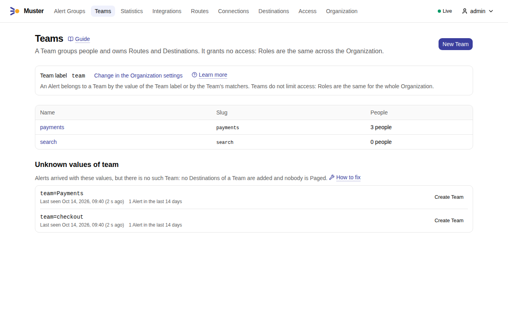
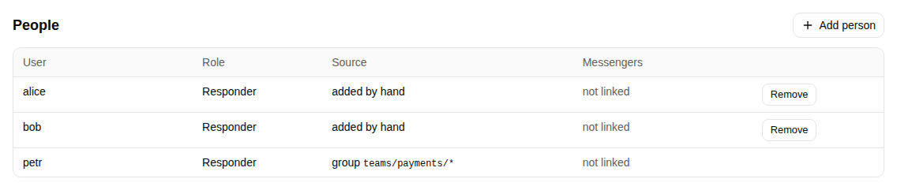
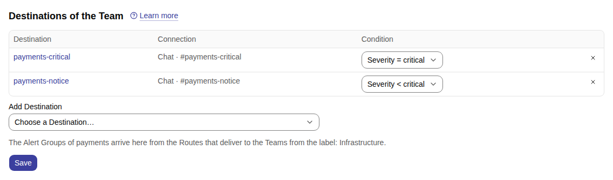
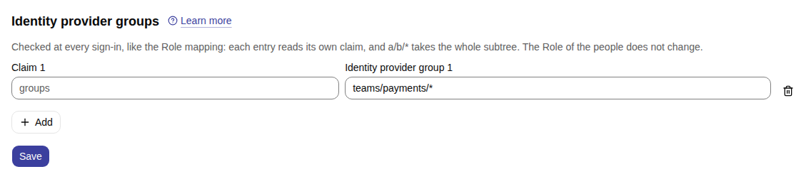

# Teams

A **Team** says who owns what: Routes and Destinations may name the Team that owns them, so that each team finds its
own configuration with a filter. Alerts and Alert Groups belong to Teams by their labels, so that each team finds its
Alert Groups. A Route may also deliver to the Destinations of the Teams of its Alerts
([Routing to Teams](routing-to-teams.md)). Teams are managed in the web UI, under **Teams** in the main navigation, and
through the API under `/api/v1/teams`.

A Team costs nothing to start with. It may have no people and no Destinations and only name Alerts: it then groups and
filters them, and you add people, channels and Routes when you want them.

## In the web UI

**Teams** lists the Teams with the people in each, and above them the Team label and the values of it that name no
Team ([Values without a Team](#values-without-a-team)). **New Team** makes a Team; a value without a Team has its own
**Create Team**.

{ .screenshot }

A Team's page has its people, its identity provider groups, its Working hours, its Destinations, and **Which Alerts
belong to this Team**: the Team label with its slug and the Team matchers, with an example of what an Alert gets.

{ .screenshot }

The Destinations of a Team are the channels of the team, each with a
[Severity condition](routing-to-teams.md#severity-conditions). They receive the Alert Groups of the Routes that deliver
to the Teams, and nothing else: owning a Destination is another thing.

{ .screenshot }

## What a Team is

A Team has:

- a **name**, unique in the Organization, compared without regard to case;
- a **slug**, such as `payments`. A slug is 1 to 63 characters — lowercase letters, digits, `-`, `_` and `.` — and
  starts with a letter or a digit (`team.slug_format`), so `Payments` and `-x` are refused. It is unique in the
  Organization and compared exactly;
- a **description**;
- its **Team matchers**, which pick the Alerts that belong to it beside its slug;
- the **people** in it, which may be nobody, added by hand or through the groups of the identity provider;
- its **Working hours**: its own, else the Organization's.

What a Team owns
:   A Route or a Destination names its owning Team in the field `owning_team_id`; reads carry it as `owning_team`,
    with the Team's id, name and slug. `listRoutes` and `listDestinations` take the parameter `team`: a Team's id, or
    `mine` for the Teams you are in ("My Teams"). The owner only organizes: owning a Destination does not make it
    deliver to the Team, and a Route's owning Team adds no delivery.

What a Team does not grant
:   A Team grants no Permission and limits none: Roles stay the same for the whole Organization. A Responder in a Team
    cannot change the Team, and a Viewer in a Team is refused Acknowledge as any Viewer is. Only an Admin creates,
    edits and deletes Teams and adds people to them; every Role reads them.

Deleting a Team
:   The people leave it, its Working hours and Team matchers are removed, and the Routes and Destinations it owned
    have no owner from then on, each with a new version. Its slug and name are free at once for a new Team, and its
    slug no longer gives Alerts the Team. The Team itself is kept, marked deleted, for what still names it: the Alert
    Groups that had it among their Teams list it by its name, with `deleted` true.

Every change of a Team and of the people in it is recorded in the Audit log, and the metric `muster_team_info` has
one series per Team that is not deleted, with its name ([Metrics](../reference/metrics.md)). The operations are listed
in the [API reference](../reference/api.md).

## Which Alerts belong to a Team

An Alert belongs to a Team in two ways, and may belong to several Teams.

By the Team label
:   The Team label is an Organization setting, `team` by default (`organization.team_label`, `team_label` of the
    Organization's settings). An Alert whose value of the Team label, with the Static labels of its Integration,
    equals a Team's slug exactly belongs to that Team: with the Team "payments", `team="payments"` belongs to it and
    `team="Payments"` does not. The Team label cannot be a label that an Internal alert sets itself, such as
    `alertname`, `severity`, `integration`, `schedule` or `team_id`: such a label is refused with `422`
    `reserved_label`.

By Team matchers
:   A Team's `matchers` use the syntax of Route Matchers on any label — `=`, `!=`, `=~` and `!~`, regular expressions
    anchored at both ends, a missing label counting as empty — and each is enough on its own: an Alert that any one of
    them picks belongs to the Team. The Team with the matchers `namespace=~"checkout|billing"` and
    `pod=~"checkout-.*"` gets an Alert with `namespace="billing"` and one with `pod="checkout-api-1"`, and not one
    with `namespace="search"`. Matchers are saved with the Team, with `If-Match`, and replaced as a whole; an update
    that omits them keeps them. An expression that is not RE2 is refused with `422` `invalid_regex` at its pointer.
    A matcher with only a negative operator, such as `env!="prod"`, picks every Alert that lacks the label, Internal
    alerts included, because a missing label counts as empty.

Muster decides the Teams of an Alert when it starts firing — its first firing, and each firing after it resolved —
and records them on the Alert with the rule that matched: `label`, or `matcher` with the matcher's text. The Alerts
view of an Integration shows them as `teams`: the Teams of the Alert's latest firing, which replace those of an earlier
one. A Continuation is not a new firing and decides nothing. Saving a Team or the Team label also evaluates the Alerts
that are firing in open Alert Groups again, and only adds Teams to them
([Values without a Team](#values-without-a-team)).

The Teams of an Alert Group are those of every Alert that ever joined it. They only grow: a Team stays among them
after its Alerts resolve. Each Team that joins records the Quiet lifecycle event `team_joined` in the Timeline, naming
the Team and the rule that brought it; `getAlertGroup` and `listAlertGroups` carry the Teams as `teams`, and outgoing
webhooks in events mode carry them in `alert_group.teams` ([Events mode](../outgoing-webhooks/events.md)). An event
carries the state of the Alert Group, not a change: each `team_joined` lists every Team the Alert Group has at that
moment, the new one included. The
parameter `team` of `listAlertGroups` and `getAlertGroupCounts` takes a Team's id, or `mine` for the Alert Groups of
the Teams you are in ("My Teams"). The Teams of an Alert Group exist whatever its Route says: they do not change where
it is delivered.

A worked example
:   A rule generator sets `category`, `team` and `system` on every alert rule, so that the rule for a container that
    was killed for lack of memory, `KubernetesContainerOOMKilled`, reaches Muster with the labels
    `category="infra"`, `team="payments"` and `system="k8s"`. With the Team label `team` (the default), the slug of
    each Team is the value its rules carry: the Teams `payments`, `checkout` and `search` pick up their Alerts with no
    Team matcher at all, and the Alerts with `team="payments"` have `payments` among the Teams of their Alert Group.
    The labels `category` and `system` belong to the Route: `category="infra"` is the Matcher of the Route
    "Infrastructure" ([Routing to Teams](routing-to-teams.md#operations-and-team-channels-by-severity)), and `system`
    is a label to group by. A Team matcher is for Alerts that carry no Team label, or a wrong one: the Team `devops`
    with the matcher `category="infra"` also owns every infrastructure Alert, whichever `team` it says.

Teams without people
:   A Team does not need people to be useful. A Team with nobody in it, such as `search` above, still names its Alerts
    and Alert Groups, so that the list of Alert Groups filters by it and an outgoing webhook event carries it in
    `alert_group.teams`, and may still have Destinations that receive the Alert Groups of its Alerts. People join it
    later, by hand or through the identity provider, and nothing has to be redone.

Test clusters with one shared namespace
:   When every team deploys into the same namespace of a test cluster, `namespace` does not tell them apart. Match
    another label instead: the Pod name (`pod=~"checkout-.*"`), an app label the workloads carry
    (`app_kubernetes_io_part_of="checkout"`), or put the Team label itself on the workloads, so that their Alerts carry
    `team="checkout"`. In the first two ways the Team `checkout` has the Team matchers `pod=~"checkout-.*"` and
    `app_kubernetes_io_part_of="checkout"`, and an Alert that either one picks belongs to it. In the third, no matcher
    is needed, and the Alerts of a production cluster and a test cluster reach the same Team. The Route
    [for test clusters](routing-to-teams.md#a-route-for-test-clusters) then sends them to the team's own channels.

## Values without a Team

A value of the Team label that names no Team — a typo, a team without a Team yet, or a case that differs, such as
`Payments` — adds nothing to the Alert Group: it is delivered to its Route's Destinations as before. Its Timeline
records the Quiet lifecycle event `unknown_team_value` with the value, once per value and Alert Group, and outgoing
webhooks in events mode receive it. Create a Team with that value as its slug, or add a Team matcher that picks those
Alerts, and the Alerts that start firing from then on belong to it. A value that is not a valid slug, such as
`Payments`, reaches a Team only through a Team matcher.

The values of the Team label seen without a Team in the last 14 days (`organization.team_values_window`) are listed by
`listTeamLabelValues` (`GET /api/v1/team-label-values`, Permission `teams:read`), the most recently seen first, each
with when it was last seen, how many Alerts carried it and `valid_slug`, false for a value that is not a valid slug.

Saving a Team — creating one, or changing its slug or its Team matchers — or saving a new Team label evaluates the
Alerts that are firing in open Alert Groups again, and only adds:

- An Alert that the save now brings to a Team records that Team, and the Team joins the Alert's Alert Group with a
  Quiet `team_joined`. The Root messages are updated Quietly, with no new message and no Mention, and no Escalation
  chain starts.
- A Team that an Alert no longer belongs to stays where it is, on the Alert and in its Alert Group.
- Saving the name, the description, the people or the Working hours of a Team evaluates nothing. A new name edits the
  Root messages of the open Alert Groups that have the Team once, Quietly, so that their field Teams shows it.

So "Create Team" for a value without a Team brings the Team the open Alert Groups of that value at once: with an open,
firing Alert Group of `team="checkout"` and no such Team, creating the Team with the slug `checkout` adds it to the
Alert Group, and `checkout` leaves the list of values without a Team. The evaluation runs on any replica shortly after
the save; a replica that stops during it leaves the rest to another one, which goes on where it stopped. It records no
`unknown_team_value` and leaves an Alert Group that gets no new Team as it is.

With the default Team label `team` and no Teams defined yet, every Alert that carries a `team` label records
`unknown_team_value` in its Alert Group's Timeline and sends it to outgoing webhooks in events mode. Create the Teams,
or change the Team label to a label your Alerts do not use for something else, to avoid it.

## People

An Admin adds Users to a Team by hand and removes them, through the API (`addTeamUser`, `removeTeamUser`). A User may be
in several Teams. The list of a Team's people shows each person's Role, how they are in the Team — `by_hand` for a
person an Admin added, `idp` for a person the identity provider put in it — and the messengers they linked.

- Disabling a User keeps them in their Teams.
- Deleting a User takes them out of every Team.

## Membership from the identity provider

A Team may name groups of the identity provider in `idp_entries`; the people in those groups who sign in through
OIDC are in the Team. Each entry has a group and, optionally, the claim it reads:

{ .screenshot }

The claim of an entry
:   An entry reads its own claim, by its exact name, or, without one, the groups claim of the OIDC settings. Muster
    reads it from the ID token, and from userinfo when the ID token lacks it, as for the Role mapping; GitLab, for
    example, puts its role claims such as `https://gitlab.org/claims/groups/maintainer` in userinfo
    ([Sign-in with GitLab](../sign-in/oidc-gitlab.md#3-map-groups-to-roles)).

Exact groups and subtrees
:   An entry `teams/payments` matches that group exactly, letter case included. A subtree `teams/payments/*` matches
    `teams/payments` and every group below it, such as `teams/payments/oncall`, at `/` boundaries only: never
    `teams/paymentsx`. There are no other wildcards; a `*` anywhere else is refused.

Sign-in and re-checks
:   At every OIDC sign-in, and at every successful background re-check, a person joins each Team with an entry that
    matches them and leaves each Team they are in only through entries that no longer match. This happens whether or
    not **Sync Role at sign-in** is on, and never changes a Role. A re-check reads only the refreshed ID token: a claim
    it lacks counts as no groups once an earlier re-check found it in a refreshed ID token, and until then — as for a
    claim found only in userinfo — an entry of that claim keeps the person as the last sign-in left them. A refused or failed re-check changes no membership.

People added by hand
:   The identity provider never takes out a person an Admin added. A person added by hand whom an entry matches has
    both sources, `by_hand` and `idp`, and the entries that matched them. Removing such a person by hand takes away
    only `by_hand`: they stay in the Team through the identity provider until a sign-in finds that no entry matches
    them; removing by hand a person who is in the Team only through the identity provider is refused with `404`.

Identity providers without an offline token
:   GitLab, and any provider that grants no offline token, cannot be re-checked in the background, so its people join
    and leave Teams only when they sign in.

A change of a Team's entries changes nobody's membership at once: each person follows the new entries at their next
sign-in or re-check. Every change the identity provider makes is recorded in the Audit log as `team.user_added` or
`team.user_removed` by the system, with the source `idp` and the entry that matched.

For example, a Team whose people are the members of the GitLab group `corp/payments` and its subgroups:

```json
"idp_entries": [{"group": "corp/payments/*"}]
```

With the groups claim `groups`, which GitLab fills with a person's groups and the groups below them, this takes in a
person of `corp/payments/oncall` and nobody of `corp/paymentsx`. Subtree entries are safe here, also with a role claim:
a Team grants no Permission and no Role.

## Working hours

Working hours are days of the week, a start and an end on the 24-hour clock, and a time zone. The end is later than
the start on the same day: Working hours never span midnight. Holidays are not part of them.

The Organization's Working hours
:   Monday to Friday, from the start of the working day — the time at which the Snooze presets end, `09:00` by
    default — to `18:00`, in the Organization's time zone (`organization.working_hours`). An Admin changes the days
    (`working_days`) and the end (`workday_end`) with the Organization's settings; an end that is not later than the
    start is refused.

A Team's Working hours
:   A Team's own Working hours, with days, a start, an end and an IANA time zone such as `Europe/Berlin`
    (`own_working_hours`), else the Organization's. A Team without its own moves with the Organization: a new start of
    the working day moves the Team's start too.
