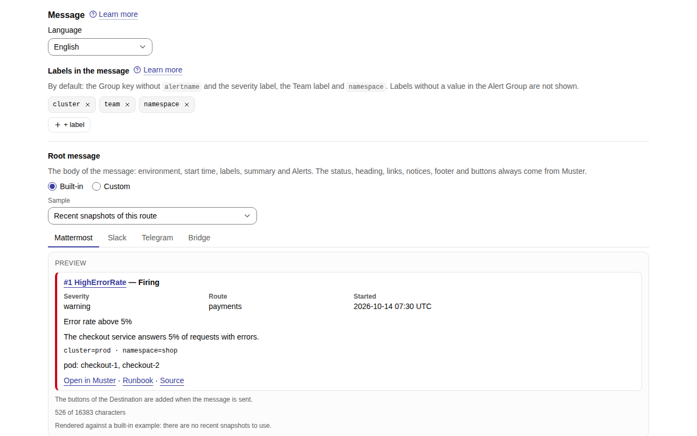
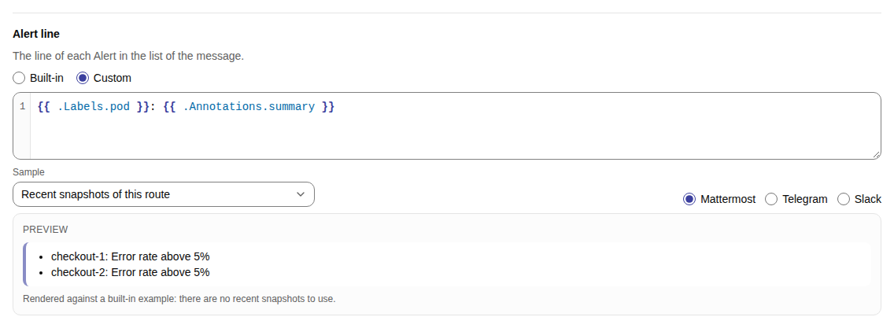
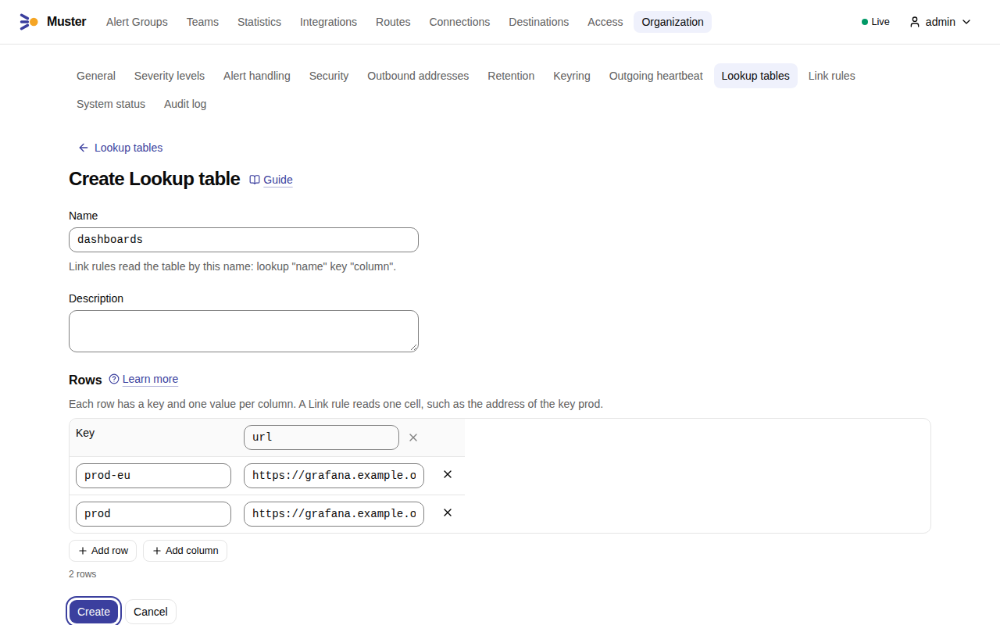
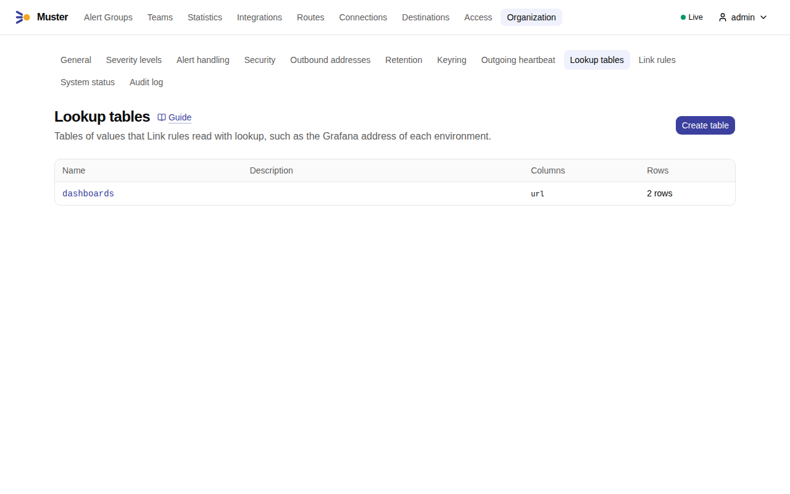
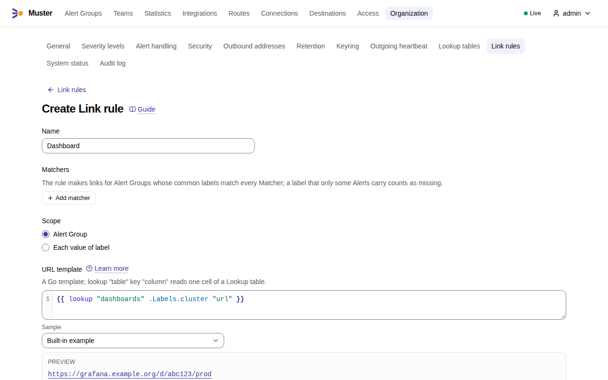
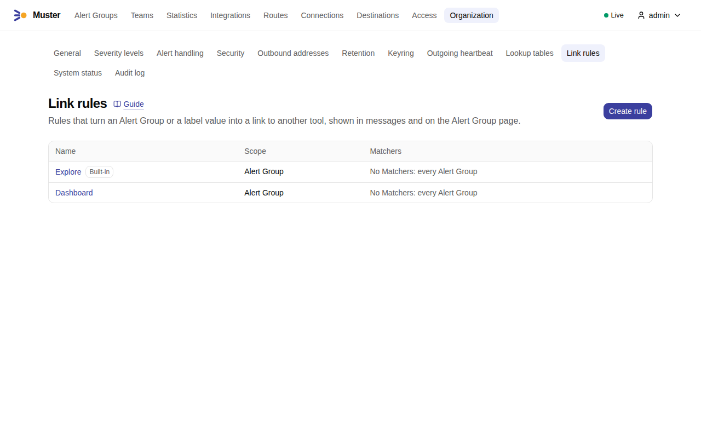

# Messages and templates

Muster shows every Alert Group as one **Root message** in each Destination, and edits it as the Alert Group changes.
Without any setup the message is complete and compact, so that a phone shows what a person needs to act: the number
and title with the status as a word, a few fields, the summary and the description, one line of key labels, the
Alerts by the label that tells them apart, the notices, who has it, the buttons and the links. This page is for the
Admin who wants to change what it says: [the labels it shows](#labels-in-the-message), the template of a Route, whom
a message mentions, and the links it carries.

## The default message

From 0.2.0 every Root message has this layout, here as Telegram shows it; each messenger lays it out in its own form:

```text
#1287 KubernetesContainerOOMKilled — 🟠 Acknowledged
Severity: warning
Route: Infrastructure
Teams: payments
Started: 2026-10-04 03:12 UTC
Container killed for memory
The container exceeded its limit.
system=kubernetes · team=payments · namespace=checkout
pod: checkout-api-5b2c1, checkout-api-7d9f4, checkout-worker-8e6a0
Acknowledged by Olga
Open in Muster · Runbook · Source
[Unack] [Resolve] [Snooze 1 h] …
```

1. **The title**: `#N` and the Alert Group's title, linked to its page, and the status as a word — Firing,
   Acknowledged, Snoozed or Resolved. The status colour stays: as the colour of the message in Mattermost and Slack,
   and as an emoji beside the word in Telegram.
2. **The fields**: Severity, the Alert Group's Severity level; Route; Teams, left out when the Alert Group has none;
   and Started, absolute in the Organization's time zone.
3. **The summary and the description**: the `summary` and `description` annotations of the first Alert that has each,
   as plain text, each left out when no Alert has it.
4. **The key labels**: the labels of the Route's [Labels in the message](#labels-in-the-message), on one line.
5. **The Alerts**, when the Alert Group has more than one: named by the label that tells them apart — the first of
   the Organization's Instance labels whose values differ (`pod`, `instance`, `container`, `endpoint` by default),
   otherwise the first label, by name, whose values differ — with up to five values (`message.compact_alerts_listed`),
   firing Alerts first and resolved ones struck through, then "…and K more".
6. **The notices** that apply, such as "Nobody has taken this" or the Reopen count.
7. **The footer**: who acknowledged, snoozed or resolved the Alert Group, or why Muster resolved it.
8. **The buttons** of the Destination's set.
9. **The links**: "Open in Muster" first, then the runbook, the source and the links of Link rules.

Every other label and annotation is on the Alert Group page, one click away through "Open in Muster".

**Mattermost**
:   One attachment in the colour of the status: the title of item 1 as its title, the fields as short fields, items 3
    to 7 as its text with the links as its last line, and the buttons under it.

**Slack**
:   One attachment in the colour of the status: a section with the title, one section with the fields, a section with
    the summary and the description, the key labels as a context, a section with the Alerts and the notices, the
    footer as a context, a section with the links, and the buttons.

**Telegram**
:   One message: the title with the status emoji beside the word, the fields as lines `Severity: warning`, then the
    items in order, with the buttons as its inline keyboard.

A message longer than its messenger allows — 4,096 characters in Telegram, 3,000 in a Slack section, 16,383 in
Mattermost — loses its description first, then its Alerts, then its summary, then its key labels; the title, the
status, the fields, the footer, the buttons and the link to Muster always stay.

## Labels in the message

"Labels in the message" (`route.message_labels`) chooses the labels of item 4. Choose them in **Routes → a Route →
Message → Labels in the message**: the labels are chips that you remove with their ×, and **+ label** offers the labels
**From recent Alert Groups of the Route**, each with an example value, and takes any other name you type. **Reset to
default** goes back to the computed list. Through the API, give the Route `own_message_labels: true` and its list as
`message_labels` in `updateRoute`, or `own_message_labels: false` to go back to the default. By default the list is the
Route's Group key without `alertname` and the Organization's severity label, which the field Severity already shows,
then the Team label and `namespace`; it follows the Group key and the Organization's settings until the Route has a
list of its own. The preview under the Root message shows the labels saved on the Route.

A label shows as `name=value` when every firing Alert has the same value, as `name: N values` when their values
differ, and not at all when no Alert has it. The Route suggests labels from its recent Alert Groups, each with an
example value (`listRouteLabelSuggestions`). A change of the list, or of the Group key while the list is the default,
edits the open Root messages of the Route, Quietly, to show the new labels.

The open Root messages also follow the Organization's settings and the names of Teams that they show: a change of the
[severity label, the Team label, the Instance labels, the time zone, the start of the working day or the first day of
the week](organization.md) edits every open Root message once, Quietly, and a rename of a Team edits those of the open
Alert Groups that have the Team. A message the change does not alter is not edited, and no change sends a new message or
a Mention.

## What you can change, and what you cannot

A Route has three templates, under **Routes → a Route → Message**. Each is **Built-in** or **Custom**.

**Root message**
:   The body of the message: items 3 to 5 of [the default message](#the-default-message), the summary, the
    description, the key labels and the Alerts. The title with the status, the fields, the notices, the footer, the
    buttons and the links always come from Muster, so no template can lose the buttons or the link to the Alert Group.
    When a template fails, the Fallback template shows every label of the Alert Group and of each Alert instead.

**Alert line**
:   The line of each listed Alert, which then stands on a line of its own instead of the value of the label that tells
    the Alerts apart. It is also called the **Line template**.

**Ack timeout notice**
:   The reply Muster sends when nobody acknowledges an Alert Group in time.

**Language** of the same section sets the language of the built-in texts of the Route, English or Russian
(`route.language`, English by default). Times in messages are absolute and use the Organization's time zone, never
relative: see [Organization settings](organization.md#general).

Choosing **Custom** fills the editor with the source of the built-in template in the Route's language, so you start
from what people see today and edit it. Choosing **Built-in** again keeps your text until you leave the page.

Each editor has a **Preview** under it. Choose the **Sample** it renders against: a **Built-in example**, the **Recent
snapshots of this route**, or the Stored Snapshots of one Integration; and, for the other templates, the **Markup of the preview**, Mattermost,
Slack or Telegram. The preview of the Root message has the tabs **Mattermost**, **Slack**, **Telegram** and **Bridge**:
each lays out [the default message](#the-default-message) as its messenger does and shows its length against the
messenger's limit, in red when it is over; the **Bridge** tab shows the `layout` a bridge receives as JSON beside the
CommonMark body, and says so when a Route with a template of its own sends the body alone. When you save, Muster parses every template and runs it against the most recent Stored Snapshots of
the Route (up to 20, `template.dry_run_sample`, or the built-in example when there are none). A template that does not
parse, or that calls a function Muster does not have, is **not saved**: the editor marks the error at its line and
column.

The Outgoing webhook Destinations have templates of their own, written the same way: see
[template mode](../outgoing-webhooks/templates.md).

## Edit a Route's message

1. Open **Routes** and the Route, and scroll to **Message**. Choose the **Language** of its built-in texts. Each
   template shows **Built-in** or **Custom**, with its **Preview** under it.

    { .screenshot }

2. Choose **Custom** for the template you change, such as **Alert line**, and edit the source in the editor; it starts
   from the built-in template. The **Preview** renders it as you type, against the **Sample** you choose, in the markup
   of **Mattermost**, **Telegram** or **Slack**. A Route without recent Stored Snapshots renders against the built-in
   example. [The template language](#the-template-language) lists what a template reads.

    { .screenshot }

3. Select **Save**. A template with an error is not saved, and the editor marks the error at its line and column.

## The template language

Templates are Go templates, the language of Alertmanager's own templates, and run in a sandbox:

- The functions are those of Alertmanager's templates under their own names (`toUpper`, `toLower`, `title`, `join`,
  `match`, `reReplaceAll`, `safeHtml`, `stringSlice`, `date`, `tz`, `humanizeDuration`, `toJson` and more), so an
  Alertmanager template usually carries over. On top of them come the string, list, map, conversion and regular
  expression (RE2) functions of the [sprout](https://github.com/go-sprout/sprout) library, `now` and `since` from
  Muster's clock, and two Muster functions: `lookup` (see [Links](#links)) and `mention`.
- There is no function that reads the environment, files or the network; `env` does not exist. Muster has no list of
  functions in the web UI: sprout's documentation and Alertmanager's template reference are the function reference,
  and the editor names an unknown function when you save.
- Loops are capped, a template may run for 2 seconds, and the output is cut at about 50,000 characters
  (`template.output_cap`).
- A label or annotation that is not there is empty text, as in Alertmanager: `{{ .Labels.cluster }}` prints nothing
  and passes `""` to a function, so `toJson` gives `""`, not `null`. Tell a missing value apart with `if` or `or`,
  as in `{{ or .CommonLabels.team "none" }}`.

What the Root message template reads:

`.AlertGroup`
:   `Number`, `Title`, `Summary`, `Status`, `Route`, `SeverityLevel`, `Urgent`, `StartedAt`, `URL`, `ReopenCount`, `Owner`.

`.Alerts`, `.Status`, `.GroupLabels`, `.CommonLabels`, `.CommonAnnotations`, `.ExternalURL`
:   As in Alertmanager's templates. `.Alerts.Firing` and `.Alerts.Resolved` select by status.

The line template reads **one Alert** directly, as `.Labels`, `.Annotations`, `.Status`, `.StartsAt`, `.EndsAt`,
`.GeneratorURL` and `.Fingerprint`, and `.AlertGroup` as above.

Alert data is safe by construction. Label and annotation values arrive already escaped for the Destination's markup,
cut at 4 KB each (`message.value_cap`), and an `@` in them is neutralised with a zero-width space, so `@channel` in a
label notifies nobody. Links in messages are `http` or `https` only.

!!! tip "Two small examples"
    A line template that shows the pod and its summary:

    ```
    {{ .Labels.pod }}: {{ .Annotations.summary }}
    ```

    A Root message template that shows the summary and the pods that fire:

    ```
    {{ .AlertGroup.Summary }}
    {{ range .Alerts.Firing }}- {{ .Labels.pod }}
    {{ end }}
    ```

    Check both in the preview with a sample that has Alerts before you save.

If a template that was saved fails later, on data it did not expect, Muster does not drop the message. It renders the
**Fallback template** instead, which shows every label under Muster's heading, footer and buttons. The Route shows
**Template error** with the time and the error, the Timeline records that the fallback was used, and the Internal alert
`MusterTemplateError` fires until the template renders again; see its
[runbook](../operations/runbooks/MusterTemplateError.md). **Organization → System status** lists the template errors.

A long message is shortened to the limit of the messenger by cutting the list of Alerts first, then the label sections.
It always keeps the title, status, footer, buttons and the link. The list shows up to 10 lines of Alerts
(`message.alerts_listed`); above that it shows the distinct values of each label that differs, and "Full list in
Muster".

## Whom a message mentions

Each Destination has a **Mentions** section for six kinds of Loud event: nobody by default, or everyone in the chat,
chosen Muster users, or messenger groups, as far as the messenger offers them (`destination.mentions`). The
[Loud and Quiet](../concepts/loud-and-quiet.md#mentions) page lists what each Destination type takes and why a user
needs an Account link to be mentioned.

In a template, `{{ mention "all" }}`, `{{ mention "channel" }}`, `{{ mention "here" }}`, `{{ mention "owner" }}` and
`{{ mention "group" "oncall" }}` write a trusted Mention that Muster renders for the messenger. A literal `@all` written
in a template is escaped and mentions nobody.

## Links

Links to other tools come from data, not from code in a message: Link rules read Lookup tables. They appear as one line
in the message and as the **Links** block on the Alert Group page.

### Add a Lookup table

A **Lookup table** is a table of values: a key and one value per named column. Limits: 50 columns and 10,000 rows,
names and column names up to 200 characters, a description up to 2,000, a key or value up to 4,096
(`lookup_table.size_max`).

1. Open **Organization → Lookup tables** and select **Create table**.
2. Enter the **Name** that Link rules read the table by, and a **Description** if you like. Under **Rows**, name the
   first column, add more with **Add column**, and add each row with **Add row**: its **Key** and a value per column.

    { .screenshot }

3. Select **Create**. The list of Lookup tables shows the table with its number of rows.

    { .screenshot }

### Add a Link rule

A **Link rule** turns an Alert Group, or each value of a label, into a link. Its fields:

**Name**
:   Shown as the text of the link.

**Matchers**
:   Conditions on the Alert Group's common labels. A label that only some Alerts carry counts as missing. Without
    Matchers the rule applies to every Alert Group.

**Scope**
:   **Alert Group** gives one link. **Each value of label** gives one link per distinct value of a label among the
    Alerts.

**URL template**
:   A Go template. It reads `.Labels` (the common labels for the scope Alert Group, the labels of the first Alert with
    the value otherwise), `.Value` (the label's value) and the data of the Root message template. `lookup "table" key
    "column"` reads one cell and gives an empty text when the table, the key or the column does not exist. A template
    that writes nothing, or something that is not an `http` or `https` URL, gives no link.

1. Open **Organization → Link rules** and select **Create rule**.
2. Fill in the fields above. The **Preview** under the URL template shows the link that the rule makes for the
   **Sample** you choose, a built-in example or a recent Alert Group.

    { .screenshot }

3. Select **Create**. The list of Link rules shows the rule beside the built-in **Explore**.

    { .screenshot }

All the Link rules of one message together read at most 100 rows with `lookup` in one render
(`template.lookups_per_render`); the 101st is a template error, and a Link rule that fails is left out of the message
and counted.

Example: a dashboard per cluster.

1. Create the Lookup table `dashboards` with the column `url` and one row for each cluster: the key `prod-eu`, the
   value `https://grafana.example.org/d/abc123/prod-eu`.
2. Create the Link rule `Dashboard`, scope **Alert Group**, with the URL template
   `{{ lookup "dashboards" .Labels.cluster "url" }}`. An Alert Group without a common `cluster` looks up an empty key
   and gets no link: a missing label is [empty text](#the-template-language).
3. The preview of the rule shows the link for a sample. Alert Groups with `cluster="prod-eu"` now carry **Dashboard**.

A rule with the scope **Each value of label** and the label `pod` can build one log link per pod:
`https://logs.example.org/search?pod={{ .Value | urlquery }}`.

Muster adds links without a rule as well: the annotations `runbook_url` and `dashboard_url`, shown as **Runbook** and
**Dashboard**, and the `generatorURL` of the first firing Alert, shown as **Source**.

The built-in Link rule **Explore** opens the query of the Alert in Grafana's Explore. It reads the Lookup table
`grafana` with the columns `address` (the address of your Grafana) and `datasource_uid`, and the key is the value of the
`environment` label, else of the `cluster` label. It cannot be deleted, renamed or given another scope; its Matchers and
URL template can be changed. A Lookup table that a Link rule reads cannot be deleted or renamed.

The API has `lookup-tables` and `link-rules` for the same: see the [API reference](../reference/api.md). A list of
Lookup tables comes at most 50 to a page (`lookup_table.page_max`), since each carries its rows.

## Thread replies

Lifecycle events that are Thread replies, such as a Takeover or a Reopen, are sent at once. Only new Alerts are
batched, by the Route's **Thread batching window** (**Routes → a Route → Delivery**, `route.thread_batching_window`, 60
seconds by default): the first new Alert is sent at once and opens the window, and the new Alerts that arrive within it
are sent as one reply when it closes. After a quiet period longer than the window, the next one is again immediate. A
reply lists the first 10 new Alerts and then "…and K more" (`delivery.thread_alerts_listed`).
