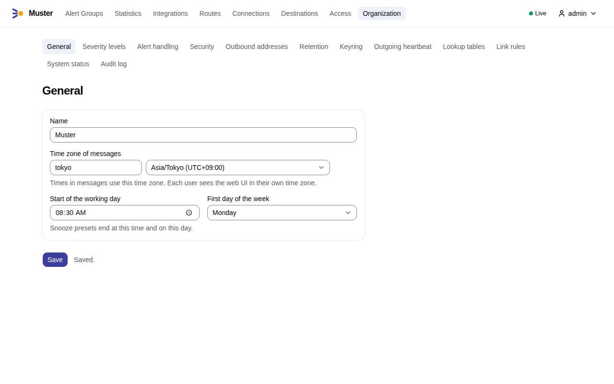
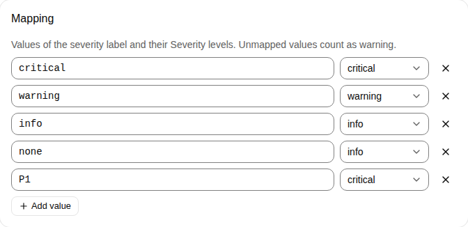
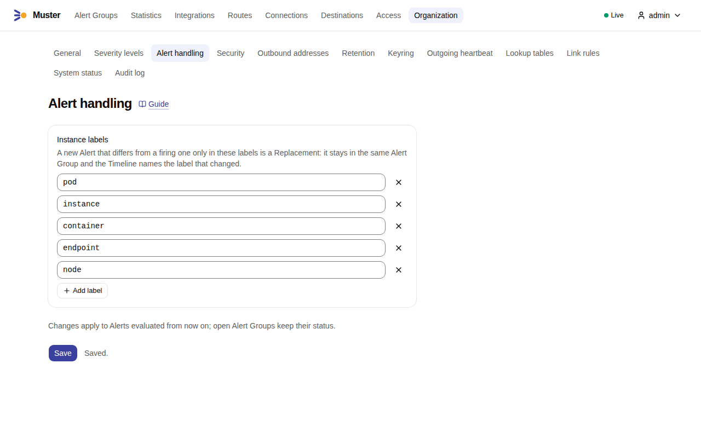
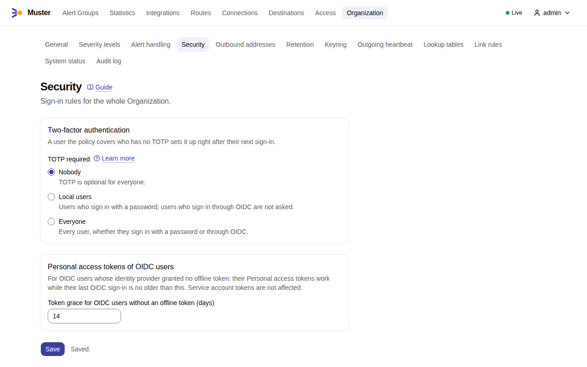
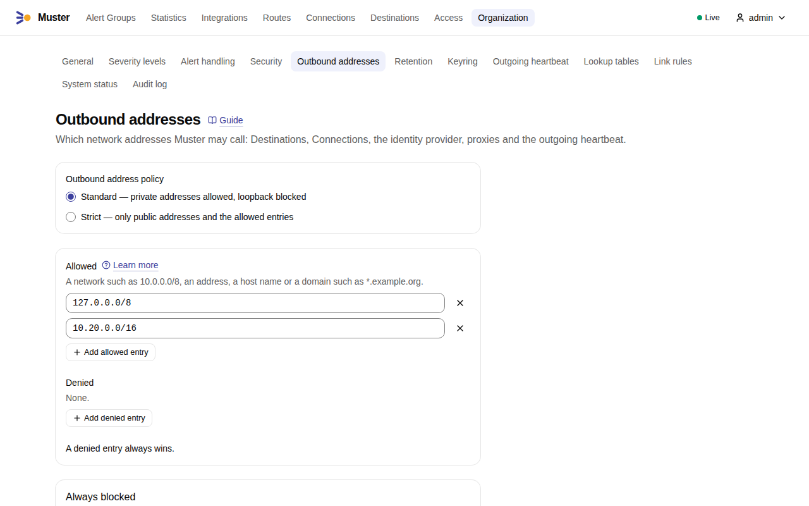
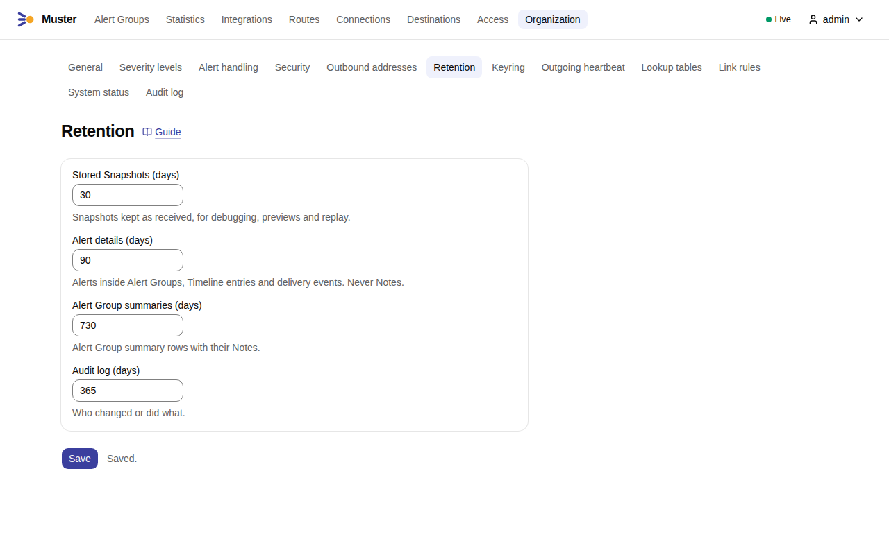
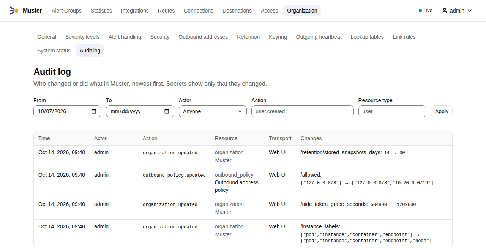
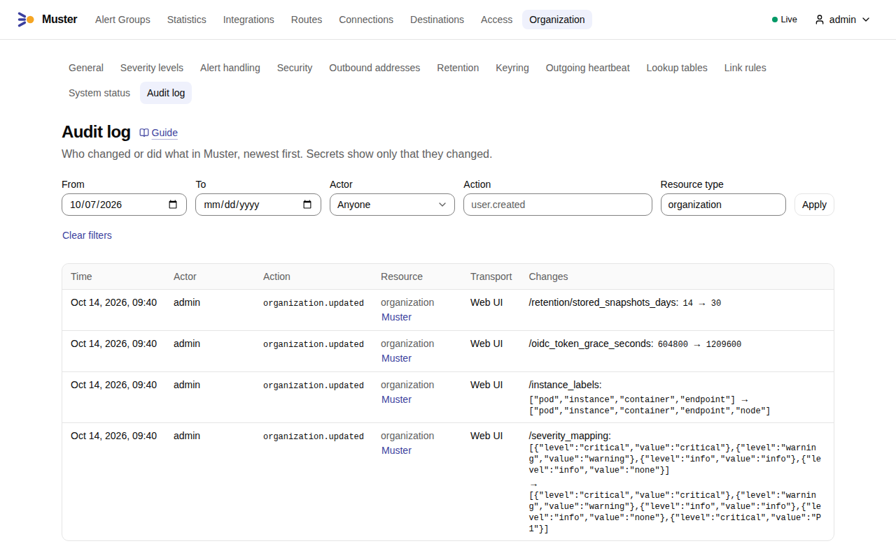

# Organization settings

The **Organization** is the owner of all Users, Routes and data in Muster; there is one. Its settings change behaviour
for everyone, so only Admins open them: choose **Organization** in the main navigation, then a page of its
sub-navigation. Every change is recorded in the Audit log (**Organization → Audit log**) with a before and after, and two Admins
editing the same page do not overwrite each other: the second save is refused with "Someone else changed these settings.
Reload to see them.", and you
reload and apply your change again.

The defaults below are what a new installation has.

## General

**Organization → General**

**Name** (`organization.name`, `Muster`)
:   The name of the Organization.

**Time zone of messages** (`organization.time_zone`, `UTC`)
:   The time zone of every time in a message in a messenger. It is `UTC` until you change it, so a new installation
    shows times such as "started 07:12" in UTC. Times in messages are absolute, never "5 minutes ago". Each User sees the
    web UI in their own time zone, which they set in their profile.

**Start of the working day** (`organization.workday_start`, `09:00`) and **First day of the week** (`organization.week_start`, `monday`)
:   The Snooze presets "Until tomorrow 09:00" and "Until Monday 09:00" end at this time of day and on this day, in the
    time zone of the person who snoozes. A change applies to Snoozes set afterwards; a Snooze already set does not move.
    See [statuses and commands](../concepts/statuses-and-commands.md).

1. Open **Organization**; **General** opens first.
2. Change the **Name**, the **Time zone of messages** — type in **Search time zones** to narrow the list —, the **Start
   of the working day** or the **First day of the week**, and select **Save**. "Saved." confirms it.

    { .screenshot }

## Severity levels

**Organization → Severity levels**

Alerts say how bad they are in a label. Muster turns its values into three **Severity levels**: critical, warning and
info.

**Severity label** (`organization.severity_label`, `severity`)
:   The label that carries the severity.

**Mapping** (`organization.severity_mapping`)
:   Values of that label and their level. By default `critical` is critical, `warning` is warning, and `info` and `none`
    are info. A label that is missing counts as info; any other value counts as warning and is shown as received.

**Emoji and colours** (`organization.severity_styles`)
:   The emoji and the colour of each level: critical 🟥 `#d32f2f`, warning 🟧 `#f57c00`, info 🟦 `#1976d2`.

**Values seen** (`organization.severity_values_window`, the last 14 days)
:   The values of the severity label that arrived, with their counts. A value with no mapping is marked "No mapping —
    counts as warning" and has a **Map** action. If your alerts use `P1` and `page`, map them to critical here.

1. Open **Organization → Severity levels**.
2. Under **Mapping**, select **Add value**, enter the value, such as `P1`, and choose its level; or select **Map** next
   to a value under **Values seen**. Select **Save**.

    { .screenshot }

## Alert handling

**Organization → Alert handling**

**Instance labels** (`organization.instance_labels`, `pod`, `instance`, `container`, `endpoint`)
:   A new Alert that differs from a firing one only in these labels is a **Replacement**: it stays in the same Alert
    Group, and the Timeline names the label that changed.

From 0.2.0 the page has no **Critical is Urgent** switch: an Alert Group is
[Urgent](../concepts/routes-and-group-keys.md#urgent) exactly when its Severity level is critical.

Changes to Severity levels and Instance labels apply to Alerts evaluated from then on. Open Alert Groups keep their
status.

1. Open **Organization → Alert handling**.
2. Change the **Instance labels**: **Add label** adds one, the × next to a label removes it. Select **Save**.

    { .screenshot }

## Security

**Organization → Security**

**TOTP required** (`organization.totp_required`, **Nobody**)
:   **Nobody**, **Local users** (Users who sign in with a password) or **Everyone** (OIDC users too). A person the
    policy covers who has no TOTP sets it up right after their next sign-in. See [TOTP](../sign-in/totp.md).

**Token grace for OIDC users without an offline token** (`auth.oidc_token_grace`, 7 days)
:   Applies to Users who sign in through OpenID Connect when the identity provider granted no offline token. Their
    Personal access tokens work while their last OIDC sign-in is no older than this; after that they get `401` with the
    code `oidc_recheck_required` until the person signs in through OIDC again. Service account tokens are not affected.
    See [API tokens and automation](api-tokens.md).

1. Open **Organization → Security**.
2. Choose who must have TOTP under **TOTP required**, and change the **Token grace for OIDC users without an offline
   token (days)**. Select **Save**.

    { .screenshot }

## Outbound addresses

**Organization → Outbound addresses**

The **Outbound address policy** (`organization.outbound_policy`) says which network addresses Muster may call:
Destinations, Connections, the identity provider, proxies and the outgoing heartbeat. The check runs after the name is
resolved, so a name that points at a blocked address is blocked.

- **Standard** (the default) allows private addresses and blocks loopback.
- **Strict** allows only public addresses and the entries you allow.

**Allowed** and **Denied** (`organization.outbound_allowed`, `organization.outbound_denied`, both empty) take a network
such as `10.0.0.0/8`, an address, a host name or a domain such as `*.example.org`. A denied entry always wins. Some
addresses are always blocked and no allowed entry opens them: link-local, cloud metadata, unspecified and multicast
addresses. A chat server on the loopback address, for one, needs `127.0.0.0/8` in **Allowed** under Standard.

1. Open **Organization → Outbound addresses**.
2. Choose the **Outbound address policy**. Add entries with **Add allowed entry** and **Add denied entry**, and remove
   one with the × next to it. Select **Save**.

    { .screenshot }

The screenshot is of a development installation, whose test chat servers listen on the loopback address.

## Retention

**Organization → Retention**

**Stored Snapshots (days)** (`retention.stored_snapshots`, 14)
:   Snapshots kept as received, for debugging, previews and replay.

**Alert details (days)** (`retention.alert_details`, 90)
:   Alerts inside Alert Groups, Timeline entries and delivery events. Never Notes.

**Alert Group summaries (days)** (`retention.alert_group_summaries`, 730)
:   The summary row of an Alert Group, with its Notes.

**Audit log (days)** (`retention.audit_log`, 365)
:   Who changed or did what.

Each period is 1 to 36,500 days. The summaries must be kept at least as long as the details, because details go first;
a save that breaks this is refused (`retention_order`).

1. Open **Organization → Retention**.
2. Enter the number of days of each period and select **Save**.

    { .screenshot }

## Audit log

**Organization → Audit log** (Admins only) records who changed or did what, newest first, for the last 7 days by
default: the time, the actor with the token or the Transport it acted through, the action, the resource and the changes
with their values before and after. Secrets show only that they changed. Entries are kept for `retention.audit_log`
days, as [Retention](#retention) sets.

1. Open **Organization → Audit log**.

    { .screenshot }

2. Narrow it with the filters: **From** and **To**, the **Actor**, the **Action**, such as `organization.updated`, and
   the **Resource type**, such as `organization`; select **Apply**, and **Clear filters** to see everything again. The
   filters are kept in the address, so a link to a filtered list can be shared.

    { .screenshot }

3. Read the changes of an entry in its **Changes**: each field with its value before and after.

    { .screenshot }

## Elsewhere

Other Organization pages have their own guides: **Keyring** in [Key rotation](../operations/key-rotation.md), **Outgoing
heartbeat** (`outgoing_heartbeat.url`, unset) in [Outgoing heartbeat](../operations/outgoing-heartbeat.md), **Lookup
tables** and **Link rules** in [Messages and templates](messages-and-templates.md#links), and **System status** in
[Monitoring](../operations/monitoring.md#system-status).

## The API

`GET /api/v1/organization` reads the Organization and its `ETag`; `PUT /api/v1/organization` replaces the fields above
with `If-Match` set to that ETag, as [API tokens and automation](api-tokens.md#conventions) shows. The fields are
`name`, `time_zone`, `workday_start`, `week_start`, `severity_label`, `severity_mapping`, `severity_styles`,
`critical_is_urgent` (ignored from 0.2.0, and always read as `true`), `instance_labels`, `outgoing_heartbeat`
(required, with `proxy`, whose `enabled` is
required; `url` is write-only and kept when omitted), `retention` (`stored_snapshots_days`, `alert_details_days`,
`alert_group_summaries_days`, `audit_log_days`), `totp_required` (`nobody`, `local_users` or `everyone`) and
`oidc_token_grace_seconds`. The outbound policy is `GET` and `PUT /api/v1/organization/outbound-policy`, and the values
seen are `GET /api/v1/organization/severity-values`. Reading the Organization needs any sign-in; reading the outbound
policy and the values seen needs `organization:read`, and changing anything needs `organization:write`; only the Admin
Role holds both. `workday_start` and `week_start` are optional on an update.
