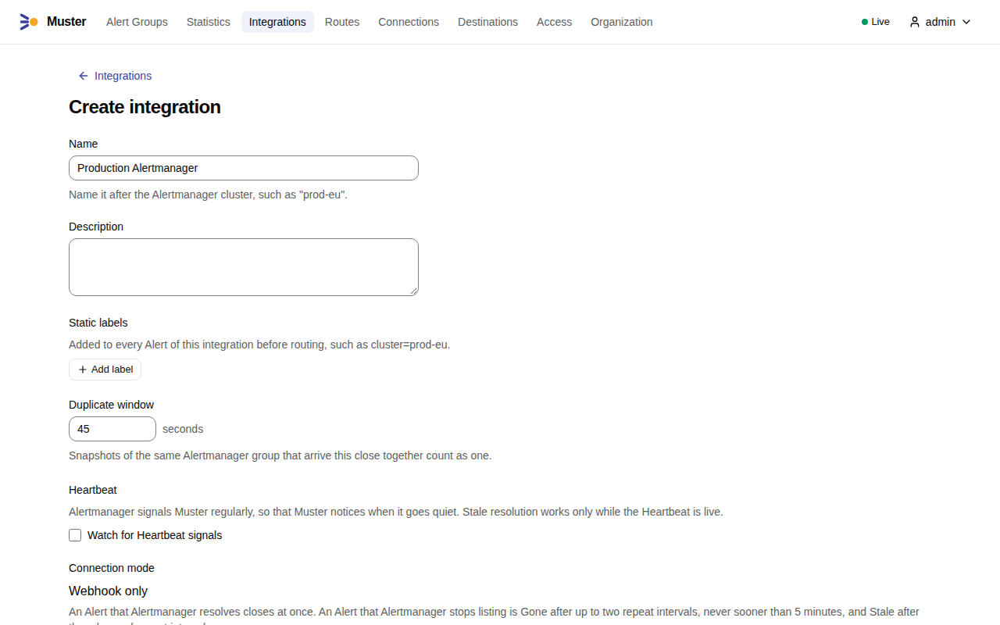
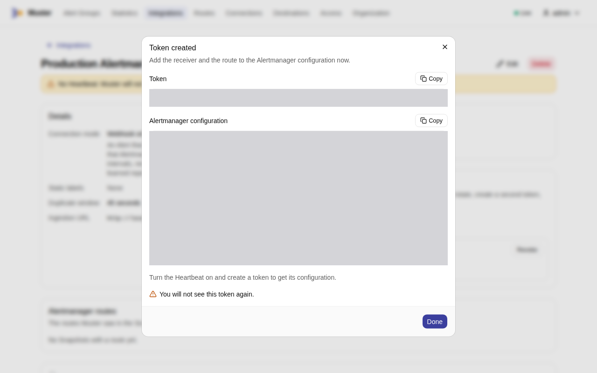
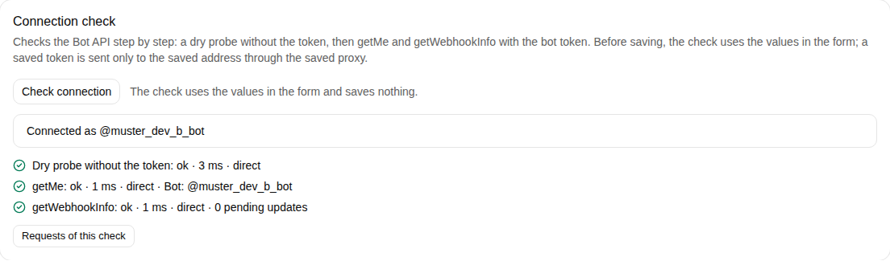
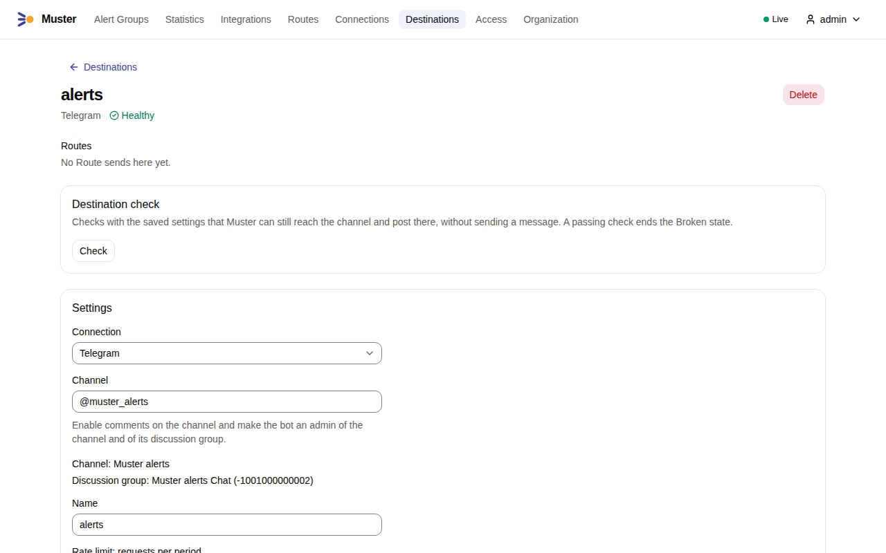
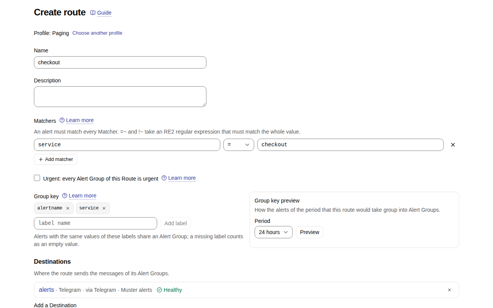
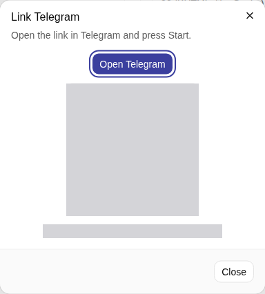
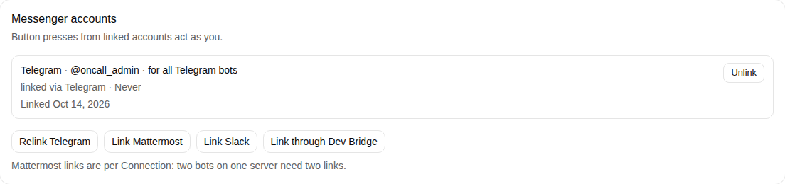
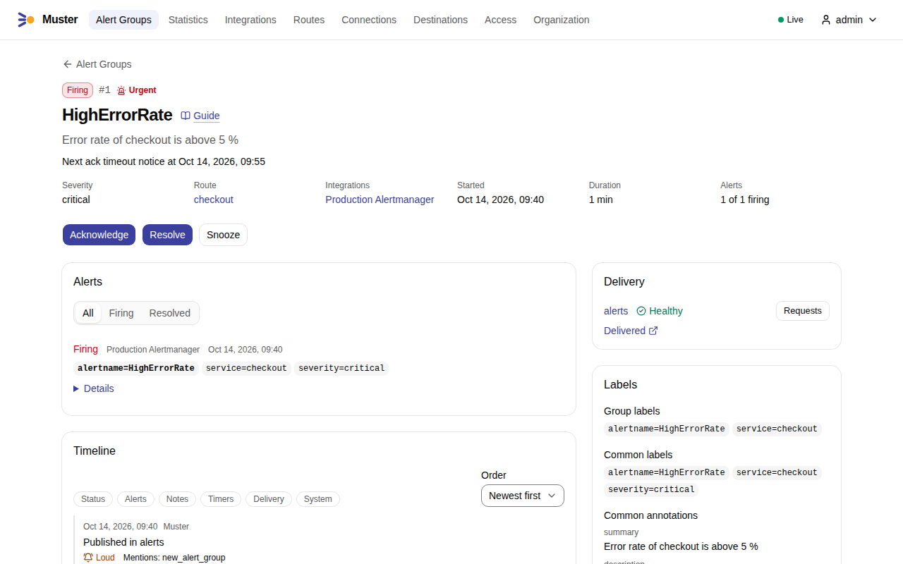
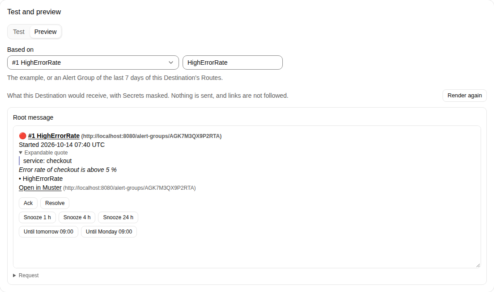
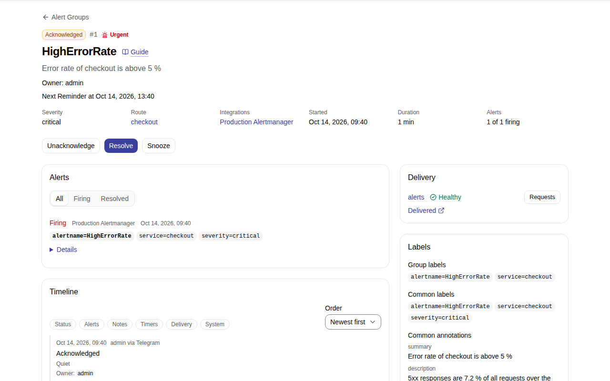

# First alert in a messenger

This tutorial takes one alert from Alertmanager to a Telegram channel and back: you connect Alertmanager, connect a
Telegram bot, send Alert Groups of one service to a channel, and acknowledge the Alert Group from Telegram. It starts
where [Quick start](quick-start.md) ends: Muster runs and you are signed in as the Admin. It takes about fifteen
minutes.

Telegram needs no address of Muster that Telegram can reach: Muster asks Telegram for updates itself. Before you start,
in Telegram:

- create a bot with [@BotFather](https://t.me/BotFather) and copy its token, as
  [Create the bot](messengers/telegram.md#create-the-bot) describes;
- create a channel for the alerts, enable comments on it, and make the bot an admin of the channel and of its
  discussion group, as [Enable comments on the channel](messengers/telegram.md#enable-comments-on-the-channel) and
  [Make the bot an admin](messengers/telegram.md#make-the-bot-an-admin-of-the-channel-and-of-the-group) describe.

The screenshots show the channel `@muster_alerts` and the bot `@muster_dev_b_bot`; yours have your names.

## 1. Create the Integration

An **Integration** is the way one Alertmanager sends to Muster. Open **Integrations**, select **Create integration**,
name it after your Alertmanager, such as `Production Alertmanager`, and select **Create**.

{ .screenshot }

On the Integration's page, under **Tokens**, select **Create token**, name it, such as `alertmanager`, and select
**Create**. The dialog shows the **Token** and the **Alertmanager configuration** once; copy both before you select
**Done**. Add the configuration to your Alertmanager and reload it. In the screenshot both are hidden.

{ .screenshot }

[Connect Alertmanager](integrations/alertmanager.md) explains every line of the configuration.

## 2. Connect Telegram

A **Connection** holds the credentials Muster uses to talk to a messenger, here a Telegram bot. Open **Connections**, select **Create connection** and choose
**Telegram**. Enter a **Name**, such as `Telegram`, select **Set a value** next to **Bot token** and paste the bot's
token. Keep the **Bot API base URL** `https://api.telegram.org` and the **Update mode** **Long polling**.

Select **Check connection**. The check runs in three steps against the values in the form and saves nothing; it names
the bot when they pass. Then select **Save**.

{ .screenshot }

[Connect Telegram](messengers/telegram.md#create-the-connection) explains each field and each step of the check.

## 3. Add a Destination

A **Destination** is the channel Muster posts to. Open **Destinations**, select **Create destination** and choose
**Telegram**. Choose the **Connection** of step 2, enter the **Channel** as `@username`, or its chat id for a private
channel, give it a **Name**, such as `alerts`, and select **Save**. Saving runs the **Destination check**: the bot is
an admin of the channel and of its discussion group. The saved Destination shows the discussion group it found.

{ .screenshot }

Under **Test and preview**, on the tab **Test**, select **Send test message**. A message marked 🧪 appears in the
channel, and the result shows the request Muster sent, with the bot token hidden. Links in the screenshots start with
`http://localhost:8080`, the address of a development installation; yours start with your `MUSTER_PUBLIC_URL`.

{ .screenshot }

[Connect Telegram](messengers/telegram.md#add-a-destination) lists what the Destination check needs and what it says
when it fails.

## 4. Send Alert Groups to the Destination

A **Route** picks Alerts by their labels and decides where their Alert Groups go. Alerts that no other Route takes go
to the **Default route**, which has no Destination yet. Open **Routes**, select **Create route** and choose the profile
**Paging**. Name the Route `checkout` and select **Add matcher**: the label `service`, `=`, the value `checkout`. In
**Group key**, remove `severity` and `cluster` and add `service`, so that each alert name of each service is one Alert
Group. Under **Destinations**, choose `alerts` in **Add a Destination**, then select **Create**.

{ .screenshot }

[Routes and Group keys](concepts/routes-and-group-keys.md) explains Matchers, Group keys and the order of the Routes.

## 5. Link your Telegram account

A button in Telegram acts as a Muster User only through an **Account link**. Open your profile from the user menu and,
under **Messenger accounts**, select **Link Telegram**. With more than one Telegram Connection, choose the one of step
2 and select **Get link**. Select **Open Telegram**, or scan the QR code with your phone, and press **Start** in the
chat with the bot. The link works once and expires after a few minutes; in the screenshot the code and the time are
hidden.

{ .screenshot }

The dialog closes once the bot has linked your account, and your profile shows it.

{ .screenshot }

[Link your messenger accounts](messengers/account-links.md#link-telegram) explains the other messengers.

## 6. Send a test alert

Send an alert of the service `checkout`, as Alertmanager would send it, with the request of
[Quick start](quick-start.md#send-a-test-alert) and the token of step 1 in `TOKEN`:

```sh
TOKEN=mstr_int_...
curl -sS -o /dev/null -w '%{http_code}\n' http://localhost:8080/api/v1/ingest \
  -H "Authorization: Bearer $TOKEN" -H 'Content-Type: application/json' --data-binary @- <<EOF
{
  "version": "4",
  "groupKey": "{}:{alertname=\"HighErrorRate\"}",
  "status": "firing",
  "receiver": "muster-prod-eu",
  "groupLabels": {"alertname": "HighErrorRate"},
  "commonLabels": {"alertname": "HighErrorRate", "service": "checkout", "severity": "critical"},
  "commonAnnotations": {"summary": "Error rate of checkout is above 5 %"},
  "externalURL": "http://localhost:9093",
  "alerts": [
    {
      "status": "firing",
      "labels": {"alertname": "HighErrorRate", "service": "checkout", "severity": "critical"},
      "annotations": {"summary": "Error rate of checkout is above 5 %"},
      "startsAt": "$(date -u +%Y-%m-%dT%H:%M:%SZ)",
      "endsAt": "0001-01-01T00:00:00Z"
    }
  ]
}
EOF
```

Muster answers `202`. Open **Alert Groups**: the Alert Group `HighErrorRate` is there, Firing, on the Route
`checkout`. Its page shows the Alert, its labels, its delivery to `alerts` and its Timeline.

{ .screenshot }

At the same moment the bot posts its **Root message** in the channel: the status, the title, the labels and the
buttons. The Destination's **Preview**, based on the Alert Group, shows that message as Telegram draws it.

{ .screenshot }

[Alert Groups](concepts/alert-groups.md) explains how Alerts become Alert Groups.

## 7. Acknowledge it in Telegram

In the channel, press **Ack** under the Root message. Telegram shows "Done: Acknowledge", the message changes to
Acknowledged, and the Alert Group's page names you as its **Owner**. Its Timeline records that you acknowledged it
through Telegram.

{ .screenshot }

[Statuses and commands](concepts/statuses-and-commands.md) lists what each button does.

## Next steps

Mattermost, Slack and Bridges differ only in steps 2, 3 and 5:

- **Mattermost**: [create the Connection](messengers/mattermost.md#create-the-connection) with the server's address and
  a bot token, [add a Destination](messengers/mattermost.md#add-a-destination) for a channel the bot is a member of, and
  [link the account](messengers/account-links.md#link-mattermost) with a code the bot sends. Mattermost calls Muster for
  button presses, so it must reach `MUSTER_INGEST_URL`.
- **Slack**: [create the app and the Connection](messengers/slack.md#create-the-connection), invite the bot and
  [create Destinations](messengers/slack.md#invite-the-bot-and-create-destinations), and
  [link the account](messengers/account-links.md#link-slack). In Socket Mode, Slack needs no address of Muster.
- **Any other messenger** through a [Bridge](messengers/bridge.md#create-the-connection), with a Destination for each
  [channel](messengers/bridge.md#add-a-destination).

Then set the [time zone of the Organization](configure/organization.md#general), change
[what messages say](configure/messages-and-templates.md), and watch the path from Alertmanager with a
[Heartbeat](integrations/heartbeat.md).
