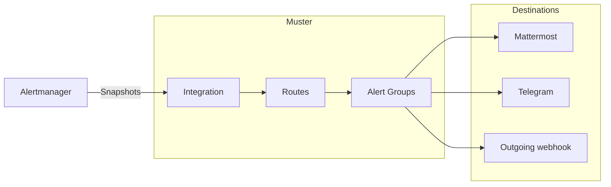

# Muster

Muster is a self-hosted alert grouping and on-call service that sits after Alertmanager. It groups Alerts into Alert
Groups, the problems people act on; keeps one editable message per Alert Group in Mattermost, in Telegram or behind an
outgoing webhook; and lets people acknowledge, resolve and snooze Alert Groups.

The Alertmanager of each cluster sends its notifications to an Integration of Muster. Routes pick Alerts by their
labels, group them into Alert Groups and decide the Destinations they are delivered to, and Muster keeps the message
of each Alert Group there up to date until the Alert Group is resolved.

## Sections

- [Alertmanager](integrations/alertmanager.md): connect the Alertmanager of a cluster, and watch the path from it with
  a [Heartbeat](integrations/heartbeat.md).
- [Messengers](messengers/mattermost.md): connect [Mattermost](messengers/mattermost.md) and
  [Telegram](messengers/telegram.md), and [link your messenger accounts](messengers/account-links.md).
- [Outgoing webhooks](outgoing-webhooks/events.md): send the lifecycle events of Alert Groups in the
  [events mode](outgoing-webhooks/events.md), or keep a message in any chat in the
  [template mode](outgoing-webhooks/templates.md).
- [Sign-in](sign-in/oidc-keycloak.md): sign in with OpenID Connect, shown with Keycloak.
- [Reference](reference/index.md): metrics, log events, Internal alerts, environment variables, chart values and the
  API.
