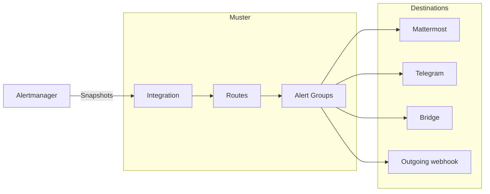

# Muster

Muster is a self-hosted alert grouping and on-call service that sits after Alertmanager. It groups Alerts into Alert
Groups, the problems people act on; keeps one editable message per Alert Group in Mattermost, in Telegram, in any other
messenger through a Bridge, or behind an outgoing webhook; and lets people acknowledge, resolve and snooze Alert Groups.

The Alertmanager of each cluster sends its notifications to an Integration of Muster. Routes pick Alerts by their
labels, group them into Alert Groups and decide the Destinations they are delivered to, and Muster keeps the message
of each Alert Group there up to date until the Alert Group is resolved.

## Sections

- [Quick start](quick-start.md): run Muster with Docker Compose, sign in, connect Alertmanager and send a test alert,
  in about five minutes.
- [Install](install/helm.md): run Muster in production with [Helm](install/helm.md) and an external
  [PostgreSQL](install/database.md), and read the [requirements and tested versions](install/versions.md) and how
  to verify a release.
- [Integrations](integrations/alertmanager.md): connect the Alertmanager of a cluster, connect
  [Grafana Alerting](integrations/grafana.md) directly or through an Alertmanager, and watch the path from Alertmanager
  with a [Heartbeat](integrations/heartbeat.md).
- [Messengers](messengers/index.md): see what each Destination type can do, connect [Mattermost](messengers/mattermost.md) and
  [Telegram](messengers/telegram.md), reach any other messenger through a [Bridge](messengers/bridge.md) (and
  [write one](messengers/write-a-bridge.md)), [link your messenger accounts](messengers/account-links.md), and set a
  [proxy](messengers/proxies.md) for a client.
- [Outgoing webhooks](outgoing-webhooks/events.md): send the lifecycle events of Alert Groups in the
  [events mode](outgoing-webhooks/events.md), or keep a message in any chat in the
  [template mode](outgoing-webhooks/templates.md); [recipes](outgoing-webhooks/recipes.md) for a phone call, a status page,
  a second chat and an issue tracker.
- [Configure](configure/messages-and-templates.md): change what [messages and templates](configure/messages-and-templates.md)
  say, add links with Lookup tables and Link rules, set the [Organization](configure/organization.md), and automate
  with [API tokens](configure/api-tokens.md).
- [Sign-in](sign-in/index.md): Roles and ways to sign in; [OpenID Connect with Keycloak](sign-in/oidc-keycloak.md),
  [TOTP](sign-in/totp.md), and [closed networks](sign-in/closed-networks.md).
- [Concepts](concepts/alert-groups.md): what an [Alert Group](concepts/alert-groups.md) is, how
  [Routes and Group keys](concepts/routes-and-group-keys.md) group Alerts, the rules of
  [Snapshots](concepts/snapshot-semantics.md), [Loud and Quiet](concepts/loud-and-quiet.md) messages, the
  [statuses and commands](concepts/statuses-and-commands.md), and [Broken Destinations](concepts/broken-destinations.md).
- [Operations](operations/backup-and-restore.md): [back up and restore](operations/backup-and-restore.md),
  [upgrade](operations/upgrades.md), [rotate the master keys](operations/key-rotation.md), run
  [more than one replica](operations/high-availability.md), [monitor Muster](operations/monitoring.md), set an
  [outgoing heartbeat](operations/outgoing-heartbeat.md), use the [command line](operations/cli.md), and read the
  [Request log](operations/request-log.md).
- [Runbooks](operations/runbooks/index.md): what each alert about Muster means and how to fix it.
- [Reference](reference/index.md): metrics, log events, Internal alerts, environment variables, chart values, the API
  and the Bridge protocol.

## AI agents

AI agents and coding assistants start at [llms.txt](llms.txt): the map of this documentation for agents, with a
Markdown version of every page and the full text in one file.
