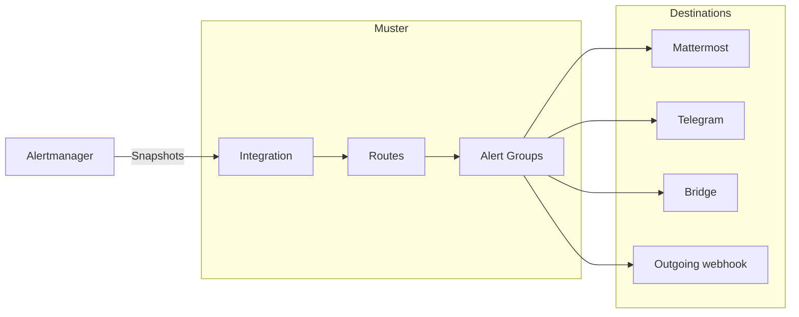

# Muster

Muster is a self-hosted alert grouping and on-call service that sits after Alertmanager. It groups Alerts into Alert
Groups, the problems people act on; keeps one editable message per Alert Group in Mattermost, in Telegram, in any other
messenger through a Bridge, or behind an outgoing webhook; and lets people acknowledge, resolve and snooze Alert Groups.

The Alertmanager of each cluster sends its notifications to an Integration of Muster. Routes pick Alerts by their
labels, group them into Alert Groups and decide the Destinations they are delivered to, and Muster keeps the message
of each Alert Group there up to date until the Alert Group is resolved.

## Sections

- [Quick start](quick-start.md): run Muster with Docker Compose, sign in, connect Alertmanager and send a test alert,
  in about five minutes.
- [Install](install/helm.md): run Muster in production with [Helm](install/helm.md) and an external
  [PostgreSQL](install/database.md).
- [Alertmanager](integrations/alertmanager.md): connect the Alertmanager of a cluster, watch the path from it with a
  [Heartbeat](integrations/heartbeat.md), and send [Grafana Alerting](integrations/grafana.md) through it.
- [Messengers](messengers/mattermost.md): connect [Mattermost](messengers/mattermost.md) and
  [Telegram](messengers/telegram.md), reach any other messenger through a [Bridge](messengers/bridge.md) (and
  [write one](messengers/write-a-bridge.md)), [link your messenger accounts](messengers/account-links.md), and set a
  [proxy](messengers/proxies.md) for a client.
- [Outgoing webhooks](outgoing-webhooks/events.md): send the lifecycle events of Alert Groups in the
  [events mode](outgoing-webhooks/events.md), or keep a message in any chat in the
  [template mode](outgoing-webhooks/templates.md).
- [Sign-in](sign-in/index.md): Roles and ways to sign in; [OpenID Connect with Keycloak](sign-in/oidc-keycloak.md),
  [TOTP](sign-in/totp.md), and [closed networks](sign-in/closed-networks.md).
- [Runbooks](operations/runbooks/index.md): what each alert about Muster means and how to fix it.
- [Reference](reference/index.md): metrics, log events, Internal alerts, environment variables, chart values, the API
  and the Bridge protocol.
