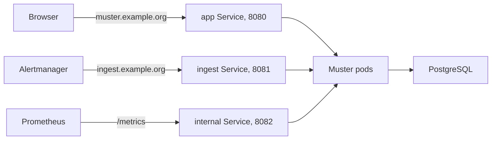

# Install with Helm

The Helm chart runs Muster on Kubernetes 1.30 or newer. It deploys Muster and its Services, and optionally an Ingress or
Gateway API routes, a PodDisruptionBudget, a ServiceMonitor, a NetworkPolicy, alert rules and a dashboard. It does not
include PostgreSQL: Muster takes an [external database](database.md). For a first try on one machine, use the
[Quick start](../quick-start.md) with Docker Compose instead.



## Get the chart

Each release publishes the chart as an OCI artifact in the registry of the image:

```sh
helm install muster oci://ghcr.io/muster-io/charts/muster --version <version> \
  --namespace muster --create-namespace -f values.yaml
```

The release signs the chart with cosign, keyless, as it signs the image; [Verify a release](versions.md#verify-a-release)
shows how to check the signature before you install. Artifact Hub lists the released versions of the chart, each
with its changes and the image it runs, pinned by digest: [Muster on Artifact Hub](https://artifacthub.io/packages/search?repo=muster).

!!! note "Before the first release"
    Nothing is released yet, so the registry holds no chart. Install it from a clone of the repository instead, with the
    development image of `master`:

    ```sh
    git clone https://github.com/muster-io/muster && cd muster
    helm install muster deploy/helm/muster --namespace muster --create-namespace \
      -f values.yaml --set image.tag=edge
    ```

    The chart in the repository has the version `0.0.0`, and its `image.tag` defaults to `appVersion`, which names no
    existing image. A release sets the chart's version to its tag without the `v`, such as `1.2.3`, and `appVersion` to
    the tag itself, such as `v1.2.3`.

## Create the Secret

The chart never generates the master keys. Create a Secret yourself and name it in `existingSecret`; rendering fails
without it. The Secret holds, under the key names that the values `masterKeysKey`, `database.passwordKey` and
`bootstrapAdmin.passwordKey` name:

`secret-keys`
:   the default of `masterKeysKey`

    Holds the master key of the Keyring, as `openssl rand -base64 32` prints it.

`database-password`
:   the default of `database.passwordKey`

    Holds the password of the database user, unless `database.existingSecret` names another Secret for it.

`bootstrap-password`
:   no default; set `bootstrapAdmin.passwordKey`

    Holds the password of the first Admin.

```sh
kubectl create namespace muster
kubectl -n muster create secret generic muster \
  --from-literal=secret-keys="$(openssl rand -base64 32)" \
  --from-literal=database-password='<the database password>' \
  --from-literal=bootstrap-password="$(openssl rand -hex 16)"
```

The pods mount the Secret as files and read the values through `MUSTER_SECRET_KEYS_FILE`,
`MUSTER_DATABASE_PASSWORD_FILE` and `MUSTER_BOOTSTRAP_ADMIN_PASSWORD_FILE`, so no secret appears in the pod's
environment, except the whole database URL when you name its key in `database.urlKey`.

When another operator keeps the database credentials in a Secret of its own, name that Secret in
`database.existingSecret` instead of copying the password: `database.passwordKey` and `database.urlKey` then name keys
of that Secret, and the master keys and the password of the first Admin stay in `existingSecret`. For the Secret
`muster-db-app` that CloudNativePG generates:

```yaml
existingSecret: muster
database:
  existingSecret: muster-db-app
  urlKey: uri
```

[The database](database.md#cloudnativepg) shows the form with `sslmode`.

!!! warning "Keep a copy of the master key"
    Muster refuses to start on a database without the key that wrote it, and a restored database is useless without it.
    Keep a copy **apart from the database backups**: see [Backup and restore](../operations/backup-and-restore.md).

A tool that manages Secrets, such as External Secrets or Sealed Secrets, works the same way: it only has to produce a
Secret of that name with those keys.

## Values

A short `values.yaml` for an installation with an Ingress and an external database:

```yaml
existingSecret: muster

database:
  host: muster-db-rw.muster.svc
  name: muster
  user: muster
  sslmode: require

publicURL: https://muster.example.org
ingestURL: https://ingest.example.org

bootstrapAdmin:
  email: admin@example.org
  passwordKey: bootstrap-password

replicas: 2
podDisruptionBudget:
  enabled: true

ingress:
  enabled: true
  className: nginx
  app:
    hosts:
      - host: muster.example.org
    tls:
      - secretName: muster-tls
        hosts: [muster.example.org]
  ingest:
    hosts:
      - host: ingest.example.org
    tls:
      - secretName: muster-ingest-tls
        hosts: [ingest.example.org]
```

`publicURL` is required: the chart renders without it, but Muster stops at start. The notes that `helm install` prints
warn about a missing `publicURL` or a missing database. `bootstrapAdmin` creates the first Admin once; after the first
Admin exists, Muster ignores it. Everything else about the installation — Connections, Integrations, Routes, people —
is configuration in the database and changes in the web UI and the API, never in the chart.

The full list of values, with types and defaults, is the [chart values reference](../reference/chart-values.md). The
chart rejects a value it does not know. Environment variables that have no value of their own go into `extraEnv`; the
[environment reference](../reference/environment.md) lists them.

The chart sets `MUSTER_MIGRATE_ON_START` off and runs `muster migrate` in an init container instead, under a database
lock, so that the pods of a rollout do not migrate at once. The pods run as a non-root user with a read-only root file
system. The readiness probe checks only the database, and a startup probe gives a slow start up to five minutes.

## The two public addresses

Muster has two addresses that other systems use, and the chart takes both as values:

`publicURL`
:   environment variable: `MUSTER_PUBLIC_URL`

    Used for people: the web UI, links in messages, the OIDC redirect.

`ingestURL`
:   environment variable: `MUSTER_INGEST_URL`

    Used for machines: Alertmanager, Heartbeats, Mattermost button callbacks, the Telegram webhook, and the button
    presses of Slack Connections in the HTTP event mode.

`ingestURL` defaults to `publicURL`. Muster never derives either from an Ingress or a route: set them to the addresses
that people and machines really use, or the links it builds will be wrong.

Muster serves ingestion on its own listener (`8081`) apart from the web UI and the API (`8080`), and the chart gives
each a Service. A separate address for ingestion lets you expose the two differently: the web UI only inside the company
network, and ingestion to Alertmanagers in other networks, or the other way round, with different TLS settings, rate
limits and firewall rules on each. It also keeps a burst of Snapshots away from the web UI's address. When you have no
such need, give both the same host name and send the paths `/api/v1/ingest`, `/api/v1/heartbeat` and
`/api/v1/callbacks/` (with everything below them) to the ingest Service and everything else to the app Service, as
[Connect Alertmanager](../integrations/alertmanager.md#behind-a-reverse-proxy) describes.

The third listener, `8082`, serves `/health/live`, `/health/ready` and `/metrics`. It has a Service and no Ingress or
route; do not expose it outside the cluster.

## Ingress

`ingress.enabled` creates two Ingress objects, one for the app Service and one for the ingest Service. List the hosts of
each under `ingress.app.hosts` and `ingress.ingest.hosts`, with their `tls` blocks, and set `ingress.className` and
`ingress.annotations` for your controller. A host takes an optional `path` (`/` by default) and `pathType` (`Prefix`).
Annotations apply to both Ingress objects. Set the body size limit of your controller to at least 16 MB for the ingest
host, because Muster accepts Snapshots up to that size.

## Gateway API

`httpRoute.enabled` creates two `HTTPRoute` objects (`gateway.networking.k8s.io/v1`) instead of Ingress objects, one
for each Service. Name the Gateway in `httpRoute.parentRefs` and the host names in `httpRoute.app.hostnames` and
`httpRoute.ingest.hostnames`:

```yaml
httpRoute:
  enabled: true
  parentRefs:
    - name: public
      namespace: gateway
  app:
    hostnames: [muster.example.org]
  ingest:
    hostnames: [ingest.example.org]
```

The chart does not create the Gateway and its certificates. The Gateway API resources must be installed in the cluster
and the Gateway must accept routes from the namespace of Muster. Use `ingress` or `httpRoute`, not both.

## Replicas and the PodDisruptionBudget

`replicas` is 1 by default. All replicas are active: each serves the web UI and ingestion and works on the queues, and a
Leader among them does the few jobs that must run only once. With more than one replica:

- Set `podDisruptionBudget.enabled` to `true`. The budget allows one unavailable pod (`maxUnavailable`), so a node drain
  never takes all replicas down at once.
- Spread the pods over nodes with `topologySpreadConstraints` or `affinity`.
- If the main database connection goes through PgBouncer in transaction mode, set `database.sessionHost` (and
  `sessionPort`) to a session-capable endpoint. See [the database](database.md#pgbouncer).
- Keep the clocks of all nodes in sync with NTP; Muster compares them with the database's clock and logs a warning on a
  skew, and the chart rule `MusterClockSkew` raises an alert.

Rolling updates run between adjacent minor versions only, and the init container of each new pod applies the database
migrations before the pod starts. Take a backup first.

## Watch Muster

`serviceMonitor.enabled` makes the Prometheus Operator scrape `/metrics` of the internal Service.
`alerting.prometheusRule.enabled` or `alerting.vmRule.enabled` renders the alert rules, and `dashboard.configMap.enabled`
or `dashboard.grafanaDashboard.enabled` the Grafana dashboard. The rules and the dashboard are reference material; the
[Runbooks](../operations/runbooks/index.md) explain each alert, and the [metrics reference](../reference/metrics.md)
lists what Muster exports.
