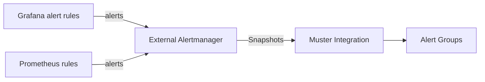

# Grafana Alerting

Muster takes its alerts from an Alertmanager. Grafana-managed alert rules reach Muster the same way as Prometheus rules
do: Grafana forwards its alerts to an external Alertmanager, and that Alertmanager has the Muster receiver from
[Connect Alertmanager](alertmanager.md).



One Alertmanager can serve Grafana and Prometheus together, with one Integration in Muster for the whole Alertmanager
cluster.

## Why through an Alertmanager

Grafana can also send alerts to a webhook from its own built-in Alertmanager, with a webhook contact point. Muster does
not take that route in this release. What Muster does with a Snapshot rests on the behaviour of Alertmanager that has
been verified against Alertmanager itself: the `groupKey` that names the route and the group, the whole state of an
Alertmanager group in every Snapshot (`max_alerts: 0`), and the repeats at the `repeat_interval` of the route, from
which Muster learns when an alert is Gone or Stale (see [Repeat intervals](alertmanager.md#repeat-intervals)). The
payload of Grafana's webhook contact point looks similar, but Muster has not verified how its grouping and repeats
behave, so it does not treat it as a source. A generic inbound webhook, for senders that are not an Alertmanager, is
planned for a later layer of Muster. Until then, use an Alertmanager between Grafana and Muster.

## Send Grafana's alerts to the Alertmanager

In Grafana, two settings are needed, and both must be on.

1. Add the Alertmanager as a data source: **Connections** → **Data sources** → **Alertmanager**. Set the
   **Alertmanager Implementation** (Prometheus, for a plain Alertmanager) and the **HTTP URL**, and turn on **Receive
   Grafana Alerts**.
2. In **Alerting** → **Settings** (called Administration in some versions), enable that Alertmanager so that it shows
   that it receives Grafana-managed alerts.

From then on Grafana forwards all its Grafana-managed alerts to the Alertmanager. The same data source in a
provisioning file, which covers step 1 only; step 2 is still done in **Alerting** → **Settings**:

```yaml
apiVersion: 1

datasources:
  - name: Alertmanager
    type: alertmanager
    url: http://alertmanager.monitoring.svc:9093
    access: proxy
    jsonData:
      implementation: prometheus
      handleGrafanaManagedAlerts: true
```

The option in the user interface is **Receive Grafana Alerts**; its `jsonData` name is `handleGrafanaManagedAlerts`. The
names above are those of the Grafana documentation of the Alertmanager data source; check the version of Grafana that
you run, because the places of the settings in the interface change between versions.

Then follow [Connect Alertmanager](alertmanager.md): create an Integration for the Alertmanager, paste the receiver and
the route into its configuration, and keep the catch-all child route last.

## Labels

Grafana adds two labels of its own to every Grafana-managed alert: `alertname`, the name of the alert rule, and
`grafana_folder`, the title of the folder that holds the rule. Labels that you set on the rule, such as `severity` or
`team`, come with them. Route and Group key on these labels in Muster as on any others:

- Set `severity` on your rules: it is part of the default Group key, and Routes can match it.
- `alertname` is also part of the default Group key, so rules of different names make different Alert Groups.
- Grafana rules have no `cluster` label of their own: add it to the Integration as a
  [Static label](alertmanager.md#static-labels), or give Grafana's alerts an Integration of their own.
- A rule on a query that returns one series per pod or instance makes one alert per series, with those labels. Keep
  [Instance labels out of informational alerts](alertmanager.md#instance-labels-in-informational-alerts); a Grafana
  rule can reduce the series to one with an aggregation.

Muster shows the labels of each alert on the page of its Alert Group. If a label you expected is missing, open the
Stored Snapshot on the Integration page, which shows the request as the Alertmanager sent it.
