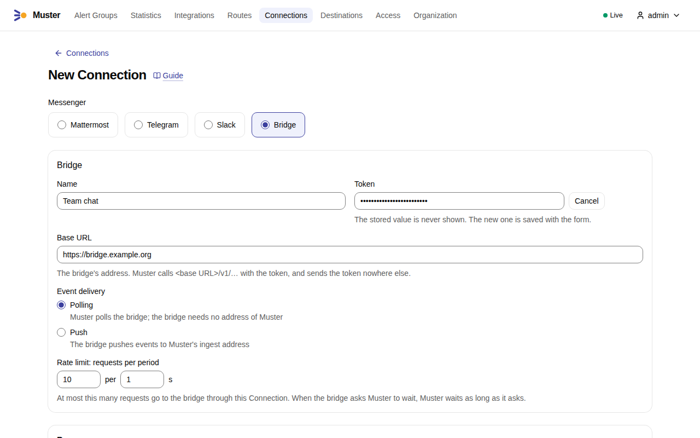
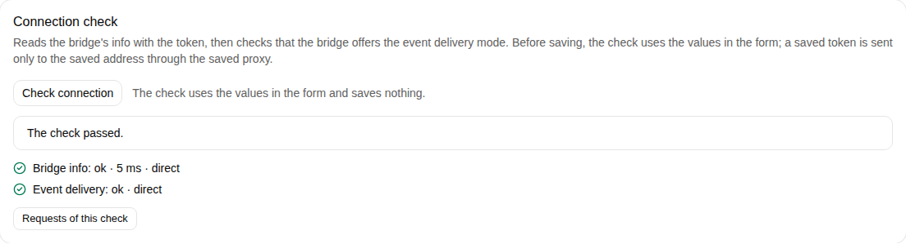
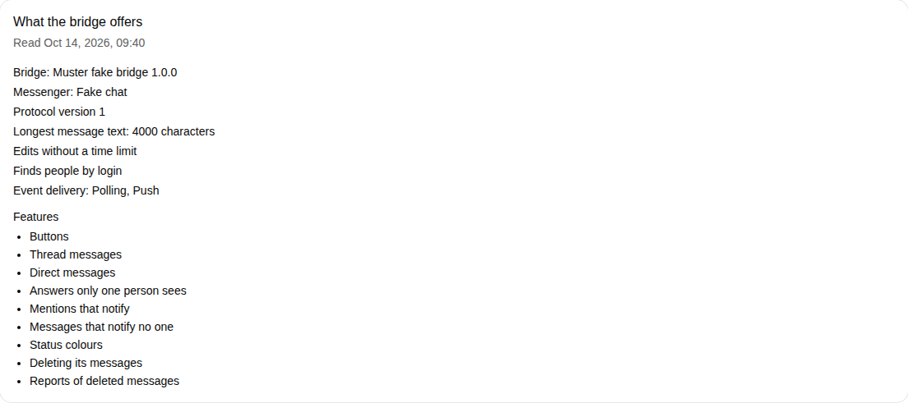
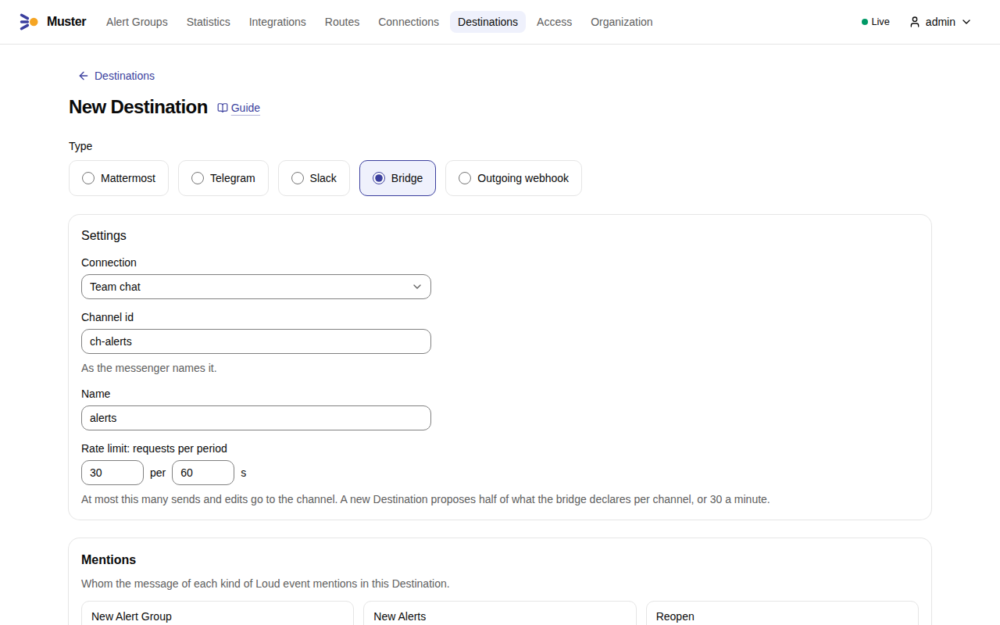
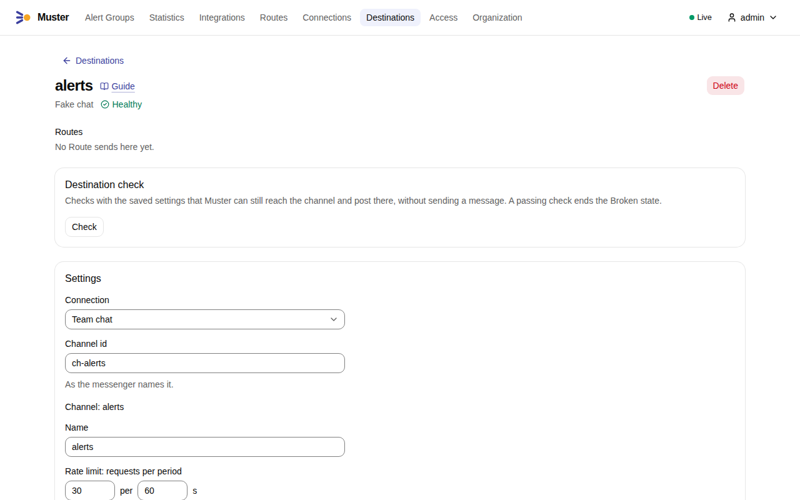
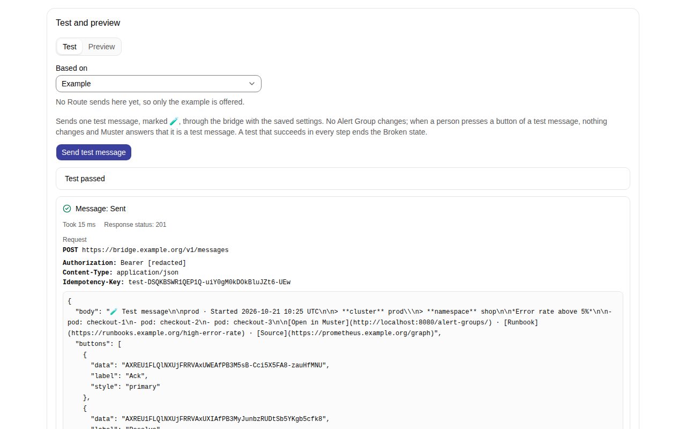

# Connect a messenger through a bridge

A **bridge** connects Muster to a messenger that Muster does not support natively. It is a separate service that
speaks the Bridge protocol with Muster on one side and talks to your messenger on the other: Muster sends it every
message as an **envelope** — the status, the title, a link, the text and the buttons — and the bridge renders the
envelope in its messenger. A **Bridge Connection** is one bot of your messenger behind one bridge: one token is one
bot. Muster posts one **Root message** per Alert Group to a channel of that messenger, edits it as the Alert Group
changes, and replies in its **Thread** for what happens later, as it does for Mattermost, Slack and Telegram.

To write a bridge, read [Write a bridge](write-a-bridge.md); the protocol itself is the
[Bridge protocol](../reference/bridge-protocol.md) reference.

In the examples, `MUSTER_PUBLIC_URL` is `https://muster.example.org`, `MUSTER_INGEST_URL` is
`https://ingest.muster.example.org` and the bridge listens on `https://bridge.example.org`. The steps use the web UI;
the examples do the same with the [API](../reference/api.md), with a Personal access token of an Admin in
`MUSTER_TOKEN`.

## Create the Connection

From your bridge, you need:

- its **base URL**, an `http` or `https` address with an optional path prefix, such as
  `https://bridge.example.org/muster`. Muster sends every request to `<base URL>/v1/…`, and only there, with
  `User-Agent: Muster/<version>`;
- the **token** it gave your bot. Muster sends it as `Authorization: Bearer` on every request, stores it encrypted and
  never shows it again.

Choose how the bridge reports **events** — the presses of buttons and the messages people write in a Thread — with the
**event delivery** mode:

- **`poll`** (`connection.bridge.event_delivery`, the default) when the bridge cannot reach Muster. The Leader asks the
  bridge for new events, so the bridge needs no address of Muster.
- **`push`** when the bridge can reach `MUSTER_INGEST_URL`. The bridge posts each event to the Connection's callback
  address, `https://ingest.muster.example.org/api/v1/callbacks/bridge/CN…`, which the Connection shows in
  `callback_url`, signed with a **push secret** that you configure on both sides. The push secret has the Standard
  Webhooks form, `whsec_` followed by base64, and is write-only like the token.

A Connection also has a **proxy**, for a bridge that Muster reaches only through one, and a **limiter**: 10 requests
per second by default, shared by all its Destinations. When the bridge answers that it is rate-limited, Muster waits
as long as it asks, whatever the limiter allows.

1. Open **Connections**, select **Create connection** and choose **Bridge**.
2. Enter a **Name**, the **Base URL** and, after **Set a value**, the **Token**. Choose the event delivery mode,
   **Polling** or **Push**; with push, also the push secret.

    { .screenshot }

3. Select **Check connection**, below the form. It runs the steps of [What the check shows](#what-the-check-shows)
   against the values in the form and saves nothing.

    { .screenshot }

4. Select **Save**, then **Check connection** on the saved Connection: Muster keeps what the bridge offers, which the
   page shows.

    { .screenshot }

With the API:

```sh
curl -X POST https://muster.example.org/api/v1/connections \
  -H "Authorization: Bearer $MUSTER_TOKEN" -H 'Content-Type: application/json' \
  -d '{"type":"bridge","name":"Team chat","base_url":"https://bridge.example.org/muster",
       "bot_token":"the-token-of-the-bot","event_delivery":"poll","proxy":{"enabled":false},
       "limiter":{"limit":10,"per_seconds":1}}'
```

For `push`, set `"event_delivery":"push"` and add `"push_secret":"whsec_…"`.

## What the check shows

Check the Connection after you create it, and after every change of the bridge:

```sh
curl -X POST https://muster.example.org/api/v1/connections/CNK7M3QX9P2RTA/checks \
  -H "Authorization: Bearer $MUSTER_TOKEN"
```

The check calls the bridge's `getInfo` and shows two steps, each with its latency and whether it went through the
proxy:

1. **`info`**: the bridge's name and version, the messenger's name, the protocol version — Muster speaks `1` — what
   the bridge offers, such as buttons and Thread messages, its limits, such as the longest text of a message, how it
   finds people for Account links, and its event delivery modes. Muster keeps this copy on the
   Connection and reads it again before a call that depends on it once it is older than 10 minutes, so a change in the
   bridge reaches Muster without a restart.
2. **`event_delivery`**: whether the bridge offers the Connection's event delivery mode.

A failed step names its cause with a code:

`token_invalid`
:   The bridge refused the token.

`protocol_version_unknown`
:   The bridge speaks a protocol version that this Muster does not speak.

`protocol_mismatch`
:   The answer does not match the protocol, or is larger than 64 KiB.

`event_delivery_not_offered`
:   The bridge does not offer the Connection's event delivery mode.

`proxy_refused`
:   The Connection's proxy refused its credentials (`407`).

`timeout`, `connect_failed`, `dns_failed`, `tls_failed`
:   Muster got no answer from the bridge.

`blocked`
:   The outbound address policy does not allow the bridge's address.

`request_failed`
:   The bridge answered with another error; the message names its class and the bridge's text.

## Check before saving

The check above reads a saved Connection. **Check connection** in the form of a new Connection, or on the page of a
saved one while the form holds changes, checks the values in the form before anything is saved, with
`POST /api/v1/connections/checks`. It saves nothing: the `info` it reads is returned, not stored, and the Audit log
gets no entry.

- With the token typed, the steps `info` and `event_delivery` run against the base URL in the form, through the proxy in
  the form, with that token.
- Without one, a saved Connection (`connection_id`) uses its stored token only when the base URL — a trailing `/`
  aside — and the proxy are the saved ones: the stored token is sent only to the saved address, through the saved
  proxy. After a change of the base URL or of the proxy, the check makes only a dry probe, `GET <base>/v1/info` without
  the token, which a bridge answers with `401` and a problem (`application/problem+json`). An address that answers
  otherwise fails with `not_bridge`, a `404` with `wrong_path_prefix`, another status with a problem with
  `unexpected_status`; after a dry probe that passes, `info` and `event_delivery` ask you to type the token again to
  check the new address or proxy, or to save first. A new Connection without a token gets the dry probe alone too.

```sh
curl -X POST https://muster.example.org/api/v1/connections/checks \
  -H "Authorization: Bearer $MUSTER_TOKEN" -H 'Content-Type: application/json' \
  -d '{"type":"bridge","base_url":"https://bridge.example.org/muster","event_delivery":"poll",
       "bot_token":"the-token-of-the-bot"}'
```

## Add a Destination

A **Bridge Destination** is one channel of the messenger, named by its **channel id** — the channel as your messenger
names it, which the bridge's documentation explains how to find. Its **Mention settings** take nobody or chosen
users; everyone in the chat and messenger groups are not available through a bridge. Its limiter allows 30 requests
per minute by default, sends and edits together.

1. Open **Destinations**, select **Create destination** and choose **Bridge**.
2. Choose the **Connection**, enter the **Channel id** and a **Name**.

    { .screenshot }

3. Select **Save**, which runs the Destination check below. The saved Destination shows the channel's name as the
   bridge reports it.

    { .screenshot }

4. Under **Test and preview**, on the tab **Test**, select **Send test message**: the bridge posts a message marked 🧪,
   and the result shows the envelope Muster sent. Links in the screenshot start with `http://localhost:8080`, the
   address of a development installation; yours start with your `MUSTER_PUBLIC_URL`. See
   [Test messages and previews](#test-messages-and-previews).

    { .screenshot }

With the API:

```sh
curl -X POST https://muster.example.org/api/v1/destinations \
  -H "Authorization: Bearer $MUSTER_TOKEN" -H 'Content-Type: application/json' \
  -d '{"type":"bridge","name":"alerts","connection_id":"CNK7M3QX9P2RTA","channel_id":"C024BE91L",
       "mentions":{"new_alert_group":{"everyone":"none","user_ids":[],"groups":[]},
                   "new_alerts":{"everyone":"none","user_ids":[],"groups":[]},
                   "reopen":{"everyone":"none","user_ids":[],"groups":[]},
                   "ack_timeout":{"everyone":"none","user_ids":[],"groups":[]},
                   "snooze_ended":{"everyone":"none","user_ids":[],"groups":[]},
                   "rise_to_urgent":{"everyone":"none","user_ids":[],"groups":[]}},
       "limiter":{"limit":30,"per_seconds":60}}'
```

Saving the Destination runs its **Destination check**, the one item `channel`: the bridge's `checkChannel`, which
posts nothing. It passes when the bot can post, edit and reply in the channel, and the Destination then shows the
channel's name as the bridge reports it. It fails with the bridge's own text when the bridge refuses the channel —
it does not exist, or the bot is not in it — with `proxy_refused` when the Connection's proxy refuses its credentials,
and with the class of the bridge's answer otherwise; a Destination that fails the check is not saved.
`POST /api/v1/destinations/DS…/checks` runs the same check at any time.

## What Muster posts

- **The envelope.** Every Root message carries its status with a colour and an emoji, the title `#N` and the Alert
  Group's title, the link "Open in Muster" to the Alert Group page, and its text in CommonMark: the labels, the
  summary, one line per Alert, the links, the notices and the footer. A Thread reply carries its text in CommonMark.
  Alert data are escaped, so a label value cannot format the message, link anywhere or mention anyone. A Loud message
  asks the bridge to notify; a Quiet one does not.
- **The length.** The text fits the longest text the bridge declares, read from the Connection's copy of its info: a
  long Root message drops its Alert lines first, then the label sections, but always keeps its title, its status, its
  footer, its buttons and its link to Muster. The bridge may still shorten what it renders, and says so.
- **Buttons.** When the bridge offers buttons, a Root message carries the buttons of its status — Ack, Resolve, one
  per Snooze duration and the two [Snooze presets](../concepts/statuses-and-commands.md#in-messengers) "Until tomorrow
  09:00" and "Until Monday 09:00", for example — with a style hint for each, the presets `neutral` like the durations,
  at most as many as the bridge allows. Beyond that limit the Snooze buttons go first, whatever their labels: the
  "Until Monday" preset (the first day of the week), then the "Until tomorrow" preset, then the durations from the
  longest. A firing Root message on a Paging Route has seven buttons, so a bridge that allows five gets Ack, Resolve
  and the three durations, and one that allows six also "Until tomorrow 09:00". Without buttons, a bridge that forwards
  the messages of a Thread gets a last line in each Root message that is not resolved, such as "Reply in the Thread:
  ack · resolve · snooze 1h", and takes the presets as Text commands such as `snooze tomorrow`.
- **Edits and Thread replies.** An edit sends the whole envelope of the new state, Quiet and without Mentions. A Thread
  reply goes under the Root message with the Thread reference the bridge returned last.
- **The footer.** "Acknowledged by", "Snoozed by" and "Resolved by" name a person with an Account link for the
  Connection by a Mention marker in a new Root message to a bridge with native mentions, Loud or Quiet; in an edit,
  which carries no Mentions, and through any other bridge, by the name the bridge reported for their account.
- **Posts are not repeated.** Every new message carries an idempotency key, the same for every retry of it. When an
  answer is lost — a timeout, or a connection cut after the request — Muster retries with the same key, the bridge
  answers with the message it posted already, and Muster edits it to the current state. When the bridge did not know
  the key, the retry may have posted a second message: the Timeline records a **possible duplicate**.
- **The token never shows** in a log line, an error, the Timeline or a metric; a test shows it as `[redacted]`.

## Edit windows

Some messengers let a bot edit a message only for a while after posting it. A bridge for such a messenger declares
how long in its info, as `limits.edit_max_age_seconds`, and Muster stops editing its Root messages in time. A bridge
that declares no limit (`null`) has none: Muster edits each Root message for as long as its Alert Group changes.

- **When Muster stops editing.** Muster makes no edit of a Root message once it is as old as the bridge's limit less
  60 seconds, counted from its Publication on Muster's clock, so that a last edit does not race the messenger's: with
  a limit of 600 seconds, the last edit is made within 9 minutes. Muster reads the limit from the Connection's copy of
  the info, as for every call. When the messenger refuses an edit earlier than declared, the bridge answers `gone` with
  the `reason` `edit_window_closed`: this is not a deletion, and Muster treats the Root message as past its window at
  once. A Root message that Muster posts again after it was deleted has a window of its own.
- **Alerts reach only the Thread.** Past the window, a change that keeps the status of the Alert Group — new Alerts,
  Alerts that resolve, the counters — no longer changes the Root message, which keeps the state of its last edit; the
  Thread replies that such a change makes are sent as usual.
- **A change of status posts a new Root message.** When the status changes past the window — Acknowledge, Resolve,
  Snooze, a Reopen — Muster posts a new Root message with the current state, Quietly, to the same channel, and replies
  under the old one: "This message is no longer updated. The current one: {link}", with a link to the new message when
  the bridge returned one and to the Alert Group page otherwise. Later Thread replies go under the new Root message,
  which has a window of its own. This reply is sent once: when the bridge refuses it, the failure is recorded with the
  delivery event and the reply is not sent again.
- **A new Root message is not left behind.** When the answer to the post of a new Root message is lost, Muster posts
  it again with the same key, even if the status has changed back meanwhile, so that a message the bridge may have
  taken is never left with a stale status and live buttons: a bridge that took the first post answers with that
  message instead of posting a second one. When the Destination left the Route meanwhile, the post carries the final
  text; when the bridge answers with the earlier post, which shows an older state, Muster then gives that message the
  final edit.
- **The old message keeps working.** A press on the buttons of an older Root message, or a Text command in its
  Thread, acts on the Alert Group as on the current one.
- **The final edit is a Thread reply.** When the Destination leaves the Route or is deleted, each open Root message
  gets a final edit, "No longer updated here; current state in Muster: {link}"; past the window, Muster sends the same
  text as a Thread reply instead.
- **Storm summaries are never posted again.** Past its window, a Storm summary keeps the state of its last edit.
- **What the delivery shows.** `GET /api/v1/alert-groups/AG…/deliveries` shows `past_edit_window` as `true` for a
  Destination whose Root message is past its window, while the delivery stays `delivered`, or `pending` while a new
  Root message is due. Each new Root message posted past the window is the delivery event
  `republished_past_edit_window` in the Alert Group's Timeline, with the error of the reply under the old message when
  it failed, and the log line `bridge_republished_past_edit_window`, with the ids of the old and the new message.

## Test messages and previews

A **test message** checks how a Destination looks without touching any Alert Group:

```sh
curl -X POST https://muster.example.org/api/v1/destinations/DSK7M3QX9P2RTA/tests \
  -H "Authorization: Bearer $MUSTER_TOKEN" -H 'Content-Type: application/json' \
  -d '{"source":{"kind":"example"}}'
```

It posts one message of the kind `test`, Quiet, marked "🧪 Test message" before its text, with the buttons of its
status, whose presses change nothing. It goes through the same limiters as delivery, and the result shows the step
`message` with the request — the token masked — the bridge's answer and its error class. Use
`{"source":{"kind":"alert_group","alert_group_id":"AG…"}}` to render a recent Alert Group of one of the
Destination's Routes instead of the example. `POST …/previews` with the same body returns, without posting anything,
the envelope the test would post, as JSON in the item `message`.

## Broken Destinations

A Bridge Destination becomes **Broken** when the bridge refuses it — it answers `forbidden`, for example because the
bot was removed from the channel — with the bridge's text as the reason, or when the bridge keeps failing or does not
answer for the whole Transient budget: 10 attempts within 30 minutes. A bridge that asks Muster to wait does not make
a Destination Broken unless it asks for more than 15 minutes (`bridge.retry_after_max`); an answer the bridge calls `invalid` ends that one
delivery as Not delivered and leaves the Destination healthy. When the bridge answers that a Root message is gone,
Muster publishes the Alert Group again, once; an edit refused as `gone` with the `reason` `edit_window_closed` is not a
deletion, but the end of the message's [edit window](#edit-windows).

While a Destination is Broken, Muster tries again every 5 minutes: with the oldest waiting delivery, or, when nothing
waits, with the Destination check, which posts nothing. The first success ends the Broken state, and so does a
successful check or test message. See [MusterDestinationBroken](../operations/runbooks/MusterDestinationBroken.md).
A Bridge Connection whose bridge cannot be reached does not become Broken itself: its Destinations do, and its
Connection check shows the cause.

## Account links

A press or a Mention through a bridge names a person through their Account link for that Connection; see
[Link your messenger accounts](account-links.md).

## Check from the command line

`muster doctor` prints one line per Bridge Connection, with the result of `getInfo`, and one line per Bridge
Destination, with the result of `checkChannel`, without posting anything.
