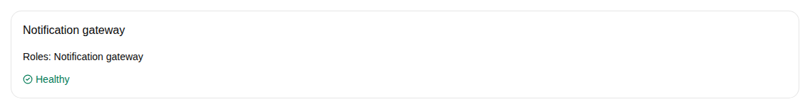
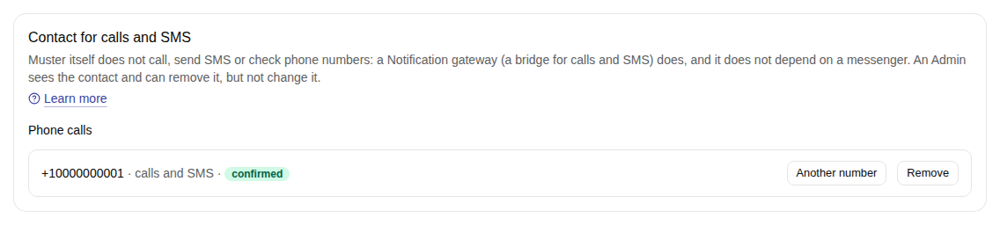

# Notification gateways

A **Notification gateway** reaches people outside messengers — by phone call or SMS, for example — through a provider
of its own. It is a bridge in the role `gateway`: a service that speaks the [Bridge protocol](../reference/bridge-protocol.md)
with Muster and calls or texts people through your provider. Muster ships no gateway and never calls or texts anyone
by itself: you run a gateway written for your provider, and Muster sends it the person's contact and a plain text.

A gateway does not depend on a messenger, so it still reaches a person whose messenger is down or silent at night. Read
[At night](#at-night) before you rely on a messenger alone for that, and
[How an alert reaches people](../concepts/how-an-alert-reaches-people.md) to see where a call fits among the Pages of
an Alert.

The page follows the way a gateway is used: [connect it](#connect-a-notification-gateway), [let people confirm a
contact](#contact-for-calls-and-sms), then see [how calls are made](#how-calls-are-made), [how a person acknowledges
from a call](#acknowledging-from-a-call) and [what to do when a gateway is Broken](#broken-gateways).

In the examples, `MUSTER_PUBLIC_URL` is `https://muster.example.org`, and the contacts are numbers such as
`+10000000001`, which reach nobody.

## Connect a Notification gateway

A Notification gateway is a [Bridge Connection](bridge.md) whose bridge declares the role `gateway` in its `info`:

1. Run the gateway bridge. To write one for your provider, read [Write a bridge](write-a-bridge.md): a gateway
   implements `info`, `sendNotification`, `answerEvent` and events in at least one delivery mode.
2. Create a Bridge Connection for it, with its base URL and the token of its bot, as
   [Connect a messenger through a bridge](bridge.md#create-the-connection) describes.
3. Check the Connection. The check reads the roles from the bridge's `info` and shows **Notification gateway**; the
   read of the Connection has `"roles": ["gateway"]`, and `GET /api/v1/connections?role=gateway` lists it.

    { .screenshot }

A Bridge Connection whose only role is `gateway` cannot be a Destination and is not offered for Account links
([Roles](bridge.md#roles)). A bridge may have both roles, `messenger` and `gateway`: its Connection is then both a
messenger, whose channels are Destinations, and a gateway, and the Connection page shows both roles. A bridge that
once had the role `messenger` and now declares only `gateway` leaves its Destinations without messages, and the
Connection page warns about them: remove them or change the bridge.

Choose the event delivery mode with the answer to a call in mind. A person who acknowledges in a call is on the line
while Muster answers, and only a gateway that **pushes** its events, with the Connection's push secret, makes Muster
answer before it answers the push, so that the answer is read out in the same call. A gateway that is polled still
works, but the time of the answer depends on Muster's next read of the event, so it may come after the person has hung
up; see [Answering during a call](write-a-bridge.md#answering-during-a-call).

`muster dev` runs the demo Connection "Example Gateway" on its fake bridge, whose `info` declares only the role
`gateway`; the fake bridge lists what it was sent at `/_fake/notifications`.

## Contact for calls and SMS

A gateway calls or texts a person at their **contact**: a phone number or another address the gateway understands, as
text. Muster does not check phone numbers. Each person has at most one confirmed contact per Notification gateway, and
only a confirmed contact is called.

### Add and confirm a contact

A person adds their own contact from their signed-in web session, and confirms it with a code that the gateway
delivers. In the web UI this is **Profile**, the section **Contact for calls and SMS**, with a block for each
Notification gateway: type the number in **Phone**, select **Send code**, type the code in **Code** and select
**Confirm**. The section then shows the contact as "+10000000001 · calls and SMS · confirmed", with **Remove**, and
the note that a call acknowledges an Alert Group only while nobody has it. **Another number** starts a change, and
**Send a new code** asks for another code. Without a gateway the section says "Unavailable: a Notification gateway is
needed (a bridge for calls and SMS)" and links here; a person who may create Connections sees **Connect a bridge** beside it.

{ .screenshot }

The same steps through the API:

1. Add the contact for the gateway (`createMyGatewayContact`, `POST /api/v1/me/gateway-contacts`, with
   `connection_id` and `contact`). The contact is trimmed and holds 1 to 200 characters. Muster stores it
   unconfirmed and sends a code through the gateway with `sendNotification`, without action data, in the language of
   the person's profile: "Your Muster code: 123456. It is valid for 10 minutes. Do not share it."
2. Type the code back, in the same web session (`confirmMyGatewayContact`, `POST
   /api/v1/me/gateway-contacts/{id}/confirmation`, with `code`). The contact is confirmed.
3. To get another code, ask for one (`sendMyGatewayContactCode`, `POST /api/v1/me/gateway-contacts/{id}/code`); once
   the gateway accepted it, it voids the earlier codes of the contact. A code the gateway did not take leaves the
   earlier one valid.

The code (`gateway.contact_code`):

Length
:   6 digits.

Validity
:   10 minutes after it was asked for.

Attempts
:   At most 5. A wrong code answers `422` `contact_code_invalid` with `attempts_remaining`; after the fifth wrong code,
    once the code expired or was used, and once a newer code was sent, the code is void.

Session
:   A code is checked only in the web session that asked for it. The right code typed in another session is refused
    and counts as an attempt; a session that ends voids its codes.

Code requests — adding a contact and asking for a new code — are limited (`gateway.contact_code_requests`):

Per person
:   5 within an hour.

Per person and contact
:   3 within an hour from one person for one contact, as typed and trimmed.

A request beyond them answers `429` `contact_code_requests_exceeded` with `Retry-After`; a request whose code the
gateway could not deliver still counts. What others ask for never refuses a person's request: a contact receives at
most 10 codes within an hour whoever asks, and a request beyond them is answered as if its code were sent, but nothing
is sent, so that the answer never tells of other people's requests. The code is sent on the interactive path, since
the person waits for it: when no rate-limit token of the gateway is free within `delivery.interactive_budget`, the
answer is `503` with `Retry-After`, and when the gateway refuses the notification, `502` `gateway_refused` with its
`gateway_class`. The contact stays, unconfirmed, and a new code can be asked for.

### Change a contact

Add the new contact for the same gateway. Until it is confirmed, the confirmed contact stays the one called, and both
are listed, the new one naming the confirmed one in `replaces`; confirming the new contact replaces the old one, so
that changing a number never leaves a person unreachable. Adding another contact before the new one is confirmed
replaces the unconfirmed one. A person removes a contact with `deleteMyGatewayContact`.

### Admins

An Admin sees the contacts of any User (`listUserGatewayContacts`, `GET /api/v1/users/{id}/gateway-contacts`) and
removes one (`deleteUserGatewayContact`), but never sets one: `createUserGatewayContact` always answers `403`, "Only the
person sets their contact, from their own web session.", so that nobody can tie a contact to another person's User.
The operations that change a person's own contacts take the web session only; an API token, an Admin's included, gets
`403` `session_required`.

### Privacy

A contact is personal data, not a secret: the person, Admins and the gateway read it. Muster does not log it, and the
[Request log](../operations/request-log.md#masking) shows the contact and the text of every request to
`sendNotification` as `[redacted]`, the code included. Adding, confirming and removing a contact are recorded in the
Audit log. Deleting a User erases their contacts and codes, and the Audit log then shows their earlier contacts as
`[erased]`.

## How calls are made

A call is one notification through a gateway to one person, about one or more Alert Groups. Escalation chains make
calls with their steps "Call through a Notification gateway", and Notification rules with their call actions
([Calls through a Notification gateway](../concepts/escalation-chains.md#calls-through-a-notification-gateway));
`muster dev` also queues one by hand with `POST /_dev/gateway-calls` on its internal listener.

- The first call to a person through a gateway goes at once. The Pages to the same person through the same gateway
  that come due while a call to them waits, is being retried, or within 60 seconds (`gateway.combine_window`) after
  the previous call ended — accepted or not — go together in the next call, once those 60 seconds have passed.
- Right before its first attempt, a call drops the Alert Groups on which the chain or the rule that Paged has stopped
  — acknowledged, snoozed or resolved meanwhile, or whose chain started over —; a call left without any is not sent.
  From its first attempt on, a call keeps its Alert Groups and its text, and takes no more.
- A call that the gateway accepted makes the person an Assignee of the chain that called, as a delivered Mention
  does.
- The text names each Alert Group by number, title and Severity level and says how to acknowledge, in the language
  of the person's profile: "Muster: 1 Alert Group needs you. #42 DiskFull, critical. Press 1 to acknowledge." Its
  action data names the call and fits in 64 bytes however many Alert Groups it is about.
- Every replica sends calls, critical ones first, through the limiter of the gateway's Connection, with the same
  `Idempotency-Key` `calls/<id of the call>` on every attempt: a gateway that keeps idempotency keys answers a repeated
  call `replayed`, which Muster counts as accepted, so a replica that restarts after a call never makes the person's
  phone ring twice. An answer of the class `transient` is retried within the retry budget of deliveries; a gateway
  that asks to wait (`rate_limited` with `Retry-After`) is waited for, and its waits count toward the time of that
  budget. Retries end when every Alert Group of the call has stopped.
- A call is never reconciled: it has no Root message to keep up to date, and a call that has gone is not changed
  afterwards.
- A text longer than the 1,000 characters of the Bridge protocol lists as many Alert Groups as fit, then "And N
  more.", and always ends with how to acknowledge.
- A call that the gateway refuses, answers in a way Muster cannot classify, or that used up its retry budget, ends Not
  delivered, as does one to a person without a confirmed contact (`no_confirmed_contact`), one through a gateway
  deleted before the call went (`gateway_deleted`) and one that comes due while the gateway is Broken
  (`gateway_broken`). Each of its Alert Groups records
  `page_not_delivered` in its Timeline, of the kind **Escalation chains**, naming the person, the gateway and the
  reason, and the chain and the step that called; outgoing webhooks in events mode receive it.
- A gateway that answers a call with a Fatal error, or whose call used up its retry budget, becomes
  [Broken](#broken-gateways).

The text of a call, which names its Alert Groups, is cleared when the call ends; the call itself is kept until every
Alert Group it is about is removed by `retention.alert_group_summaries`.

`muster_gateway_calls_total{connection,outcome}` counts the attempts of calls, `muster_notification_gateway_broken`
is 1 while a gateway is Broken, and the log has the events `gateway_call_queued`, `gateway_call_attempted`,
`gateway_call_not_delivered`, `gateway_call_dropped`, `gateway_call_failed`, `gateway_broken` and
`gateway_recovered`, none with the contact or the text.

## Acknowledging from a call

When the person acknowledges in the call — presses 1, for example — the gateway reports `notification_acknowledged` with
the call's action data. Muster verifies the data, which names the call and its Connection, and acknowledges each Alert
Group of the call as the person the call was for, never as whoever holds the phone, with the Transport `gateway`: the
Timeline shows "Ivan from a call through Example Gateway", with the name of the gateway. It acknowledges only while
nobody owns an Alert Group: an Alert Group someone has already, the same person included, stays theirs, as a resolved
one stays resolved — a call never takes an Alert Group over. The gateway tells the person, in the language of their
profile, what happened: "Acknowledged: #12, #13", "Already taken by Alice" or "Already resolved". A Viewer, a disabled
person, and data that does not verify or belongs to another Connection change nothing and are answered so; the log
records the latter as `gateway_acknowledge_refused`. An event is handled once, however often the gateway reports it.

An acknowledgement that the gateway reports more than an hour after it happened (`bridge.event_max_age`) is dropped,
unanswered, and logged as `bridge_acknowledgement_dropped`. Because the action data of a call is the same for each of
its retries and carries no time, an acknowledgement also acts only for the notification that the gateway accepted the
call as — its `notification_id` — and only for two hours after the gateway accepted it: an acknowledgement of a call
the gateway never accepted — still waiting, not delivered or dropped — one with another `notification_id`, and one
that comes more than two hours after the call was accepted, whatever time the gateway reports, change nothing; the log
records them as `gateway_acknowledge_refused` with the reason `not_accepted`, `notification_mismatch` or
`stale_call`. A call that is still being sent — its answer not back yet, or retried after a temporary error or a
timeout — may already have rung: an acknowledgement of it acts, with no `notification_id` to compare, as a call is
sent only within `delivery.transient_budget`. That budget is checked as the call's attempts are made, so while no
replica sends calls, a call stays being sent, and acknowledgeable, until one does. An acknowledgement through a gateway counts in
`muster_commands_total{transport="gateway"}`. The key that signed a call's action data stays needed in the Keyring
while the call is being sent, so that such an acknowledgement can act, and for two hours after it was accepted while
any of its Alert Groups is open: the hour in which an acknowledgement is acted on, and as long again for the call to
ring or be retried by the gateway after it was accepted. The Keyring also keeps the key of a call not delivered after
an attempt for those two hours, though an acknowledgement of it changes nothing.

## Broken gateways

A gateway becomes **Broken** when a call through it ends with a Fatal error — the bridge, or the provider behind it,
refuses the token or the credentials (`forbidden`), or the outbound address policy blocks the bridge's address — or
when a call used up its retry budget (`delivery.transient_budget`). A call that the gateway refuses as `invalid`, a
contact the provider refuses for good for example, does not make it Broken: that call alone ends Not delivered.

While a gateway is Broken, the calls that come due are not sent and end Not delivered with the reason
`gateway_broken`, and they are not sent after the gateway recovers either: check the Alert Groups whose Timeline shows
them. Muster raises the Internal alert `MusterNotificationGatewayBroken`, and the Connection page shows "Broken since"
with the time and the reason in a banner. It reads the gateway's `info` every 5 minutes (`delivery.broken_probe_interval`);
the first success, or a check of the Connection whose step `info` passes, ends the state. The Destinations of the same
bridge are not affected, nor the other way round.

A Broken gateway cannot call anybody about itself: route the Internal alert to a messenger Destination. The
[runbook of `MusterNotificationGatewayBroken`](../operations/runbooks/MusterNotificationGatewayBroken.md) says how to
find the cause, fix it and check that calls go through again, with `muster bridge check` and its `--contact` flag.

## At night

A person's phone is quiet at night unless something rings or buzzes it. A Mention in a Thread reply pushes to a phone
in Mattermost, Slack and Telegram with the person's default settings, but not through Do Not Disturb or a Focus mode of
the phone, while a Notification gateway reaches a person whatever their phone and messenger do. The pushes were
checked on a locked phone, with the app in the background and the desktop client not in use:

- **Mattermost**, with the server's push notifications on through a push proxy: under `PushNotificationContents`
  `full`, a Mention in a Thread reply pushed at once with the text of the post, whether the person followed the Thread
  or not (F-143); under `generic` the push shows a fixed text such as "… mentioned you." instead (F-115). Do Not
  Disturb kept a direct message from pushing (F-146).
- **Slack**, with the person's default notification settings: a Mention in a Thread reply pushed whether they followed
  the Thread or not (F-150); with their notifications paused, a direct message made no push (F-153).
- **Telegram**: a comment that mentioned an ordinary member of the discussion group pushed at once, even with the
  channel and the group muted, while a comment without a Mention did not (F-130); in a Focus mode of the phone a push
  came without sound (F-134).

An edit made no push in any of them (F-012, F-146, F-153), so every Page is a new Thread reply. A messenger may notify
a desktop in use instead of the phone, by the person's settings, and Muster cannot see whether a push arrived. What the
server and the person need for the push is in [Mattermost](mattermost.md#who-gets-notified),
[Slack](slack.md#who-gets-notified) and [Telegram](telegram.md#join-the-discussion-group-and-mute-the-channel).

So, for anybody who must be reached at night whatever their phone and messenger do, connect a Notification gateway,
have them [confirm a contact](#contact-for-calls-and-sms), put a call in their important
[Notification rule](../concepts/notification-rules.md#the-switch) or in a step of the
[Escalation chain](../concepts/escalation-chains.md#calls-through-a-notification-gateway), and do not count on a
Mention alone. [How an alert reaches people](../concepts/how-an-alert-reaches-people.md) shows a Page by
Mention and by call side by side.
