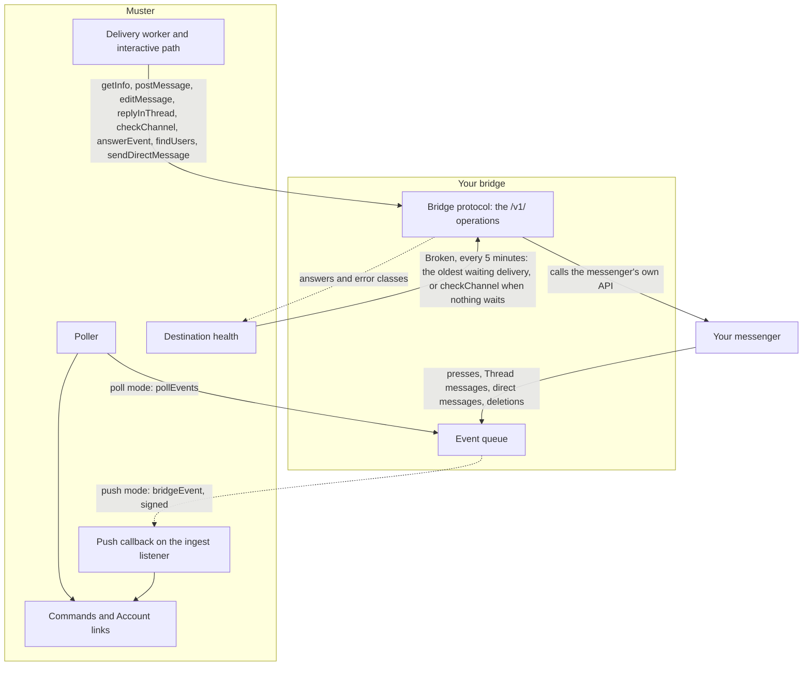
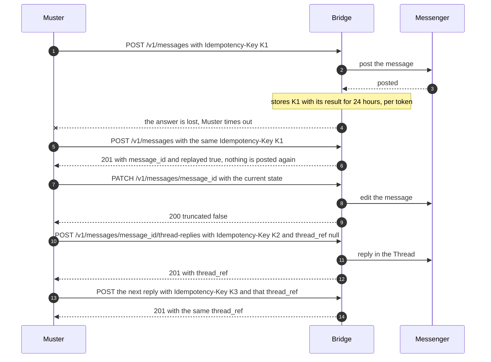
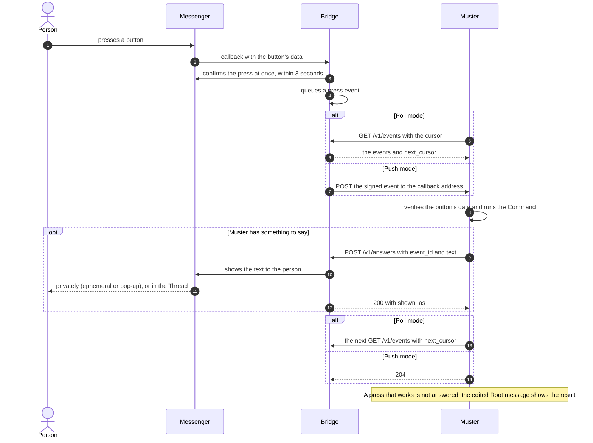
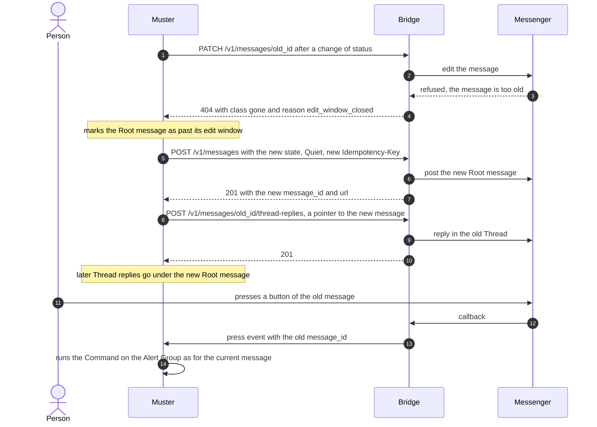
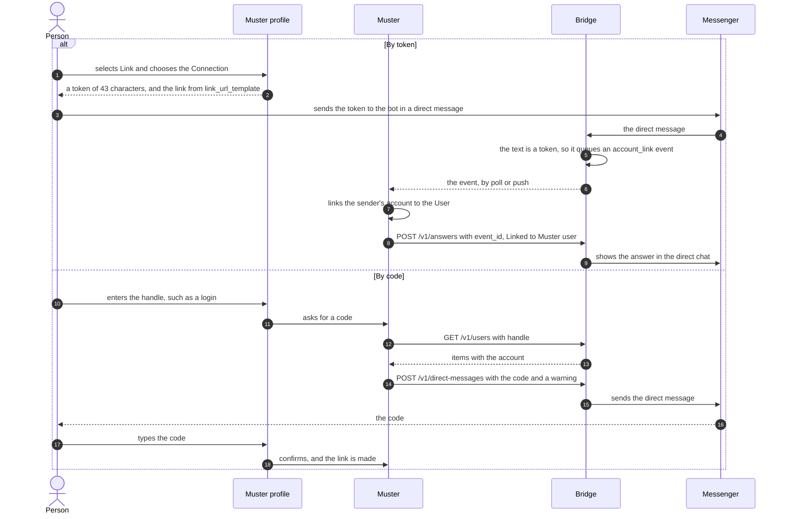

# Write a bridge

A **bridge** connects Muster to a messenger that Muster does not support natively. This page is for the people who
write one. It starts with the bridge libraries, which do the protocol's part of a bridge, and then describes the
**Bridge protocol** step by step for a bridge written without a library. If you run a bridge that somebody else wrote,
read [Connect a messenger through a bridge](bridge.md) instead.

## What a bridge is, and when to write one

Muster has native support for [Mattermost](mattermost.md) and [Telegram](telegram.md). For any other messenger, Muster
talks to a bridge: a small HTTP service that you write and run. Muster calls the bridge to post, edit and reply to
messages. The bridge calls the messenger. When people press a button or write in a Thread, the bridge reports it back
to Muster as an **event**.

Write a bridge when your team uses a messenger with a bot API that Muster does not support. A bridge does not need to
live in Muster's repository, and it may stay closed: the protocol is MIT licensed (see [Licence](#licence)).



Muster is always the caller of the `/v1/` operations, and the bridge is always the caller of the messenger. Events
travel the other way, in one of two modes that the Admin chooses on the Bridge Connection: Muster **polls** the bridge
with `pollEvents`, or the bridge **pushes** each event, signed, to Muster's callback address. The bridge answers every
call with a result or an error class, and Muster turns those into the health of the Destination: a Destination whose
bridge keeps failing, or refuses the channel, becomes Broken until a check succeeds (see
[Run your bridge](#run-your-bridge)).

Terms follow Muster's glossary: a **Root message** is the one editable message that shows an Alert Group in a channel
of the messenger, its **Thread** holds the replies under it, and a **Mention** is a deliberate @-reference. A **Bridge
Connection** in Muster is one bot of your messenger behind one bridge: one token is one bot.

## Start with a library

Most bridge authors should not write the protocol again. A bridge library does the protocol's part of a bridge, and
you write only the calls to your messenger.

### What a library does, and what is left to you

A library:

- serves every operation of the protocol under `/v1/`;
- checks the token of each bot in constant time, and keeps the events and idempotency keys of each bot apart;
- validates every request against `api/bridge.yaml` and every answer before it is sent, and enforces the bridge's
  limits;
- keeps each `Idempotency-Key` with its result and answers a repeated key with that result and `replayed: true`;
- builds the answer to `getInfo` from the features and limits you give it;
- answers failures as problems with an error class, and never logs a token or a push secret;
- queues events for `pollEvents`, and pushes them with Standard Webhooks signatures and retries;
- turns a direct message that carries an Account link token into an `account_link` event.

You write:

- the calls to your messenger: post, edit, reply in a Thread, check a channel and show an answer to a person, and,
  where the messenger offers them, finding a person, sending a direct message and deleting a message;
- the mapping of the messenger's failures to the five error classes (see [Error classes](#error-classes));
- the reports of what people do: a press, a message in a Thread, a deleted message and a direct message;
- the rendering of the envelope in the messenger's markup (see [Rendering the envelope](#rendering-the-envelope)).

The Go library, `muster-bridge-go`, follows the protocol's major version and is released from its own repository,
under the MIT licence and without a CLA. The same holds for every bridge library of the project.

### The Go library

The Go module is `github.com/muster-io/muster-bridge-go`, and its package is `bridge`.

```sh
go get github.com/muster-io/muster-bridge-go
```

The libraries are released when Muster's first release is. The module is at `0.x` until then, and `go get` without a
version takes the latest commit of its `master` branch. From the first release, `1.x` speaks protocol version 1, and
each release is a tag `vX.Y.Z`.

**1. Implement `bridge.Messenger`.** It has five methods, each given the name of the bot whose token Muster sent:
`PostMessage`, `EditMessage`, `ReplyInThread`, `CheckChannel` and `AnswerEvent`. The sketch below is for Parley, a
fictional messenger; its client `parleyClient` stands for whatever library your messenger has.

```go
// parleyMessenger is the bridge's calls to the fictional messenger Parley.
type parleyMessenger struct{ api *parleyClient }

// mention is how Parley writes a mention of a person.
func mention(p bridge.Mention) string { return "<@" + p.ExternalId + ">" }

func (m *parleyMessenger) PostMessage(ctx context.Context, bot string, in bridge.MessageInput) (
	bridge.MessagePosted, error) {
	body := bridge.ReplaceMentions(in.Body, in.Mentions, mention)
	id, err := m.api.Send(ctx, in.ChannelId, render(in.Title, body))
	if err != nil {
		return bridge.MessagePosted{}, classify(err)
	}
	return bridge.MessagePosted{MessageId: id}, nil
}

func (m *parleyMessenger) EditMessage(ctx context.Context, bot, messageID string, in bridge.MessageContent) (
	bridge.MessageEdited, error) {
	if err := m.api.Edit(ctx, messageID, render(in.Title, in.Body)); err != nil {
		return bridge.MessageEdited{}, classify(err)
	}
	return bridge.MessageEdited{}, nil
}

func (m *parleyMessenger) ReplyInThread(ctx context.Context, bot, messageID string, in bridge.ThreadReplyInput) (
	bridge.ThreadReplyPosted, error) {
	var thread string
	if in.ThreadRef != nil {
		thread = *in.ThreadRef
	}
	body := bridge.ReplaceMentions(in.Body, in.Mentions, mention)
	id, thread, err := m.api.Reply(ctx, messageID, thread, body)
	if err != nil {
		return bridge.ThreadReplyPosted{}, classify(err)
	}
	return bridge.ThreadReplyPosted{MessageId: id, ThreadRef: thread}, nil
}

func (m *parleyMessenger) CheckChannel(ctx context.Context, bot, channelID string) (string, error) {
	name, err := m.api.ChannelName(ctx, channelID)
	if err != nil {
		return "", classify(err)
	}
	return name, nil
}

// AnswerEvent answers an Account link in its direct chat, a Thread message in its Thread, and a press privately.
func (m *parleyMessenger) AnswerEvent(ctx context.Context, bot string, ev bridge.ReportedEvent, text string) (
	bridge.AnswerShownShownAs, error) {
	switch ev.Type {
	case bridge.EventTypeAccountLink:
		if err := m.api.SendDirect(ctx, ev.Chat, text); err != nil {
			return "", classify(err)
		}
		return bridge.AnswerShownShownAsDirect, nil
	case bridge.EventTypeThreadMessage:
		if _, _, err := m.api.Reply(ctx, ev.MessageID, ev.ThreadRef, text); err != nil {
			return "", classify(err)
		}
		return bridge.AnswerShownShownAsThread, nil
	default:
		if err := m.api.Whisper(ctx, ev.Chat, text); err != nil {
			return "", classify(err)
		}
		return bridge.AnswerShownShownAsEphemeral, nil
	}
}
```

For the features you declare, also implement `UserFinder` (when `UserLookup` is not `none`), `DirectMessenger` (when
the bridge offers direct messages) and `Deleter` (when it offers deletion). `bridge.New` refuses a configuration whose
features lack their interface, or whose `info` would not match the protocol, and names the reason.

**2. Answer failures with error classes.** A method returns `bridge.TransientError`, `bridge.RateLimitedError`,
`bridge.GoneError` (with `bridge.ReasonEditWindowClosed` for an edit that the messenger refuses only for the message's
age), `bridge.ForbiddenError` or `bridge.InvalidError`. Any other error, and a panic, is answered as `transient`.

```go
// classify tells Muster what a failure of Parley means. Only the bridge knows.
func classify(err error) error {
	var pe *parleyError
	if !errors.As(err, &pe) {
		return bridge.TransientError("Parley did not answer.")
	}
	switch pe.Code {
	case "slow_down":
		return bridge.RateLimitedError(time.Duration(pe.RetryIn)*time.Second, bridge.ProblemScopeChannel,
			"Parley asks to slow down.")
	case "message_not_found", "thread_removed":
		return bridge.GoneError("The message no longer exists.")
	case "edit_too_old":
		return bridge.GoneError("The message can no longer be edited.", bridge.ReasonEditWindowClosed)
	case "channel_not_found", "not_a_member", "bot_banned", "no_permission":
		return bridge.ForbiddenError("The bot is not a member of this channel.")
	case "user_blocked_bot":
		return bridge.ForbiddenError("This person cannot receive a message from the bot.")
	case "text_too_long", "bad_request":
		return bridge.InvalidError("Parley refused the request.")
	default:
		return bridge.TransientError("Parley is not available.")
	}
}
```

**3. Create the bridge with `bridge.New`.** Give it the bot's token in `Config.Bots`, the features in
`Config.Capabilities` and the limits in `Config.Limits`, and mount `b.Handler()` behind an HTTP server. The code below
is the body of a function that returns an `error`.

```go
token, err := os.ReadFile("/run/secrets/muster-token")
if err != nil {
	return err
}
messenger := &parleyMessenger{api: &parleyClient{}}

b, err := bridge.New(bridge.Config{
	Name:          "parley-bridge",
	Version:       "0.1.0",
	MessengerName: "Parley",
	Bots:          []bridge.Bot{{Name: "main", Token: strings.TrimSpace(string(token))}},
	Limits:        bridge.Limits{MaxBodyLength: 4000},
	Capabilities: bridge.Capabilities{
		Buttons: &bridge.Capabilities_Buttons{MaxPerMessage: 5, MaxPerRow: 5, DataMaxBytes: 64,
			Styles: []bridge.ButtonStyle{bridge.ButtonStylePrimary, bridge.ButtonStyleSuccess,
				bridge.ButtonStyleNeutral, bridge.ButtonStyleDanger}},
		ThreadMessages: new(bridge.CapabilitiesThreadMessagesAll),
		PrivateAnswers: &[]bridge.CapabilitiesPrivateAnswers{bridge.CapabilitiesPrivateAnswersEphemeral},
	},
	UserLookup: bridge.InfoUserLookupNone,
}, messenger)
if err != nil {
	return err
}
defer b.Close(context.Background())

srv := &http.Server{
	Addr:              "127.0.0.1:8095",
	Handler:           b.Handler(),
	ReadHeaderTimeout: 10 * time.Second,
	// No WriteTimeout: pollEvents holds a request open for up to 60 seconds.
}
return srv.ListenAndServe()
```

`MaxBodyLength` is the longest `body` that your bridge always accepts, after its own rendering; the protocol's smallest
value is 500, and the library takes at most 100000. `Capabilities` lists the optional features: a nil member is a
feature the bridge does not offer, and Muster never calls an operation that the bridge did not declare. To serve the
handler under a path prefix, mount it with `http.StripPrefix`.

!!! warning "No WriteTimeout"
    `pollEvents` holds a request open for up to 60 seconds. Serve the handler with no `WriteTimeout`, or one above 75
    seconds. A shorter one cuts a poll off without an answer, and its events reach Muster late.
    `ReadHeaderTimeout` and `IdleTimeout` are safe to set.

**4. Report what happens in the messenger.** When a person presses a button, writes in a Thread, deletes a message of
the bot or writes to the bot, call `b.Press`, `b.ThreadMessage`, `b.MessageDeleted` or `b.DirectMessage`. Each returns
at once, so confirm a press to your messenger within its deadline whatever Muster does. Give the messenger's own id of
the update as `UpdateID`: an update that the messenger delivers twice is then queued once.

```go
// onPress is called when a person presses a button in Parley. chat is what AnswerEvent needs to whisper to
// the person; the library keeps it with the event and never sends it to Muster.
func onPress(ctx context.Context, b *bridge.Bridge, updateID, messageID, data, chat string, who bridge.Person) error {
	// ... confirm the press to Parley first, then report it. Press returns at once.
	return b.Press(ctx, "main", bridge.Press{
		UpdateID: updateID, MessageID: messageID, User: who, Data: data, Chat: chat,
	})
}
```

`Chat` comes back as `ReportedEvent.Chat` when Muster answers the event; `b.ThreadMessage` and `b.DirectMessage` take
one too.

A direct message whose whole text is an Account link token becomes an `account_link` event; any other direct message is
ignored.

**5. Turn Mention markers into mentions.** `bridge.ReplaceMentions(body, mentions, render)` replaces each marker
`[@Name](muster-mention:ref)` by what `render` returns for its entry in `mentions`, as the sketch above does. For a
bridge without `NativeMentions`, pass a nil `render` and the markers become plain names.

**6. Push, if you want it.** Give a bot a `bridge.PushTarget` with the callback address that its Bridge Connection
shows and the push secret you entered on it, in `Config.Bots` or later with `b.SetPush`. `b.Close` stops the pushers.

**7. Use a `Store` that survives restarts.** `bridge.NewMemoryStore`, the default, keeps the idempotency keys and the
queued events in memory. A restart forgets them: a retried request that Muster sends after the restart then posts a
second message, and events that Muster has not collected are lost. Implement `bridge.Store` over your database and
set `Config.Store`. Long polls and pushers are woken in the process that queued an event, so with several processes
over one store, run each bot in one process only.

**8. Check it.** Run `muster bridge check` against your bridge (see [Test your bridge](#test-your-bridge)).

The library's repository has a complete bridge in one file, `examples/minimal`: its messenger lives in memory and
writes every message the bot posts to the log. From a clone of the repository, with Go 1.26 or newer, run it with a
token, the one a Bridge Connection in Muster would hold:

```sh
git clone https://github.com/muster-io/muster-bridge-go && cd muster-bridge-go
printf example-token > /tmp/bt
go run ./examples/minimal -token-file /tmp/bt
```

It listens on `127.0.0.1:18095`, knows the channels `alerts` and `ops` and the people `alice` and `bob`, and offers
every feature of the protocol. In another terminal:

```sh
curl -s -o /dev/null -w '%{http_code}\n' 127.0.0.1:18095/v1/info          # 401: no token
curl -s -H 'Authorization: Bearer example-token' 127.0.0.1:18095/v1/info \
  | jq -c '{protocol_version, user_lookup}'                                 # {"protocol_version":"1","user_lookup":"login"}
```

Then run `muster bridge check` against it, here from Muster's development image, which reaches the host's loopback
with `--network host` on Linux only:

```sh
docker run --rm --network host -v /tmp/bt:/token:ro ghcr.io/muster-io/muster:edge bridge check \
  http://127.0.0.1:18095 --token-file /token --channel alerts --forbidden-channel nobot --handle alice \
  --no-interactive
```

```text
PASS info
PASS channel_check
PASS post
PASS replayed_key
PASS buttons
PASS edit
PASS thread_reply
PASS thread_ref
PASS forbidden_channel
PASS user_lookup
PASS direct_message
PASS delete
PASS poll
SKIP press: --no-interactive
SKIP push: --no-interactive
PASS answer
```

The package documentation on pkg.go.dev describes what the library does for every operation.

### The Python library

The Python library is `muster-bridge` on PyPI, and its import package is `muster_bridge`. It needs Python 3.11 or
newer and depends only on Starlette, httpx and pydantic 2. Like the Go library, it is released from its own repository,
`muster-bridge-python`, under the MIT licence and without a CLA.

```sh
pip install muster-bridge
```

The libraries are released when Muster's first release is. Until then the package is not on PyPI, so
`pip install muster-bridge` finds nothing: install it from a clone of its repository with `pip install .`. Its version
is `0.x` until Muster's first release; from then, `1.x` speaks protocol version 1.

```sh
git clone https://github.com/muster-io/muster-bridge-python && cd muster-bridge-python
python3 -m venv .venv && . .venv/bin/activate
pip install .
```

The library serves the protocol as an ASGI application, `BridgeApp`, and calls your code with `async` methods on the
event loop that serves the bridge. Call your messenger with an asynchronous client, or move a blocking call off the
loop with `asyncio.to_thread`.

**1. Implement `Messenger`.** It is a protocol of five coroutines, each given the name of the bot whose token Muster
sent: `post_message`, `edit_message`, `reply_in_thread`, `check_channel` and `answer_event`. Define them with
`async def`. The sketch below is for Parley, the same fictional messenger; its asynchronous client `ParleyClient`
stands for whatever library your messenger has.

```python
from muster_bridge import (
    AnswerShownShownAs,
    Mention,
    MessageContent,
    MessageEdited,
    MessageInput,
    MessagePosted,
    ReportedEvent,
    ThreadReplyInput,
    ThreadReplyPosted,
    replace_mentions,
)


def mention(m: Mention) -> str:
    """Write a mention of a person as Parley does."""
    return f"<@{m.external_id}>"


class ParleyMessenger:
    """The bridge's calls to the fictional messenger Parley."""

    def __init__(self, api: ParleyClient) -> None:
        self.api = api

    async def post_message(self, bot: str, message: MessageInput) -> MessagePosted:
        body = replace_mentions(message.body, message.mentions, mention)
        try:
            message_id = await self.api.send(message.channel_id, render(message.title, body))
        except ParleyError as error:
            raise classify(error) from error
        return MessagePosted(message_id=message_id)

    async def edit_message(self, bot: str, message_id: str, content: MessageContent) -> MessageEdited:
        try:
            await self.api.edit(message_id, render(content.title, content.body))
        except ParleyError as error:
            raise classify(error) from error
        return MessageEdited()

    async def reply_in_thread(self, bot: str, message_id: str, reply: ThreadReplyInput) -> ThreadReplyPosted:
        body = replace_mentions(reply.body, reply.mentions, mention)
        try:
            reply_id, thread = await self.api.reply(message_id, reply.thread_ref, body)
        except ParleyError as error:
            raise classify(error) from error
        return ThreadReplyPosted(message_id=reply_id, thread_ref=thread)

    async def check_channel(self, bot: str, channel_id: str) -> str:
        try:
            return await self.api.channel_name(channel_id)
        except ParleyError as error:
            raise classify(error) from error

    async def answer_event(self, bot: str, event: ReportedEvent, text: str) -> AnswerShownShownAs:
        """Answer an Account link in its direct chat, a Thread message in its Thread, and a press privately."""
        try:
            if event.type == "account_link":
                await self.api.send_direct(event.chat, text)
                return AnswerShownShownAs.direct
            if event.type == "thread_message":
                await self.api.reply(event.message_id, event.thread_ref, text)
                return AnswerShownShownAs.thread
            await self.api.whisper(event.chat, text)
            return AnswerShownShownAs.ephemeral
        except ParleyError as error:
            raise classify(error) from error
```

For the features you declare, also implement `UserFinder` (`find_user`, when `user_lookup` is not `none`),
`DirectMessenger` (`send_direct_message`, when the bridge offers direct messages) and `Deleter` (`delete_message`, when
it offers deletion). `BridgeApp` raises `ConfigError` for a configuration whose features lack their methods, or whose
`info` would not match the protocol, and names every reason.

**2. Answer failures with error classes.** A method raises `Transient`, `RateLimited` (with the wait `retry_after` in
seconds, and `scope` `"channel"` or `"bot"`), `Gone` (with `edit_window_closed=True` for an edit that the messenger
refuses only for the message's age), `Forbidden` or `Invalid`. Each takes a `detail` that Muster shows the Admin, so
keep secrets out of it. Any other exception is answered as `transient`, with a generic detail that carries none of its
text.

```python
from muster_bridge import BridgeError, Forbidden, Gone, Invalid, RateLimited, Transient


def classify(error: ParleyError) -> BridgeError:
    """Tell Muster what a failure of Parley means. Only the bridge knows."""
    match error.code:
        case "slow_down":
            return RateLimited("Parley asks to slow down.", retry_after=error.retry_in, scope="channel")
        case "message_not_found" | "thread_removed":
            return Gone("The message no longer exists.")
        case "edit_too_old":
            return Gone("The message can no longer be edited.", edit_window_closed=True)
        case "channel_not_found" | "not_a_member" | "bot_banned" | "no_permission":
            return Forbidden("The bot is not a member of this channel.")
        case "user_blocked_bot":
            return Forbidden("This person cannot receive a message from the bot.")
        case "text_too_long" | "bad_request":
            return Invalid("Parley refused the request.")
        case _:
            return Transient("Parley is not available.")
```

**3. Create the bridge with `BridgeApp`.** Give its `Config` the bot's token in `bots`, the features in
`capabilities` and the limits in `limits`, and serve the `BridgeApp` with uvicorn or another ASGI server.

```python
from pathlib import Path

import uvicorn

from muster_bridge import (
    Bot,
    BridgeApp,
    ButtonStyle,
    Capabilities,
    CapabilitiesButtons,
    CapabilitiesPrivateAnswer,
    CapabilitiesThreadMessages,
    Config,
    Limits,
)

token = Path("/run/secrets/muster-token").read_text(encoding="utf-8").strip()

config = Config(
    name="parley-bridge",
    version="0.1.0",
    messenger_name="Parley",
    bots=[Bot(name="main", token=token)],
    limits=Limits(max_body_length=4000, edit_max_age_seconds=None),
    capabilities=Capabilities(
        buttons=CapabilitiesButtons(
            max_per_message=5,
            max_per_row=5,
            data_max_bytes=64,
            styles=[ButtonStyle.primary, ButtonStyle.success, ButtonStyle.neutral, ButtonStyle.danger],
        ),
        thread_messages=CapabilitiesThreadMessages.all,
        private_answers=[CapabilitiesPrivateAnswer.ephemeral],
    ),
    user_lookup="none",
)
bridge = BridgeApp(config, ParleyMessenger(ParleyClient()))

uvicorn.run(bridge, host="127.0.0.1", port=8095)
```

`max_body_length` is the longest `body` that your bridge always accepts, after its own rendering; the protocol's
smallest value is 500, and the library takes at most 100000. `Limits` also needs `edit_max_age_seconds`, how long the
bot can edit a message after posting it, or `None` when edits never expire. A member of `Capabilities` left `None` is
a feature the bridge does not offer, and Muster never calls an operation that the bridge did not declare.

To serve the bridge under a path of a Starlette or FastAPI application, mount it there and pass its `lifespan` to the
application. The base URL of the Bridge Connection then ends with that path.

```python
from fastapi import FastAPI

app = FastAPI(lifespan=bridge.lifespan)
app.mount("/bridge", bridge)
```

Starlette runs the lifespan of the top-level application only, and the bridge's lifespan starts and stops its pushers.
An application with a lifespan of its own enters the bridge's in it, with `async with bridge.lifespan(app):`. A
`BridgeApp` has one lifespan, and its end stops the pushers for good: a program or a test that starts the application
again makes a new `BridgeApp`.

!!! warning "A read timeout above 75 seconds"
    `pollEvents` holds a request open for up to 60 seconds. uvicorn sets no timeout that cuts such a request short, but
    a proxy in front of the bridge needs a read timeout above 75 seconds. A shorter one cuts a poll off without an
    answer, and its events reach Muster late.

**4. Report what happens in the messenger.** When a person presses a button, writes in a Thread, deletes a message of
the bot or writes to the bot, await `bridge.press(...)`, `bridge.thread_message(...)`, `bridge.message_deleted(...)`
or `bridge.direct_message(...)`, all four coroutines, in the event loop that serves the bridge. Each queues
the event and returns at once, so confirm a press to your messenger within its deadline whatever Muster does. Give the
messenger's own id of the update as `update_id`: an update that the messenger delivers twice is then queued once.

```python
from muster_bridge import BridgeApp, Person


async def on_press(bridge: BridgeApp, update_id: str, message_id: str, data: str, chat: str, who: Person) -> None:
    """Report a press in Parley.

    chat is what answer_event needs to whisper to the person; the library keeps it with the event and never sends it
    to Muster.
    """
    # ... confirm the press to Parley first, then report it. press returns at once.
    await bridge.press("main", message_id=message_id, user=who, data=data, update_id=update_id, chat=chat)
```

`chat` comes back as `ReportedEvent.chat` when Muster answers the event; `thread_message` and `direct_message` take
one too. `Person` and the other models validate when they are built, so cut a display name to 200 characters before you
build the `Person` of a report. A report raises `UnknownBotError` for a bot that the `Config` lacks, `NotOfferedError`
for a feature that the bridge does not offer, and `InvalidEventError` for an event that would not match the protocol.
From another thread, hand the coroutine to the event loop with `asyncio.run_coroutine_threadsafe`.

A direct message whose whole text is an Account link token becomes an `account_link` event; any other direct message is
ignored.

**5. Turn Mention markers into mentions.** `replace_mentions(body, mentions, render)` replaces each marker
`[@Name](muster-mention:ref)` by what `render` returns for its entry in `mentions`, as the sketch above does. For a
bridge without `native_mentions`, pass `None` as `render` and the markers become plain names.

**6. Push, if you want it.** Give a bot a `PushTarget` with the callback address that its Bridge Connection shows and
the push secret you entered on it, in `Bot(push=...)` or later with `bridge.set_push(bot, target)`, from the thread of
the event loop that serves the bridge. The end of the bridge's lifespan, or `await bridge.aclose()`, stops the
pushers; the events stay queued for polling.

**7. Use a `Store` that survives restarts.** `MemoryStore`, the default, keeps the idempotency keys and the queued
events in memory. A restart forgets them: a retried request that Muster sends after the restart then posts a second
message, and events that Muster has not collected are lost. Implement the protocol `Store` over your database and pass
it as `Config(store=...)`. Long polls and pushes are woken in the process that queued an event, so with several
processes over one store, run each bot in one process only.

**8. Check it.** Run `muster bridge check` against your bridge (see [Test your bridge](#test-your-bridge)).

The library's repository has a complete bridge in one file, `examples/memory_bridge.py`: its messenger lives in memory
and writes every message the bot posts to the log. In the clone, with the library installed as above, install uvicorn
beside it and run the example with a token, the one a Bridge Connection in Muster would hold:

```sh
pip install uvicorn
printf example-token > /tmp/bt
python examples/memory_bridge.py --token-file /tmp/bt
```

Like the Go library's example, it listens on `127.0.0.1:18095`, knows the channels `alerts` and `ops` and the people
`alice` and `bob`, and offers every feature of the protocol, or only those that `BRIDGE_FEATURES` lists. The `curl`
calls and the `muster bridge check` command of [the Go library](#the-go-library) give the same answers against it.
Outside the protocol, the example serves `POST /demo/press`, which presses the first button of a message as a person,
so that a script can play the person of an interactive check. It has no authentication of its own: keep it on
loopback.

The library's README and the docstrings of the package describe what the library does for every operation.

### The example bridge

The **example bridge** is built on the Go library and lives in its repository, in `examples/chat`. It is a small chat
that runs in memory, with a web page: channels, Threads, buttons, direct chats between a person and the bot, and users
found by login. It offers every feature of the protocol, one by one switchable, and both event delivery modes. Use it
to try Muster without a real messenger, and as a reference for your own bridge.

Its image is `ghcr.io/muster-io/muster-example-bridge`. Until the libraries' first release, use the tag `edge`, which
follows the `master` branch of the library's repository; releases will be tagged `vX.Y.Z`.

```sh
docker run --rm -p 8095:8095 -e BRIDGE_TOKEN=example-token ghcr.io/muster-io/muster-example-bridge:edge
```

The page is then at `http://127.0.0.1:8095/`, and the protocol under `/v1/` on the same port. `BRIDGE_FEATURES` limits
the features the example offers, comma-separated: with `BRIDGE_FEATURES=thread_messages`, for one, it shows no buttons,
and people answer with Text commands in Threads.

!!! warning "The page has no authentication"
    The protocol under `/v1/` needs the token, but the example's page and its JSON API under `/chat/api/` have no
    authentication of their own: whoever reaches them reads every message and acts as any person. Keep the example on
    your machine's loopback, or put it behind an authenticating proxy.

**Next to `muster dev`:**

1. Start `muster dev` from a Muster checkout (`make dev`) and sign in.
2. Start the example on the host's loopback at `127.0.0.1:18095`. From a checkout of the library, `go run
   ./examples/chat -token-file <file>` listens there by default. With the image on Linux, use `--network host`, mount
   the token file, and give `-listen 127.0.0.1:18095 -token-file /token`, because the image listens on `:8095`
   otherwise. The image runs as the user 65532, so the mounted file must be readable by that user, for example with
   mode 0644. `muster dev` lets Muster call loopback addresses; elsewhere the Organization's outbound address policy
   blocks them, and you allow the example's address there.
3. Create a Bridge Connection with the base URL `http://127.0.0.1:18095`, the token you gave the example and the
   event delivery **Polling**. **Check connection** shows "Messenger: Example chat" and the features the example
   offers.
4. Create a Destination on that Connection for the channel `alerts`. **Send test message** makes the message
   "🧪 Test message" appear in `#alerts` on the page.
5. Alert Groups that a Route sends to the Destination appear in `#alerts`, one Root message each. A press acts for the
   Muster User whose account is linked to the person who pressed, so link an account first: copy the token from your
   profile, pick the person under "You are", open their direct chat with the bot under "Direct", and send the token.

**Next to the Quick start:** run the example as one more service of the compose project, so that Muster reaches it by
name and nothing on the host's loopback is involved.

1. In the directory of the [Quick start](../quick-start.md), where `docker-compose.yml` and `.env` are, add a token to
   `.env` and write a file `compose.override.yaml` next to them, which Docker Compose merges into the project by itself.
   `docker compose up -d --wait` then starts the example, and leaves Muster running if it already runs:

    ```sh
    echo "EXAMPLE_BRIDGE_TOKEN=$(openssl rand -hex 16)" >> .env
    cat >compose.override.yaml <<'EOF'
    services:
      example-bridge:
        image: ghcr.io/muster-io/muster-example-bridge:edge
        environment:
          BRIDGE_TOKEN: ${EXAMPLE_BRIDGE_TOKEN}
        ports:
          - "127.0.0.1:8095:8095"
        restart: unless-stopped
    EOF
    docker compose up -d --wait
    ```

    The example's page is published on the loopback of the host only, at `http://127.0.0.1:8095/`, because it has no
    authentication (see the warning above). On a VM, reach it with an SSH tunnel, `ssh -L 8095:localhost:8095 <vm>`.
    The protocol under `/v1/` is not published: Muster reaches it inside the compose network.
2. Create a Bridge Connection with the base URL `http://example-bridge:8095`, the token from `.env`
   (`grep EXAMPLE_BRIDGE_TOKEN .env`) and the event delivery **Polling**. The Organization's outbound address policy
   is **Standard**, which allows the private address that the name resolves to; only loopback is blocked.
3. Then do steps 3 to 5 of the list above: **Check connection** shows "Messenger: Example chat", create a Destination for
   the channel `alerts`, and link an account to press buttons.

`docker compose down -v` removes the example together with the rest of the project.

For **Push**, choose a push secret (see [Push](#push)), enter it in the Connection, and restart the example with
`BRIDGE_PUSH_URL` set to the callback address that the Connection shows, and the secret in `BRIDGE_PUSH_SECRET` or in
the file of `-push-secret-file`.

## The protocol without a library

This part describes the protocol in the order a bridge author implements it. The full definition is the
[Bridge protocol reference](../reference/bridge/spec/index.html), rendered from `api/bridge.yaml`; the page
[Bridge protocol](../reference/bridge-protocol.md) in the Reference gives its version and the specification itself.
Every request and answer below follows that specification. The values in the examples are examples only.

**Conventions.**

- Every path is under `/v1/`. `GET /v1/info` returns `protocol_version` `"1"`. A bridge ignores request fields it does
  not know, and Muster ignores fields of `info` it does not know. A change that breaks existing bridges gets a new major
  path.
- Muster sends the Connection's token on every request as `Authorization: Bearer <token>`. The bridge answers `401` to
  a missing or wrong token. Muster sends the token only to the base URL saved on the Connection, and follows no
  redirects.
- The Bridge Connection's base URL may have a path prefix. Muster sends every request to `<base URL>/v1/…`.
- `message_id` and `channel_id` are opaque strings of up to 512 characters. Muster percent-encodes each as one path
  segment, and the bridge decodes it.
- Request bodies are JSON, with `Content-Type: application/json`. Errors are `application/problem+json`.
- One token is one bot. A bridge that serves several Connections tells them apart by the token.

**What every bridge implements:** `getInfo`, `postMessage`, `editMessage`, `replyInThread`, `checkChannel`,
`answerEvent`, and events by `pollEvents`, by the `bridgeEvent` push, or by both. A bridge sends at least
`account_link` events, because every bridge takes Account link tokens. Everything else is optional and declared in the
`capabilities` of `info`.

### `getInfo`

Muster calls it on every Connection check, and again before a call that depends on it when its copy is older than 10
minutes. A bridge whose features change is therefore picked up without a restart of Muster.

```http
GET /v1/info HTTP/1.1
Authorization: Bearer <token>
```

```json
{
  "protocol_version": "1",
  "bridge": { "name": "parley-bridge", "version": "0.1.0" },
  "messenger": { "name": "Parley" },
  "capabilities": {
    "buttons": { "max_per_message": 5, "max_per_row": 5, "data_max_bytes": 64,
                 "styles": ["primary", "success", "neutral", "danger"] },
    "thread_messages": "all",
    "direct_messages": { "bot_can_start": true },
    "private_answers": ["ephemeral"],
    "native_mentions": true,
    "quiet_messages": true,
    "status_color": true
  },
  "limits": { "max_body_length": 4000, "edit_max_age_seconds": null },
  "user_lookup": "login",
  "event_delivery": ["poll", "push"],
  "link_url_template": "https://chat.example.org/bots/muster?start={token}"
}
```

- `messenger.name` is shown on the Connection and the Destinations.
- `limits.max_body_length` is the longest `body` you always accept, in code points, at least 500.
  `limits.edit_max_age_seconds` is how long after posting the bot can still edit a message, at least 300, or `null`
  when edits never expire.
- `user_lookup` is what a person enters to be found for an Account link by code: `email`, `login`, `username`,
  `user_id` or `none`.
- `event_delivery` lists the modes you offer, `poll`, `push` or both. Each Connection chooses one.
- `link_url_template` is an `http` or `https` link that opens a chat with the bot and hands it the Account link token,
  with `{token}` where the token goes. Use `null` or leave it out when your messenger has no such link.

The answer must match the protocol and be smaller than 64 KiB, or the Connection check fails.

### `checkChannel`

The Destination check. It must **not** post anything. Answer `200` only when the bot can post, edit its own messages and
reply in Threads in the channel. Muster runs it when a Destination is saved, when a person presses **Check**, and every
few minutes while the Destination is Broken.

```http
POST /v1/channels/ch-alerts/check HTTP/1.1
Authorization: Bearer <token>
```

```json
{ "channel_id": "ch-alerts", "name": "alerts" }
```

`name` is the channel's name as people see it. When the channel does not exist, or the bot cannot use it, answer
`forbidden` with a `detail` that a person can act on:

```json
{
  "title": "Forbidden",
  "status": 403,
  "detail": "The bot is not a member of this channel.",
  "class": "forbidden"
}
```

### `postMessage`

Posts a Root message, a Storm summary or a test message. The request carries an `Idempotency-Key`, and the answer
names the message for later edits and Thread replies.

```http
POST /v1/messages HTTP/1.1
Authorization: Bearer <token>
Idempotency-Key: <key>
Content-Type: application/json
```

```json
{
  "channel_id": "ch-alerts",
  "kind": "root",
  "status": "firing",
  "color": "#d32f2f",
  "emoji": "🔴",
  "title": "#42 HighErrorRate",
  "link": {
    "url": "https://muster.example.org/alert-groups/AGK7M3QX9P2RTA",
    "label": "Open in Muster"
  },
  "body": "[@Alice Smith](muster-mention:m1)\n\nprod · started 14:03\n\n> **namespace** payments\n\n- `api-7f9c` error rate 12 %\n- `api-5d2a` error rate 9 %\n\n[Runbook](https://wiki.example.org/runbooks/high-error-rate)",
  "buttons": [
    { "label": "Ack", "style": "primary", "data": "a1.k2.QmFzZTY0U2lnbmF0dXJlRXhhbXBsZQ" },
    { "label": "Resolve", "style": "success", "data": "a2.k2.U2Vjb25kU2lnbmF0dXJlRXhhbXBsZQ" }
  ],
  "mentions": [
    { "ref": "m1", "external_id": "u-alice", "display_name": "Alice Smith" }
  ],
  "notify": true
}
```

```json
{
  "message_id": "m-77",
  "thread_ref": null,
  "url": "https://chat.example.org/c/alerts/m-77",
  "truncated": false,
  "replayed": false
}
```

- `kind` is `root`, `storm_summary` or `test`. `status` is `firing`, `acknowledged`, `snoozed`, `resolved` or `storm`.
- `message_id` is opaque to Muster: encode in it whatever you need to edit the message and reply under it.
- `thread_ref` may be returned when the messenger's Thread id is known at once; otherwise the first `replyInThread`
  returns it (see [`thread_ref`](#thread_ref)).
- `url` is a link that opens the message in your messenger, if it has one. Muster shows it on the Alert Group page and
  links to it from the Thread of an older Root message.
- `truncated` is `true` when you shortened the body to fit your messenger (see
  [Rendering the envelope](#rendering-the-envelope)).

### `editMessage`

Replaces the whole message with the envelope of its new state. An edit is always Quiet and never carries Mentions, so
its body has no `channel_id`, `kind`, `mentions` or `notify`. An empty `buttons` removes the buttons. Editing to the
state that the message already shows is a success.

```http
PATCH /v1/messages/m-77 HTTP/1.1
Authorization: Bearer <token>
Content-Type: application/json
```

```json
{
  "status": "acknowledged",
  "color": "#f57c00",
  "emoji": "🟠",
  "title": "#42 HighErrorRate",
  "link": {
    "url": "https://muster.example.org/alert-groups/AGK7M3QX9P2RTA",
    "label": "Open in Muster"
  },
  "body": "prod · started 14:03\n\n> **namespace** payments\n\n- `api-7f9c` error rate 12 %\n- `api-5d2a` error rate 9 %",
  "buttons": [
    { "label": "Unack", "style": "neutral", "data": "a3.k2.VGhpcmRTaWduYXR1cmVFeGFtcGxl" },
    { "label": "Resolve", "style": "success", "data": "a2.k2.U2Vjb25kU2lnbmF0dXJlRXhhbXBsZQ" }
  ]
}
```

```json
{ "truncated": false }
```

A message that no longer exists is `gone`. An edit that the messenger refuses because the message is older than it
allows is `gone` with the `reason` `edit_window_closed` (see [Edit windows](#edit-windows)).

### `replyInThread`

Posts a reply in the Thread of a message, usually a Root message. Muster sends the last `thread_ref` it received for
that message, or `null` when it has none, and the bridge creates the Thread if its messenger needs that.

```http
POST /v1/messages/m-77/thread-replies HTTP/1.1
Authorization: Bearer <token>
Idempotency-Key: <key>
Content-Type: application/json
```

```json
{
  "thread_ref": null,
  "body": "New alert: `api-1c3e` error rate 14 %",
  "buttons": [],
  "mentions": [],
  "notify": false
}
```

```json
{
  "message_id": "m-78",
  "thread_ref": "t-77",
  "truncated": false,
  "replayed": false
}
```

`message_id` of the answer is the reply; a press on its buttons names it. A Thread that no longer exists, or a message
that was deleted, is `gone`. A reply may carry buttons, such as "Still on it" on a Reminder, when the bridge declares
`buttons`.

### Events and `answerEvent`

The rest of the required protocol is the way a person's actions reach Muster, and the way Muster answers them:

- `pollEvents`, `GET /v1/events`, returns the events after a cursor, and the `bridgeEvent` push posts each event,
  signed, to Muster's callback address. A bridge offers either or both; the Admin chooses one per Connection. See
  [Events](#events).
- `answerEvent`, `POST /v1/answers`, shows Muster's answer to the person behind an event. See
  [Presses within 3 seconds, and answers later](#presses-within-3-seconds-and-answers-later).

### Optional: `deleteMessage`, `findUsers` and `sendDirectMessage`

- `DELETE /v1/messages/{message_id}` is offered when `capabilities.delete` is declared. Muster L1 never deletes
  messages; the operation is reserved so that a later version of Muster can remove its test messages without a new
  protocol version. A message that no longer exists is a success, `204`.
- `GET /v1/users?handle=alice` is offered when `user_lookup` is not `none`. Muster calls it when a person asks to link
  an account by a code. The answer lists the one account with that handle, or none; a handle you cannot search for is
  `invalid`.
- `POST /v1/direct-messages` is offered when `capabilities.direct_messages` is declared with `bot_can_start`. Muster
  uses it to send the code of an Account link. An account that cannot receive a message from the bot is `forbidden`.

```http
GET /v1/users?handle=alice HTTP/1.1
Authorization: Bearer <token>
```

```json
{ "items": [ { "external_id": "u-alice", "display_name": "Alice Smith", "handle": "alice" } ] }
```

```http
POST /v1/direct-messages HTTP/1.1
Authorization: Bearer <token>
Idempotency-Key: <key>
Content-Type: application/json
```

```json
{
  "user_external_id": "u-alice",
  "body": "You requested a link to Muster. Do not share this code.\n\n**K7M3Q9XT**"
}
```

```json
{ "message_id": "dm-12", "replayed": false }
```

## Required and optional features

The `capabilities` of `info` declare the optional features. A missing member means the feature is not offered, and
Muster adapts:

`buttons`
:   Without it: Muster sends no buttons. When the bridge has `thread_messages`, a Root message that is not resolved ends
    with the commands line, such as "Reply in the Thread: ack · resolve · snooze 1h", and people write **Text
    commands** in the Thread. Without either, the link to Muster is the only way to act.

`thread_messages`
:   Without it: Muster receives no Text commands. `all` reports every message of a person in a Thread of a message of
    the bot, `mentions_only` only those that mention the bot (the commands line then says "mentioning the bot").

`direct_messages` with `bot_can_start`, and a `user_lookup` other than `none`
:   Without it: Account links work by token only: the person sends the token to the bot. With both, a person can also
    link by a code that the bot sends.

`private_answers`
:   Without it: Muster's answer to a press appears in the Thread of the message instead of privately. `ephemeral` is a
    message only the person sees, `popup` a short plain-text pop-up.

`native_mentions`
:   Without it: a Mention marker is rendered as the person's name in plain text, which notifies nobody.

`quiet_messages`
:   Without it: a Quiet message (`notify: false`) is posted as an ordinary message, without Mentions.

`status_color`
:   Without it: the bridge shows the `emoji` of the status instead of the `color`.

`deletion_events`
:   Without it: Muster learns that a Root message was deleted from `gone` on its next edit or Thread reply, instead of
    at once.

`delete`
:   Without it: Muster L1 never deletes messages, so nothing changes.

`link_url_template`
:   Without it: the profile shows the Account link token without a link that opens the bot.

`edit_max_age_seconds`
:   Without it: a value of `null` means Muster edits a Root message for as long as its Alert Group changes.

A bridge sends `press` events only with `buttons`, `thread_message` events only with `thread_messages`, and
`message_deleted` events only with `deletion_events`. Muster handles every event type whatever its copy of `info`
says, so an event sent just after a feature was switched on is not lost.

## Rendering the envelope

Muster sends a JSON envelope: the `status`, `color` and `emoji`, the `title`, the `link`, the `body` and the `buttons`.
**The bridge renders it in its messenger's markup.** Muster never writes a messenger's markup for a bridge.

**The body is CommonMark 0.31 with one extension, strikethrough** (`~~text~~`) as GitHub Flavored Markdown writes it.

- Muster uses paragraphs, hard line breaks, emphasis, strong emphasis, strikethrough, code spans, links, bullet lists
  and block quotes.
- Muster never uses headings, tables, images or raw HTML.

Use a CommonMark parser rather than patterns, and map each construct to the closest thing your messenger has. The
`title` is plain text. Show it as the heading of the message, linked to `link`. Alert data in the body is already
escaped for CommonMark, and it cannot mention anyone or form a link.

**Links** are `http` and `https` links, plus Mention markers.

**Mention markers** are links of the form `[@Display Name](muster-mention:<ref>)`, where `ref` names an entry of
`mentions`. A bridge with `native_mentions` renders the marker as its messenger's mention of the entry's `external_id`,
which notifies that person. Any other bridge renders the link text alone, as plain text. The Mentions of a Loud message
form the first line of its body. The `external_id` is the account's id in the messenger as the bridge reported it when
the account was linked.

**Colours and emoji.** `color` is `#rrggbb` in lower case, for messengers that colour messages. `emoji` is the status
as an emoji, for messengers that do not: 🔴 firing, 🟠 acknowledged, ⚪ snoozed, 🟢 resolved, ⛈ storm.

**Loud and Quiet.** `notify: true` is a **Loud** message: it should notify people as the messenger's new messages do,
and it carries the `mentions` of the envelope. `notify: false` is **Quiet**: with `quiet_messages` declared, send it
without a notification. Edits are always Quiet. Do not make an edit ring anyone.

**Buttons.** Each button has a `label` (up to 64 characters), a `style` hint (`primary`, `danger`, `neutral` or
`success`), and `data`. The data is opaque and signed by Muster; return it unchanged with the press. Map a style that
your messenger lacks to the closest one, or show a plain button. Muster sends at most `max_per_message` buttons, and
drops Snooze buttons first: the preset of the first day of the week ("Until Monday 09:00"), then the preset of the next
morning ("Until tomorrow 09:00"), then the durations from the longest. A firing Root message on an On-call Route has
seven buttons, Ack, Resolve, three durations and the two presets, so a bridge that declares `max_per_message: 5` gets
Ack, Resolve and the three durations.

**Length and safe truncation.** Muster keeps the `body` within `limits.max_body_length` code points of the CommonMark it
sends. Choose that limit so that a body of that length fits your messenger after your rendering. When the rendered
message is still too long, you make the final cut where your markup needs it, and answer `truncated: true`. Cut by
whole code points, never inside an entity, a tag or a surrogate pair, and close any markup you opened. A request whose
body exceeds `max_body_length` is `invalid`.

## `Idempotency-Key`

Every request that creates something carries an `Idempotency-Key` header: `postMessage`, `replyInThread`,
`sendDirectMessage` and `answerEvent`. The key is one to 255 printable ASCII characters without spaces. Muster reuses a
key when it retries a request, also after a crash or a timeout.

The bridge must:

- store each key **per token**: the same key sent with another Connection's token is another request;
- keep each key with its **successful** (`2xx`) result for **at least 24 hours**, because Muster may retry long after
  the first attempt, and a bridge that forgot the key would post a second message;
- answer a repeated key with that first result and `replayed: true`, whatever the body of the repeated request, without
  creating anything again;
- store nothing for a failed request, so that its retry is a new attempt;
- answer a repeated key whose first request is still running with `transient`;
- pass the key on to the messenger when the messenger has an idempotency mechanism of its own.

Muster treats a `postMessage` whose answer says `replayed` as the same message, and follows it with an `editMessage` of
its current state, because the retry may carry a newer state than the request whose answer was lost. If the bridge did
not know the key, the retry posts a second message, and Muster records a **possible duplicate** in the Alert Group's
Timeline.



## `thread_ref`

The messenger decides how a Thread is named, and some messengers need a Thread to be created before the first reply.
The `thread_ref` carries that between calls, so that the bridge needs no store of its own that maps messages to Threads:

- `postMessage` may return a `thread_ref` when the Thread's id is known at once, and may leave it out or return
  `null`.
- `replyInThread` carries the last `thread_ref` Muster received for that message, from `postMessage` or from an earlier
  reply, or `null` when it has none. When it is `null`, create the Thread if your messenger needs that.
- `replyInThread` always returns a `thread_ref`. Muster stores it and sends it with the next reply of the same Thread.

A `thread_ref` is opaque to Muster, up to 512 characters, and it may equal the message id. In a `thread_message` event,
the `thread_ref` is the same value, or `null`.

## Presses within 3 seconds, and answers later

The bridge confirms a press to its messenger itself, within the messenger's deadline and **at most 3 seconds after the
press**, before Muster has seen it. Messengers expect that quick answer; Muster would be too late. Only then does the
bridge report the press to Muster as an event.

When Muster has something to say to the person, it answers with a separate `answerEvent` call, made before it
acknowledges the event: before it answers a push with `204`, or polls with the next cursor. Muster makes the call within
a few seconds of receiving the event, or not at all. A press that works is not answered; the edited Root message shows
its result. A refusal, a failure, a press from an account without an Account link and a press on a test message are
answered.

```http
POST /v1/answers HTTP/1.1
Authorization: Bearer <token>
Idempotency-Key: <key>
Content-Type: application/json
```

```json
{ "event_id": "ev-1001", "text": "Done: Acknowledged #42" }
```

```json
{ "shown_as": "ephemeral", "replayed": false }
```

The bridge shows `text` to the person who caused the event `event_id`, as plain text of at most 500 characters, and
answers where:

A `press`
:   Privately (`ephemeral` or `popup`) when the messenger allows it, with `private_answers`, and the press is recent
    enough; otherwise in the Thread of the message (`thread`).

A `thread_message`
:   In that Thread (`thread`), never as a pop-up.

An `account_link`
:   In the direct chat it came from (`direct`).

An event that the bridge no longer knows, or can no longer answer anywhere, is `gone`.



Muster ignores, without answering, a press or a Thread message about a message that it did not post through that
Connection. It drops a press or a Text command whose `occurred_at` is more than an hour old.

## Error classes

Errors are RFC 9457 problems (`application/problem+json`) with a `class` member that **the bridge chooses**, because
only the bridge knows what its messenger's codes mean. Muster acts on the class:

`transient`
:   A temporary failure: the messenger is down, a timeout.

    Muster retries with exponential backoff; repeated failures make the Destination Broken.

`rate_limited`
:   The messenger or the bridge throttles; send `Retry-After` in seconds.

    Muster waits exactly that long, for the channel, or for every channel of the bot when `scope` is `bot`; not counted
    as a failure; a wait longer than 15 minutes (`bridge.retry_after_max`), or none given, is treated as `transient`.

`gone`
:   The message no longer exists: deleted, or its Thread is gone.

    Muster publishes the Alert Group again once; with `reason` `edit_window_closed`, treats the message as past its edit
    window.

`forbidden`
:   The channel is missing, the bot was removed from it or lacks a right, the bot was blocked.

    Muster marks the Destination Broken until a check succeeds.

`invalid`
:   The request cannot succeed as sent: too long, malformed, an unknown id.

    Muster ends that delivery as Not delivered, without retrying.

The problem members are `title`, `status`, an optional `detail`, the `class`, and for `rate_limited` a `scope` of
`channel` (the default) or `bot`. The `detail` is shown to the Admin as the reason, as untrusted text, so write it for a
person and never put a secret in it.

```json
{ "title": "The messenger is not available.", "status": 503, "class": "transient" }
```

```json
{ "title": "Too many requests", "status": 429, "class": "rate_limited", "scope": "channel" }
```

The `429` carries `Retry-After: 7`, for example.

```json
{ "title": "The message no longer exists.", "status": 404, "class": "gone" }
```

```json
{ "title": "The message is too long for this messenger.", "status": 400, "class": "invalid" }
```

**Who decides `gone`.** Only the bridge. Muster never treats a message as gone because of a status code, and a `404`
without the class `gone` is `invalid`. A bridge that means `gone` says so in `class`. Use it for a message, a Thread or
an event that no longer exists. Muster reacts by publishing the Alert Group again, once, so do not use it for anything
else.

**Why a missing channel is `forbidden`.** A channel that does not exist, or that the bot cannot see, is
**`forbidden`, never `gone`**. `gone` makes Muster post the message again, and that would fail again at once.
`forbidden` marks the Destination Broken with your `detail`, which the Admin reads ("The bot is not a member of this
channel."), and Muster probes it with `checkChannel` until the channel works again.

**An answer without a `class`.** Muster still classifies a problem without a `class`, or an answer that is not a
problem, by its status, so a plain framework error does no harm:

`401`, `403`
:   class: `forbidden`

`408`
:   class: `transient`

`429`, and `503` with `Retry-After`
:   class: `rate_limited`

Other `5xx`, timeouts and network errors
:   class: `transient`

`404`, `410`, a redirect and everything else
:   class: `invalid`

No status is ever read as `gone`. Muster also follows no redirects, and treats one as a configuration error.

**An example mapping.** Parley, a fictional messenger, answers its own error codes. The bridge for Parley maps them
like this, as the `classify` function above does:

`502`, a timeout, `unavailable`
:   class: `transient` · why: the messenger is down

`slow_down`, with `retry_in` seconds
:   class: `rate_limited` · why: send `Retry-After`; use `scope` `bot` if the limit holds for the whole account

`message_not_found`, `thread_removed`
:   class: `gone` · why: the message or its Thread is deleted

`edit_too_old`
:   class: `gone` with `reason` `edit_window_closed` · why: the message exists, but cannot be edited any more

`channel_not_found`, `not_a_member`, `bot_banned`, `no_permission`
:   class: `forbidden` · why: the channel is unusable until somebody fixes it

`text_too_long`, `bad_request`
:   class: `invalid` · why: this request cannot succeed

`user_blocked_bot` on a direct message
:   class: `forbidden` · why: the account cannot receive a message from the bot

### Edit windows

Some messengers let a bot edit a message only for a while. Declare how long in `limits.edit_max_age_seconds`. Muster
then stops editing a Root message once it is as old as that, less 60 seconds, measured from its publication on Muster's
clock, without sending a failing request. If the messenger refuses an edit earlier than declared, answer `gone` with
`reason` `edit_window_closed`:

```json
{
  "title": "The message can no longer be edited.",
  "status": 404,
  "class": "gone",
  "reason": "edit_window_closed"
}
```

This is not a deletion. Muster marks the Root message as past its window. When the status of the Alert Group changes
after that, Muster posts a new Root message, Quietly, to the same channel, and replies under the old Thread: "This
message is no longer updated. The current one: {link}", where the link is the new message's `url` when you returned one,
and the Alert Group page otherwise. Later Thread replies go under the new Root message. Any other change leaves the old
Root message as it is. The old message keeps working: a press on its buttons, and a Text command in its Thread, act on
the Alert Group as on the current one, so the bridge must keep reporting them.



## Events

The bridge reports what people do in the messenger as events. Every event has a stable `id`, a `type` and
`occurred_at`; Muster handles each `id` of a Connection once. An `id` is up to 200 printable ASCII characters without
spaces, because it travels as the `webhook-id` header of a push. A bridge delivers every event at least once, so
Muster deduplicates.

`press`
:   needs: `buttons`

    A person pressed a button of a message of the bot, already confirmed to the messenger.

`thread_message`
:   needs: `thread_messages`

    A person, never the bot itself, wrote in the Thread of a message of the bot.

`account_link`
:   needs: always

    A person sent the bot an Account link token, or opened the `link_url_template` link.

`message_deleted`
:   needs: `deletion_events`

    A message of the bot was deleted in the messenger.

```json
{
  "id": "ev-1001",
  "type": "press",
  "occurred_at": "2026-10-18T14:05:12Z",
  "message_id": "m-77",
  "user": { "external_id": "u-alice", "display_name": "Alice Smith", "handle": "alice" },
  "data": "a1.k2.QmFzZTY0U2lnbmF0dXJlRXhhbXBsZQ"
}
```

```json
{
  "id": "ev-1002",
  "type": "thread_message",
  "occurred_at": "2026-10-18T14:07:40Z",
  "message_id": "m-77",
  "thread_ref": "t-77",
  "user": { "external_id": "u-alice", "display_name": "Alice Smith", "handle": "alice" },
  "text": "ack"
}
```

`message_id` of a `thread_message` is the message whose Thread it is in, as in the path of `replyInThread`, usually the
Root message, never the id of a reply. `text` is plain text of at most 4000 characters, with mentions of the bot
removed.

```json
{
  "id": "ev-1003",
  "type": "account_link",
  "occurred_at": "2026-10-18T14:09:03Z",
  "token": "0123456789abcdefghijklmnopqrstuvwxyzABCDEFG",
  "user": { "external_id": "u-alice", "display_name": "Alice Smith", "handle": "alice" }
}
```

```json
{
  "id": "ev-1004",
  "type": "message_deleted",
  "occurred_at": "2026-10-18T14:11:30Z",
  "message_id": "m-77"
}
```

### Polling

Offer `poll` in `event_delivery` and implement `pollEvents`. Muster, on the Leader, calls it in a loop:

```http
GET /v1/events?cursor=<next_cursor>&wait=25 HTTP/1.1
Authorization: Bearer <token>
```

```json
{
  "events": [
    {
      "id": "ev-1001",
      "type": "press",
      "occurred_at": "2026-10-18T14:05:12Z",
      "message_id": "m-77",
      "user": { "external_id": "u-alice", "display_name": "Alice Smith", "handle": "alice" },
      "data": "a1.k2.QmFzZTY0U2lnbmF0dXJlRXhhbXBsZQ"
    }
  ],
  "next_cursor": "c-5"
}
```

- Return the events after `cursor`, oldest first, at once when there are any. Without `cursor`, return all of them.
  When there are none, hold the request open until one arrives or until `wait` seconds have passed, and then return an
  empty list. `wait` is 0 to 60, 25 by default (`bridge.poll_wait` is the 25 that Muster sends). Muster waits for your answer up to `wait` plus 15 seconds.
- `next_cursor` is opaque to Muster. Muster handles the batch and sends the `next_cursor` with its next call; only
  then may you forget the events before that cursor. Keep events that Muster has not passed for at least 24 hours.
- A cursor that you do not know is `invalid`; Muster then polls again without one. Return only the events of the
  token's bot.
- Only one Muster replica polls a Connection at a time, but after a handover two calls may overlap. That is why events
  are deduplicated by `id`.

### Push

Offer `push` in `event_delivery`. The Admin chooses it on the Connection and enters a **push secret**. The bridge posts
each event, one per request, to the callback address that the Connection shows:

```text
<MUSTER_INGEST_URL>/api/v1/callbacks/bridge/<connection id>
```

The request is signed as [Standard Webhooks](https://www.standardwebhooks.com/) specifies:

`webhook-id`
:   The event's `id`, kept across retries.

`webhook-timestamp`
:   The Unix time of this attempt, in seconds.

`webhook-signature`
:   `v1,` followed by the base64 of HMAC-SHA256 over `<webhook-id>.<webhook-timestamp>.<body>`.

The push secret is `whsec_` followed by the base64 of at least 24 random bytes. The HMAC key is **the decoded bytes**:
strip the prefix `whsec_` and base64-decode the rest. The signed content is the three values joined with full stops,
followed by the exact body that you send. `webhook-signature` may hold several signatures separated by spaces, which is
how a secret is rotated. Muster refuses a `webhook-timestamp` more than 5 minutes away from its own clock, so keep your
clock right, and sign each attempt with the time of that attempt.

Generate a secret and enter it on both sides:

```sh
printf 'whsec_%s\n' "$(head -c 32 /dev/urandom | base64)"
```

Muster answers:

| Answer | Means | The bridge |
|---|---|---|
| `204` | Muster handled the event, now or before | forgets the event |
| `400` | the event can never be handled | drops it |
| `401` | the signature, the Connection or its mode is wrong | keeps the event, retries after fixing its configuration |
| anything else, a timeout | a temporary failure | retries with backoff for at least an hour, same `webhook-id` |

Muster answers `401` for a bad signature, an unknown Connection and a Connection in poll mode alike, so the endpoint
reveals nothing about which Connections exist.

**In the protocol the bridge signs and Muster verifies.** The snippets below show both sides: the signer is what your
bridge needs, and the verifier is what Muster checks, which is useful in your tests. Both were run against Muster's own
code.

```go
package pushsig

import (
	"crypto/hmac"
	"crypto/sha256"
	"encoding/base64"
	"errors"
	"regexp"
	"strconv"
	"strings"
	"time"
)

// timestampPattern is what Muster accepts as webhook-timestamp: Unix seconds, digits only.
var timestampPattern = regexp.MustCompile(`^[0-9]{1,12}$`)

// key decodes a push secret: whsec_ and the standard base64 of the key.
func key(secret string) ([]byte, error) {
	encoded, ok := strings.CutPrefix(secret, "whsec_")
	if !ok {
		return nil, errors.New("the push secret does not start with whsec_")
	}
	k, err := base64.StdEncoding.DecodeString(encoded)
	if err != nil || len(k) == 0 {
		return nil, errors.New("the push secret is not whsec_ and base64")
	}
	return k, nil
}

// signature is v1, a comma and the base64 HMAC-SHA256 of "<id>.<timestamp>.<body>".
func signature(k []byte, id, timestamp string, body []byte) string {
	mac := hmac.New(sha256.New, k)
	mac.Write([]byte(id + "." + timestamp + "."))
	mac.Write(body)
	return "v1," + base64.StdEncoding.EncodeToString(mac.Sum(nil))
}

// Sign returns the value of webhook-timestamp and of webhook-signature for the event with this id, sent now.
// The bridge sets webhook-id to the id of the event, and retries the event with the same webhook-id, with a new
// timestamp and signature.
func Sign(secret, id string, now time.Time, body []byte) (timestamp, sig string, err error) {
	k, err := key(secret)
	if err != nil {
		return "", "", err
	}
	timestamp = strconv.FormatInt(now.Unix(), 10)
	return timestamp, signature(k, id, timestamp, body), nil
}

// Verify checks the three headers of a pushed event the way Muster does. The header may hold several
// signatures separated by spaces; one that matches is enough.
func Verify(secret, id, timestamp string, body []byte, header string, now time.Time) error {
	k, err := key(secret)
	if err != nil {
		return err
	}
	want := []byte(signature(k, id, timestamp, body))
	matched := false
	for _, part := range strings.Fields(header) {
		if hmac.Equal([]byte(part), want) {
			matched = true
		}
	}
	if !matched {
		return errors.New("no signature matches")
	}
	if !timestampPattern.MatchString(timestamp) {
		return errors.New("the timestamp is not Unix seconds")
	}
	sent, err := strconv.ParseInt(timestamp, 10, 64)
	if err != nil {
		return err
	}
	if d := now.Sub(time.Unix(sent, 0)); d > 5*time.Minute || d < -5*time.Minute {
		return errors.New("the timestamp is more than 5 minutes from the clock")
	}
	return nil
}
```

For a bridge in Python:

```python
import base64
import hashlib
import hmac
import re
import time


def _key(secret: str) -> bytes:
    """Decode a push secret: whsec_ and the standard base64 of the key."""
    if not secret.startswith("whsec_"):
        raise ValueError("the push secret does not start with whsec_")
    key = base64.b64decode(secret.removeprefix("whsec_"), validate=True)
    if not key:
        raise ValueError("the push secret is not whsec_ and base64")
    return key


def _signature(secret: str, msg_id: str, timestamp: str, body: bytes) -> str:
    mac = hmac.new(_key(secret), f"{msg_id}.{timestamp}.".encode() + body, hashlib.sha256)
    return "v1," + base64.b64encode(mac.digest()).decode()


def sign(secret: str, msg_id: str, body: bytes, now: float | None = None) -> tuple[str, str]:
    """Return the values of webhook-timestamp and webhook-signature."""
    timestamp = str(int(now if now is not None else time.time()))
    return timestamp, _signature(secret, msg_id, timestamp, body)


def verify(secret: str, msg_id: str, timestamp: str, body: bytes, header: str,
           now: float | None = None) -> bool:
    """Check the three headers of a pushed event the way Muster does."""
    if not re.fullmatch(r"[0-9]{1,12}", timestamp):
        return False
    want = _signature(secret, msg_id, timestamp, body).encode()
    matched = False
    for part in header.split():
        if hmac.compare_digest(part.encode(), want):
            matched = True
    drift = (now if now is not None else time.time()) - int(timestamp)
    return matched and abs(drift) <= 300
```

Verification compares in constant time, so that the time it takes tells nothing about the signature. It accepts a
header with several signatures when one of them matches, and refuses a timestamp more than 5 minutes from the clock.
Sign and send the exact bytes of the body: a re-serialized body has another signature.

### Account links

An **Account link** ties a Muster User to their account in the messenger. A press, a Text command or a Mention names a
person only through it, and it is started in the person's Muster profile, never from the messenger. Every bridge takes
a **token**; a bridge that can look people up and write to them also offers a **code**. See
[Link your messenger accounts](account-links.md) for what the person sees.

- **By token.** The profile shows a token of 43 characters of base64url, valid for 10 minutes and for one use. The
  person sends it to the bot in a direct message, or opens your `link_url_template` link, which hands it to the bot. The
  bridge sends an `account_link` event. The token is the whole text of the direct message, trimmed and after an
  optional `/start `. Muster links the sender's account and answers with `answerEvent`, which you show in the direct
  chat the event came from: "Linked to Muster user …".
- **By code.** It is offered only with `direct_messages` and `bot_can_start`, and a `user_lookup` other than `none`. The
  person enters their handle, of the kind `user_lookup` declares, in their Muster profile. Muster calls `findUsers`,
  then `sendDirectMessage` with the code and a warning, and the person types the code into the profile. The bot sends
  no confirmation.



## Test your bridge

### `muster bridge check`

`muster bridge check <url>` runs the protocol against a bridge, without a Muster database, master key or configuration.
It writes no file and stores nothing, and never changes the bridge's configuration. It does post, edit and reply in the
channel of `--channel`, delete its own message there when the bridge offers deletion, and write to the person of
`--handle`.

```sh
muster bridge check http://127.0.0.1:18095 --token-file ./token --channel alerts \
  --forbidden-channel nobot --handle alice --no-interactive
```

`--token-file <file>`
:   The bridge's token, alone in the file (required).

`--channel <id>`
:   A channel the bot can post to (required).

`--forbidden-channel <id>`
:   A channel the bot cannot use, which must answer `forbidden`; without it the step `forbidden_channel` is skipped.

`--handle <handle>`
:   A person to look up and write to; without it `user_lookup` and `direct_message` are skipped.

`--push-listen <addr>`
:   Where the push listener listens, `127.0.0.1:0` by default.

`--push-url <url>`
:   Where the bridge reaches the push listener, the listener's own address by default.

`--push-secret-file <file>`
:   The push secret, `whsec_` and base64, instead of a generated one.

`--no-interactive`
:   Skip `press` and `push`, which need a person.

Flags may come before or after the URL. The check prints one line per step as it ends: `PASS <step>`,
`FAIL <step>: <reason>` or `SKIP <step>: <why>`. The steps run in this order: `info`, `channel_check`, `post`,
`replayed_key`, `buttons`, `edit`, `thread_reply`, `thread_ref`, `forbidden_channel`, `user_lookup`, `direct_message`,
`delete`, `poll`, `press`, `push` and `answer`. A failed `info` ends the run. `replayed_key` posts the same request
again with its `Idempotency-Key`, which must return the same `message_id` with `replayed`.

```text
PASS info
PASS channel_check
PASS post
PASS replayed_key
PASS buttons
PASS edit
PASS thread_reply
PASS thread_ref
PASS forbidden_channel
PASS user_lookup
PASS direct_message
PASS delete
PASS poll
SKIP press: --no-interactive
SKIP push: --no-interactive
PASS answer
```

It exits `0` when no step failed, `1` when one did, and `2` on a usage error. A step for an optional feature that the
bridge does not declare is skipped.

Without `--no-interactive`, the check also needs a person. For a bridge that offers push, it opens a push listener and
prints `PUSH <url> <secret>` (or `PUSH <url>` with `--push-secret-file`): point your bridge's push target there with
that secret. Before it waits, up to five minutes, for a press, it prints `WAIT press: …, message_id <id>`; press a
button of that message in your messenger, or play the person in a script.

The check runs from the `muster` binary, or from the development image:

```sh
docker run --rm --network host -v "$PWD/token:/token:ro" ghcr.io/muster-io/muster:edge bridge check \
  http://127.0.0.1:18095 --token-file /token --channel alerts --forbidden-channel nobot --handle alice \
  --no-interactive
```

(`--network host` gives the container your loopback on Linux only.)

### The fake bridge of `muster dev`

`muster dev` starts a fake bridge on `127.0.0.1:18094` that offers every feature and both event delivery modes, and
creates a Bridge Connection "Dev Bridge" to it in poll mode, with the token `muster-dev-bridge-token`. The fake serves
a second bot with the token `muster-dev-bridge-token-b`, which `muster dev` creates no Connection for, so you can run
the check against it without touching the demo. Its channels are `ch-alerts` and `ch-alerts-prod`, and `ch-nobot` is one
it refuses with `forbidden`. It records every request at `/_fake/requests` and takes scripted faults at
`/_fake/faults`. It is for Muster's own tests and for trying Muster; it is not a messenger.

### The example bridge

The [example bridge](#the-example-bridge) passes every step of the check, and skips the optional ones when
`BRIDGE_FEATURES` switches them off. Use it as a second opinion when your own bridge fails a step.

### Check a bridge before saving it

The Admin can check a bridge before saving the Connection. **Check connection** in the form of a Bridge Connection runs
the steps `info` and `event_delivery` against the base URL and token typed in the form, and stores nothing; see
[Check before saving](bridge.md#check-before-saving).

### See what Muster sent

The **Request log** tab of the Bridge Connection (**Connections → a Connection → Request log**) shows the recent
requests that Muster sent to your bridge and the answers it got, and the events that reached Muster's callback address,
with secrets masked. Open a record for the request with its headers and body, and the problem your bridge answered. See
[Request log](../operations/request-log.md).

## Run your bridge

- **The token and the push secret.** One token is one bot. Keep both in a secret store or a file with restricted
  access, not in the image or on a command line. To change the push secret without a refused push, sign with both the
  old and the new secret while it changes in Muster: `webhook-signature` may hold both signatures, separated by a
  space, and Muster accepts the header when one of them matches. The Go library's `PushTarget` holds one secret, so it
  signs with one: between the change in Muster and `b.SetPush` with the new secret, Muster answers its pushes `401`.
  The library keeps those events and retries them, for at least an hour and at once after `b.SetPush`, so none is lost
  when the bridge gets the new secret within that hour.
- **Logs.** Never log a token, a push secret, an Account link token, or an `Authorization` header. The Account link
  token is a credential until it is used. A `detail` that you answer is shown to the Admin, so keep secrets out of it
  too.
- **Who calls you.** Muster sends `User-Agent: Muster/<version>` on every request, only to the base URL saved on the
  Connection, and follows no redirects. Serve the bridge over HTTPS when it is reachable from beyond a trusted
  network. A bridge that cannot reach Muster should use polling.
- **Timeouts.** Answer quickly, and return an error class rather than hang: Muster waits only so long for an answer, and
  treats a timeout as `transient`. A `pollEvents` call may be held for up to 60 seconds, so do not put a shorter
  timeout in front of it.
- **Monitoring.** Muster monitors your bridge through the health of its Destinations. A Destination that the bridge
  refuses with `forbidden`, or that keeps failing for the whole Transient budget (10 attempts within 30 minutes),
  becomes **Broken**, with your `detail` as the reason. A bridge that asks Muster to wait does not make a Destination
  Broken unless it asks for more than 15 minutes. While a Destination is Broken, Muster probes it every 5 minutes, with
  `checkChannel` when nothing waits, and the first success ends the state. The Internal alert `MusterDestinationBroken`
  tells the operators; its runbook is [MusterDestinationBroken](../operations/runbooks/MusterDestinationBroken.md). A
  Bridge Connection whose bridge cannot be reached does not become Broken itself: its Destinations do.

## Licence

- **The protocol**, `api/bridge.yaml`, is MIT licensed. A bridge may stay closed: nothing in the protocol obliges you to
  publish your bridge, or to license it under Muster's licence.
- **The bridge libraries** and the **example bridge** are MIT licensed. They are developed in their own repositories,
  which take contributions under the MIT licence and without a CLA.
- **Muster** itself is AGPL-3.0-only. A contribution to `api/bridge.yaml` in Muster's repository is a contribution to
  Muster and falls under the CLA that Muster's repository asks for.
