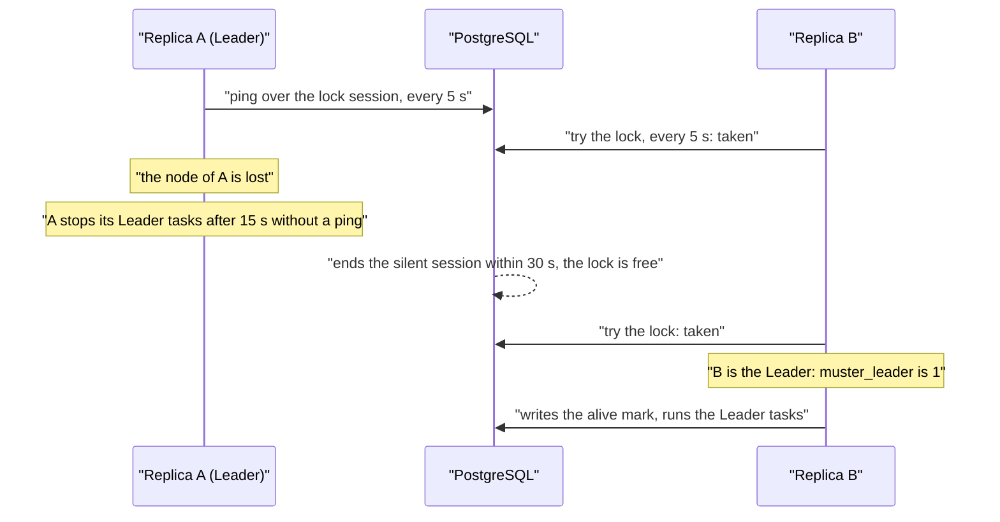

# High availability

Run more than one replica of Muster when you want the web UI, ingestion and delivery to survive the loss of a node or
a restart. The Helm chart defaults to one replica, and the compose example runs one. Two replicas with a
PodDisruptionBudget are an option, not a requirement.

## All replicas are active

Every replica serves the web UI, the API and ingestion, and runs the workers for ingestion, delivery and timers. The
workers claim rows from PostgreSQL with a lease, so a timer such as an ack timeout, a Reminder or the end of a Snooze
fires on whichever replica is free. A replica that stalls delays nothing beyond its lease.

## The Leader

A few tasks must run **once**, not once per replica. One replica, the **Leader**, runs only those. The list is closed:

| Task | What it does |
|---|---|
| Telegram polling | long polling of `getUpdates` for Connections in that update mode; Telegram answers `409` to a second poller |
| Bridge polling | polls the events of Bridge Connections in the `poll` event delivery mode, with one cursor per Connection |
| Heartbeat and Stale checks | find Integrations that are Heartbeat lost and Alerts that went Stale |
| partitions and retention | create partitions ahead of time, drop expired ones, and delete what the retention periods remove |
| pruning | removes ended sessions, expired requests and links, the records of gone replicas, and the Request log past its bounds |
| database gauges | the metrics computed from the database: open Alert Groups, the ingestion backlog, delivery queues, Broken Destinations, Storms |
| the "alive" mark | every 30 seconds, so that a restarted Muster knows how long it was down |
| the outgoing heartbeat | the call to your [dead man's switch](outgoing-heartbeat.md) |
| OIDC secret expiry check | raises `MusterOIDCSecretExpiring` |
| re-render after a key rotation | re-signs the buttons of open Root messages ([Key rotation](key-rotation.md)) |

Nothing else depends on the Leader. Every task is safe to run twice, because a handover can overlap for a moment.

### How a replica becomes Leader

The Leader holds a **session advisory lock** in PostgreSQL on a dedicated connection, the *session connection*. Every
replica tries to take the lock every `leader.ping_interval` (5 seconds); one succeeds. The Leader proves that it still
holds the lock by pinging over that session at the same interval. If no ping succeeds for `leader.fencing_timeout` (15
seconds), it stops all Leader tasks and closes the connection, and it may compete for the lock again later.

When a Leader crashes, its connection closes and PostgreSQL releases the lock at once. When its node disappears or the
network splits, PostgreSQL would keep the session for hours by default. Muster sets `idle_session_timeout` on the lock
session and TCP keepalives, so PostgreSQL ends a silent session and releases the lock within `leader.server_bound` (30
seconds). The fencing timeout is shorter than that, so the old Leader normally stops before another replica can take
over. The values are built in; they are not settings.



A handover after the loss of a node takes well under a minute. During it, Telegram and Bridge polling, the periodic checks
and the outgoing heartbeat pause. Ingestion, delivery and timers do not.

### When no replica leads

The gauge `muster_leader` is 1 on the Leader and 0 on the others. When the "alive" mark is older than 2 minutes
(`leader.absence_notice`), the web UI shows a notice that no replica is leading. The chart rule `MusterNoLeader` fires
when no replica has led for 2 minutes; see [its runbook](runbooks/MusterNoLeader.md).

While there is no Leader:

- **Bridge** Connections in the `poll` mode and Telegram Connections in the long polling mode receive no button presses and
  no Text commands. A press or Text command older than `bridge.event_max_age` (1 hour) when a Leader returns is dropped unanswered. Connections in the
  `push` mode of a Bridge and the webhook mode of Telegram keep working.
- No Integration becomes Heartbeat lost and no Alert goes Stale.
- Partition maintenance, retention and pruning pause; the gauges that only the Leader exports go stale.
- The outgoing heartbeat stops, so a [dead man's switch](outgoing-heartbeat.md) alerts you.

Ingestion, delivery, timers, the web UI and the API keep working.

### After downtime

When every replica was down, the next Leader reads the "alive" mark, records the period, and adds a Timeline entry to open
Alert Groups. Timers that came due during the downtime fire once, collapsed. For a while the web UI says Muster is
recovering.

## The session connection

The Leader lock and the `LISTEN` connections need a real session. If the main database connection goes through PgBouncer
in transaction mode, set `MUSTER_DATABASE_SESSION_URL` (in the chart, `database.sessionHost`) to an endpoint that reaches
PostgreSQL directly or through a pooler in session mode. At start, Muster checks that advisory locks and `LISTEN` work
over it and stops with an error that names the setting otherwise. See [PgBouncer](../install/database.md#pgbouncer).

## Two replicas

In the Helm values:

```yaml
replicas: 2
podDisruptionBudget:
  enabled: true
  maxUnavailable: 1
```

The PodDisruptionBudget keeps a node drain from stopping both pods at once. Spread the pods over nodes with
`topologySpreadConstraints` or `affinity`. See [Install with Helm](../install/helm.md) for the other values. PostgreSQL
is the single stateful component, so its own availability, such as a CloudNativePG cluster with two instances, sets the
limit of the installation.

Replicas of different minor versions run side by side only during a rolling [upgrade](upgrades.md#the-rules).

## Clocks

Replicas share one database and take the time from their own system clocks. Run NTP, or the time service of your cloud
provider, on **every node** and on the database server. A replica measures its clock against the database every minute and
exports it as `muster_clock_skew_seconds`; it logs a warning above `process.clock_skew_warning` (2 seconds), and the chart
rule `MusterClockSkew` fires after 5 minutes.

A skew moves the timestamps a replica writes and the timers and windows it evaluates, and it can make TOTP codes, OIDC ID
tokens and the timestamps of outgoing webhook signatures fail. It can also make the lease of a row or of the Leader lock
expire too early or too late, so that work runs twice or waits. See the [MusterClockSkew
runbook](runbooks/MusterClockSkew.md), and check the clock with [`muster doctor`](cli.md#muster-doctor).
