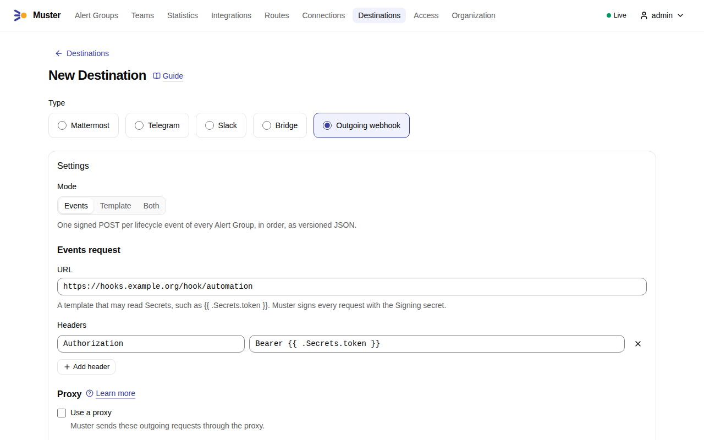
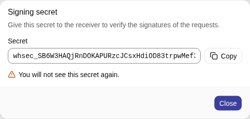
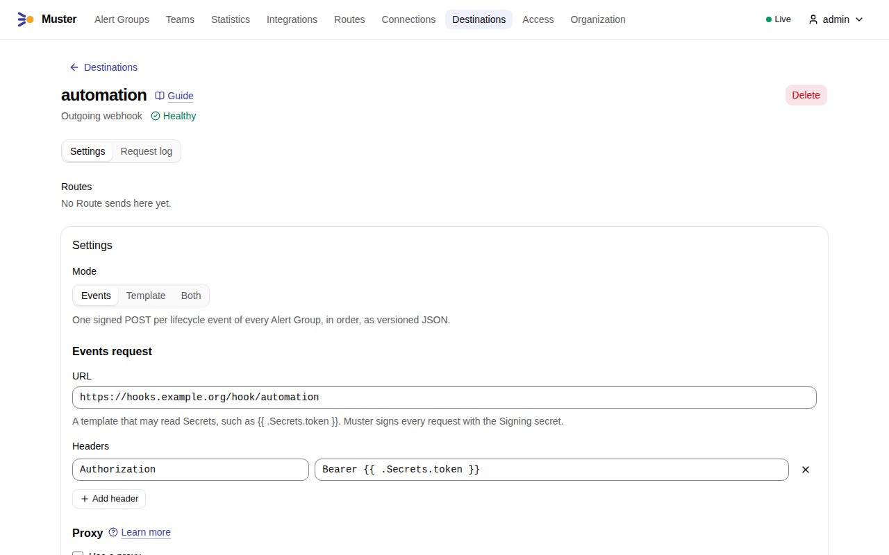
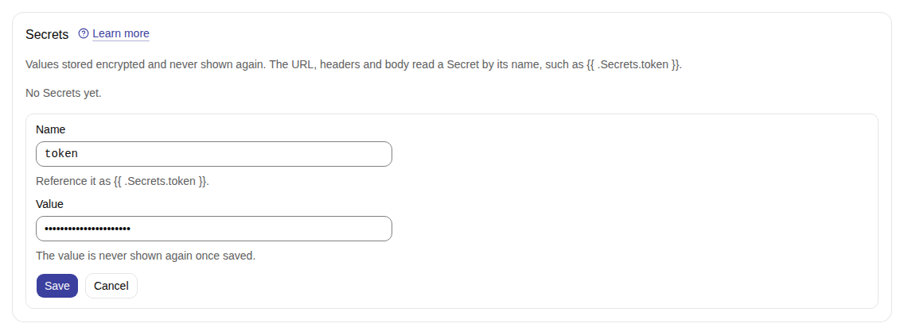
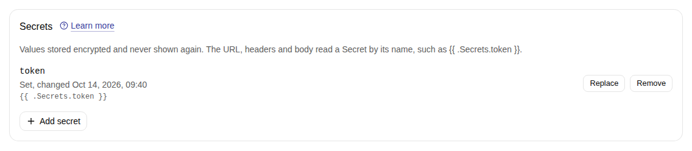
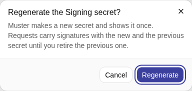
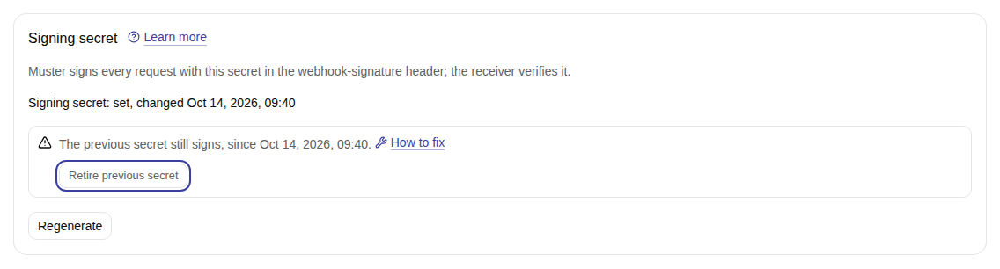

# Outgoing webhook: events mode

An outgoing webhook Destination in the **events mode** sends one HTTP `POST` for every lifecycle event of every Alert
Group on its Routes: an ordered, signed stream of versioned JSON events that an automation can record, react to or
forward. A step "Send to an outgoing webhook" of an Escalation chain also sends it `escalation_webhook`, even about an
Alert Group on none of its Routes ([escalation_webhook](#escalation_webhook)). Muster renders nothing for a chat here; for a chat with a REST API, use the template mode instead.

In the examples, `MUSTER_PUBLIC_URL` is `https://muster.example.org` and the receiving endpoint is
`https://automation.example.org/muster`.

## Create the Destination

In the web UI:

1. Open **Destinations**, select **Create destination** and choose **Outgoing webhook**. Keep the **Mode** **Events**.
2. Under **Events request**, enter the **URL** and, with **Add header**, each header's name and value; a value reads a
   [Secret](#secrets) as `{{ .Secrets.<name> }}`. Set the **Proxy** if the endpoint needs one, and give the
   Destination a **Name**. Select **Save**.

    { .screenshot }

3. Muster shows the **Signing secret** once: copy it to the receiving endpoint, which verifies the signatures with it
   (see [Verify the signature](#verify-the-signature)), and close the dialog.

    { .screenshot }

4. The saved Destination shows its type and health, its **Routes** and its settings, with the tab **Request log** beside
   **Settings**. Add it to a Route to send it events. In the screenshots, the receiving endpoint is
   `https://hooks.example.org`.

    { .screenshot }

Through the API, create a Destination of type `webhook` with the mode `events`:

```json
{
  "type": "webhook",
  "name": "automation",
  "mode": "events",
  "events": {
    "url": "https://automation.example.org/muster",
    "headers": [{ "name": "Authorization", "value": "Bearer {{ .Secrets.token }}" }]
  },
  "proxy": { "enabled": false },
  "mention_entries": [{ "target": { "kind": "team", "team_id": "TE7D2K9M4QX1PV" } }],
  "limiter": { "limit": 5, "per_seconds": 1 }
}
```

- The **URL** and the **header values** are Go templates. They can read the Destination's Secrets as
  `{{ .Secrets.<name> }}` (or `{{ $.Secrets.<name> }}`, or `{{ index .Secrets "<name>" }}`) and nothing else; any
  other use of `.Secrets`, such as `{{ with .Secrets }}` or `{{ $s := .Secrets }}`, is refused, because Muster could
  not check that the Secret exists. They are parsed and run on a dry run when you save; an error names the field, its
  line and its column.
- Muster sets `Content-Type`, `webhook-id`, `webhook-timestamp` and `webhook-signature` itself; a header template may
  not name them. Every request also carries `User-Agent: Muster/<version>` unless a header template sets its own.
- The **proxy** is the Destination's own; the requests never read `HTTP_PROXY` or `HTTPS_PROXY`.
- The **limiter** defaults to 5 requests per second in the form (`destination.webhook.limiter`).
- An outgoing webhook has no Connection and no Destination check: checking it answers `422 check_not_supported`.

The answer to the creation carries the **Signing secret** once, in `signing_secret`. Store it where the endpoint verifies the signatures; Muster
never shows it again.

## Secrets

Credentials the endpoint needs go into the Destination's **Secrets**, never into the URL or a header as text.

1. On the page of the Destination, under **Secrets**, select **Add secret**. Enter the **Name**, such as `token`, and the
   **Value**, and select **Save**.

    { .screenshot }

2. The list shows the Secret's name, that it is set and when it changed, and its reference, `{{ .Secrets.token }}`,
   which the URL and the headers read. **Replace** sets a new value and **Remove** deletes it; the value is never shown
   again.

    { .screenshot }

Through the API:

```sh
curl -X PUT https://muster.example.org/api/v1/destinations/DSK7M3QX9P2RTA/secrets/token \
  -H "Authorization: Bearer $MUSTER_TOKEN" -H 'Content-Type: application/json' \
  -d '{"value":"the-token-of-the-endpoint"}'
```

- A Secret name is a letter or an underscore followed by letters, digits and underscores.
- Values are write-only: `GET …/secrets` lists names, whether they are set and when they last changed, with an `ETag`
  that `If-Match` on `PUT` and `DELETE` compares with.
- Everyone who can read Destinations sees the URL and header templates as written, with the references only.
- Secret values and the Signing secrets are masked as `[redacted]` in delivery errors, the Timeline and the logs.
- A template that reads a Secret the Destination does not have fails: that event is not sent and ends as Not
  delivered.

A header named `Authorization`, or a URL whose user information or query holds a literal value instead of a
`{{ .Secrets.<name> }}` reference, gives the Destination the warning `literal_credential` with the JSON Pointer of the
field, for example `/events/headers/0/value`: the value is shown to everyone who can read Destinations.

## What is sent

One `POST` per lifecycle event, with the version 1 body as `application/json`:

```json
{
  "version": 1,
  "event": "created",
  "notify": true,
  "mentions": [{ "type": "user", "id": "SR2K9D1VW3MPTE", "name": "Alice Smith", "login": "alice" }],
  "sequence": 1,
  "occurred_at": "2026-10-03T09:41:07Z",
  "actor": { "kind": "system", "transport": "system" },
  "alert_group": {
    "number": 412,
    "id": "AGK7M3QX9P2RTA",
    "title": "HighErrorRate payments-api",
    "summary": "Error rate above 5% for 10 minutes",
    "status": "firing",
    "route": { "id": "RT8Q2M4X7K1P3B", "name": "payments" },
    "urgent": false,
    "severity_level": "critical",
    "started_at": "2026-10-03T09:41:07Z",
    "resolved_at": null,
    "snooze_until": null,
    "reopen_count": 0,
    "url": "https://muster.example.org/alert-groups/AGK7M3QX9P2RTA",
    "teams": [{ "id": "TM4D7K2Q9X1VBN", "name": "Payments", "slug": "payments" }]
  },
  "alerts": [
    {
      "fingerprint": "6f1c2b0e9d4a7c31",
      "status": "firing",
      "labels": { "alertname": "HighErrorRate", "service": "payments-api" },
      "annotations": { "summary": "Error rate above 5%" },
      "starts_at": "2026-10-03T09:31:07Z",
      "resolved_at": null,
      "resolve_reason": null,
      "generator_url": "https://prometheus.example.org/graph?g0.expr=…"
    }
  ]
}
```

`version`
:   `1`.

`event`
:   The lifecycle event, one of the names below.

`notify`
:   `true` exactly when the event is Loud.

`mentions`
:   Who the event mentions under the Destination's Mention entries, as data: `{"type": "everyone"}`,
    `{"type": "group", "name": …}`, `{"type": "user", "id": …, "name": …, "login": …}` — the On-call of a Team too —
    or `{"type": "team", "slug": …, "name": …}`, with one target per Team of the Alert Group for "Team from the label".
    Always `[]` for a Quiet event. A Team is a target of the Destination's
    [Mention entries](../concepts/mentions.md#what-each-messenger-supports), given by its `team_id`, and the receiver
    gets its slug and name. On `paged` they are not the Destination's Mention entries but the people of the Page, each
    a `user` target, or for a step "Page the whole Team" its Team as a `team` target or `{"type": "everyone"}`.

`sequence`
:   The Alert Group's lifecycle event number. It grows with every lifecycle event of the Alert Group, may have gaps,
    and does not start at 1 for a Destination added to the Route later: rely only on "greater means newer".

`occurred_at`
:   When the event was recorded.

`actor`
:   Who made the change: a `user` or `service_account` with `id`, `name` (and the user's `login`, or the `token_name`
    used) and the `transport` (`ui`, `api`, `mattermost`, `telegram`, `bridge`, `slack`, `gateway`, `cli`), or
    `system` with the `reason`, for example `timer`.

`alert_group`
:   The Alert Group as it was when the event was recorded: number, `id`, title, `summary`, status, the `owner` (`id`,
    `name`, `login`) while acknowledged, Route, Urgent, Severity level, times, Reopen count, its page in Muster and its
    `teams`: the `id`, `name` and `slug` of each Team of the Alert Group, in the order they joined, a deleted Team by
    its name, `[]` for none ([Teams](../concepts/teams.md#which-alerts-belong-to-a-team)).

`alerts`
:   One element per Alert, by fingerprint, with its status, labels, annotations, times and the resolve reason.

`destination`
:   Only on `destination_joined`, the `id`, `name` and `type` of the Destination the Alert Group joined, and on
    `escalation_webhook`, those of the outgoing webhook Destination the step sends to. No other event carries it.

`page`
:   Only on `paged` and `page_not_delivered`: the people the Page names in `users` (`id`, `name`, `login`), empty for
    a step "Page the whole Team"; the Notification gateway of a call in `gateway` (`id`, `name`), null for a Page by
    Mention; the `reason` of a `page_not_delivered`, null on `paged`; the Escalation chain whose step made the Page in
    `chain` (`id`, `name`), null when no step of a chain made it and once the chain was deleted, and the number of
    that step in `step`, null when no step of a chain made the Page and kept when the chain was deleted; and the
    `importance`, `normal` or `important`, null for a step "Page the whole Team" and a call. No other event carries
    it.

`escalation_step`
:   Only on `escalation_step_skipped` and `escalation_webhook`: the Escalation chain in `chain` (`id`, `name`), null
    once the chain was deleted, the number of the step in `step`, and the `reason` of a skip, null on
    `escalation_webhook`, whose step was made. For a person the step names who was skipped, `users` names that person
    (`id`, `name`, `login`); it is empty otherwise, and always on `escalation_webhook`. No other event carries it.

The body is rendered when the event is recorded, so a retry hours later still carries the state the event described.

### Event names

Every row of the lifecycle event tables is one event, Quiet ones and those with nothing to show in a messenger
included. What delivery itself does — a Publication, a Storm summary, a final edit — is not a lifecycle event and is
never sent.

`created`
:   `notify`: true

`alerts_added`
:   `notify`: true while firing; false while acknowledged or snoozed

`alert_replaced`, `alert_resolved`, `alert_continued`, `annotations_changed`, `severity_raised`
:   `notify`: false

`urgency_raised`
:   `notify`: true when the rise ends a Snooze or removes the acknowledgement; false otherwise

`reopened`
:   `notify`: true while firing or acknowledged; false while snoozed

`snooze_ended`
:   `notify`: true

`resolved`
:   `notify`: false

`moved_to_default_route`
:   `notify`: false

`acknowledged`
:   `notify`: false

`takeover`
:   `notify`: true

`unacknowledged`
:   `notify`: true when disabling or deleting the Owner released it; false for the Command

`unresolved`, `snoozed`, `unsnoozed`, `note_added`
:   `notify`: false

`ack_timeout`
:   `notify`: true

`unclaimed`
:   `notify`: false

`reminder`
:   `notify`: true

`reminder_answered`
:   `notify`: false

`auto_unacknowledged`
:   `notify`: true

`notices_missed`
:   `notify`: true

`team_joined`
:   `notify`: false. A Team joined the Teams of the Alert Group; `alert_group.teams` lists it.

`unknown_team_value`
:   `notify`: false. An Alert of the Alert Group carries a value of the Team label that names no Team; sent once per
    value and Alert Group.

`destination_joined`
:   `notify`: true while firing; false while acknowledged or snoozed. The Alert Group, already published elsewhere,
    reached a new Destination because its Alerts raised its Severity level or brought a Team; one event per
    Destination, named in `destination` ([Routing to Teams](../concepts/routing-to-teams.md)).

`paged`
:   `notify`: true. A step of an Escalation chain, or an action of a person's Notification rule, Paged people, a Team
    or everyone in the chat by a Mention in the Threads of the chain's Destinations
    ([Where chains Page](../concepts/escalation-chains.md#where-chains-page)). It carries the people of the Page as
    `user` targets of `mentions` — every one of them, whether or not they have an Account link — or the Team of a step
    "Page the whole Team" as a `team` target, or `{"type": "everyone"}` for everyone in the chat, and the Page in
    `page`, with its chain, step and importance. The receiver acts on it to reach them
    ([How a Page reaches a person](../concepts/escalation-chains.md#how-a-page-reaches-a-person)). An events-mode
    Destination has no Root message and takes no reply, so it receives `paged` only when the Page replies in another
    Destination of the chain; a chain whose only Destinations are outgoing webhooks in the events mode records no
    `paged`, but `page_not_delivered` with `no_root_message` for a Page of people and `escalation_step_skipped` with
    `no_mention_possible` for a step "Page the whole Team".

    ```json
    "mentions": [{ "type": "user", "id": "SR4V7K2Q9X1MPA", "name": "Ivan Petrov", "login": "ivan" }],
    "page": {
      "users": [{ "id": "SR4V7K2Q9X1MPA", "name": "Ivan Petrov", "login": "ivan" }],
      "gateway": null,
      "reason": null,
      "chain": { "id": "EC5R2W8M1K7Q3D", "name": "devops" },
      "step": 1,
      "importance": "normal"
    }
    ```

`page_not_delivered`
:   `notify`: false. A call through a Notification gateway about the Alert Group ended Not delivered: the gateway
    refused it (`call_refused`), answered what Muster cannot classify (`call_unknown`), kept failing until the retry
    budget was used (`call_budget_used`), the person had no confirmed contact at the gateway
    (`no_confirmed_contact`), or the gateway was deleted before the call was sent (`gateway_deleted`); or a Page by
    Mention reached its person nowhere: no Destination of the chain has the Alert Group's Root message
    (`no_root_message`), the person has no Account link in any of their Identity spaces (`no_account_link`), or every
    Thread reply that would mention them ended Not delivered or was withheld (`not_delivered`); named in `page`
    ([Notification gateways](../messengers/notification-gateways.md),
    [Undelivered Pages](../concepts/escalation-chains.md#undelivered-pages)).

`escalation_step_skipped`
:   `notify`: false. A step of an Escalation chain on the Alert Group was skipped, and the chain went on with its next
    step: outside the Working hours of its chain (`outside_working_hours`), for a Severity level its condition does not
    meet (`severity`), in a gap of the Schedule it Pages (`schedule_gap`), for a person it names who became a Viewer
    (`viewer`) or was disabled (`disabled`) since it was saved, or for a step "Send to an outgoing webhook" whose
    Destination was deleted (`destination_deleted`) or is no longer an outgoing webhook in the mode events or both
    (`webhook_events_required`), or for a step "Page the whole Team" that none of its chain's Destinations can
    mention (`no_mention_possible`); named in `escalation_step`
    ([Escalation chains](../concepts/escalation-chains.md#when-chains-run)).

`escalation_webhook`
:   `notify`: false. A step "Send to an outgoing webhook" of an Escalation chain on the Alert Group was made. Unlike
    every other event, it is sent **only to the outgoing webhook Destination the step names**, not to the
    events-mode Destinations of the Alert Group's Routes; see [escalation_webhook](#escalation_webhook).

The event `test` is sent only by a Destination test: it carries `test: true` and `sequence` 0 and belongs to no Alert
Group's order.

### escalation_webhook

A step "Send to an outgoing webhook" of an [Escalation chain](../concepts/escalation-chains.md#steps) names an
outgoing webhook Destination in the mode events or both. When the step is made, Muster sends that Destination one
`escalation_webhook`: the Alert Group as in every event, the chain and the step in `escalation_step`, and the
Destination itself in `destination`. Muster is the actor, with the Transport `system`.

- Only the step's Destination receives it. It receives it whether or not the Alert Group is delivered there, and
  receives no other event of the Alert Group, unless it is also one of the Alert Group's Destinations.
- A Destination that is also one of the Alert Group's receives it once, among its other events in the order of
  `sequence`.
- It is signed, ordered by `sequence` and delivered at least once, with its own `webhook-id`, like every event.
- The Timeline of the Alert Group records it as a Quiet entry of the kind `escalation` with the chain, the step and
  the Destination; nothing appears in a messenger.

```json
{
  "version": 1,
  "event": "escalation_webhook",
  "notify": false,
  "mentions": [],
  "sequence": 3,
  "occurred_at": "2026-10-03T09:41:09Z",
  "actor": { "kind": "system", "transport": "system" },
  "alert_group": {
    "number": 412,
    "id": "AGK7M3QX9P2RTA",
    "title": "HighErrorRate payments-api",
    "summary": "Error rate above 5% for 10 minutes",
    "status": "firing",
    "route": { "id": "RT8Q2M4X7K1P3B", "name": "payments" },
    "urgent": false,
    "severity_level": "critical",
    "started_at": "2026-10-03T09:41:07Z",
    "resolved_at": null,
    "snooze_until": null,
    "reopen_count": 0,
    "url": "https://muster.example.org/alert-groups/AGK7M3QX9P2RTA",
    "teams": [{ "id": "TM4D7K2Q9X1VBN", "name": "Payments", "slug": "payments" }]
  },
  "alerts": [
    {
      "fingerprint": "6f1c2b0e9d4a7c31",
      "status": "firing",
      "labels": { "alertname": "HighErrorRate", "service": "payments-api" },
      "annotations": { "summary": "Error rate above 5%" },
      "starts_at": "2026-10-03T09:31:07Z",
      "resolved_at": null,
      "resolve_reason": null,
      "generator_url": "https://prometheus.example.org/graph?g0.expr=…"
    }
  ],
  "destination": { "id": "DS3N8T1K6W2QXA", "name": "ops-bot", "type": "webhook" },
  "escalation_step": {
    "chain": { "id": "EC5R2W8M1K7Q3D", "name": "payments" },
    "step": 1,
    "reason": null,
    "users": []
  }
}
```

A step whose Destination was deleted, or switched to the template mode, since the chain was saved sends nothing: it is
skipped with `escalation_step_skipped` and the reason `destination_deleted` or `webhook_events_required`, and the
chain goes on with its next step.

### Versioning

New event names and new fields are added within `version` 1. Removing a field or changing its meaning needs a new
`version`. Ignore event names and fields you do not know.

## Order and duplicates

- The events of one Alert Group are sent **in order**: the next one waits until the previous one is delivered or ends
  as Not delivered. Events of different Alert Groups do not wait for each other.
- Delivery is **at least once** and never collapsed: a retry sends the same event again with the same `webhook-id`
  and the same body. **Drop duplicates by `webhook-id`.**
- Events are never subject to Storms: during a Storm every event is sent, `created` of every Alert Group included.
- While the Destination is Broken its events wait; after it recovers, every event that came due meanwhile is sent in
  order per Alert Group, none dropped and with no age limit.

## How the answer counts

`2xx`
:   Delivered.

`429` or `503` with `Retry-After`
:   The same event is sent again exactly when asked.

`408`, any other `5xx`, a timeout or a network error
:   Retried with backoff; after `delivery.transient_budget` the Destination becomes Broken.

`401`, `403`, `404`, `410`
:   The Destination becomes Broken; the event waits and is the probe.

`400`, `413`, `422`, a redirect, any other answer
:   That event ends as Not delivered and the next one follows; the Destination stays healthy. A redirect is never
    followed; the error names its target.

Requests go through the outbound address policy: a URL that resolves to a link-local, cloud metadata, multicast or
unspecified address is refused under every policy, and loopback and private addresses need an allowed network. A
refused request makes the Destination Broken with the rule as the reason, because every later request would be
refused too. A Broken outgoing webhook is probed with its oldest waiting event; with none waiting, the next event is
attempted as soon as it comes due.

## Verify the signature

Every request carries three headers, in the style of the
[Standard Webhooks](https://www.standardwebhooks.com/) specification:

- `webhook-id` — the id of the event, kept across retries;
- `webhook-timestamp` — Unix seconds when the request was signed;
- `webhook-signature` — one or more signatures `v1,<base64>`, separated by a space.

Each signature is the base64 HMAC-SHA256 of `{webhook-id}.{webhook-timestamp}.{body}` — the raw body, byte for
byte — with the key that is the base64 after `whsec_` in the Signing secret. Accept a request when one of its
signatures matches, compare in constant time, and refuse a timestamp more than five minutes from your clock.

Go:

```go
func verify(secret, id, timestamp string, body []byte, header string) bool {
	key, err := base64.StdEncoding.DecodeString(strings.TrimPrefix(secret, "whsec_"))
	if err != nil {
		return false
	}
	ts, err := strconv.ParseInt(timestamp, 10, 64)
	if err != nil || math.Abs(time.Since(time.Unix(ts, 0)).Seconds()) > 300 {
		return false
	}
	mac := hmac.New(sha256.New, key)
	mac.Write([]byte(id + "." + timestamp + "."))
	mac.Write(body)
	want := []byte(base64.StdEncoding.EncodeToString(mac.Sum(nil)))
	for _, sig := range strings.Fields(header) {
		if v, s, ok := strings.Cut(sig, ","); ok && v == "v1" && hmac.Equal([]byte(s), want) {
			return true
		}
	}
	return false
}
```

Python:

```python
import base64, hashlib, hmac, time

def verify(secret: str, msg_id: str, timestamp: str, body: bytes, header: str) -> bool:
    key = base64.b64decode(secret.removeprefix("whsec_"))
    try:
        if abs(time.time() - int(timestamp)) > 300:
            return False
    except ValueError:
        return False
    mac = hmac.new(key, f"{msg_id}.{timestamp}.".encode() + body, hashlib.sha256)
    want = base64.b64encode(mac.digest()).decode()
    for sig in header.split():
        version, _, value = sig.partition(",")
        if version == "v1" and hmac.compare_digest(value, want):
            return True
    return False
```

A shell, with `openssl`, to check a recorded request by hand — it compares neither in constant time nor the
timestamp, so do not use it in a receiver — for a body saved in `body.json`:

```sh
KEY=$(printf '%s' "${SECRET#whsec_}" | base64 -d | od -An -v -tx1 | tr -d ' \n')
EXPECTED="v1,$( { printf '%s.%s.' "$WEBHOOK_ID" "$WEBHOOK_TIMESTAMP"; cat body.json; } |
  openssl dgst -sha256 -mac HMAC -macopt "hexkey:$KEY" -binary | base64)"
case " $WEBHOOK_SIGNATURE " in *" $EXPECTED "*) echo valid ;; *) echo invalid ;; esac
```

## Regenerate and retire the Signing secret

1. On the page of the Destination, under **Signing secret**, select **Regenerate**, and **Regenerate** again in the
   dialog. Muster shows the new secret once: deploy it to the receiving endpoint.

    { .screenshot }

2. Until you retire it, the previous secret still signs, and the Destination says since when. Once the endpoint
   verifies with the new secret, select **Retire previous secret**.

    { .screenshot }

Through the API, `POST /api/v1/destinations/{id}/signing-secret` makes a new Signing secret and shows it once. Until you retire the
previous one, requests carry two signatures — with the new and with the previous secret — and the Destination shows the
warning `previous_signing_secret_active` with the date since when: deploy the new secret to the receiving endpoint, then retire
the previous one with `DELETE /api/v1/destinations/{id}/signing-secret/previous`. Requests then carry one signature.
Both changes are recorded in the Audit log, never with the secret. Rotating the master keys re-encrypts the Signing
secrets but never changes them.

## Delete the Destination

Deleting an events-mode Destination sends nothing more: its waiting events end as Not delivered with "the Destination
was deleted", no final event is sent, and its secrets — the Signing secrets, the Secrets and the proxy password — are
wiped at once, or as soon as a request that was already being sent ends. An `escalation_webhook` that a step of an
Escalation chain queues at the very moment of the deletion is never sent either; it stays waiting until its Alert
Group is removed.
